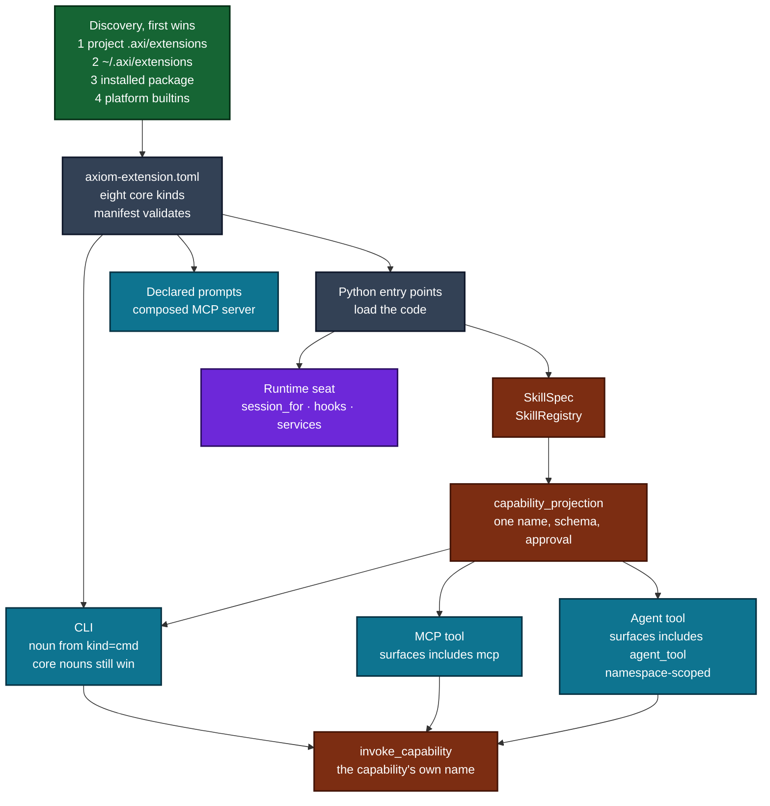
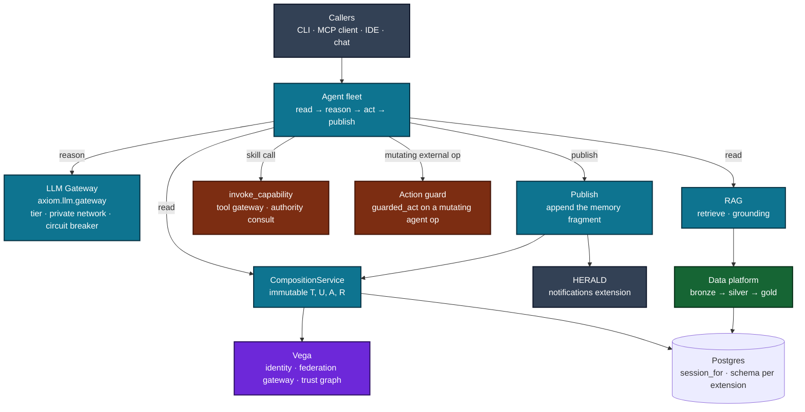
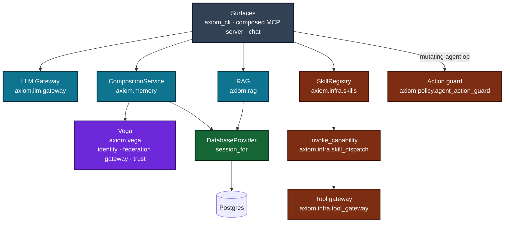
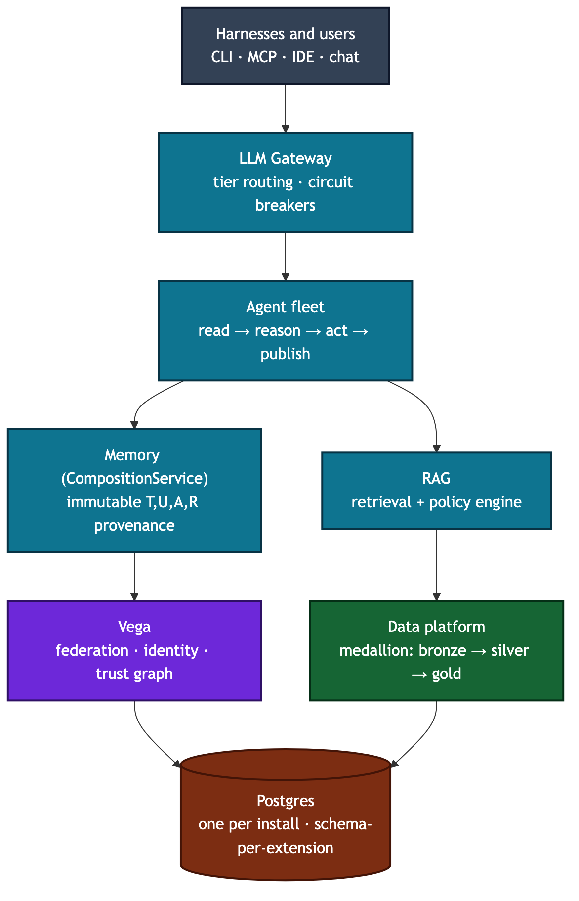
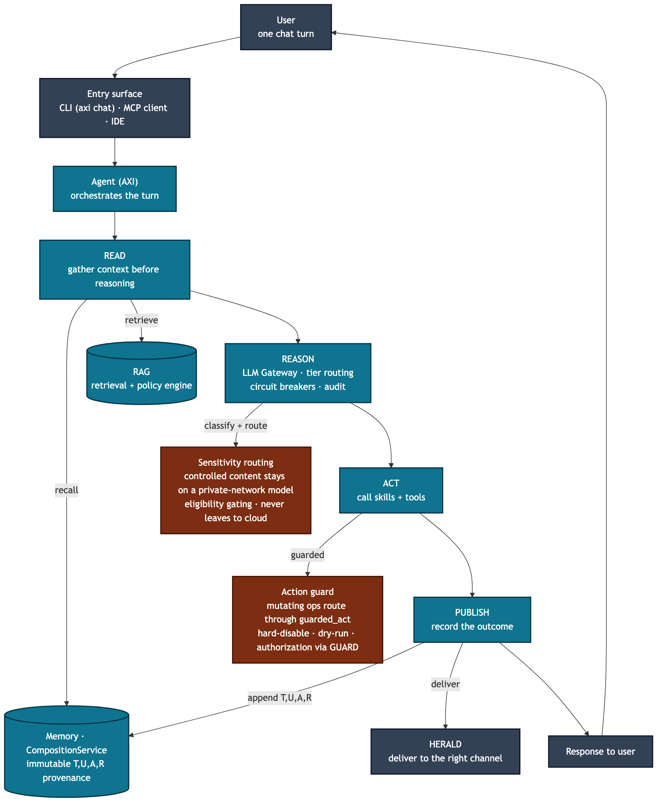
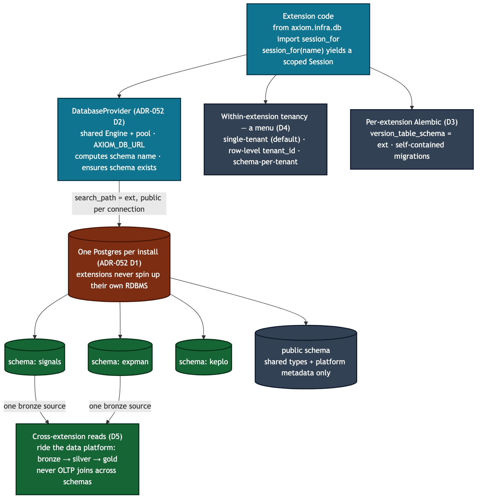
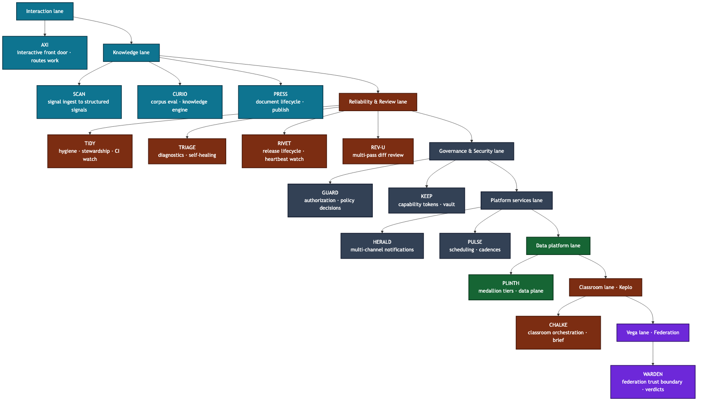

# Axiom

**The governed agent platform for high-consequence operations.**

Most agent platforms optimize for what an agent *can* do. Axiom is built for
teams who also have to answer for what it *did*: research labs, industrial
sites, classrooms, and — increasingly — fleets of physical systems, where
automation has to be provable, bounded, and reversible.

## AEOS

Every extension is packaged, declared, signed, and discovered under the
**Agent Extension Open Standard (AEOS)**. Axiom is the reference
implementation. The governing specification is
**[AEOS 0.1](docs/specs/spec-aeos-0.1.md)** — version 0.1.0, status Draft.

AEOS is a portable, signed package format and runtime contract for agent
extensions. One `axiom-extension.toml` manifest carries the extension's
capabilities, declared dependencies, a standard test base, and
cryptographic provenance. It composes the standards that each cover one
slice of that job: MCP and MCPB for tools and tool bundles, SKILL.md for
a single skill, A2A for agent cards, AGENTS.md for repository context,
OpenAPI for HTTP adapters, OASF for capability metadata, and Sigstore for
signed releases. An extension that uses only that public subset is
interoperable with any harness implementing those standards. Federation,
attestation, and governance features require an AEOS-conformant runtime.

The standard is what keeps an extension inside the same accountability
boundary as the platform. Releases are signed with Sigstore's keyless
flow, and installers verify the signature before executing extension
code; an unsigned extension installs only with an explicit
`--allow-unsigned` override. LLMs may advise; deterministic code
authorizes. Each capability is one of eight core kinds — `agent`,
`tool`, `cmd`, `service`, `adapter`, `skill`, `hook`, `prompt` — and
the CLI, the MCP catalog, and the agent fleet discover them from the
same manifest.

The package is found, then projected. Discovery walks a project directory
(`.axi/extensions/` on this platform; a branded CLI uses its own dot
directory), then `~/.axi/extensions/`, then an installed package's
`extensions/builtins/`, then the builtins shipped with the platform. The
first extension name wins, and the same walk keeps the first CLI noun. A
core noun in `axiom_cli` — `config`, `ext`, `doctor`, `schedule`,
`skills`, and their aliases — still wins over an extension. Python entry
points load the code; the manifest is what conformance checks. The
callable is a `SkillSpec` on `SkillRegistry`. One projector,
`axiom.infra.capability_projection`, keeps the name, the schema, and the
approval decision the same on every surface the spec named: the CLI verb,
an MCP tool when `surfaces` includes `mcp`, and an agent tool when it
includes `agent_tool`. Chat offers only the namespaces it was given. CLI,
MCP, and chat dispatch through `invoke_capability` under that
capability's name. Prompts the extension declares are published on the
composed MCP server. Its rows are reached with `session_for`, never a
private engine. A menu may hide a sibling distribution's extensions; a
command, a heartbeat, and a hook still load them.



The turn those surfaces join is under [Architecture](#architecture).

**Current version: 0.1.0**, the version conformance is judged against.
The same document carries additive 0.2 draft amendments for chain
readiness (§4.11) and recipes (§4.12). `recipe` is a runtime-consumed
kind, and the core list stays at eight.

**[AEOS 1.0](docs/specs/spec-aeos-1.0.md)** (version 1.0.0-draft, status
Public Preview) is the forward draft. It preserves the acronym, expands
the spelled-out name to *Agent Ecosystem Open Standard*, and drafts the
governance layers on top of the 0.1 surface: enumerated agent classes,
layer authority, checks and balances, conflict resolution, user rights,
due process, equal protection, and succession. The
[identity and credential addendum](docs/specs/spec-aeos-identity-addendum.md)
extends the 0.1 runtime and manifest: every skill invocation receives a
principal, and an extension declares the credentials it consumes.
Providers stay `adapter`, runtimes stay `service`, and verbs stay
`skill` projected to `cmd`. The
[spec index](docs/specs/README.md) groups the remaining extension
specifications, and a companion essay to the 1.0 draft is the
[AEOS white paper](docs/papers/whitepaper-aeos.md).

The manifest, the eight core kinds, and `axi ext init` / `axi ext lint`
are under [Extensions (AEOS)](#extensions-aeos).

## Why Axiom

Where the field converged on chat loops with tools, Axiom treats
accountability as the platform primitive:

- **Every action runs under a capability-scoped token.** Scheduled or
  interactive, an agent acts inside an envelope issued by the vault — never
  on a bare long-lived API key.
- **Every receipt is queryable memory.** Fires, notifications, replies, and
  edits land as provenance-stamped memory fragments. "Show every scheduled
  action that touched classified data last quarter" is one query, not log
  archaeology.
- **Humans reply where they already are — and it binds back.** Deliveries go
  out over the channels people actually use, and a reply threads back into
  the originating agent's memory context under the same provenance tuple.
- **Graduated autonomy, enforced.** Trust profiles, durable approval gates,
  and identity that reaches every `decide()` call: the agent asks before it
  matters, and the record shows that it asked.
- **Federation across organizational boundaries.** Sovereign nodes,
  classification-aware projection, and accountable humans propagated across
  cohort handoffs. Peers — not shared databases.

## One core, many surfaces

Axiom is a core runtime — gateway, memory, agent fleet, policy, data
platform — with **surfaces** as members of one extension family. The CLI and
chat surfaces ship today; a web application kit builds on the same
primitives; further surfaces (mobile, voice) follow the same pattern. A
product built on Axiom inherits its UI the way it inherits its governance —
from the platform, not from scratch.

Underneath, Axiom stays **domain-agnostic**: each product brings its own
knowledge, agents, and tools as extensions; Axiom provides everything
beneath them — LLM routing, RAG, memory, federation, and a self-discovering
CLI. A domain consumer sits on top as the first layer.

[](https://pypi.org/project/axiom-os-lm/)
[](https://pypi.org/project/axiom-os-lm/)
[](LICENSE)

## Install (60 seconds)

```bash
pip install axiom-os-lm
axi config      # onboarding wizard: provisions a local llamafile + model
axi status      # platform health
axi chat        # interactive agent
```

`axi config` provisions a single-binary llamafile and a local weights file in `~/.axi/llamafile/` so the platform runs without a cloud key. Run `axi config --model <name>` to choose a different bundled model; the LLM Gateway routes to self-hosted, private-network, or cloud providers per request tier.

## Architecture

A turn comes in from the CLI, an MCP client, or chat. The agent reads
memory and RAG, reasons through the LLM Gateway, acts through one
capability dispatch, and publishes the outcome back to memory. A mutating
agent op also passes the action guard. Vega decides what of that memory
may cross to a peer. The data platform carries the medallion tiers.
Durable state lands in one Postgres, one schema per extension.



Under that turn the substrate is small. The fleet, the data platform,
connectors, the vault, and the scheduler are extensions seated on these
modules.





The rendered figure is that same platform on one page.

Nodes join the federation independently at any tier — a laptop, a private GPU server behind a VPN, or an HPC cluster for isolated workloads. A domain product (a consumer layer) sits on top, extending the platform through AEOS extensions.

## What Axiom Provides

| Capability | What it is |
|---|---|
| **LLM Gateway** | Multi-provider routing with tier classification, private-network checks, circuit breakers, and audit logging |
| **RAG** | Three-tier corpus (community / organization / personal), pgvector embeddings, hybrid vector + full-text search, grounding hooks |
| **Composition Memory** | `MemoryFragment` with immutable `(T,U,A,R)` provenance and the MIRIX 6-type taxonomy, behind a single `CompositionService` (ADR-026/027) |
| **Agent Fleet** | 15 builtin agents coordinating read → reason → act → publish (see below) |
| **Federation (Vega)** | Ed25519 node identity, peer discovery, trust graph, `.axiompack` portable knowledge bundles, A2A agent cards |
| **Connectors** | Uniform inbound/outbound connectors for Slack, Teams, Email, and Microsoft 365, with a common descriptor for adding more (ADR-068) |
| **Data Platform** | Medallion ingest + storage via the `data_platform` extension: Bronze sinks, a pgvector vector store, and a source registry (Box and more); heavier lakehouse query tiers (DuckDB / Iceberg) install via the optional `[data-platform]` extra |
| **Scheduling & Secrets** | App-level scheduler with cadences (PULSE) and a pluggable secret/vault backend (KEEP / OpenBao) |
| **Extensions (AEOS)** | Every capability is an extension conforming to the Agent Extension Open Standard; a registered `SkillSpec` is projected onto the CLI, the MCP catalog, and the agent fleet |
| **CLI** | 50+ purpose-named nouns with availability-aware dispatch (ADR-047) — verbs whose backing service is unreachable are hidden, not broken |

## Key Concepts

### A request is a chat turn



A turn enters from the CLI (`axi chat`) or an MCP client, an agent **reads** (recalls memory and retrieves grounding), **reasons** (the LLM Gateway classifies the request and routes it to the right tier), **acts** (skills and tools; any op that mutates external state passes the action guard), and **publishes** (appends an immutable memory fragment and delivers through HERALD). Content classified as controlled stays on a private-network model and never leaves to a cloud provider; eligibility gating applies at the same seam.

### One database, one schema per extension



Extensions never construct an engine or see a DSN. They call `session_for("<ext>")`; the `DatabaseProvider` hands back a `Session` scoped to the extension's own Postgres schema (`search_path = "<ext>, public"`). One Postgres per install, schema-per-extension isolation, a guided within-extension tenancy menu (single-tenant / row-level `tenant_id` / schema-per-tenant), and cross-extension reads that ride the data platform rather than OLTP joins — all per **ADR-052**.

## The Agent Fleet



Agents are LLM personas with deterministic guardrails; the CLI nouns are their purpose-named "arms and legs" (ADR-056 — `axi hygiene`, not `axi tidy`). Fifteen builtin agents ship with the platform, grouped by lane:

| Agent | Lane | Focus | Primary CLI surface |
|---|---|---|---|
| **AXI** | Interaction | Interactive assistant + work routing | `axi chat` |
| **SCAN** | Knowledge | Signal ingestion & extraction (events → structured signals) | `axi signal` |
| **CURIO** | Knowledge | Auto-research & corpus evaluation — quality gating, confidence learning, knowledge-pack lifecycle | agent; gates the RAG corpus |
| **PRESS** | Knowledge | Document lifecycle (draft → standards → publish) | `axi publish` |
| **TIDY** | Reliability & Review | Workspace, repo & doc-standards hygiene, service health, CI watch (steward) | `axi hygiene` |
| **TRIAGE** | Reliability & Review | AI-assisted diagnostics & self-healing | `axi doctor`, `axi triage` |
| **RIVET** | Reliability & Review | Release lifecycle & CI/heartbeat monitoring | `axi release` |
| **REV-U** | Reliability & Review | Multi-pass diff review | `axi review` |
| **GUARD** | Governance & Security | Authorization & policy decisions (the sole decision point) | `axi audit` |
| **KEEP** | Governance & Security | Capability-token lifecycle + credential chaining | `axi vault` |
| **HERALD** | Platform services | Outbound multi-channel notifications | `axi notifications` |
| **PULSE** | Platform services | Scheduling & cadences | `axi schedule`, `axi calendar` |
| **PLINTH** | Data platform | Medallion data platform (Bronze/Silver/Gold) | `axi data` |
| **CHALKE** | Classroom (Keplo) | Classroom orchestration & instructor brief | `axi classroom` |
| **WARDEN** | Vega (Federation) | Federation trust boundary — peer-state transitions, signature verification, classification policy, trust-graph queries | `axi federation`, `axi nodes` |

WARDEN is Vega's federation-governance agent (Verifier · Enforcer · Gatekeeper · Arbiter); its verdicts are deterministic and auditable. The federated research and knowledge-observatory surfaces (`axi research`, `axi knowledge`, `axi security`) live on the same federation extension.

## Extensions (AEOS)

Everything non-core is an extension conforming to the **Agent Extension Open Standard** ([AEOS 0.1](#aeos), the governing spec). The CLI, MCP catalog, and agents discover commands, skills, tools, and agents from an `axiom-extension.toml` manifest:

```toml
[extension]
name = "my-extension"
version = "0.1.0"
description = "What it does"
license = "Apache-2.0"

[[extension.provides]]
kind = "cmd"        # one of eight kinds: agent · tool · cmd · service · adapter · skill · hook · prompt
noun = "myext"
entry = "my_extension.cli:main"
description = "My custom commands"
```

AEOS defines exactly **eight core capability kinds** — `agent`, `tool`, `cmd`, `service`, `adapter`, `skill`, `hook`, `prompt`. CLI verbs are thin wrappers over skill functions (`(params, ctx) -> SkillResult`, ADR-056), so the same capability is callable from the CLI, from a peer agent over A2A, and from an external harness over MCP. Discovery order is the one drawn under [AEOS](#aeos): project, then user, then installed package, then platform builtins, and the first match wins. Scaffold one with `axi ext init <name>`; check conformance with `axi ext lint`.

**Extensions:** [axiom-ext-openmc](https://github.com/UT-Computational-NE/axiom-ext-openmc) · [axiom-ext-langgraph](https://github.com/UT-Computational-NE/axiom-ext-langgraph)

## Where Things Live

```
axiom/
  src/axiom/
    memory/              # MemoryFragment, CompositionService, ownership, policy
    vega/                # Vega (federation + identity), pre-extraction staging per ADR-031
      federation/        #   cohort registry, A2A, trust graph, classification; hosts WARDEN
      identity/          #   keypair, signatures, principals
    extensions/builtins/ # the domain-agnostic builtin extensions (one dir per extension)
    infra/               # gateway, orchestrator, prompt registry, DatabaseProvider (session_for)
    rag/                 # retrieval store, hybrid search
    policy/              # scope policy engine + agent-action guard
  docs/                  # map: docs/README.md · standard: docs/conventions/doc-standards.md
    adrs/                # Architecture Decision Records (the WHY)
    prds/                # Product Requirement Documents (the WHAT)
    specs/               # Technical specifications (the HOW)
    conventions/         # portfolio standards (doc-standards, the-axiomatic-way)
    templates/           # skeletons for new PRDs / specs / ADRs
    papers/ working/     # published research; drafts, audits, design notes
    assets/diagrams/     # rendered PNG diagrams authored in Mermaid
  packages/              # sibling distributions (axiom-tests, design tokens, data-platform ext)
  runtime/               # instance-specific data (gitignored)
  tests/                 # cross-cutting tests (extension tests live alongside their code)
```

`vega/` is the federation and identity layer — the substrate WARDEN governs — staged inside the repo ahead of its extraction to a standalone product (ADR-031 Phase 3).

## Domain Products

Axiom is domain-agnostic. Domain products add the knowledge, agents, and tools for their field:

| Product | Domain |
|---|---|
| *(a domain consumer)* | A scientific facility (experiment + processing lifecycle, digital twin) |
| *(your product)* | Any domain |

## Development

```bash
git clone https://github.com/b-tree-labs/axiom-os.git
cd axiom-os
pip install -e ".[all]"

pytest                          # tests (TDD is the house rule)
ruff check src/ tests/          # lint
python -m build                 # wheel + sdist
```

See [AGENTS.md](AGENTS.md) for architecture, conventions, and the load-bearing ADRs.

## Documentation

| Document | Description |
|---|---|
| [AGENTS.md](AGENTS.md) | Architecture, conventions, ADR index (the canonical context file; per-harness files are kept in sync from it) |
| [Docs map](docs/README.md) | One folder per document kind — where everything lives |
| [Doc standards](docs/conventions/doc-standards.md) | The portfolio-wide documentation standard (audited by `axi hygiene stat docs`) |
| [Spec index](docs/specs/README.md) | Every current spec, grouped by area (start at the memory stack) |
| [AEOS 0.1](docs/specs/spec-aeos-0.1.md) | Agent Extension Open Standard — governing spec, version 0.1.0 |
| [AEOS 1.0 draft](docs/specs/spec-aeos-1.0.md) | Agent Ecosystem Open Standard — forward draft, version 1.0.0-draft |
| [AEOS identity addendum](docs/specs/spec-aeos-identity-addendum.md) | Identity and credential contract on AEOS 0.1 |
| [CLI spec](docs/specs/spec-axi-cli.md) | Full command reference |
| [Federation spec](docs/specs/spec-federation.md) | Multi-node protocol |
| [RAG architecture](docs/specs/spec-rag-architecture.md) | Knowledge retrieval design |
| [Agent architecture](docs/specs/spec-agent-architecture.md) | Agent capabilities |

## Contributing

Contributions are welcome — code, extensions, docs, and good bug reports.

- **[CONTRIBUTING.md](CONTRIBUTING.md)** — setup, the house rules (TDD, AEOS,
  domain-agnostic core), the AI-assisted-contributions policy, and the DCO.
- **[GOVERNANCE.md](GOVERNANCE.md)** — how decisions get made and what we
  optimize for.
- **[SUPPORT.md](SUPPORT.md)** — where to ask questions (best-effort, volunteer-run).
- **[SECURITY.md](SECURITY.md)** — report vulnerabilities privately; supply-chain
  posture and coordinated disclosure.
- **[Code of Conduct](CODE_OF_CONDUCT.md)** — be excellent to each other.

## License

Apache-2.0 — see [LICENSE](LICENSE).

## Acknowledgments

Developed at an academic institution and released as open source under Apache-2.0 with the institution's technology-transfer approval.

_Copyright (c) 2026 The University of Texas at Austin and B-Tree Labs. Apache-2.0 licensed._
