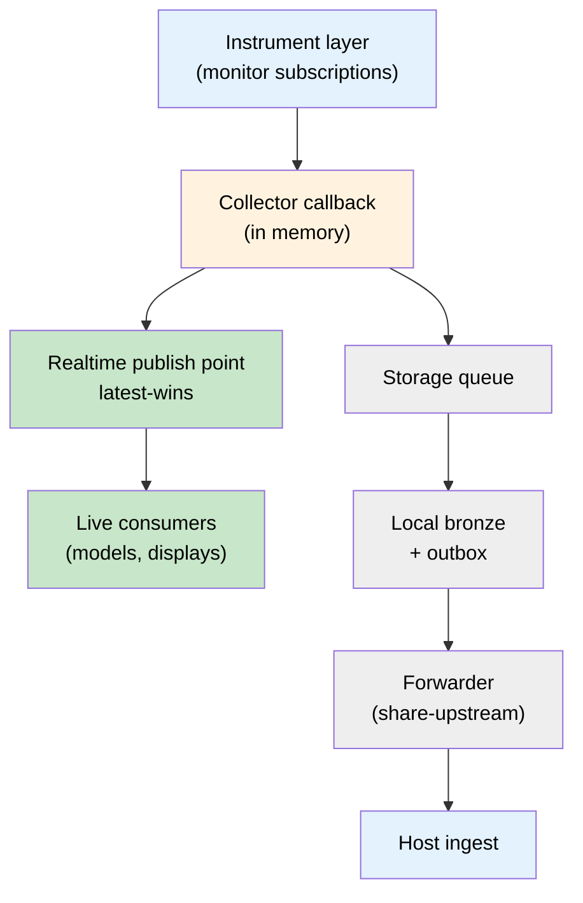

# ADR-180: A producing site keeps a local medallion and shares from it

**Status:** Proposed
**Date:** 2026-10-08
**Related:** ADR-106 (push ingest gateway), ADR-164 (node functions, draft), ADR-177 (ingest edge, proposed), ADR-178 (tenant site administration, proposed), ADR-179 (updates by approval, proposed), ADR-174 (runtime stores on Postgres)

## Context

A producing site (a lab running its own instruments) installs a collector
that reads its sensors and archive and sends readings to a host platform
operated by another organisation. Three consumers want those readings, and
they want different things:

| Consumer | Wants | Tolerates |
|---|---|---|
| Live consumers (a running model, a display) | the newest value, now | losing old values |
| The host platform's analytics | every value, exactly once, eventually | delay |
| The producing site itself | its own complete copy, on its own hardware | nothing that risks the other two |

A first design gave the third consumer a bespoke file archive beside the
collector's journal. It duplicated what the data platform already does
(landing, deduplication, retention, verification) and produced a format only
our own reader understood.

The site's relationship with the host also varies. Some sites contribute data
to a shared record kept by the host. Others keep their own record and share a
chosen part of it. The same site may move from one to the other as it gains
confidence, and should not reinstall to do so.

## Decision

### 1. The local copy is a medallion, not an archive format

The producing site runs a **local medallion**: the same data platform as the
host, as a node with a configured set of functions (ADR-164). The collector
always writes to **local bronze first**, through the same ingest door the host
exposes (`POST /ingest/rows`, ADR-106). Nothing about the collector differs
between "send to the host" and "keep a copy": it sends to its own node.

This replaces the file archive. Its guarantees move with it, stated per
failure, because the lanes share hardware and one claim does not fit all:

| Failure | Realtime (lane 1) | Store and forward (lane 2) | Local medallion (lane 3) |
|---|---|---|---|
| Database stopped | continues (memory only) | continues: the forwarder ships bronze files, no database needed | bronze still lands; silver catches up when the database returns; alarm raised |
| Disk full or failing | continues (memory only) | pauses: the outbox and the collector's journal share the disk; readings that overflow a full journal are counted as lost, never hidden | pauses; alarm raised |
| Host ingest unreachable | continues | waits, then catches up from the outbox | unaffected |

A node that cannot write must say so. Measured on a filled disk, the ingest
door answered 200 to every push while only one batch in six landed, with the
failure reported only in the body. The door now answers 507 when nothing
could be written, and its health check returns 503 `cannot_write`. Every
sender must treat an `errored` count as not delivered.

### 2. Three lanes, one source of truth for each

| Lane | Path | Contract |
|---|---|---|
| 1. Realtime | collector → in-memory latest-wins bus → live consumers | newest value per channel; a consumer that stops reading is dropped, never waited on |
| 2. Store and forward | local bronze → **forwarder** → host ingest | durable, exactly once (content hash), resumable from a cursor |
| 3. Local medallion | collector → local bronze (and, by role, silver and gold) | the site's own copy; retention set by the site |

Lane 2 is a **forwarder** that reads the local node's ingest **outbox** (the
record ADR-177 defined for the edge: `seq`, `source`, `content_hash`, payload
blob under `bronze/<source>/_content/`) and replays each batch to the host's
ingest door, choosing among transports (direct intake, an interim file
service, or wait). Lanes 2 and 3 therefore share one code path: landing writes
the outbox, and forwarding reads it. The edge (ADR-177) and the local medallion
are the same node shape in different roles.

When the local ingest door refuses (507) or is unreachable, the collector
keeps its own journal, as it does today when any ingest door is unreachable,
and catches local bronze up when it returns. The forwarder only
ever forwards what local bronze landed, so nothing reaches the host that the
site does not also hold.

### 2a. Storage is never upstream of the realtime lane

The source of live readings is a **push** from the instrument layer (for a
control-system source, monitor subscriptions) into the collector. Each update
is fanned out **in memory** at the moment it arrives:

- to the realtime publish point first, latest-wins, from the monitor callback
  itself;
- then onto the queue that local bronze and the forwarder drain, off the hot
  path.

No database (the site's own historian, or the local medallion) sits between
the instrument and a realtime consumer, and no storage step can delay a
realtime publish.



**Latency budget**, measured per publish and reported in the heartbeat, the
local monitor and status: instrument timestamp to realtime publish, and
arrival to publish (the collector's own share). Target: well under 100 ms on
modest hardware. Measured on a 2-CPU, 4 GB replica with real monitor
subscriptions at 20 Hz, with the storage loop deliberately slowed to one pass
every 2 s: p50 0.60 ms, p95 1.22 ms, max 54 ms from the instrument timestamp;
p95 0.033 ms from arrival; p95 0.25 ms from publish to a subscribing consumer.

The realtime lane ships with no consumer attached. Adding one later (a
reduced-order model on bigger hardware) is deploying that consumer and
pointing it at the publish point: no re-plumbing of the collector. The first
publish profile is a fixed eight-field packet kept for existing consumers; a
wider profile for many-channel sites is a separate decision.

### 3. Two modes of the same node

The mode is a configuration of node functions, switched with
`features enable|disable`, never a reinstall.

| | Contributor mode | Local-first mode |
|---|---|---|
| Local functions | **archive role**: ingest, bronze, silver, the gold views, and data access (below) | the archive role plus the web app (and, if wanted, chat) |
| `share-upstream` (the forwarder) | **on** by default | **off** until the site enables it |
| Record of truth | **upstream**: the host holds the shared record | **local**: the site's node is the record; the host holds a copy of what is shared |
| Corrections made at the host | applied to the shared record | not pushed down unless the site opts in |

**Record of truth is a node property** (`record_of_truth = "local" |
"upstream"`), read by reconcile (section 5) and by any feature that must know
which copy wins. It is not inferred from which functions happen to be on.

### 3a. The archive role makes the site's data easy to get at

Storing a copy is not enough; the site must be able to use it without our web
app. The archive role keeps these on (no local LLM, chat or web app by
default):

- **The CLI data verbs** the host offers (`series`, `aggregate`, `gaps`,
  `describe`, `catalog`, `export`), returning units, quality and provenance,
  with CSV and Parquet export.
- **An MCP server** exposing the same read-only queries, scoped to the site,
  so any AI client can ask the archive a question.
- **A read-only database role** for standard tools (SQL clients, dashboards,
  dataframes), with the table layout documented and the same schema names as
  the host (`silver.signals`, the gold views), so a query written against one
  works against the other. Credentials come from the vault, never from a file.

Every path answers the same query with the same numbers; that is tested, not
assumed.

### 4. The site owns its sharing policy

The forwarder applies a policy the site writes and can change at any time:

```toml
[share]
feeds = ["<feed>"]          # what may leave
channels = []                # optional narrowing within a feed
since = "2026-10-01"         # nothing older is sent
delay_minutes = 0            # optional embargo before anything leaves
```

- A batch outside the policy advances the cursor without being sent, and is
  counted, so "not shared" is visible rather than silent.
- **Turning sharing off stops sending. It never deletes what the host already
  holds.** Status says so in those words. Withdrawing shared data is a
  separate, explicit request to the host's administrators.
- Turning sharing back on resumes from the cursor; the host deduplicates by
  content hash, so nothing is sent twice.

### 5. Reconcile compares, fills and flags; it never resolves by itself

A reconcile job compares the local medallion with the host, **per channel per
hour**: a row count and a content hash over the window's readings, each
identified by `(site, feed, channel, ts, source_class)` and hashed with its
`value`, `unit` and `quality`.

- **Gap on one side:** filled from the side that has the data, in the
  direction the record of truth allows. In contributor mode the host fills a
  local gap; in local-first mode the host's copy is filled from local, never
  the reverse unless the site opted in.
- **Local expiry is not a deletion.** A window the site's retention removed is
  recorded as expired locally and is never sent to the host as a deletion.
- **Conflict** (both sides have the same reading identity,
  `(site, feed, channel, ts, source_class)`, with different values): **flagged, never auto-resolved.** Both values are kept and
  the window is reported to both sides' operators.
- Reconcile reads the record-of-truth property; it has no mode-specific code
  paths beyond that.

### 6. Footprint

Measured on a 2-CPU, 4 GB budget standing in for a ten-year-old low-power
host, at a site's real rate (107 channels at 1 Hz):

| Component | Idle | Under load |
|---|---|---|
| Ingest + bronze + outbox | 91 MB memory, 0.2% CPU | 0.9% CPU average; 8 ms p50 / 15 ms p95 per batch; disk grows about 75 KB/s (about 6.4 GB/day as landed JSON) |
| Database (TimescaleDB) for silver and the gold views | 57 MB memory, 0.0% CPU | to be measured with the data-access layer |

Storage, measured on a real one-day export from a producing site (718,708
readings, 94 channels; about 3.6 million readings a day if run continuously):

| | Bytes per reading | Per day at that rate | Days per 100 GB |
|---|---|---|---|
| silver, plain table | 501 | 1.8 GB | about 55 |
| silver, compressed hypertable | 77 | 0.28 GB | about 360 |
| bronze as landed | 662 | 2.4 GB | about 42 |
| bronze, gzipped | 110 | 0.40 GB | about 250 |

The archive role therefore makes `silver.signals` a compressed hypertable by
default (compress after two days). Retention is a site setting with no default:
deleting history is never implicit. Bronze retention and bronze compression
are the larger lever and are set per site.

Disk growth makes retention a real setting on old hardware. The database is
either the node's own small container or a separate database (never a shared
schema) on a TimescaleDB server the site already runs.

## Consequences

- One data platform, one ingest door and one outbox, at every node. A
  producing site is a small instance of the host, not a different product.
- The site's own copy is queryable with the same tools as the host's, and
  becomes a full local platform by enabling functions, not by migrating data.
- The forwarder is the only path data leaves a site, so the sharing policy has
  exactly one place to be enforced.
- Even the archive role carries a small database, because the site's data must be queryable, not only stored.
- Reconcile can surface disagreement the system cannot settle. That is
  deliberate: a measured value has one true reading, and choosing between two
  is a judgement for the people who own the instrument.
- Corrections at the host do not silently rewrite a local-first site's record.

## Alternatives considered

- **A bespoke file archive** (built and shelved): duplicated the platform's
  landing, deduplication and retention, in a format only our reader opened.
- **The host as the only copy**: rejected by sites that must keep their own
  record, and a single point of loss during long outages.
- **Mode as an install choice**: forces a reinstall exactly when a site gains
  confidence, which is when switching should be easiest.
- **Automatic conflict resolution** (last writer wins, host wins): picks a
  value no one measured with confidence, silently.
