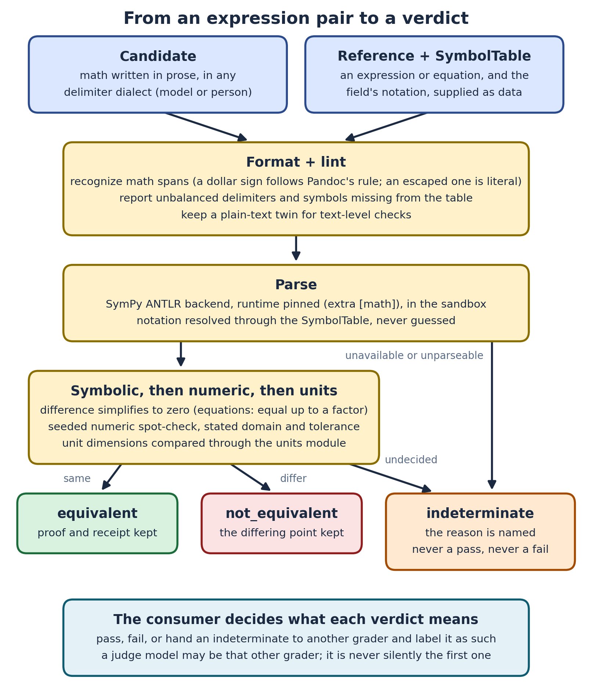

# ADR-184: Scientific displays decide whether two expressions are the same, and own how math is written out

**Status:** Proposed (2026-10-06)
**Related:** [ADR-039](adr-039-scientific-displays.md) (scientific displays; this extends D2), [ADR-101](adr-101-press-latex-pdf-provider.md) (PRESS LaTeX to PDF), [ADR-056](adr-056-skill-as-function.md) (skills as functions), [prd-scientific-displays](../prds/prd-scientific-displays.md), [spec-scientific-displays](../specs/spec-scientific-displays.md) §5.4, §6c, §7.5

## Context

ADR-039 gave Axiom a deterministic kernel that *verifies* an expression a model proposed: the model suggests, SymPy computes, the result carries a provenance receipt. That answers "what does this evaluate to?" It does not answer the question every grader, instructor and benchmark asks: **"is this expression the same as that one?"** Today that is answered by substring match (which fails on any rearrangement: `\frac{k-1}{k}` against `1 - 1/k`) or by a model's opinion (which cannot be audited as a rule, and is the failure ADR-152 corrected in a different area).

Three measured facts make the gap concrete. They come from a probe of six representative equations (a ratio, a rational expression with Greek symbols, a first-order differential equation, an exponential decay law, an indexed sum, and a symbol subscripted with a currency sign):

1. **The parser is silently absent.** In the default Axiom environment all six parse to nothing, because SymPy's LaTeX parser needs a separate `antlr4` runtime that Axiom neither installs nor declares. `parse_to_sympy` returns `None`, rendering still works, and nothing says that symbolic verification is not happening. With the ANTLR backend and a pinned runtime (4.11) five of six parse. The Lark backend, which needs no ANTLR, parses two of six.
2. **Notation is not mathematics.** Even when parsing succeeds, Euler's constant `e` becomes an ordinary symbol, and a symbol subscripted with `\$` does not parse at all. Meaning that lives in a field's notation has to be supplied by the field.
3. **Models write math in several dialects, and `$` is ambiguous.** `$...$`, `$$...$$`, `\(...\)` and `\[...\]` all occur. A `$` is also a currency sign and, in some fields, a unit. A renderer that guesses turns "costs $20 and $30" into one italicized formula, and a text-level check downstream (number extraction, a provenance gate, search) then reads garbled text.

## Decision

**Scientific displays own three things: a verdict on whether two expressions are equivalent, a lint for math in prose, and the one policy for writing math out. Each is deterministic, and each fails loudly instead of passing quietly.**

1. **Equivalence is a three-valued verdict, never a boolean.** `equivalent(a, b, ...)` returns `equivalent`, `not_equivalent` or `indeterminate`, and an `indeterminate` carries its reason (which side would not parse, a free symbol present on one side only, a timeout, an unsupported construct). A consumer must treat `indeterminate` as "needs another grader", never as a pass and never as a fail. The method is symbolic first (the difference simplifies to zero; for equations, `lhs - rhs` equal up to a nonzero constant factor), then a seeded numeric spot-check over a stated domain with a stated tolerance, then a unit-dimension check through the extension's units module. It runs in the same sandbox subprocess as compute (ADR-039 D3), with no `eval` of caller text. SymPy cannot decide equivalence for every expression; saying `indeterminate` for those is the honest answer and the reason the type has three values.
2. **The LaTeX parser is a declared, tested dependency.** The backend is SymPy's ANTLR backend with `antlr4-python3-runtime==4.11.*` (BSD-3) pinned, shipped as the optional extra `[math]`. When it is absent, parsing yields an explicit result (`unavailable`, with the install hint) and a one-time diagnostic, not `None`. The test job installs the extra and runs a curated equation corpus through it, with a negative control, so the silent failure cannot return unnoticed. The Lark backend is not used.
3. **Notation is data supplied by the caller.** A `SymbolTable` maps notation to meaning (named constants, unit tokens, multi-letter subscripts, a symbol's assumptions and domain). Axiom ships only a general default (π, Euler's constant, the standard functions). A consumer carries its own field's table; Axiom stays domain-agnostic.
4. **`lint_math(text)` reports math problems with positions**: unbalanced delimiters, snippets that do not parse, snippets whose symbols are missing from the supplied table, and ambiguous delimiter use. It exists so any consumer can check content when it is authored, not when it first fails to grade.
5. **One output-formatting policy, in one place.** `format_math(text, surface)` recognizes `$$...$$`, `\[...\]`, `\(...\)`, and `$...$` under Pandoc's rule: the opening `$` needs a non-space immediately to its right; the closing `$` needs a non-space immediately to its left and must not be followed by a digit; `\$` is always a literal dollar sign. So "$20 and $30" and "-$0.92 and -$1.16" are never math. Text outside recognized spans is never altered; the function is idempotent; each surface renders its own way (terminal Unicode, SVG or PNG, browser typesetting, PDF through the PRESS provider); and it **always returns a plain-text twin** with each math span replaced by its verified plain form, so text-level checks see stable text.
6. **The surface is skills.** `scidisplay.equivalent`, `scidisplay.lint_math` and `scidisplay.format_math` are skill functions (ADR-056), projected to the MCP tool `axiom_compute__equivalent` beside the existing `axiom_compute__verify`, and to CLI verbs by the usual projection.

## Options considered

**A model as judge of equivalence.** Easy and flexible; nondeterministic, unauditable as a rule, and it grades its own kind. Rejected. It remains a fallback a *consumer* may choose for an `indeterminate`, visibly labeled as such.

**Textual or AST equality.** Fails on any rearrangement, which is most correct answers. Rejected.

**Numeric sampling alone.** Cheap, but wrong at singularities and on domain edges, and it cannot prove anything. Kept only as the second stage after the symbolic one.

**The Lark LaTeX backend.** No ANTLR dependency, but measured weaker (two of six). Rejected on evidence, not preference.

**Vendoring a LaTeX parser.** Avoids a dependency and takes on a maintenance burden for a solved problem. Rejected.

**Formatting heuristics inside each consumer.** The delimiter and `$` policy would drift per consumer, which is the collision problem repeated. Rejected: one policy, one place.

## Consequences

`indeterminate` becomes a first-class outcome that every consumer has to handle. That discipline is the point, and it will occasionally feel like friction.

One new optional dependency (BSD-3) is pinned and tested, and the test job gains the `[math]` extra.

Symbol tables become a consumer-owned artifact. A consumer that needs a field's notation writes the table once, and lint then tells it where content strays from it.

The formatter becomes the single owner of the delimiter policy. Other code that formats math (chat rendering, press, the classroom extension) moves to it over time.

Parsing untrusted LaTeX happens inside the sandbox subprocess (ADR-039 D3, R7), so a hostile expression costs a timeout, not a compromise.

Follow-up work, sequenced in the PRD (Phase B): the `[math]` extra and its CI corpus; the equivalence verdict; lint; the formatter and plain-text twin; the tool projection.
