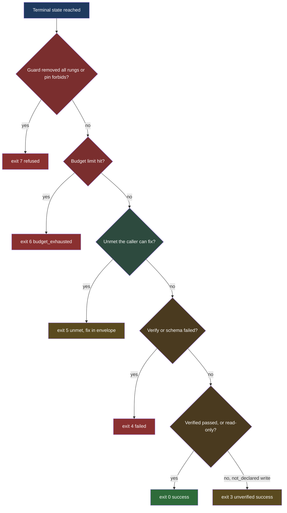
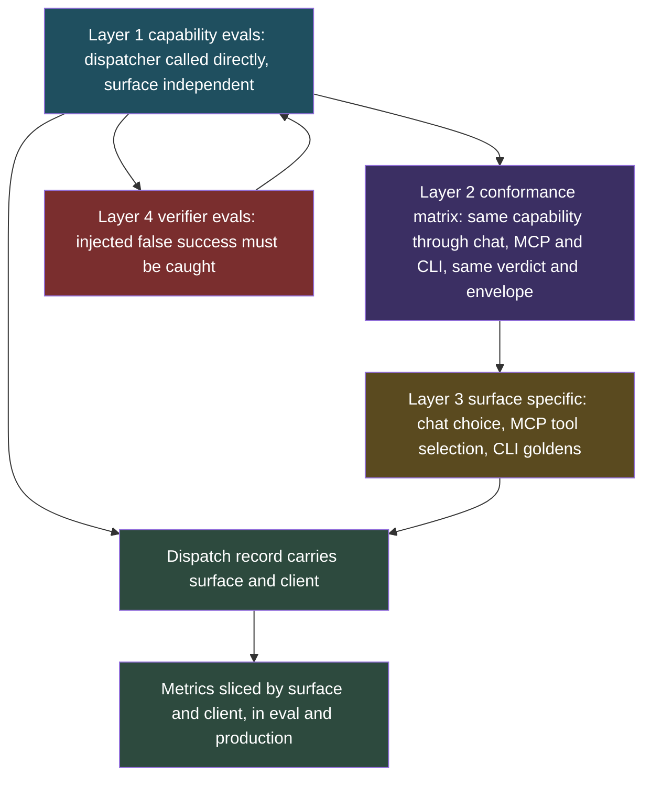
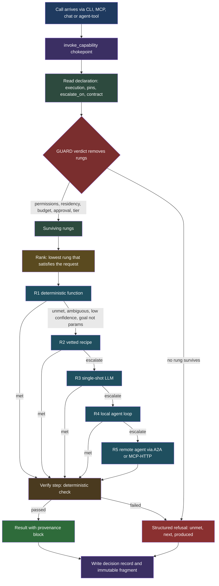

# ADR-232: Capabilities may be agent-backed, and dispatch is a recorded verdict

**Status:** Proposed (2026-10-31)
**Related:** [ADR-056](adr-056-skill-as-function.md) (a skill is a function), [ADR-061](adr-061-agent-call-protocol.md) (A2A is the agent-to-agent substrate), [ADR-072](adr-072-capability-projection.md) and [ADR-073](adr-073-mcp-registry-driven-tool-surface.md) (one capability, many projections), [ADR-139](adr-139-a-skill-accepts-the-callers-goal.md) (`caller_goal`), [ADR-185](adr-185-tools-declare-what-they-need-and-make-and-vetted-chains-are-published-as-recipes.md) (needs/makes, plan hash, recipes), [ADR-201](adr-201-routing-is-a-verdict-then-seats-guard-removes-options-graduated-seats-rank-the-rest.md) (verdict then seats), [ADR-168](adr-168-chat-states-where-every-answer-came-from-and-enforces-it.md) (state where an answer came from), [ADR-157](adr-157-the-serving-tier-bounds-what-any-one-call-can-cost.md) (cost at one door), [ADR-126](adr-126-typed-decision-receipts.md) (typed decision receipts), [ADR-045](adr-045-raci-evolution.md) (guarded act), [ADR-027](adr-027-federated-memory.md) and [ADR-028](adr-028-trust-graph.md) (federation, trust), [spec-work-verification](../specs/spec-work-verification.md), [prd-capability-budgets](../prds/prd-capability-budgets.md), [spec-aeos-0.1](../specs/spec-aeos-0.1.md) §4.1, §4.6, §4.9
**Companion:** [ADR-233](adr-233-chat-spawns-subagents-through-one-manager-and-one-run-handle.md) (subagents in chat), [prd-agent-backed-capabilities-and-subagents](../prds/prd-agent-backed-capabilities-and-subagents.md)
**Extended by:** [ADR-234](adr-234-model-selection-is-the-second-axis-of-dispatch-guard-removes-models-seats-rank-them-external-routers-are-providers-behind-a-seat.md) (model selection as the second axis of the same dispatch)

## Context

A registered capability is a function `(params, ctx) -> SkillResult` (ADR-056), projected once onto the CLI, MCP, the agent-tool list and SKILL.md (ADR-072, ADR-073), and every call crosses one chokepoint, `invoke_capability` in `src/axiom/infra/skill_dispatch.py`. ADR-056 left room for the body to "call into an LLM persona" but gave no way to say so. Three things follow from that silence.

1. **An agent-backed capability already exists and is undeclared.** `agents.ask` (`src/axiom/extensions/builtins/agents/skills/ask.py`) hands a request to a persona through `delegate()` in `src/axiom/agents/delegation.py`, which runs a bounded `HeadlessChat` turn (`TurnRunner`, `DELEGATION_TURN_DEADLINE = 120.0`, `MAX_DELEGATION_DEPTH = 2`). To the registry it is indistinguishable from a deterministic function. Nothing records that a model ran, what it was allowed to touch, or what it cost.
2. **The choice between a function and an agent is made by whoever writes the prompt.** A caller (a person in chat, or a harness over MCP) picks `data.series` or `agents.ask` by guessing. Nothing removes the agent option when the caller may not spend, may not send the data to a model, or does not need one. Nothing escalates when the function returned "unmet".
3. **Agent claims of success are not checked.** The platform's own history is of an agent reporting "done" while the effect was absent. `spec-work-verification` derives claims from observed tool calls and never from model prose, but a capability has no slot to declare the check that proves its own result.

ADR-201 settled the shape for choosing a model: a verdict removes options, then seats rank what is left. The same shape fits choosing an execution rung. ADR-185 settled that tools declare needs and makes and that vetted chains are published as recipes with no runner. This ADR extends both rather than adding a parallel mechanism.

What was verified in code while writing this (all paths relative to the repo root):

- `SkillSpec` already carries `allowed_tools`, `side_effects`, `idempotent`, `surfaces`, `allowed_principals`, `cost_class`, `risk`, `open_world`, `requires`, `produces`, `next_steps`, `recipes` (`src/axiom/infra/skills.py`). It carries no execution mode, model class, budget, residency or verification field.
- Destructive-plan hashing and single-use approval exist (`src/axiom/extensions/builtins/chat/plan_apply.py`, the existing `ApprovalGate`).
- `CapabilityToken` carries `delegation_depth` and `parent_capability` (`src/axiom/governance/capability.py`). It has no budget envelope in this tree (verified 2026-10-31: no budget field in `src/axiom/governance/`), although `prd-capability-budgets` specifies one. Part 5 makes it a prerequisite milestone (A0).
- A2A agent cards exist (`src/axiom/vega/federation/agent_card.py`). No A2A task lifecycle exists in this tree (verified 2026-10-31 under `src/axiom/vega/federation/`). Part 6 builds the internal handle first.
- The MCP server code under `src/axiom/extensions/builtins/mcp/` contains no progress-notification or task-handle code (verified 2026-10-31). Part 6 sequences the poll tool first and native support later.

## Decision

**A capability declares how it may execute. The caller sees one typed capability either way. Which rung actually runs is a verdict the platform computes, records, and can replay.** Nine parts.

### 1. Declaration: `execution` and its agent contract

`SkillSpec` gains optional fields, all defaulting to `None` ("has not said", the ADR-185 convention). An undeclared capability is `deterministic` and behaves exactly as today.

| Field | Values | Reuses or new |
|---|---|---|
| `execution` | `deterministic`, `agentic`, `hybrid` | new |
| `risk` / `side_effects` / `open_world` | existing vocabulary: `read`, `reversible-write`, `destructive` | reused as the side-effect class |
| `cost_class` | existing ADR-157 classes for reads; an agent-backed capability adds a declared `budget` | reused plus `budget` |
| `latency_class` | `interactive` (under 5 s), `bounded` (under 2 min), `long` (task handle required) | new |
| `data_residency` | `local_only`, `site`, `any` (the placement vocabulary of ADR-201 decision 14) | new, bound to the label join |
| `binding` | `local`, `remote` | new |
| `agent` | `AgentContract` (below), required when `execution` is `agentic` or `hybrid` | new |
| `dispatch` | pins and escalation conditions (part 2) | new |

`AgentContract` is data, not code:

- `persona`: a persona from an extension manifest (AEOS §4.1), the same registry `delegate()` resolves.
- `allowed_tools`: the existing `SkillSpec.allowed_tools` field, now enforced for the agent loop. Empty means the loop gets no tools, not all tools.
- `model_class`: one of the ADR-201 model classes (`simple` to `smartest`). The word "tier" is not used, because ADR-201 reserves it for prompt tiers.
- `budget`: `turns`, `tokens`, `dollars` (an estimate, labeled as one, per prd-capability-budgets R3), `wall_clock_s`. All four are required. There is no default, for the reason `HeadlessChat` refuses a default `turn_deadline`.
- `output_schema`: JSON Schema for the typed result. An agent result that fails the schema is a failed result, not a repaired one.
- `verify`: the deterministic check that backs a claimed success (part 6). Required for any capability whose `risk` is not `read`; strongly recommended for reads and lint-warned when absent.
- `local_or_remote`: when `binding` is `remote`, the address, the transport (`mcp-http` or `a2a`) and the trust requirement (part 7).

SKILL.md remains generated from the registry (ADR-063). The generator emits the execution mode, budget and verify step so the contract is readable by a human and by a harness. `caller_goal` (ADR-139) is the optional input that lets a capability accept a goal instead of parameters. It stays untrusted text and is never a reason an action was permitted.

**Projection is unchanged.** The same projector (`axiom.infra.capability_projection`) emits the CLI verb, MCP tool, agent-tool and SKILL.md for both modes. The MCP `annotations` and the tool description state that the capability may run a model, so a calling harness can see cost before calling. A caller never selects a mode by name; it may pass a hint (part 2).

### 2. Dispatch is three layers, in a fixed order

Layer 1, declaration. The skill states what it can do and what it forbids. `dispatch.pins` holds `deterministic_only` (never escalate past rung 1 or 2) and `forbid_agent` (never run rungs 4 or 5). `dispatch.escalate_on` lists conditions that may move a call up a rung (part 3). A pin that conflicts with the capability's own `execution` is a registration error.

Layer 2, guard. A GUARD verdict (ADR-201 decision 1) **removes** rungs. It is a pure function of stored labels, declared facts and the versioned policy set, and it fails closed per option (ADR-201 decision 10). It removes a rung when:

- the principal, or the persona intersected with the principal, lacks the permission (part 5);
- the label join of the inputs forbids the rung's processor or placement (`data_residency`);
- the remaining budget is below the rung's floor;
- the side-effect class needs an approval that is not held (`risk` is `destructive` and no approved plan hash, ADR-185 decision 3);
- the deployment tier does not allow agent loops at all (for example a public-only widget, ADR-201 decision 12).

A rung the guard removed is recorded with the reason. It is not routed around. If no rung survives, the call fails with a structured refusal (part 4), not an exception.

Layer 3, ranking. Among surviving rungs, pick the **lowest** that satisfies the request, and escalate on evidence. The rungs, lowest first:

| Rung | What runs | Model calls |
|---|---|---|
| R1 | deterministic function | 0 |
| R2 | vetted recipe (ADR-185) of deterministic steps | 0 |
| R3 | single-shot LLM (summarize, classify, extract), no tool loop | 1 |
| R4 | local agent loop under the capability's `AgentContract` | many, bounded |
| R5 | remote agent (A2A or MCP-HTTP), same contract enforced by the remote and by a local verifier | many, bounded |

Advisory classifiers (intent, complexity) rank only as ADR-201 seats: advice until a seat is graduated for that site, never an input to the guard. Precedence when signals disagree: **policy, then skill declaration, then caller hint, then router preference.** A caller hint (`prefer: deterministic | agent`) can move the starting rung within what policy and the declaration allow. It never relaxes a pin or a guard removal.

Deterministic first: a capability that declares `hybrid` starts at R1 or R2 and escalates only on evidence. A capability that declares `agentic` starts at R3 or R4 per its contract. `execution` bounds the rungs available; it does not fix a single rung.

### 3. Escalation is evidence, not a mood

A call moves up one rung (never skipping, so cost stays attributable) when one of these holds, each recorded as the `escalation_reason`:

- **goal_not_params:** the input is a goal (`caller_goal` is present and the required parameters are not), per ADR-139.
- **unmet:** the lower rung returned `chain.unmet` that it cannot satisfy itself.
- **ambiguous:** the lower rung returned more than one candidate result and the capability declares it needs one.
- **low_confidence:** the lower rung stated a confidence below the capability's declared floor. Confidence alone never decides anything that matters (ADR-126 decision D2); it only permits a higher rung to try, and the higher rung's result is verified.
- **multi_step:** the declared `escalate_on` says the request needs more than one dependent step.

Escalation cannot cross a guard removal. Each step re-runs the guard, because a label or a budget may have changed. A trajectory is capped at the capability's declared `max_escalations` (default 2).

### 4. Decision record and failure semantics

Every dispatch produces one decision record in the ADR-201 decision-record stream (C5). It is content-free: digests, ids and option names, never input text.

```json
{
  "kind": "dispatch",
  "decision_id": "...",
  "trace_id": "...",
  "parent_decision_id": "...",
  "capability": "ns.verb",
  "principal": "@name:context",
  "persona": "@name:context or null",
  "surface": "cli | mcp | chat | runner | web",
  "client": "axi-cli/<version> | <mcp clientInfo name/version> | null",
  "inputs_digest": "sha256:...",
  "label_join": "public | ...",
  "declared": {"execution": "hybrid", "pins": [], "binding": "local"},
  "hint": "deterministic | agent | null",
  "options": [
    {"rung": "R1", "state": "tried", "outcome": "unmet", "reason_id": "..."},
    {"rung": "R3", "state": "removed_by_guard", "reason_id": "residency"},
    {"rung": "R4", "state": "chosen", "score": null}
  ],
  "escalations": [{"from": "R1", "to": "R4", "reason": "goal_not_params"}],
  "precedence_applied": ["policy", "declaration"],
  "seat_opinions": [{"seat": "request-intent", "live": false, "answer": "..."}],
  "budget": {"granted": {}, "drawn": {}},
  "result": {"ok": true, "verified": "passed | failed | not_declared", "verify_check_id": "..."},
  "revision": {"policy": "...", "registry": "...", "code": "..."}
}
```

`surface` takes the values already defined as constants in `src/axiom/infra/skill_dispatch.py` (`CLI_SURFACE`, `MCP_SURFACE`, `CHAT_SURFACE`, `RUNNER_SURFACE`, `WEB_SURFACE`; verified 2026-10-31). `client` is new: it names the calling program so metrics can be sliced by harness (part 9). Where the client name comes from on MCP is open question 5. Neither field carries input text.

It is **not a separate record format**. It is the ADR-126 `TypedDecisionReceipt` (a `choice` over the rungs) written into the decision-record stream that ADR-201 decision 11 extends, with `kind: "dispatch"`, in the same `routing_events` table and hash chain (ADR-201 decisions 18 and 19). Ownership: ADR-201 owns the envelope and route fields, ADR-126 owns the receipt type, and this ADR owns only the dispatch payload shown above (rung states, escalations, verify outcome, budget, `surface`, `client`). Dispatch is asked at the existing `pre_tool` stage and is not a new stage. Whether that is a new column set or a new kind in the existing table is open question 1. It serves audit (what ran and why) and eval (regret: which rung would have sufficed, from the graded outcome that arrives later, as in ADR-201 decision 17).

Failure semantics reuse the `chain` envelope of ADR-185. A refusal or failure at any rung returns `unmet: [{id, why, fix}]`, `next: [...]` and `produced: [...]`; it never raises across the surface. New `unmet` ids: `budget_exhausted`, `agent_removed_by_guard`, `residency_forbids`, `approval_required` (with the plan hash route), `verify_failed`, `schema_invalid`, `remote_unreachable`, `remote_untrusted`. A `verify_failed` result is returned as a failure that carries the agent's unverified output under `produced` as a clearly marked ref, never as a success.

### 5. Controls on an agent-backed run

- **Acts as the caller.** The agent runs as the caller's principal. Its effective permissions are the **intersection** of the caller's and the persona's. The persona can narrow, never widen. The existing `delegation.py` carries a `requester` for the same reason.
- **Writes deny by default.** The agent's tool list is the `allowed_tools` allow-list, filtered to `risk: read` unless the contract names a write tool explicitly. A write tool still crosses the chokepoint, so GUARD and the approval policy apply to each call.
- **Destructive actions use the existing plan hash.** A `destructive` tool called by an agent opens a plan on the approval queue and the run pauses as `awaiting_approval` (a task state, part 6); it never self-approves. The approval bubbles to a person.
- **Tool results are data, never instructions.** The loop wraps every tool result and retrieved content in a data channel the model is told carries no authority. Text in a result that asks for a tool call is not executed on that authority; any call the model then makes still passes the allow-list, the guard and the approval path. This is a defense in depth with the chokepoint as the real enforcement.
- **Budgets and timeouts are enforced at the boundary, not trusted to the model.** Per prd-capability-budgets R4, exhaustion denies new draws at the next step boundary; it does not kill a half-finished write.

**Prerequisite milestone A0: a budget envelope on `CapabilityToken`.** The envelope does not exist in the tree, so the budget controls above cannot be enforced until it does. A0 lands before any agent-backed capability is enabled (before A3) and before subagent spawn (S1). Acceptance criteria:

1. `CapabilityToken` carries a budget envelope with four limits: `turns`, `tokens`, `dollars` (an estimate, per prd-capability-budgets R3) and `wall_clock_seconds`. An absent envelope means unbounded only for non-agent tokens; an agent-backed run refuses to start without one.
2. Draw and decrement: each model call, tool step and elapsed interval draws from the envelope at the step boundary; the remaining amounts are readable without mutating the token (a frozen token yields a new drawn view or a ledger entry, not in-place mutation).
3. Inheritance is the **intersection** on delegation and spawn: a child's envelope is at most the parent's remaining amounts on every limit, and never larger than what the parent requested for it. The parent's remaining amounts are reduced by the child's grant at spawn and refunded by unused amounts at completion.
4. Exhaustion of any limit returns `unmet: budget_exhausted` through the `chain` (naming the limit), at the next step boundary, with no raise across the surface.
5. The dispatch record (part 4) records the envelope granted, the amounts drawn and any `budget_exhausted` outcome; `budget_drawn` in the provenance block is read from the same ledger.
6. Tests cover each limit, intersection at depth 2, refund on completion, and exhaustion mid-run leaving a half-finished write untouched.
- **Depth.** Agent-backed capabilities that call agent-backed capabilities count against one depth counter shared with `delegation_depth()` (`MAX_DELEGATION_DEPTH = 2` today) and against the parent's budget slice.

### 6. Provenance, long-running work, and verify-don't-trust

**Provenance.** Each agent-backed result carries a `provenance` block: `trace_id`, `decision_id`, `model` (provider, model, placement per ADR-168), `rung`, `tools_used`, `sources`, `budget_drawn`, `verify` outcome. The run's transcript summary and result are written as an immutable fragment through `CompositionService.write` (the core invariant: every memory write goes through it) with `(T, U, A, R)` provenance, `accountable_human_id` the caller's human, and `delegation_chain` set. Raw transcripts are stored by reference with the ADR-233 transcript rule.

**Task handles.** A capability whose `latency_class` is `long`, or any `binding: remote` call, returns a **task handle** first: submit, then progress events, then result. The handle shape is internal and maps onto A2A tasks and onto MCP progress and task reporting where a client supports them. The shape is defined in ADR-233 (`RunHandle`) because chat subagents need it too. Neither MCP task or progress support nor an A2A task lifecycle exists in the tree (verified 2026-10-31), so the work is sequenced:

1. **H1, internal handle first.** Build the `TaskHandle` / `RunHandle` (ADR-233) as an internal interface: submit, state, progress events, result, cancel. Nothing external depends on a protocol yet.
2. **H2, poll tool as the guaranteed fallback.** Every capability that returns a handle also exposes `<capability>.status` (and `.cancel`), a normal MCP tool any client can call. This works with every harness and is the only path required to ship.
3. **H3, native MCP progress and task support.** Added later, only where a client advertises it, and enabled per client only after a conformance test proves it against that client. Until proven, the poll tool remains the contract.
4. **H4, A2A task mapping.** The handle's states map onto the A2A task lifecycle for remote bindings, verified by a round-trip test against the agent card in `agent_card.py` before any remote agent-backed capability is enabled.

**Verify, don't trust.** `AgentContract.verify` names a deterministic check that must pass before the run may report success: a test run, a diff against the declared scope, a probe of the restarted or deployed thing. Verification is a registered capability like any other, with `execution: deterministic`, called by the dispatcher after the agent finishes and not by the agent. This is the same rule as `spec-work-verification` R1 (claims come from structure, never prose): the verifier reads the world, not the agent's account of it. A result is `verified: passed`, `failed`, or `not_declared`. Only `passed` or a `read` capability with no side effects may be presented as success without qualification; `not_declared` renders as "unverified" and is counted in the success metric as not-verified.

**Evals.** Each agent-backed capability ships a golden-trace eval (input, expected rung, expected tools, expected verify outcome) and a cost-regression test (tokens and dollars per golden case against a recorded baseline, failing on a stated percentage rise). Both run in the existing evals surface (`prd-evals`); part 9 defines the full evaluation plan across the three surfaces. A capability without them cannot move from `shadow` (below) to enabled.

**Rollout.** A newly agent-backed capability registers in shadow: the deterministic path serves the answer, the agent path runs on a sample, and both outcomes are recorded. It is enabled by evidence, never by time, by the same rule as ADR-201 decision 8.

### 7. MCP and A2A: one call shape from the caller's side

From the caller's side every capability is an MCP tool or a CLI verb or an agent-tool call. MCP is the agent-to-tool protocol. A2A (ADR-061) is the agent-to-agent protocol and is an **implementation binding behind a capability**, not a second front door. A remote agent-backed capability is invoked over MCP-HTTP or A2A according to its `binding`; the caller's call, the guard, the decision record and the verify step are identical. The transport is chosen by locality exactly as ADR-061 decision 3 says. ADR-061's envelope carries `parent_verdict_id`; this ADR sets it equal to the dispatch `decision_id` so the audit chain is one tree.

A remote binding adds two guard conditions: the remote's identity is resolved through the trust graph (ADR-028), and the label join must allow the remote's placement. Content never leaves for a remote the join forbids. The remote's own result is not trusted either: the local verifier runs on the returned artifacts.

### 8. CLI surface: the same call, never a prompt

A CLI verb is a thin wrapper over the skill function (ADR-056, ADR-072). A CLI call to an agentic capability therefore crosses the same `invoke_capability` chokepoint, the same dispatcher, the same agent loop and writes the same dispatch record as chat and MCP; only `surface` differs (`CLI_SURFACE = "cli"`, `src/axiom/infra/skill_dispatch.py`, whose header states "One identity, three surfaces"). The CLI adds no behavior of its own beyond argument parsing, rendering, exit status and the flags below.

Verified while writing (2026-10-31): the central CLI loop in `src/axiom/axiom_cli.py` propagates a handler's non-zero integer return as the process exit status, prints "Cancelled." and exits 130 on Ctrl+C, and exits 1 on a load failure. Several verbs already take `--json` (`docs/specs/spec-axi-cli.md`, which also defines a `follow_ups` list in `--json` output). Destructive chains already refuse without a `plan_hash` naming an approved plan (`src/axiom/infra/skill_chain.py`). Not found in the tree: any documented table of exit codes beyond 0, 1 and 130; argparse's usage exit status of 2 is stdlib behavior and is not asserted from the repo.

**8.1 Flags on every agent-backed or hybrid capability verb** (added by the projector, ADR-072, not written by authors):

| Flag | Meaning |
|---|---|
| `--wait` | Default. Block until a terminal state. Progress goes to stderr, the result to stdout. |
| `--detach` | Submit and return at once with a run id (needs the node run service, ADR-233 part 10). Exit status 0 means "accepted", not "succeeded". |
| `--json` | Print one result envelope (8.3) on stdout and nothing else there. Progress stays on stderr unless `--quiet`. |
| `--approve <plan_hash>` | Supply the plan hash from a prior `approval_required` result (8.2). |
| `--no-input` | Never prompt, even on a TTY. |
| `--budget turns=N,tokens=N,dollars=N,wall=N` | Lower the call's budget below the token's remaining envelope (8.5). |
| `--prefer deterministic\|agent` | The caller hint of part 2. |

A capability that is purely `deterministic` and fast gets no `--detach`; it still honors `--json` and the exit table.

**8.2 No prompting; approval is a returned fact.** A non-interactive CLI call never asks "OK to proceed?". An action that needs approval returns `unmet: approval_required` carrying its `plan_hash` and the exact re-run command in `fix`. The hash binds the capability name, the canonical parameters and the scope (principal, resource set, budget class); a hash computed for a different plan is rejected with `approval_plan_mismatch` and is never "close enough". The caller re-runs with `--approve <plan_hash>`.

What `--approve` means is constrained by the standing rule that an agent never approves itself (part 5; ADR-185 decision 3):

- The hash must name a plan that is **approved** in the existing approval queue (`ApprovalGate`, the file `axi approve` reads). `--approve` only supplies the hash that part 5 already requires; it is the same `plan_hash` chain argument.
- On a TTY, when the invoking principal is a human and `--no-input` is absent, the CLI may show the plan and ask. A "yes" records that human as the decider on the plan, then proceeds. This is the only prompt the CLI may emit and it is never emitted when stdin is not a TTY.
- When the invoking principal is an agent or a service, or stdin is not a TTY, `--approve` succeeds only if a person has already approved that plan (`axi approve ok <id>`). Passing a hash cannot approve it.

Whether a human's own `--approve <hash>` on a non-TTY (for example in their own shell script) should count as the approval is open question 6; the conservative reading above applies until it is closed.

**8.3 Result envelope, `--json` schema v1.** One JSON object, stable and versioned:

```json
{
  "schema": "axi.capability-result/1",
  "ok": true,
  "capability": "ns.verb",
  "state": "succeeded | failed | unmet | refused | budget_exhausted | queued | running | stopped",
  "run_id": "null or the run id when a run exists",
  "dispatch": {
    "decision_id": "...", "trace_id": "...", "rung": "R1..R5",
    "escalations": [{"from": "R1", "to": "R4", "reason": "unmet"}],
    "removed": [{"rung": "R5", "reason_id": "residency_forbids"}]
  },
  "effects": "read | reversible-write | destructive",
  "verified": "passed | failed | not_declared",
  "verify_check_id": "...",
  "result": "object validated against output_schema, or null",
  "unmet": [{"id": "approval_required", "why": "...", "fix": "...", "plan_hash": "..."}],
  "next": [], "produced": [],
  "cost": {"turns": 0, "tokens": 0, "dollars_estimate": 0.0, "wall_clock_s": 0.0, "estimate": true},
  "surface": "cli", "client": "axi-cli/<version>",
  "exit_code": 0
}
```

Versioning: the `schema` string carries a major number. Adding fields is compatible within a major; renaming, removing or changing the meaning of a field bumps it. Consumers ignore unknown fields. `unmet`, `next` and `produced` are the ADR-185 `chain` keys unchanged; whether `next` and the CLI spec's `follow_ups` are one list or two is open question 7. The envelope contains no input text. A `verify_failed` result carries the unverified output only as a `produced` ref, never in `result`.

**8.4 Exit codes.** The table extends the conventions found in the tree (0, 1, 130 verified; 2 for usage by argparse convention) and adds codes for the outcomes a script must tell apart. The code is also in the envelope as `exit_code`.

| Code | Meaning | Envelope |
|---|---|---|
| 0 | Succeeded and `verified: passed`, or a read-only call (`effects: read`) whose verify is `not_declared`; also `--detach` accepted | `ok: true` |
| 1 | Internal error or a failure not covered below (the existing generic code) | `ok: false` |
| 2 | Usage error, including a `--budget` above the envelope or an unknown flag | `ok: false` |
| 3 | Succeeded but unverified: a non-read capability with `verified: not_declared` | `ok: true` |
| 4 | Failed: `verify_failed` or `schema_invalid` | `ok: false` |
| 5 | Unmet and fixable by the caller: `approval_required`, `approval_plan_mismatch`, `remote_unreachable`, `run_service_unavailable` | `unmet` lists `fix` |
| 6 | `budget_exhausted`, naming the limit | `ok: false` |
| 7 | Refused by the guard, not fixable by re-running: `agent_removed_by_guard`, `residency_forbids`, `remote_untrusted`, permission denied, the rung removed by a `forbid_agent` pin | `ok: false` |
| 8 | Run not finished: reported by `axi agents status` or `wait` while a run is `queued`, `running` or `awaiting_approval` | `ok: null` |
| 9 | Run stopped by a person or by `stop` | `ok: false` |
| 130 | Interrupted by Ctrl+C (the existing code) | n/a |

Rules: `--detach` itself exits 0 because the command did its job (the run id is in the output); exit 8 is how a later `status` or a timed-out `wait` says the run is still going, and a status call on a finished run returns that run's own code. Ctrl+C during `--wait` stops waiting, not the run: it prints the run id, exits 130, and leaves the run going unless `--stop-on-interrupt` was given (decision proposed, listed as open question 8). Codes 3 to 9 were chosen to avoid the 126 to 165 range shells reserve; whether any existing noun already assigns meaning to 3 to 9 was not checked (open question 9).



Exits 1, 2, 8, 9 and 130 are decided before or outside this classification and are omitted from the diagram.

**8.5 Identity and budget.** A CLI call runs as the invoking user's principal (the same identity resolution the other surfaces use, per the `skill_dispatch.py` header). The budget comes from the caller's `CapabilityToken` envelope (milestone A0); a child or delegated run gets the intersection (part 5). `--budget` may only lower a limit. A value above the envelope's remaining amount is a usage error (exit 2) and is not silently clamped, so a script never believes it has more budget than it does. This differs on purpose from the chat `spawn_agent` budget request of ADR-233, which is a request clamped to a slice.

### 9. Evaluation

**The eval target is the capability and its dispatch record, not the surface.** Chat, MCP and CLI are projections of one registration (ADR-072); evaluating each as a separate product would triple the work and hide the one thing that matters, whether the same call yields the same verdict. Four layers, in order of cost.



**Layer 1, capability evals (surface independent).** Call the dispatcher (`invoke_capability`) directly with a fixed principal and fixture inputs. Assert from the dispatch record and result: the rung chosen and the escalation reasons, the result against `output_schema`, the verify outcome, cost (tokens, estimated dollars, turns), latency, and the tool trace against the allow-list. Two modes:

- **Recorded-model replay** for fast, deterministic CI: model responses are recorded once per golden case and replayed, so a run costs no tokens and cannot flake on the model.
- **Live runs on a schedule** to catch drift in the model, the prompt and the tools. Model versions are pinned in the case and the pin is recorded in the report; a bump is a deliberate change that re-baselines.

Live results use replicates (N runs per case) with confidence intervals and a **paired** comparison between a candidate and the baseline over the same cases, so a difference is judged on the cases that moved. The tree has a paired test for binary outcomes (`src/axiom/evals/significance.py`, McNemar exact and chi-square) and a harness and scorers (`src/axiom/evals/harness.py`, `scorers.py`, with `behavioral.py` and `comparative.py` and tests under `tests/evals/`). A search of `src/axiom/evals` and `tests/evals` found no recorded-model replay and no confidence-interval code for continuous metrics such as cost and latency; both are new work (open question 10).

**Layer 2, surface conformance matrix.** The same capability, with the same principal and inputs, is driven through chat, MCP and CLI. The assertion is equality of verdict (rung, escalations, removed rungs, verify state, unmet ids) and of the result envelope with rendering set aside. The tree already has the pattern: `tests/memory/test_serving_transports.py` runs one gate conformance suite across a `TRANSPORTS` list (`mcp`, `plaintext`, `endpoint`) via parametrization; `tests/memory/test_mcp_client_conformance.py` and `tests/memory/test_harness_coverage_matrix.py` cover client and harness coverage; `tests/infra/test_aeos_chain_runtime_conformance.py` covers chain runtime conformance. The new matrix reuses the parametrized-transport shape, with `chat`, `mcp`, `cli` as the axis and a small set of capabilities (one deterministic, one hybrid, one agentic with a guard removal and one with `approval_required`) as the other. I did not find the cross-mem program's own conformance-matrix document under `docs/working/`; the test files above are the verified source of the pattern.

**Layer 3, surface specific.** Each surface has a failure the others cannot have:

| Surface | What is evaluated | Model in the loop? |
|---|---|---|
| Chat | The right capability and rung is chosen from natural requests; child-run events arrive as system events and never as user input; answers state their rung and verify state (ADR-168). Promptfoo already exists (`tests/promptfoo/promptfooconfig.yaml` and the `rag-*` suites) and is the harness for the natural-request cases. | yes |
| MCP | Tool-selection accuracy per client harness, driven by the tool descriptions and schemas (does the harness pick the capability, and pass valid arguments); plus server-side gates (identity, guard, double nesting). Per-harness results are sliced by `client`. | yes, the client's |
| CLI | Golden stdout and stderr, exit codes (8.4), the `--json` schema (8.3) validated against the published schema, `--detach` and `--wait` semantics, no prompt on non-TTY. | no, nothing chooses |

**Layer 4, verifier evals.** For each capability with a `verify`, inject a deliberately false "success" (the agent reports done and the effect is absent or wrong) and assert the dispatcher's verify catches it and the result is `verified: failed` with exit 4. A verifier that cannot fail is not a verifier. This layer lands with the first agentic capability that has side effects.

**Metrics sliced by surface.** Verified-success rate, escalation rate, cost per outcome and p95 latency are computed from dispatch records and grouped by `surface` and `client`, in eval and in production, so a regression that appears only on one surface or one harness is visible. Rollout from shadow to enabled (part 6) requires Layer 1 and Layer 4 for the capability and the Layer 2 matrix to be green.

**Home for golden sets.** `src/axiom/evals` (harness, scorers, significance, adapters) with cases under `tests/evals/` is the best fit: it is the existing evals surface that `prd-evals` names and it already holds paired significance. `src/axiom/bench` does not fit; its modules (`reports_vs_reality.py`, `unproven_green.py`) measure the platform's own claims rather than hold golden cases. MCP tools named `axiom_bench__*` are visible in this environment but I found no `bench` directory under `src/axiom/extensions/builtins/`, so I could not check whether a bench extension is a better home; that is open question 11.

## Dispatch flow



Each escalation arrow re-enters the guard before the next rung runs. The diagram omits that loop to stay legible.

## Sequence of an agent-backed call

```mermaid
sequenceDiagram
    autonumber
    participant Caller as Caller (person or harness)
    participant CP as invoke_capability
    participant G as GUARD
    participant D as Dispatcher
    participant A as Agent loop (R4)
    participant T as Tool chokepoint
    participant V as Verifier
    participant M as CompositionService
    Caller->>CP: capability + params + caller_goal
    CP->>G: decide(principal, labels, budget, tier)
    G-->>CP: allowed rungs, removed rungs with reasons
    CP->>D: dispatch with allowed rungs
    D->>D: try R1, R1 returns unmet (goal not params)
    D->>A: start run under AgentContract (budget, allow-list)
    loop until done or budget edge
        A->>T: tool call as caller principal intersect persona
        T->>G: decide per call
        G-->>T: allow, deny or approval required
        T-->>A: result wrapped as data
    end
    A-->>D: output validated against output_schema
    D->>V: run declared verify capability
    V-->>D: passed or failed, with check id
    D->>M: write decision record and result fragment (immutable)
    D-->>Caller: typed result + provenance + chain (unmet, next, produced)
    Note over Caller,M: A long-running call returns a task handle at step 5 and streams progress
    rect rgb(60, 60, 90)
    Note over G,T: Destructive tool: plan opened, run pauses awaiting_approval, a person approves
    end
```



## Options considered

- **Make agents a separate kind of thing beside skills.** A second registry, second projection and second audit path. Rejected: it recreates the drift ADR-072 closed, and the caller would have to know which door to knock on.
- **Let the model decide at runtime whether to use tools or itself.** This is the state that produces cost with no record and a prompt that is the only policy. Rejected in favor of declaration, guard and ranked rungs.
- **Always run an agent, with deterministic tools as its tools.** Highest flexibility, but every call pays model latency and cost and carries injection risk. The context-saving and cost goals depend on the deterministic rung being the default.
- **A runner for recipes with agent steps.** ADR-185 chose no runner so each step keeps its own authorization and audit. This ADR keeps that: a recipe may name an agent-backed capability as a step (`kind: agent` in the step), the agent follows or invokes it through the chokepoint, and recipe vetting requires that step's golden trace and verify declaration. A recipe is never itself an agent.
- **Treat A2A as the caller-facing front door for agent-backed capabilities.** Rejected. Callers already speak MCP and CLI; A2A as a binding behind the capability gives federation without a second contract.

## Consequences

- `SkillSpec` and the generated SKILL.md grow by the fields in part 1; the chaining debt lint (`scripts/skill_chaining_debt.py`) needs an analogous rule so an agent-backed capability with no `verify` and no budget fails registration. Existing capabilities need no change.
- `agents.ask` is the first migration: declare it `agentic`, bind `persona` from the resolved agent, give it a budget and an output schema. Its `verify` is `not_declared` (it answers questions), and it reports as unverified.
- The decision record gains a `dispatch` kind. Storage grows with options considered, in small structured rows; no input text is stored.
- The guard needs a `rung` option axis. This is an extension of the ADR-201 option set, not a new engine.
- The public-parity rule (ADR-201 decision 13) applies: when every label is public and the rung is deterministic, the path is today's path with no added model call, wait or refusal reason. The parity suite covers it.
- An agent-backed result is explicitly weaker evidence than a deterministic one. Surfaces must show the rung and the verify state (ADR-168: state where the answer came from).
- The CLI projector gains the flags of part 8.1 and a published `--json` schema; the exit-code table is a new public contract and changes only by a schema-style version bump.
- The dispatch record gains `client`; an MCP client-name source and a CLI client string need to be defined (open question 5).
- Evaluation (part 9) adds a replay mechanism and interval estimates to `src/axiom/evals`, neither of which exists today.
- Open work this ADR does not do: the envelope schema for intra-authority agent calls (ADR-061 open item) and the cost-price table (prd-capability-budgets R3). The budget envelope (A0) and the task handle with its protocol mappings (H1 to H4) are in the plan, not deferred.

## Decisions recorded

- **Naming (decided 2026-10-31, owner):** "model class" is the term, not "tier". ADR-201 reserves "tier" for prompt tiers.
- **Budget envelope (decided 2026-10-31, owner):** confirmed absent; built as prerequisite milestone A0 (part 5).
- **Task and progress plumbing (decided 2026-10-31, owner):** confirmed absent; internal handle first, then the `.status` poll tool, then native MCP and A2A as later test-verified milestones (part 6).

- **CLI surface and evaluation (decided 2026-10-31, owner):** a CLI call goes through the same dispatcher and record; no prompting on a non-interactive CLI, approval returns `approval_required` with a plan hash and the caller re-runs with `--approve`; `--wait` default, `--detach`, `--json` versioned; evals target the capability and its record, with a four-layer plan and metrics sliced by `surface` and `client` (parts 8 and 9).

## Open questions

1. Decided in principle (ADR-201 decision 19): one table, `kind: dispatch`. Open: the column mapping onto the current `routing_events` definition (`src/axiom/infra/audit_log.py` names the table and its HMAC chain; its columns were not read).
2. Does the guard accept an option axis of rung today, and does the `pre_tool` PEP's decide call return a ranked `choice`, or only allow or deny? Not verified; ADR-201 decision 18 assumes the framework's C1 call carries options.
3. Should `latency_class` thresholds be fixed here or be per-site settings?
4. Who may register a capability as `agentic`: any extension author, or only extensions with a signed manifest that requests the privilege (AEOS)?
5. Where does `client` come from on MCP, and what string does the CLI send? The client-sink gate already takes a `client_name` argument (`src/axiom/extensions/builtins/mcp/routing.py`, `gate_result_for_client`); whether that is the session's `clientInfo` was not verified.
6. May a human's own `--approve <hash>` in a non-TTY shell count as the approval, or must a person always approve through the queue first (8.2)?
7. Are `next` (ADR-185 chain) and `follow_ups` (CLI spec) one list or two in `--json` output?
8. Should Ctrl+C during `--wait` stop the run by default? This ADR proposes "no, detach and print the run id".
9. Does any existing noun already assign meaning to exit codes 3 to 9?
10. Replay and interval estimates for the eval harness: build in `src/axiom/evals`, or adopt a library?
11. Is there a bench extension that is a better home for golden sets than `src/axiom/evals`?
