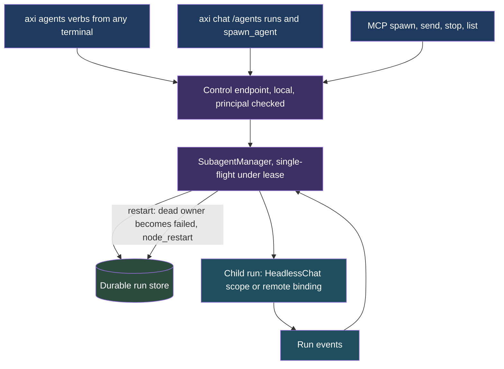
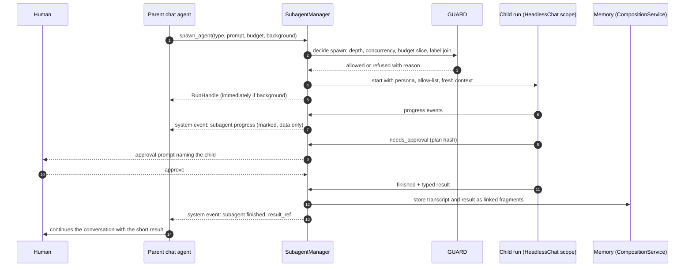
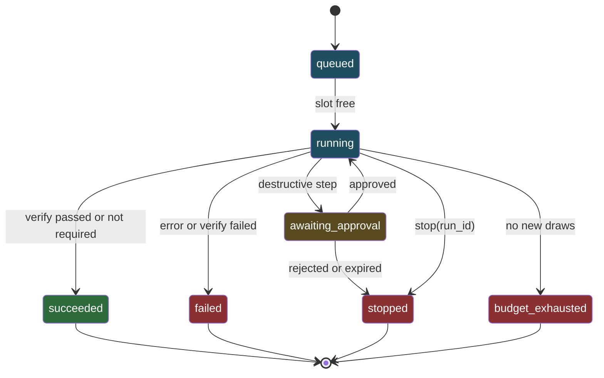

# ADR-233: Chat spawns subagents through one manager and one run handle

**Status:** Proposed (2026-10-31)
**Related:** [ADR-232](adr-232-capabilities-may-be-agent-backed-and-dispatch-is-a-recorded-verdict.md) (agent-backed capabilities, dispatch verdict; this ADR is its companion), [ADR-061](adr-061-agent-call-protocol.md) (A2A substrate), [ADR-056](adr-056-skill-as-function.md), [ADR-072](adr-072-capability-projection.md), [ADR-006](adr-006-mcp-agentic-access.md) and [ADR-038](adr-038-builtin-mcp-server.md) (MCP access), [ADR-168](adr-168-chat-states-where-every-answer-came-from-and-enforces-it.md), [ADR-185](adr-185-tools-declare-what-they-need-and-make-and-vetted-chains-are-published-as-recipes.md) (plan hash), [ADR-201](adr-201-routing-is-a-verdict-then-seats-guard-removes-options-graduated-seats-rank-the-rest.md) (model class, verdict), [ADR-027](adr-027-federated-memory.md) and [ADR-028](adr-028-trust-graph.md), [prd-capability-budgets](../prds/prd-capability-budgets.md) (spawns draw from the parent), [prd-chat-harness](../prds/prd-chat-harness.md) (`/fork`, session commands), [spec-axiom-schedule](../specs/spec-axiom-schedule.md) (lease substrate)
**PRD:** [prd-agent-backed-capabilities-and-subagents](../prds/prd-agent-backed-capabilities-and-subagents.md)
**Extended by:** [ADR-234](adr-234-model-selection-is-the-second-axis-of-dispatch-guard-removes-models-seats-rank-them-external-routers-are-providers-behind-a-seat.md) (model selection as the second axis of the same dispatch)

## Context

The leading coding harnesses let the main agent hand a bounded job to a child agent with a fresh context, so the parent keeps its window for the conversation and receives a short result. `axi chat` has the pieces but no primitive:

- `delegate()` (`src/axiom/agents/delegation.py`) runs one synchronous `HeadlessChat` turn under another persona. It is bounded (`MAX_DELEGATION_DEPTH = 2`, 120 s deadline, request and answer length caps) but has no run identity, cannot run in the background, cannot be stopped or messaged, and returns only text.
- `HeadlessChat` (`src/axiom/extensions/builtins/chat/headless.py`) mints an isolated `ChatScope` per request with a required `turn_deadline`, `max_tool_rounds` and a deny-by-default `NonInteractiveApprovalPolicy`. That is the right execution core.
- `/fork` (`.../chat/commands_ext/fork_cmd.py`) copies a session; it does not start a second agent.
- `/agents` (`.../chat/commands_ext/agents_cmd.py`) lists always-on agent services with liveness. It does not list runs.
- `LeaseManager` (`src/axiom/extensions/builtins/schedule/lease.py`) is a single-node leader lease, not a run scheduler. What the schedule extension offers for ad hoc background work was not verified. See open question 1.
- `prd-capability-budgets` requires that a spawn draws a slice of the parent's budget. No budget envelope exists on `CapabilityToken` in this tree (`src/axiom/governance/capability.py`).

ADR-232 makes an agent run a capability call with a contract, a budget and a verdict. A chat subagent is the same thing started from inside a conversation, with a lifetime that can outlast one turn. This ADR defines the chat side. It does not redefine the contract.

## Decision

**`axi chat` gains one primitive, `spawn_agent`, backed by one `SubagentManager` and one `RunHandle` interface for local and remote runs.** Eleven parts.

### 1. The primitive

```
spawn_agent(type, prompt, model_class?, tools?, background?, isolation?, fork?, budget?) -> RunHandle
```

- `type` is an agent persona from extension manifests (AEOS §4.1), resolved by the same roster `delegate()` uses. A generic `worker` persona is the fallback with an empty tool list.
- `model_class` follows ADR-201 vocabulary; `tools` can only narrow the persona's allow-list, never widen it.
- `background` false (default) blocks the parent until the child finishes. True returns the handle at once.
- `isolation` is `none` or `worktree` (part 8).
- `fork` false (default) starts a fresh context: the child sees only `prompt` and its persona. True copies the parent's transcript up to now, using the same mechanism as `/fork`, and is allowed only when the label join of the parent context permits the child's model placement.
- `budget` is a request, clamped to a slice of the parent's remaining budget (part 6).

`spawn_agent` is a registered capability under ADR-056 (`chat.spawn_agent`), so it is projected to the agent-tool list and, where policy allows, MCP (part 9) from one registration, and a call to it is a dispatch under ADR-232: the guard can remove it, and a decision record is written.

### 2. The manager

A `SubagentManager` in the chat extension owns runs. A run holds:

| Field | Meaning |
|---|---|
| `run_id` | generated, never supplied by a caller |
| `parent_id` | the parent run or the chat session id |
| `depth` | parent depth plus one; shares the `delegation_depth()` counter |
| `type`, `persona` | the resolved agent |
| `principal` | the caller's principal; the run acts as it with the persona intersection (ADR-232 part 5) |
| `state` | `queued`, `running`, `awaiting_approval`, `succeeded`, `failed`, `stopped`, `budget_exhausted` |
| `budget` | granted and drawn: turns, tokens, dollars estimate, wall clock |
| `transcript_ref` | pointer to the stored transcript |
| `result_ref` | pointer to the typed result fragment |
| `binding` | `local` or `remote` |

The manager also holds an event bus for run events (`started`, `progress`, `needs_approval`, `finished`) and exposes three verbs as skill functions: `send(run_id, message)`, `stop(run_id, reason)`, `list(filter)`. In the TUI these are the runs view. The name collision with `/agents`, which already lists services, is handled by making the runs view `/agents runs` and keeping `/agents` as is (decided 2026-10-31, owner).

### 3. One run interface for local and remote

`RunHandle` has `status()`, `events()` (stream), `send(msg)`, `stop()`, `result()`. A local run wraps a `HeadlessChat` scope. A remote run wraps an ADR-232 remote binding (MCP-HTTP or A2A task). The manager and the parent cannot tell them apart except by the `binding` field and by the placement shown to the person (ADR-168). `RunHandle` is also the task handle ADR-232 part 6 requires for long calls.

### 4. Context, transcripts and memory

Fresh context is the default because the purpose is to save the parent's window. The parent receives the child's typed result and a summary of at most a declared length, never the transcript. The transcript is stored as memory fragments written through `CompositionService.write` with `delegation_chain` set to the parent chain, linked parent to child by fragment reference, and with the same `(T, U, A, R)` provenance as any write. A fork copies the parent's context at spawn time and records the fork point. A reviewer can open the parent, follow the link, and read the child's full trace.

### 5. Completion and progress are system events, never user input

Events from children are delivered to the parent as messages with a distinct system role and a fixed envelope: `{kind: "subagent_event", run_id, event, summary, result_ref}`. The renderer shows them as marked system lines. The parent model sees them in a data channel that carries no instruction authority, the same posture as tool results (ADR-232 part 5). A child cannot make a parent turn begin by emitting text that looks like a person's message, because the envelope is added by the manager and not by the child, and a child's output is escaped before it is placed in the summary.

### 6. Policy and limits

- **Concurrency:** at most 3 running children per parent by default; a setting raises or lowers it. Excess spawns queue (`queued`) and do not fail.
- **Depth:** the existing depth cap applies and is shared; a child at the maximum depth has no `spawn_agent` in its tool list.
- **Budgets:** a child's budget is a slice of the parent's remaining budget and the sum of children cannot exceed the parent's grant (prd-capability-budgets R2). Exhaustion stops new draws at a step boundary and never kills a write mid-action (R4). A warning fires at the configured threshold (R5).
- **Approvals bubble up.** A child with a destructive step opens a plan on the approval queue (ADR-185) and moves to `awaiting_approval`. The prompt appears to the human in the parent session with the child's identity on it. A child never approves on its own authority, and a background child with no human attached stays paused. The default approval policy for a child is the deny-by-default `NonInteractiveApprovalPolicy` of `HeadlessChat`.
- **Verification:** a child's reported success is subject to the capability's `verify` check (ADR-232 part 6). A child spawned as a free-form `worker` with no verify step reports its result as `unverified`.

### 7. Scheduling

Background runs execute on the schedule substrate, with a lease per run for single-flight and recovery, rather than on ad hoc threads, so a restart finds the runs in the durable store and marks orphaned ones `failed` with a cause instead of losing them. Whether the substrate supports one-off run scheduling or needs a small extension is unverified (open question 1). Until it does, P1 runs are synchronous and in-process only.

### 8. Isolation for code-editing agents

`isolation: worktree` gives the child its own git worktree off the parent's current branch, with the child's tool root set to it. The worktree is removed on completion when it has no changes, and kept with its path reported when it has. Merging a child's changes is a normal approved write by the human or by the parent through the plan-hash path; the manager never merges. A child may not enter a worktree it did not create (the standing rule that agents do not remove containers or resources they did not create applies equally here).

### 9. MCP exposure

`spawn`, `send`, `stop` and `list` are exposed over MCP so an external harness can use Axiom's subagents, subject to the ADR-114 identity gate and the guard. Two guards apply: an MCP-originated spawn counts as depth 1 even if the calling harness is itself a subagent, and a spawn originating from an MCP call made by an Axiom-spawned run is refused (`double_nesting`), since that would let two systems each believe the other holds the depth counter. A spawn over MCP returns a `RunHandle` id; progress is by `list` and `status` polling unless the client supports native MCP progress or tasks. The `RunHandle` is the internal interface built first (H1 in ADR-232 part 6); the `status` poll tool is the guaranteed fallback (H2); native MCP progress and tasks come later, verified by test per client (H3).

### Phasing

P1: synchronous subagent as a tool, fresh context, allow-list, budget, depth. P2: background runs, system-event notifications, send and stop, the runs view, the concurrency cap. P3: remote binding and federation trust (ADR-028), MCP exposure. P4: fork, worktree isolation, and an eval harness for subagent traces.

### 10. Node service and run verbs from any terminal

Runs must outlive the command and the chat process. The `SubagentManager` is therefore a **node service**, not an object owned by `axi chat`. Chat and the CLI are both clients of it. P1 (synchronous, in-process) still uses the same manager class; what changes in P2 is where it is hosted.

**Verbs.** CLI nouns are purpose-named and verbs are imperative with the resource as a positional (`spec-aeos-0.1.md` section 4.3.1; `docs/working/cli-verb-grammar-audit-2026-05-30.md`). The extension that owns agents already owns the noun `agents` (`src/axiom/extensions/builtins/agents/axiom-extension.toml`, `noun = "agents"`) with verbs `status`, `start`, `stop`, `logs`, `register`, `unregister`, `info`, `roster`, `ask` (`src/axiom/extensions/builtins/agents/cli.py`; verified 2026-10-31). `status` and `stop` there act on always-on agent services by name. The repo-correct verbs are:

| Command | Meaning | Note |
|---|---|---|
| `axi agents list runs [--state S] [--json]` | List runs | `runs` is a positional resource, because a bare `runs` verb breaks the grammar rule |
| `axi agents status <run_id>` | State, budget drawn, last events of one run | the existing `status [name]` accepts a run id; run ids carry the `run_` prefix, so they cannot be mistaken for an agent name (collision-freedom not checked, open question 4) |
| `axi agents stop <run_id>` | Stop a run at the next step boundary | same overload of the existing `stop [name]` |
| `axi agents send <run_id> <message>` | Deliver a message to a running or paused run | new |
| `axi agents wait <run_id> [--timeout S]` | Block and stream progress to stderr; exit status per ADR-232 8.4 | new |

The chat TUI keeps `/agents runs` as the runs view (decided 2026-10-31); `/agents` is unchanged. Each verb is a skill function on the manager (part 2), so the CLI, the TUI view, and the MCP tools of part 9 are projections of one registration. All of them exit and render per ADR-232 part 8: `--json` uses the same envelope, exit 8 means "run not finished".

**Start and discovery.** The service is single-flight per node. Discovery is a local control endpoint owned by the service and published in the node state directory (location not decided; open question 5), guarded by the node's existing principal checks. Single-flight uses the schedule substrate: `LeaseManager` (`src/axiom/extensions/builtins/schedule/lease.py`) is a single-node leader lease. Note the existing `background_service_main` in `src/axiom/agents/background_service.py` is a timer-fired tick that dispatches due heartbeats, not a resident process, and it is gated by the autonomy setting (default off); the run service is a distinct resident service and does not piggyback on that tick.

**No service running.** Behavior depends on the command:

- `--detach`, `send`, `stop`: need the service. If the setting `agents.runs.autostart` is on (default on for a human on a TTY, off otherwise), the CLI starts it on demand and retries once. If not, it returns `unmet: run_service_unavailable` with the start command in `fix` (exit 5). It never silently runs a detached job in a dying process.
- `--wait`: runs through the same manager class embedded in the command process if no service is up. The run is written to the same durable store, but it cannot be controlled from another terminal and it ends with the command. The envelope marks `hosted: "embedded"`.
- `list runs` and `status`: read the durable store directly when the service is down, so history is visible, and report the service as down.

**Persistence and recovery.** Run records are durable (fields in part 2, plus owner process and start time). On service start the manager reconciles in the owner-aware way the schedule engine already does for pending fires (`src/axiom/extensions/builtins/schedule/recovery.py`: a row whose owner process is dead is an orphan; one whose owner is alive is left alone): runs in `running` with a dead owner become `failed` with cause `node_restart`; the run is never silently re-run, because a half-finished write must not repeat. Runs in `awaiting_approval` and `queued` survive a restart unchanged. Where the run records live is open question 6: the schedule store (the schedule API already has a `one_shot` cadence kind, `src/axiom/extensions/builtins/schedule/api.py`), or the `axi tasks` store (`src/axiom/infra/tasks/models.py`, which tracks OS process tasks by pid and node id). Neither was checked for fit.



### 11. Evaluation

Subagents are evaluated as the same capability calls as ADR-232 part 9, plus what is specific to runs. The target is the run and its dispatch record, not the surface that started it.

- **Layer 1 (spawn as a capability):** call `chat.spawn_agent` through the dispatcher with recorded-model replay; assert the guard outcome (depth, concurrency, budget slice, label join), the run's final state, budget drawn, and the result schema. Live scheduled runs with pinned models catch drift.
- **Layer 2 (conformance):** the same spawn through chat, MCP and the CLI wrapper yields the same verdict and run record; and a spawn from an Axiom-spawned run over MCP is refused (`double_nesting`) on every surface.
- **Layer 3 (run specific):** child events reach the parent only as marked system events and never as user input, including against a child whose output imitates a person's message; an approval from a child bubbles with the child's identity; `stop` leaves no half-finished write; a restart marks orphans `failed` with `node_restart` and keeps `awaiting_approval` runs; CLI goldens for exit codes and `--json` for each run verb.
- **Layer 4 (verifier):** a child that reports success when the effect is absent is caught by the capability's verify; a free-form `worker` with no verify reports `unverified`.
- **Metrics:** run success rate by state, context saved per call, cost per verified outcome, sliced by `surface` and `client`. Golden sets live with the ADR-232 home (`src/axiom/evals`, `tests/evals/`).

## Spawn and event flow



## Run states



## Options considered

- **Reuse `delegate()` as is.** It is synchronous, has no identity, and cannot be stopped; it stays as the implementation of the P1 local runner and is wrapped, not replaced.
- **Threads per child.** Loses runs on restart and cannot be audited. Rejected for the schedule substrate.
- **Deliver child output as an ordinary assistant message.** It would let a child's text steer the parent as if the parent had said it. Rejected for the marked system event.
- **Let children approve their own destructive steps within budget.** Rejected: budgets bound spend, not harm.

## Consequences

- The chat extension gains the manager, the run store and the runs view. The `chat.spawn_agent` registration brings subagents under the ADR-232 verdict and record.
- Transcript storage grows with use. A retention rule for child transcripts is needed and is not set here (open question 2).
- `/agents` semantics must stay stable for current users; the runs view is additive.
- Concurrency and depth defaults are conservative on purpose; the first release will feel limited, which is the intended trade against the cost-runaway failure.

## Decisions recorded

- **Runs view name (decided 2026-10-31, owner):** `/agents runs`. `/agents` is unchanged.
- **Budget slice prerequisite (decided 2026-10-31, owner):** a spawned run's budget slice requires the `CapabilityToken` budget envelope (A0, ADR-232 part 5), which is absent today. S1 depends on A0; the child's envelope is the intersection of the parent's remaining amounts and the requested slice.
- **Node service and CLI verbs (decided 2026-10-31, owner):** the `SubagentManager` is a node service so runs outlive commands; `axi agents list runs|status|stop|send|wait` are available from any terminal and `/agents runs` stays the TUI view; the CLI never prompts (ADR-232 part 8).
- **MCP progress and tasks (decided 2026-10-31, owner):** absent today (verified). `RunHandle` first, `status` poll tool as the fallback, native MCP and A2A mappings later as test-verified milestones (ADR-232 part 6).

## Open questions

1. Does the schedule substrate support ad hoc one-off background jobs with a lease per job? Partly answered: the schedule API has a `one_shot` cadence kind and `recovery.py` reconciles orphaned fires by owner liveness, but a per-run lease and a run-shaped record were not verified (see open question 6).
2. Retention of child transcripts and who may read them.
3. Whether `fork: true` is allowed at all when the parent context holds any non-public label.
4. Are `run_` ids collision-free against agent names, so overloading `status` and `stop` is safe? Or should the run verbs be `show` and `cancel`-style names under a separate positional?
5. Where is the control endpoint published in the node state directory, and what authenticates a local client?
6. Which store holds run records: the schedule store or the `axi tasks` store, or a new table?
7. `--stop-on-interrupt` default for `wait` (ADR-232 open question 8).
