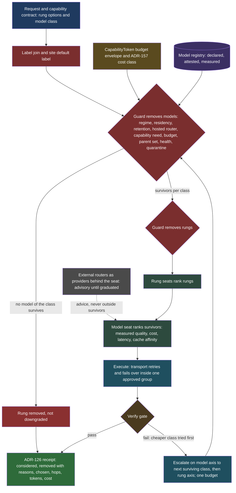

# ADR-234: Model selection is the second axis of dispatch: the guard removes models, seats rank them, and external routers are providers behind a seat

**Status:** Proposed (2026-10-31)
**Related:** [ADR-201](adr-201-routing-is-a-verdict-then-seats-guard-removes-options-graduated-seats-rank-the-rest.md) (verdict then seats; decision 9 model class and capability card; decision 20 rung then model), [ADR-232](adr-232-capabilities-may-be-agent-backed-and-dispatch-is-a-recorded-verdict.md) (dispatch verdict, escalation, budget envelope), [ADR-233](adr-233-chat-spawns-subagents-through-one-manager-and-one-run-handle.md) (subagents), [ADR-071](adr-071-llm-first-class-core-primitive.md) (`llm` is a core primitive, the gateway routes), [ADR-157](adr-157-the-serving-tier-bounds-what-any-one-call-can-cost.md) (cost at one door), [ADR-126](adr-126-typed-decision-receipts.md) (typed decision receipts), [ADR-054](adr-054-llm-tier-policy.md) (model classes), [spec-model-routing](../specs/spec-model-routing.md) §13 (ModelStrategy), §14 (`auto`), §15.6, §15.14 (capability cards and the solve), [spec-decision-providers](../specs/spec-decision-providers.md) (seats, graduation), [llm-routing-landscape-2026-10](../reference/llm-routing-landscape-2026-10.md), [prd-capability-budgets](../prds/prd-capability-budgets.md)
**PRD:** [prd-agent-backed-capabilities-and-subagents](../prds/prd-agent-backed-capabilities-and-subagents.md) (phases M0 to M4)

## Context

ADR-232 made the choice of execution rung (deterministic, agent, remote) a recorded verdict, and ADR-201 decision 20 said that once a rung that calls a model is chosen, `ModelStrategy.resolve_assembly` picks the model for the contract's model class under the same verdict filter. That sentence is all the dispatch design says about models. The owner's review on 2026-10-31 named the gap: model selection is a dimension of dispatch, not a footnote to it, and the design should start from the work already done by OpenRouter and the open-source routing libraries rather than invent its own.

What exists in the tree, verified 2026-10-31 by reading the code:

- `ModelStrategy` (Protocol) and `BaseStrategyResolver` in `src/axiom/agents/strategy/` already implement a filter-then-sort resolution per role (`ROUTER`, `PLANNER`, `EXECUTOR`, `VERIFIER`, `EMBED`, `RERANK`, `DEFAULT`). The filters are classification clamp, network reachability, cohort constraints, user forbid, per-role budget, and health. The sort is user preference, role hint, then cost. `ModelContext` already carries `classification`, `budget_remaining_usd`, `tier_hint` (`simple`, `standard`, `smart`, `smartest`), and optional federated endpoints. `ResolvedAssembly.to_audit_payload()` renders a rationale. `ProviderSpec` has only `name`, `tier`, `model`, `estimated_cost_per_1k_tokens_usd`, `role_hints`, `requires_vpn`.
- `LLMProvider` in `src/axiom/llm/gateway.py` carries `routing_tier`, `routing_tags`, `placement`, optional `cost_per_1k_input`/`cost_per_1k_output` (unconfigured means "unpriced", never "free"), `context_window`, `tool_mode`, and a `transport` of `direct` or `litellm`. A `litellm` provider is a whole per-tier router group, and the gateway deliberately does not fan out across its own list inside that tier (RATIONALIZE-4). The serving extension (`src/axiom/extensions/builtins/llm_serving/`) already runs vLLM behind a LiteLLM gateway.
- `src/axiom/llm/tier_policy.py` (`admits`), `placement.py` (local, cloud, remote-node), `health.py` and `routing_health.py` exist.
- Not found in the tree: any record of OpenRouter beyond a host name in `placement.py`; any circuit breaker or cooldown in `gateway.py`; any prompt-cache or session-affinity logic in `gateway.py`; any registry field for ZDR or data policy, structured-output support, vision, or measured quality per capability class; any cascade on a failed verify; any per-model eval table. `spec-model-routing` §15.6 and §15.14 specify capability cards, a need vector, and a solve with cascades expressed in the same utility, all Proposed and none built.

So the platform has a working filter-and-sort for models and a transport seam, and has specified but not built the registry, the measured side of the card, cascades, and model-level receipts. This ADR decides how those fit the dispatch pipeline, and which pieces to build or take from outside.

## Landscape

Gathered 2026-10-31 from the pages linked in each row, plus repository metadata read from the GitHub API the same day (license identifier, last push). "Unverified" marks a claim taken from a secondary source or not confirmable from the primary page. Fit for restricted deployments is this ADR's judgment, not the project's claim.

| Project | Routes on | License | Self-hostable | Maintenance (GitHub, 2026-10-31) | Integration surface | Fit for export-controlled or residency-bound sites |
|---|---|---|---|---|---|---|
| [OpenRouter](https://openrouter.ai/docs/features/provider-routing) | Default balance of price, throughput, time to first token, reliability; `sort` by price, latency or throughput; `max_price`; `preferred_max_latency`; provider `only`/`ignore`/`order`; `allow_fallbacks`; `require_parameters`; `quantizations`; `data_collection: deny`; `zdr: true` | Hosted service (proprietary) | No | Hosted; n/a | OpenAI-compatible HTTP; request-level provider object | Hosted third-party processor plus onward providers. Its ZDR and data-collection flags are the provider's claims, not attestations. Must be removable by the guard. |
| [OpenRouter Auto Router](https://openrouter.ai/docs/model-routing) | Learned prompt analysis by NotDiamond; `plugins: auto-router` with `allowed_models` patterns; `cost_quality_tradeoff` 0 to 10; pins model and provider per session; no extra fee over the chosen model | Hosted service | No | Hosted; the exact candidate pool "may be updated" (docs) | Model id `openrouter/auto` | As above, and the prompt is read by an additional router. Non-regulated labels only. |
| [RouteLLM](https://github.com/lm-sys/RouteLLM) ([paper arXiv 2406.18665](https://arxiv.org/abs/2406.18665)) | Learned strong-versus-weak: `mf` (matrix factorization, recommended), `bert`, `causal_llm`, `sw_ranking`; a threshold set by `calibrate_threshold` for a target share of strong calls | Apache-2.0 | Yes | Last push 2024-08-10; no releases listed; 5.7k stars. Treat as unmaintained. | Python library; OpenAI-compatible server selected via the `model` field (`router-mf-0.5`) | Runs locally; no data leaves. Trained on one model pair (README says it "generalizes"); needs recalibration on our own queries. |
| [LiteLLM](https://github.com/BerriAI/litellm) ([routing docs](https://docs.litellm.ai/docs/routing)) | Load balancing (`simple-shuffle` default, latency-based, usage-based, lowest-cost), retries, fallbacks, cooldowns, timeouts; proxy adds virtual keys, spend tracking, guardrails | Mixed: repository license reads `NOASSERTION` in the API; the README names a Commercial License for enterprise features (core is commonly described as MIT; unverified) | Yes | Active (release v1.106.6, 2026-10-28; 62k stars). Versions 1.82.7 and 1.82.8 on PyPI were malicious on 2026-03-24 ([InfoQ](https://infoq.com/news/2026/03/litellm-supply-chain-attack/), [NetSPI](https://www.netspi.com/blog/executive-blog/ai-ml-pentesting/litellm-supply-chain-compromise/); accounts of the entry vector disagree). | Python SDK and OpenAI-compatible proxy | Self-hosted, so residency is ours. Routing is cost, latency and load, never labels. Pin by hash. Already present in the serving stack. |
| [vLLM Semantic Router](https://vllm.ai/blog/vllm-sr-iris) ([arXiv 2603.04444](https://arxiv.org/html/2603.04444v1)) | Signals (domain, keyword, embedding, factual, feedback, preference) combined by AND/OR decision rules and priority; also safety and caching plugins | Apache-2.0 | Yes | Active (push 2026-10-31; 6.4k stars) | Envoy external processor; `pip install vllm-sr`; Helm chart | Local models only; strong fit for the intent and domain seats. A serving-side proxy, so a deployment choice, not a library import. |
| [NVIDIA LLM Router blueprint](https://build.nvidia.com/nvidia/llm-router/blueprintcard) and [NeMo Switchyard](https://github.com/NVIDIA-NeMo/Switchyard) | Blueprint: BERT task and complexity classifier behind a Rust proxy on Triton. Switchyard: typed, composable routing algorithms, OpenAI and Anthropic format translation, operational metrics | Blueprint repo Apache-2.0 per API, but the product page cites NVIDIA license terms and the classifier model has its own license (sources disagree; read the files); Switchyard Apache-2.0 | Yes | Blueprint repo marked deprecated in favor of Switchyard (push 2026-07-24). Switchyard active (push 2026-10-31); its PyPI release lagged the repository per one aggregator (unverified) | Rust library and proxy; pip `nemo-switchyard`; LiteLLM plugin path | Local; strong candidate for the transport and algorithm layer, young. |
| [Aurelio semantic-router](https://pypi.org/project/semantic-router) | Embedding similarity to example utterances (static routes), optional LLM parameter extraction (dynamic routes) | MIT (one directory disputes that the README states it; read the LICENSE) | Yes | Active (push 2026-10-22; 4.0k stars) | Python library; pluggable encoders | Local with a local encoder. A cheap intent classifier, not a model router. |
| [Arch-Router and Plano (formerly archgw)](https://arxiv.org/html/2506.16655v1) | A 1.5B model maps a query to user-written domain or action preferences, then to a model | Gateway repository Apache-2.0 per API; the Arch-Router model is under a custom Katanemo license (terms not read) | Yes | Gateway repository (now `katanemo/plano`) active, push 2026-10-24 | Rust proxy; model weights on Hugging Face | Local. Preference-written routing maps well to a seat; the model license blocks assuming redistribution rights. |
| Gateways: [Portkey](https://github.com/Portkey-AI/gateway), Helicone, [Kong AI Proxy Advanced](https://developer.konghq.com/ai-gateway/load-balancing/) | Config-driven fallbacks, retries, load balancing, conditional routing on metadata (Portkey); observability (Helicone); semantic, weighted, lowest-latency, lowest-usage, priority balancers (Kong) | Portkey MIT; Helicone Apache-2.0; Kong Apache-2.0 for the gateway (AI Proxy Advanced is a plugin; its license tier was not checked) | Yes | Portkey last push 2026-05-25 and reports of a stalled 2.0 after acquisition (unverified); Helicone active; Kong active | Proxy with OpenAI-compatible endpoints | Self-hosted fits residency. They route on cost, latency and metadata, not on data labels. Overlaps LiteLLM. |
| [Not Diamond](https://docs.notdiamond.ai/) and Martian (commercial) | Learned routing; Not Diamond trains custom routers from your evaluation data (async, per its SDK) | Proprietary | Enterprise VPC deployment advertised for Not Diamond; terms not verified. Martian not verified. | Commercial | Hosted API and SDKs | Hosted routers read the prompt. Removable by the guard; never for regulated labels unless a VPC contract is attested. |
| [FrugalGPT](https://arxiv.org/abs/2305.05176) cascades (and [RouterBench arXiv 2403.12031](https://arxiv.org/abs/2403.12031), [routing and cascading unified, arXiv 2410.10347](https://arxiv.org/abs/2410.10347)) | Try cheap first, score the answer, escalate on a low score | Papers | n/a | n/a | Technique | Technique carries over; the scorer must be our verify gate. |
| OpenAI and Anthropic native routing | OpenAI describes a real-time router among fast and thinking models inside ChatGPT (secondary sources only; whether the API exposes an auto mode is contradicted across sources). Anthropic: not verified in this pass. | n/a | No | n/a | n/a | Not verified; no design depends on it. Provider-side routing is invisible to the guard, so it is treated as one opaque model. |

How learned-router quality was validated, where stated. RouteLLM's README claims up to 85 percent cost reduction while keeping 95 percent of GPT-4 quality on MT-Bench, and names MMLU and GSM8K as other evaluation sets; its routers are trained on Chatbot Arena preference data. FrugalGPT's abstract claims matching GPT-4 with up to 98 percent cost reduction, or 4 percent higher accuracy at equal cost. These are the authors' own results on public benchmarks; independent replication on enterprise workloads was not found in this pass. That is the reason this ADR makes every learned router advisory until it graduates on Axiom's own evaluation (decision 5).

## Decision

**Choosing a model is the second axis of the dispatch decision, made by the same pipeline: the guard removes models, seats rank the survivors, the choice is recorded in the same receipt.** Nine parts.

### 1. One pipeline, two axes

The dispatch of ADR-232 chooses a rung. For a rung that calls a model, the same verdict now also yields the survivor set of models. The order is fixed:

1. The label join and guard compute the surviving models for each model class the capability's contract names, using the registry (part 2). This runs before rung selection because ADR-201 decision 20(a) removes a rung when no model of its class survives.
2. The rung seats rank the surviving rungs (ADR-232 part 2).
3. For the chosen rung, the model seats rank that class's surviving models (part 4).
4. Execution, verify, and escalation (part 6). A failed verify may move along the rung axis, the model axis, or both, drawing one shared budget.
5. One ADR-126 receipt records both axes (part 8).

The existing `ModelStrategy` is the model-axis resolver. It is extended, not replaced: the registry feeds `ProviderSpec`, the new guard filters join the existing filter list, and `resolve_assembly` gains the survivors-and-reasons output the receipt needs.

### 2. The model registry

Model class in a declaration (`simple` to `smartest`, ADR-201 decision 9) never names a concrete model. It resolves through a registry whose entry is the capability card (spec-model-routing §15.6) for a model. Two kinds of field, kept apart as ADR-201 decision 9 requires:

| Group | Fields | Source |
|---|---|---|
| Declared (hash-pinned snapshot, may satisfy a minimum, never raise a fit score) | provider, model id and version/alias, kind (`local`, `site`, `hosted`, `hosted_router`, `peer`), price in and out (absent means unpriced), context window, max output, tool use, parallel tools, structured output, vision, reasoning-effort range, quantization, cache-read price | Provider pages and a vendor-neutral price table used as a prior. LiteLLM's community price and capability table is one acceptable source; it is data, read as a pinned snapshot, never imported at runtime. |
| Attested (first-party only) | regimes the processor may receive, retention (ZDR yes or no), training use, region, onward processors | The processor agreement, as `spec-model-routing` §15.7 requires. An aggregator's listing is never attestation. |
| Measured (per capability class, site-scoped) | quality per (capability class, intent) cell with sample size and eval set id; tool-call reliability; latency p50/p95 on this site; cache hit rate; error rate | Axiom's own evals and live receipts (part 9). Only a measured value may raise a fit score. |

An entry of kind `hosted_router` (OpenRouter, a commercial router) is a processor whose onward providers are not under our agreements. It carries the attested facts of the router itself and the declared, unattested facts of what it forwards to. The registry is a table in the existing configuration store, loaded into `ProviderSpec`; there is no second configuration path next to `models.toml`.

### 3. The guard removes models

A model is removed, with a reason code, when any of these holds. Removal fails closed per option (ADR-201 decision 10): an input that cannot be resolved removes that model, not the request.

| Check | Removes a model when | Existing hook |
|---|---|---|
| Label and regime | the join's strictest label is not in the entry's attested regimes | `_is_classification_compliant`, `tier_policy.admits` |
| Placement and residency | placement or region is outside the site, capability or token residency | `placement.py`, `data_residency` (ADR-232 part 1) |
| Deployment tier | the deployment forbids hosted processors, or forbids `hosted_router` | `CohortModelPolicy.required_provider_class` |
| Retention | the label or token needs zero retention or no training and the entry's attested retention does not say so | new |
| Hosted router | kind is `hosted_router` and the label is non-public, or the site setting forbids third-party routers. A hosted router is never an exception to the label rule because it forwards the prompt to providers the site has no agreement with. | new |
| Capability need | the call needs tool use, structured output, vision, a context length, or an output length the entry does not declare | new; `require_parameters` in OpenRouter's vocabulary is the same idea |
| Budget | the entry's expected cost (price times estimated tokens) exceeds what remains on the `CapabilityToken` envelope, or the class floor exceeds the per-call cap | `_passes_budget`, ADR-157, A0 |
| Parent set | a subagent's model is outside its parent's allowed set (part 7) | new |
| Health | the circuit for the entry is open (part 5) | `_is_healthy` |
| Regression quarantine | the model is quarantined by a failed regression gate (part 9) | new |

Removal reasons are kept as codes, not prose, in the receipt (part 8).

### 4. Seats rank the survivors

Ranking is a seat, `model-fit`, with the standing rules of spec-decision-providers: shadow, advisory, active, by evidence per site. The default provider is the existing deterministic order (user preference, role hint, cost) plus these features, each recorded:

- measured quality for the capability class, when measured; otherwise declared class order with a recorded `unmeasured` flag;
- expected cost and cost against the remaining envelope;
- predicted latency against the time budget;
- stickiness (part 4a);
- health and recent error rate.

**4a. Cache affinity is a ranking feature, not a rule.** A session or agent run that has paid for a cached prefix on a model gains a bounded bonus for staying on it, sized from the registry's cache-read price against the input price. The bonus can never re-admit a removed model, and it does not apply once the class changes. OpenRouter's Auto Router pins model and provider per conversation for the same reason ([docs](https://openrouter.ai/docs/model-routing)). Verified absent in `gateway.py` today.

### 5. External routers are providers behind a seat

A learned or semantic router answers a closed question: given the survivors and the request, return a ranking or a suggested class. It never returns a model outside the survivors. The adapter enforces that, drops any answer that violates it, and records the drop.

| Provider | Seat | Where it may run |
|---|---|---|
| RouteLLM `mf` (or a router trained on our own data) | `model-fit` difficulty advice: strong or weak | local only |
| vLLM Semantic Router signals, Aurelio semantic-router, Arch-Router style preference routes | `request-intent` and `topic` (ADR-201 seats) | local only |
| OpenRouter Auto Router, commercial routers | `model-fit` advice | only where the guard keeps a `hosted_router` entry (non-public labels never) |

An external router is advisory (shadow, then advisory) until it graduates by evidence from Axiom's own evaluation: its pick compared with the default on our paired eval set, with cost and quality both reported, per capability class. Published benchmark results do not promote anything. The threshold of a strong-or-weak router is calibrated on our queries, as RouteLLM's own tool recommends. When the guard keeps a hosted router, its parameters are produced from the guard's output, not written by hand: survivors become the `allowed_models` or `only` list, the retention need becomes `zdr: true` and `data_collection: deny`, capability needs become `require_parameters: true`, and the cap becomes `max_price`. The hosted router then cannot choose what the guard removed, and the adapter still checks the returned model against the survivors.

### 6. Cascade is the model-axis escalation

A cascade policy tries a model of a lower class, runs the capability's verify gate, and on a failed verify escalates to the next class that survived the guard. This is FrugalGPT's cascade with Axiom's verifier as the scorer, and it is the model-axis analogue of the rung escalation of ADR-232 part 3. The two share three things:

- **One verify gate.** The same deterministic check and verifier executor. No second judge is introduced.
- **One budget.** Every hop draws the same envelope. An escalation whose floor exceeds the remainder is not taken; the call returns `unverified` or `budget` as ADR-232 defines.
- **One escalation record.** Each hop is an entry in the receipt: from, to, evidence (the failed check), cost drawn.

Rules: the cascade's candidate path is fixed from the survivor set computed at the start, so an escalation can never reach a model the guard removed; if a label changes mid-run, the survivor set is recomputed and a no-longer-allowed model ends the cascade; the maximum number of hops is a contract field; escalation on the model axis happens before escalation on the rung axis unless the contract says otherwise, because a stronger model is cheaper than a stronger rung. A cascade starts in shadow: the cheap model answers a sample, the default model serves, and the comparison feeds part 9.

### 7. Subagents, local models, and remote bindings

- **Subagents.** A child's allowed model set is the intersection of its own contract's set and its parent's survivor set, and its class ceiling is no higher than the parent's. A child cannot name a model; it names a class and the same pipeline resolves it. The budget slice (ADR-233) bounds its spend, so a child that cascades draws from its slice.
- **Local versus hosted.** Placement is a registry field. A local model is priced at zero only because its placement derives it (existing convention), and the solve degenerates to the single local model with no extra call or wait on a site that has one, which keeps the public-parity guarantee of ADR-232. Local models are always eligible for the labels that hosted ones lose; the guard may leave a local model as the only survivor and that is a normal outcome, not an error.
- **Remote binding.** A remote agent runs its own dispatch and chooses its own model. The local guard constrains it through the contract (`model_class` ceiling, `data_residency`) and requires the remote receipt to be returned and recorded by reference. The model the remote reports is recorded as reported and marked unverified by the caller.

### 8. Reliability, accounting, and the receipt

- **Fallback, retry and circuit breaker are per provider and belong to the transport, but a fallback that changes the processor is a new model selection.** Within one homogeneous group (one label set, one placement, one retention class) the transport may retry and fail over freely; this is what the `litellm` transport already assumes. A fallback to an entry outside the group goes back through the guard. A transport must never be configured with a fallback list that crosses a label boundary. The circuit breaker state (open, half-open, closed, with error-rate and latency inputs) feeds the guard's health check; there is none in `gateway.py` today.
- **Accounting.** Every model call reports input, output and cached tokens. Cost is tokens times the registry price, drawn from the envelope at the call, and a model with no price draws as unpriced and is shown unpriced. This is ADR-157's single door; no per-provider counters.
- **The receipt.** The ADR-126 dispatch payload gains, per axis step: the class asked, models considered, models removed with reason codes, the seat advice and its provider, the model chosen and why (score table), each escalation hop, tokens and cost, and cache-read tokens. Receipts hold no prompt text. This extends the payload ADR-232 part 4 owns; it adds no parallel record.

### 9. Evaluation of models

The unit of evaluation is the (model, capability class) cell. Axiom already plans capability evals (E1, E2); this adds the model dimension.

- **Per-model, per-capability-class quality tables** on the site's own tasks, with n, interval and eval set id, written to the registry's measured fields. Paired comparison on identical cases between the default choice and any challenger (a cheaper model, a router's pick).
- **Version pinning.** An entry names a version or dated snapshot where the provider offers one. For an alias, the response's reported model or fingerprint is recorded on each call; a change in it is an event.
- **Regression gate.** A scheduled canary set runs per entry. A drop beyond a stated interval, or a changed reported model on an alias, moves the entry to `quarantined` for measured purposes: the guard removes it from seat ranking for the affected capability classes until a person or a passing re-run clears it. The deterministic rung and the other survivors remain.
- **Router graduation** uses the same tables (part 5), and a router's choice never lowers a quality floor.

### 10. Build versus incorporate

| Layer | Options considered | Recommendation |
|---|---|---|
| Transport and gateway | Adopt LiteLLM or OpenRouter as the required layer; keep the `direct` and `litellm` transport seam; adopt NeMo Switchyard | **Keep the seam; require none.** Axiom owns selection; a transport only moves bytes within a group the guard approved. LiteLLM stays an optional transport where the serving stack already uses it, pinned by hash. OpenRouter is a registered provider kind the guard can remove entirely, never a dependency. Revisit Switchyard when its releases catch the repository. |
| Learned router | Adopt RouteLLM; adopt OpenRouter Auto; train our own | **Seat provider in shadow, with RouteLLM first and our own trained router as the destination.** RouteLLM is Apache-2.0, local, has a calibrate tool and a server, but is stale (last push 2024-08-10) and trained on one pair, so take its method and interface, pin the code, and expect to replace the weights with ones trained on part 9's preference data. OpenRouter Auto only as a second provider on a site whose guard keeps a hosted router. |
| Semantic and intent classification | vLLM Semantic Router; Aurelio semantic-router; Arch-Router | Provider behind `request-intent`, chosen by the conformance suite on our golden sets, not by this ADR. |
| Registry, guard filters, receipts, budget accounting, cascade, eval tables | Any library | **Build natively.** These carry the labels, agreements, envelope and verify gate that no external project has; the landscape reference found none that treats routing and access as one decision. |
| Price and capability prior | LiteLLM table; OpenRouter listing | Read as a pinned data snapshot into the declared group; not attested. |

What already exists and is not duplicated: the filter-and-sort resolver, `LLMProvider` price, context and placement fields, the `litellm` transport and its serving stack, tier admission, health checks, the classifier health report, the audit payload. What would change this recommendation:

1. A site wants one managed gateway with virtual keys and spend limits; then LiteLLM proxy becomes the required transport for that site (a deployment profile, not a core dependency).
2. RouteLLM or a router trained on our data does not beat the default on paired evals; then the seat stays empty and the cascade carries the cost saving.
3. A hosted router offers a contractually attested, enclave-resident deployment and the owner approves it for regulated labels; then its entry gains attested regimes and the hosted-router rule narrows.
4. A second LiteLLM-class supply-chain incident, or an unresolved license question on a dependency; then the transport is dropped to `direct` only.

## Two-axis decision path

## Consequences

- One receipt explains both which rung and which model ran, and why each removed option was removed. `explain` can answer "why was a smaller model used" and "why not a hosted one".
- A site that must not send data to any third party removes `hosted` and `hosted_router` entries by setting, and nothing else changes. No external router is on the critical path.
- The platform does not depend on a routing vendor's roadmap, license or incident record. The cost is that the registry, the cascade and the eval tables are ours to maintain, and measured quality needs eval volume before it can outrank the declared class order.
- A cascade adds latency on a failed cheap attempt. Shadow data decides which capability classes enable it; the interactive latency class may forbid it.
- The regression gate can quarantine a model during a provider's silent update; sites with one model have no survivor and the call falls to the deterministic rung or a structured refusal.
- Phases M0 to M4 are added to the PRD's phased delivery table. M0 can start now; M2 and later wait on ADR-201's seat release.

## Open questions

1. Is the registry a new table in the configuration store or an extension of the `models.toml` loader? (Not verified which the loader reads today.)
2. May a site configure a hosted router for non-public but unregulated labels, or is "public only" the default for it? The owner decides; this ADR defaults to public only.
3. Cache-affinity bonus size and its decay when a session is idle; needs measured cache-read data from M1.
4. Where do canary sets live and who owns their upkeep: `src/axiom/evals` or a bench extension (PRD open question 9)?
5. Does a remote agent's receipt always name its model, or only its class? What the local side may require of a remote binding.
6. Should the registry's declared snapshot carry a signature, as the public baseline of spec-model-routing §15.7 does?
7. RouteLLM's Python 3.14 compatibility and dependency set were not checked; M2 begins with that check.
8. Whether OpenAI or Anthropic expose routing controls that belong in the declared group was not verified in this pass.
