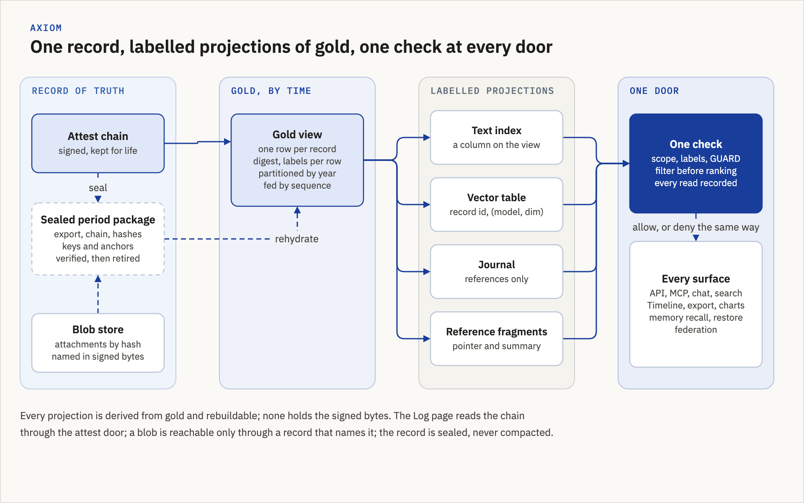

# ADR-251: Indexes and agent context are labelled projections of the record; the record is sealed and archived, never compacted; one check at every door

**Status:** Proposed (2026-11-10)
**Extends:** [ADR-241](adr-241-a-record-lives-with-its-writer-gold-serves-what-is-derived.md) (a record lives with its writer, gold serves what is derived). Nothing in ADR-241 changes; its D6 table gains rows and columns here, and its D7 row "logbook growth over decades" gains its mechanism.
**Related:** [ADR-128](adr-128-medallion-tier-boundaries.md) (tier boundaries),
[ADR-142](adr-142-attestation-is-the-record-of-accountable-human-acts.md), ADR-143 and [ADR-150](adr-150-an-attestation-record-is-kept-in-a-logbook.md) (signed records in logbooks),
[ADR-163](adr-163-steer-and-log-are-two-projections-of-one-journal.md) as amended 2026-11-09 (the journal references, never holds),
[ADR-087](adr-087-cross-mem-portable-cross-harness-memory.md), [ADR-088](adr-088-memory-recall-projection-corpus.md) and [ADR-092](adr-092-cross-mem-continuous-bidirectional-sync.md) (cross-mem: `SourceOrigin`, the `rag-memory` corpus, the serving gate, sync),
[ADR-197](adr-197-a-switch-is-one-runner-with-a-gate-a-lock-budget-a-soak-and-an-explicit-retire.md) (prove, then retire),
[ADR-205](adr-205-a-key-belongs-to-a-person-and-what-it-reads-is-resolved-from-grants-and-sharing-programs.md) (what a key reads is resolved from grants),
[ADR-213](adr-213-upload-is-a-composable-extraction-pipeline.md) (the Library's extraction path),
[ADR-230](adr-230-keel-is-the-one-node-agent.md) (KEEL), [ADR-236](adr-236-one-permission-model-deny-ask-notify-allow.md) (one permission model),
`docs/specs/spec-rag-retrieval-policy.md`, `docs/specs/spec-memory-compaction.md`, `docs/specs/spec-attestation.md`, `docs/prds/prd-attestation.md` §6 item 11,
issue #1695 (a lossiness policy per stream), issue #1732 (provenance as attestation), epic #1722 and ADR-250 (draft, PR #1735).

## Context

The owner's question (2026-11-10): "There needs to be coherence ... for any system data:
where it goes so that it can be called into context efficiently and not needlessly
duplicated ... how does log data relate to Axiom memory? Does it get chunked and embedded
for RAG? Do we train a model on it in future? How does search work on logs? Our access
control has to cover all the surfaces and all the storage endpoints. Log data could be a
security hole." Also: attachments need a home, and how are logs compacted and archived?

ADR-241 settled where a record lives (with its writer), what gold is (derived) and how a
page reads gold (through the door). It left four places unnamed: the text and vector
indexes a search needs, the memory an agent recalls, the attachments an entry carries,
and what happens to a record over decades. Each is a copy, and a copy made without the
record's labels and without the one check is a new door with no lock. That is the
security hole: not the record, which is signed and guarded, but its unguarded
derivatives.

What exists on 2026-11-10, read from the tree:

- Text search over records is an in-process substring scan over fetched rows
  (`axiom.attest.query.records(text=...)`); there is no index.
- The journal (unit J1, PR #1729) is the first projection built to the rule: references
  only, labels on every row, a retention class per lane, one `Caller` on every door.
- The memory serving gate (`axiom.memory.serving.ServingGate`) denies fail-closed in a
  fixed order (`unresolved_consumer`, `vault`, `secret_routed_to_vault`, `unlabeled`,
  `cross_account`, `tier_mismatch`, then policy), and `rag-memory` chunks carry labels so
  it can pre-filter (ADR-088). Nothing like it guards a log index, because there is none.
- The retrieval policy engine has a classification ceiling, a retrospective access check
  and a post-filter breach detector; pre-filtering before ranking is mandated nowhere.
- A logbook declares `retention = { live_days, archive }` and the API returns it (unit
  W1) under `not_yet_enforced`; nothing seals, archives or deletes. Evidence lists
  attachments by checksum; no store holds the bytes and no door serves them.
- The pieces to build on exist: one `StorageProvider` (`axiom.infra.storage`, local and
  S3-compatible), the Library's typed extraction pipeline (ADR-213), hybrid retrieval with
  reciprocal rank fusion (`axiom.rag.hybrid`, `axiom.rag.rrf`) and embedding spaces keyed
  `(model, dim)` (`axiom.memory.embedding_registry`).

## Decision

### D1. Derived indexes and agent context are a fourth kind of place: labelled projections of gold, served only through the one check

ADR-241 D1 named three homes: the owner's schema, gold, and published app tables.
Full-text indexes, embeddings and RAG corpora, and memory fragments are a fourth. They
are **derived from gold** (never from silver, never from drafts or a person's tray); they
carry the record's labels on every row (site or tenant, logbook or lane, classification
tier, export-control flag, roles); they hold no official copy; they are rebuildable at any
time from gold; and they are served only through the one access check applied at serve
time, with rights **pre-filtered before similarity ranking**, never only post-filtered.
Post-filtering stays as breach detection (spec-rag-retrieval-policy): a hit there is a
defect report, not the control.

The table of kinds, extending ADR-241 D6:

| Kind | Record of truth | Projection, index or context | Readers | Who checks | Retention and archive |
|---|---|---|---|---|---|
| **Signed logbook entries** | The attest chain (ADR-241 D6). | The gold view, one row per record, partitioned by time; a text-search column on it; a vector table keyed by record id; journal rows; memory reference fragments (D2). | The Log page reads the chain. Everything else reads gold through the door. | The attest door for the chain; the gold door for every projection; the same labels at both. | Kept for life unless the logbook's retention says otherwise; sealed and archived (D7); indexes rebuildable. |
| **Attachments** | One immutable blob per content hash in the node's object store (D6). The signed entry names the hash inside its signed bytes. | Text or metadata extracted by type, as a labelled derived index through the Library's extraction path. | Through the attest door only, with the entry's labels. | The attest door. | The record's. Carried in the sealed package by hash. |
| **Provenance records** (#1732) | An attest record whose subjects are artifacts: sealed by the system, signed by a person where the step is an accountable act. | Lineage as a gold projection: nodes are artifacts and runs, edges are PROV relations. | Site view, chat and `verify`, through the door. | As for entries. | As for entries. |
| **System log** (Platform events) | JSON-lines files and their snapshots (ADR-241 D6). | None by default; aggregated health facts land in bronze when a report needs them. | `axi log platform`, the node agent, diagnosis tools. | File permissions; the gold door for aggregates. | Rotation and snapshots with a retention class (prd-logging). Never a record. |
| **The journal and the Timeline** | None. An index of references over lane records (ADR-163 as amended; J1). | Itself. | The Timeline and the worklist. | One `Caller` on every door (J1). | A retention class per lane; whole time partitions dropped; rebuildable; history from gold. |
| **Full-text and vector indexes** | None. | A text-search column on the gold view; a vector table keyed by record id and `(model, dim)`. | Search, chat, RAG retrieval and the Timeline's search: one index, one door (D4). | The gold door, pre-filtered. | Fine vectors for archived periods dropped; the seal's summary stays indexed; rebuildable. |
| **Memory reference fragments** | None. A pointer, a summary and provenance (D2). | A `rag-memory` chunk (ADR-088). | Recall, through the serving gate, then re-resolved through the gold door. | The serving gate and the gold door, both. | Memory compaction's; a fragment whose record was tombstoned resolves to the tombstone. |
| **Training corpora** (future, D10) | None. | A consented publication from gold. | Model training. | The publication registry plus consent. | Its own ADR. |
| **A product's own logbooks and projections** | Whatever its logbook declaration says; every row above applies (D12). | | | | |

### D2. Memory holds references, not records

A memory fragment about an organizational record is a **reference fragment**: the
record's pointer (`axiom://attest/sha256:<digest>`, with logbook and sequence), a short
summary, and provenance: the fragment's `(T, U, A, R)` tuple and its `SourceOrigin`
(ADR-087 D1). The record's labels are copied onto the fragment at write time. Recall
**re-resolves the pointer through the gold door with the caller's rights at that
moment**, so revoked access denies the recall although the fragment exists; the summary
is never served when the pointer is denied. A reference fragment is a `resource` fragment
under ADR-088 (metadata plus pointer, never blob content). It leaves the node only as a
pointer and a summary, only where its labels allow (ADR-087 D7, the no-push rule; ADR-092
write-back), and never with the record's content.

### D3. An entry is its own chunk

A signed entry is embedded as one chunk from the gold view, keyed by record id, carrying
its labels and the embedder's `(model, dim)` from the embedding registry so it can be
re-embedded. Secret patterns are redacted at write time, and a detection raises `vault
exposed` on the existing exposure path. An imported-but-unsigned entry (`kind = import`)
is embedded with that label on the chunk. A supplement, acknowledgement, co-signature or
seal is its own chunk pointing at its target; nothing is concatenated across records.

### D4. Search is hybrid and time-first, over one index, through one door

A search over records applies structured filters first (time range, log, entry type,
signer, site, role, interval), then takes full-text and semantic candidates and fuses
them with the existing reciprocal rank fusion, over a gold view partitioned by time. The
filters are the pre-filter of D1 and run before any ranking. Every answer is "as of"
(ADR-241 D4 point 4), and every result deep-links to the record. The Timeline, the Log
page's search and chat read **one index through one door**; a surface-private index is a
defect.

### D5. Storage: one copy of the content, many indexes

The canonical signed bytes live once, in the attest chain. Beside them: a text-search
column on the gold view, a vector table keyed by record id, and attachments stored once
by content hash. Records are few and small and kept for life (ADR-241 D7); the indexes
and the journal grow, are rebuildable, and carry retention classes. No index holds a
second copy of the signed bytes.

### D6. An attachment is an immutable blob, stored once, content-addressed, served through the attest door

- Stored once in the node's object store by content hash, through the storage-provider
  abstraction (`axiom.infra.storage.StorageProvider`): any provider, never a vendor name
  in core.
- The signed entry carries the hash, the media type and the size **inside its signed
  bytes**, so the signature covers the attachment without putting bytes in the chain.
- Served only through the attest door, with the entry's labels. A blob is never
  addressable without a record that names it.
- Retention is the record's; the sealed package (D7) carries the blob by hash.
- Text or metadata extracted from it is a labelled derived index, produced by the
  Library's extraction path (ADR-213) and chunked by type: documents parsed and embedded,
  images OCR or caption, video metadata only.
- Backups include the blob store; restore validation checks that every hash an entry names
  resolves.
- A video attachment references a specific rendition's hash under the per-stream lossiness
  policy (#1695); the policy and its loss record are inside what the hash covers.

### D7. The record is never compacted; it is sealed and archived

- **Sealing is the compaction unit.** A seal (unit L5: period summary, open items, chain
  head) closes a period. The seal's summary is the compacted representation; nothing in
  the period is rewritten, summarized in place or dropped.
- **A sealed period becomes a verifiable package**: the L6 export plus the chain segment,
  attachments by hash, the signing keys and the anchored checkpoints that cover it, with a
  manifest carrying the labels, the retention rule and the package digest. It goes to cold
  storage through the storage-provider abstraction. **Logs from export-controlled work
  archive only to controlled storage.**
- **Prove, then retire** (ADR-197): the hot copy is retired only after the package verifies
  offline with the standalone verifier. Retire reclaims data, so it is an explicit,
  approved act.
- **Deletion** happens only where the logbook's declared retention allows it, and then as a
  **signed tombstone** naming the sealed period and the rule. The record's row keeps its
  digest, signatures and labels; its content and attachments are removed; the verifier
  accepts a content-less record only when a later tombstone covers its sealed period, so
  the chain still verifies. A tombstone is a record kind, and people sign it.
- **The journal**: a retention class per lane; whole time partitions dropped; rebuildable
  from gold.
- **Gold**: partitioned by year; old partitions tiered to cheaper storage and still
  queryable through the door.
- **Indexes**: fine-grained vectors for archived periods are dropped; the seal's summary
  stays indexed; retrieval hits summaries first and rehydrates from the archive on demand,
  through the same door. This mirrors spec-memory-compaction: consolidation is lossless,
  compaction is lossy, and the archive is the escape hatch.
- **Archive reads go through the same door and are recorded** (D8). Labels travel in the
  package manifest.
- **Who does what**: PULSE schedules sealing per logbook at its declared cadence; KEEL
  (ADR-230) runs moves, drops and the retire step; KEEP holds the archive keys.

### D8. Reads are recorded at the door for every surface

One recording path, called by every door (unit X2): API, MCP, chat, search, RAG retrieval,
memory recall, Timeline, export, charts and reports, backup restore, federation. The read
record names the principal, the surface, the record ids or range, and the labels at the
time, never the content. It is a system fact, not an attestation (as ADR-142 rule 6 treats
a missed obligation): nobody signed it.

### D9. Conformance is a cross-door matrix

Every denial reason × every door gives the same answer. The matrix generalizes the memory
serving gate's conformance matrix (cross-mem P3: seven denials across three transports) to
every door in D8 and every label in D1. It is the test that catches "the new endpoint
forgot the check": a door registered without its rows fails the build.

### D10. Training corpora are a consented publication from gold

A training corpus, when one is wanted, is a publication from gold per site and per
logbook, labels and provenance kept, export-control and personal-data rules applied, never
from memory or drafts. One sentence now; its own ADR when real.

### D11. Provenance records are a record kind

An attest record whose subjects are artifacts, sealed by the system and signed by a person
where the step is an accountable act; lineage is a gold projection; people sign, systems
seal. Listed here as a kind. The full decision is issue #1732's.

### D12. Products inherit all of it by declaration

Anything a product builds on top (its own logbooks and projections) inherits every rule
here by being a logbook declaration. Nothing product-specific lives in storage, in the
indexes, in the package format or in the door.

## Enforcement (proposed, not built here)

1. A static guard: no indexer, corpus or embedding job reads a `silver.` relation, a
   drafts table or a tray; each indexer lists its gold sources.
2. The cross-door matrix (D9) in CI. Doors are registered in one place; the matrix
   enumerates that registry, so an unregistered door is itself a failure.
3. Label columns on every index row and fragment are non-null; a null is `unlabeled` and
   denied (the serving gate's rule, made general).
4. A blob is reachable only through an attest route; listing the blob prefix on the
   provider is an operator verb and is recorded.
5. The retire step of an archive refuses without a stored verify report for the package
   (ADR-197 D1).

## Options considered

- **Compact the record itself**, as memory summarizes old episodes in place. Rejected: a
  signed record is never altered (ADR-142 rule 8), and the seal already is the summary.
- **Index from silver or from drafts** for freshness. Rejected: silver serves nobody
  (ADR-128); a draft is not a record and may never become one.
- **Post-filter only**, as most vector stores do. Rejected: a top-k chosen before rights
  leaks through the ranking and a list filtered afterwards degrades silently. Pre-filter,
  then detect.
- **Attachment bytes in the chain.** Rejected: the chain is few and small by design; a
  hash inside the signed bytes gives the same guarantee.
- **The Library as the attachment's record of truth.** Rejected: the Library organizes
  files and grants no access (ADR-239, LIB-R1.6); an attachment belongs to the record that
  names it. Its extractors are reused, not its ownership.
- **A separate search service with its own permission model.** Rejected: a second check
  diverges (ADR-241 D7, "apps and harnesses").

## Consequences

- One sentence a reviewer can check: every copy of a record carries the record's labels,
  is rebuilt from gold, and is served through the one check that records the read; the
  record itself is sealed, archived and verified, never compacted.
- **ADR-241** gains a fourth home (D1); its D6 table gains rows (attachments, provenance
  records, indexes, memory fragments, training corpora) and columns (who checks; retention
  and archive); its D7 row on decades gains D7 here.
- **ADR-163** gains retention and partition mechanics for the journal, as for any projection.
- **ADR-087, 088 and 092** gain the reference fragment as the shape of a fragment about a
  record, and serve-time re-resolution through the gold door behind the serving gate.
- **ADR-142, 143 and 150**: the record gains attachments by hash inside the signed bytes
  and a tombstone kind; the declared `retention` becomes enforceable (seal, archive,
  tombstone).
- **ADR-197** gains a second domain: archive retire is a switch with prove, commit and an
  explicit retire.
- **ADR-205 and 236**: the one check composes grant resolution with GUARD's answer for the
  verb; the matrix (D9) proves they agree on every door.
- **ADR-213**: the extraction path gains a second caller, the attachment indexer.
- **spec-rag-retrieval-policy**: pre-filtering before ranking is mandatory; post-filtering
  is breach detection. **spec-memory-compaction**: its lossless and lossy split is reused
  for record indexes.
- **ADR-250 D6** (draft, PR #1735) carries an attachments paragraph; it should point here.
- Costs: a text index and a vector table per embedder to keep fresh; a package format to
  version; a matrix that grows with doors and labels.

## Open questions for the owner

1. The tombstone: a new kind `tombstone` with meaning `performed`, signed by a custodian
   role the logbook declares? No new meaning would enter the closed vocabulary.
2. Fine-grained vectors for archived periods: dropped by default, or kept while storage
   allows and dropped on pressure?
3. The read record's own retention class; it grows with every search.
4. Whether a reference fragment's summary may be produced by a model (then it carries the
   model as provenance) or must be the entry's title and first line.
