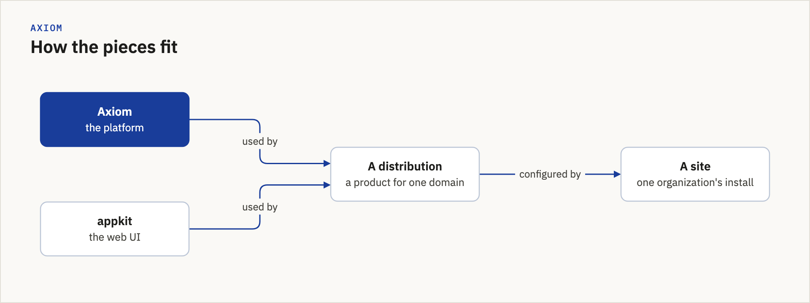

# Part 3: Build a feature, and the developer workflow

For a new contributor who works through a coding agent. You do not need to be an experienced
programmer. Reading this page takes about ten minutes. Then you build.

**You end with** your first real change merged.

**Before you start.** Parts 1 and 2 (use the system, then add data) are in your product's own
onboarding. For this part you need a clone with the hooks installed and a test database: the
[contributor quickstart](contributor-quickstart.md), steps 1 to 3.

**In this order:** read this page, do the hello world (section 3), then take your first ticket
(section 10) through the loop (section 2).

**Your agent reads a different page.** Tell your agent to read `AGENTS.md`. It sends the agent to
the [Part 3 agent reference](../reference/developer-workflow.md), which has every command, every
check and every fix. This page is for you.

## Contents

1. [How the pieces fit](#1-how-the-pieces-fit)
2. [The loop](#2-the-loop)
3. [Hello world: your first extension](#3-hello-world-your-first-extension)
4. [Run the tests on your computer](#4-run-the-tests-on-your-computer)
5. [Kinds of tests](#5-kinds-of-tests)
6. [AGENTS.md](#6-agentsmd)
7. [The checks your change must pass](#7-the-checks-your-change-must-pass)
8. [Pull requests](#8-pull-requests)
9. [After you merge](#9-after-you-merge)
10. [Your first ticket](#10-your-first-ticket)

## 1. How the pieces fit



*Figure: The platform and the web UI are used by a distribution, which each site configures.
Source: `scripts/diagrams/onboarding_diagrams.py`.*

- **Axiom** is the platform. It works for any field of work.
- **appkit** is the web UI that Axiom and the products share.
- **A distribution** is a product for one domain, built on both.
- **A site** is one organization's install of a distribution. It holds configuration and content,
  not code.

Where a change goes:

- Something every domain would want (data, skills, commands, an API): **Axiom**.
- A screen or a web component every product could use: **appkit**.
- Something only one domain wants: **that distribution**.
- One organization's settings and content: **that site**.

If you are not sure, ask your reviewer before you branch.

## 2. The loop

Every change follows the same eight steps:

1. **Branch.** Make a new worktree on a new branch (a second folder of the same clone).
2. **Write the test first.** Ask your agent for a test that fails, and nothing else.
3. **Watch it fail.** Run it. Read why it fails.
4. **Make it pass.** Ask for the smallest code that passes. Run the test again.
5. **Push.** `git push` runs a check on your computer first, called the pre-push hook. If it
   refuses because `main` (the shared branch) is red, that is not your change: wait, and tell
   your reviewer.
6. **Open a pull request.** This asks for your change to be added.
7. **CI runs.** GitHub runs the checks again, and more.
8. **Merge.** After a person approves it and the checks pass, the change joins `main`.

The commands for each step are in [Working with a coding agent](working-with-a-coding-agent.md),
sections 3 to 8.

## 3. Hello world: your first extension

Do the tutorial [Build your first extension](build-your-first-extension.md). You build a small
extension with one skill, see it on each surface (the command line, an agent's tools, the API and
the web app), and add a small logbook. It uses the same loop: test first, then code.

Do it in a scratch folder. It is practice, not a pull request.

## 4. Run the tests on your computer

Run your extension's tests:

```sh
python -m pytest path/to/your/extension/tests -q
```

**Green** means the last line says `passed` and does not say `failed` or `error`. `skipped` is
fine.

Then run the hook by hand before you push, as the
[quickstart's step 4](contributor-quickstart.md#4-run-the-fast-tests-and-the-layer-guard) shows.
The first run is slow. Later runs only test what your change can affect.

Two failures are usually not your fault:

- **A full disk.** Some tests refuse to write when less than about 5% of the disk is free. They
  fail with a message about free space. Free some space and run again.
- **A busy computer.** A few tests measure time, and they fail when the computer is busy. Run the
  failing test alone. If it passes alone, it was the load.

For anything else, see [When something goes wrong](../reference/developer-workflow.md#when-something-goes-wrong).

## 5. Kinds of tests

You write unit tests for every change. The others depend on what you change, or CI runs them for
you.

| Kind | What it checks | Who runs it |
|---|---|---|
| Unit | One small piece of behaviour. You write these first, for every change | You, the hook and CI |
| Integration | Your code with a real database or service | CI, after merge |
| Acceptance | A row of a spec is really done | You, when a ticket names a row |
| Contract | Two repositories agree, for example on an API | You, when your change crosses repositories |
| Visual | A screen still matches its design | You, when you change a screen |
| Smoke and install | The package installs and starts | CI |

For example, a new API route that the web app calls needs unit tests and a contract test. Ask
your agent to check the [agent reference](../reference/developer-workflow.md#test-kinds), which
says when each kind is required.

## 6. AGENTS.md

`AGENTS.md` is the rule book at the top of each repository, for people and agents. Your agent reads
it when it starts. Read it once yourself.

Two rules:

- **The repository's `AGENTS.md` wins** over your own agent settings.
- **Edit only `AGENTS.md`.** Files such as `GEMINI.md` and `.github/copilot-instructions.md` are
  copies made from it. Never edit a copy.

## 7. The checks your change must pass

Each check catches one kind of mistake. When one fails, ask your agent to read the message and
look it up in the [agent reference](../reference/developer-workflow.md#the-gates).

| Check | What it catches |
|---|---|
| Lint | Small code mistakes, such as an unused import or a misspelled name |
| Naming guard | A customer or a specific field of work named inside the platform |
| ADR numbers | Two decision records (ADRs) with one number |
| Pre-push hook | All of the above, plus the tests your change can affect, before anything leaves your computer |
| CI (continuous integration) | The same again on GitHub, plus the full test suite |
| The lander | Merges a pull request when it is green and nothing holds it |

A red check is information. Read it before you run anything again.

## 8. Pull requests

Every change goes through a pull request, and a person reviews it before it merges.\*

1. Push your branch and open a draft: `gh pr create --draft --fill`.
2. In the description, say why the change exists and which tests you ran.
3. Ask for a reviewer: `gh pr edit --add-reviewer <their GitHub login>`. Your program lead tells
   you who; with no program, ask the platform owner.
4. Mark it ready: `gh pr ready`. The checks run.
5. Answer the review. Push fixes to the same branch.
6. When it is approved, run `gh pr merge --squash --auto`. It merges by itself once the checks
   pass.

Ask for the reviewer **before** you mark it ready. In Axiom, a green pull request with no review
pending can be merged automatically.

Your agent knows the commit rules. Two to watch for yourself: it names each file it adds (never
`git add -A`), and commits carry no "Co-Authored-By" or "Generated with" line for an AI tool. You
are the author.

\* How the team uses pull requests is being evaluated. For one argument that they cost more than
they give, read Andrea Laforgia's
["Stop Using Pull Requests"](https://a4al6a.substack.com/p/stop-using-pull-requests) (2026).

## 9. After you merge

**Versions.** Each release of Axiom has a version number. Your change is in the next one.

**Release.** A maintainer cuts a release from `main` and publishes it. You do not do this yet.

**Deploy.** A site moves to a new release when its owner updates it. That is when people see your
change.

Part 4, ship and operate, covers all three (coming).

## 10. Your first ticket

A ticket is a written task. If you have joined a program, its tickets folder names your first
change, with its branch, files and checks. Follow the loop above with that ticket. If you have no program, ask the platform owner
for a small first change.

---

**Reference:** [Part 3 agent reference](../reference/developer-workflow.md) ·
[FAQ](../reference/faq.md) · [Guides index](README.md)
