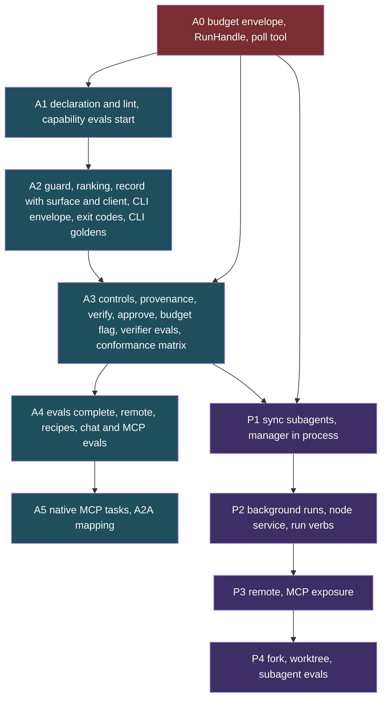

# PRD: Agent-backed capabilities and subagents

**Product / Feature:** Capabilities that may be backed by an agent, a recorded decision about when an agent runs, and subagents in `axi chat`.

**Owner:** Ben Booth (B-Tree Labs)   •   **Status:** Draft   •   **Last updated:** 2026-10-31

**Routing context:** dispatch is a routing decision under [ADR-201](../adrs/adr-201-routing-is-a-verdict-then-seats-guard-removes-options-graduated-seats-rank-the-rest.md) decisions 18 to 20; track C of `docs/working/router-pipeline-build-plan-2026-10-22.md` lists the routing dependencies.

**Decisions:** [ADR-232](../adrs/adr-232-capabilities-may-be-agent-backed-and-dispatch-is-a-recorded-verdict.md) (capabilities, dispatch verdict, controls), [ADR-233](../adrs/adr-233-chat-spawns-subagents-through-one-manager-and-one-run-handle.md) (subagents in chat)

**Related (not changed by this PRD):** [prd-agents](prd-agents.md), [prd-chat-harness](prd-chat-harness.md) (session commands, `/fork`), [prd-capability-budgets](prd-capability-budgets.md) (spawn budget slices), [prd-work-verification](prd-work-verification.md) (proof of done), [prd-axiom-mcp-gateway](prd-axiom-mcp-gateway.md), [prd-evals](prd-evals.md), [prd-axiom-agent-plane](prd-axiom-agent-plane.md), [prd-agent-state-management](prd-agent-state-management.md)

**Why a new PRD and not an amendment:** the existing agent and chat PRDs describe the roster and the session commands. This feature crosses the capability registry, the dispatch guard, the MCP surface and chat, and has its own metrics. Extending `prd-agents` (a needs assessment) or `prd-chat-harness` (a trust and commands PRD) would bury it. Both are linked above so the relationship is explicit.

---

## 1) Elevator Pitch

A capability says how it may execute (a function, an agent, or a mix), the platform picks the cheapest rung that works and records why, and `axi chat` can hand bounded jobs to subagents that keep the parent's context small. Callers see one typed capability either way.

## 2) Problem / Opportunity

- Today a model-backed capability such as `agents.ask` (`src/axiom/extensions/builtins/agents/skills/ask.py`) looks identical in the registry to a pure function. Nothing records that a model ran, what it could touch, or what it cost.
- Whoever writes the prompt chooses between a function and an agent. Nothing removes the agent when the caller may not spend, or the data may not leave; nothing escalates when the function says "unmet".
- Agents report success without evidence. The platform already has a rule that claims come from observed effects (`prd-work-verification`), but a capability has no place to declare its own check.
- `axi chat` has a synchronous delegate (`src/axiom/agents/delegation.py`) and a session `/fork`, but no way to run a child in the background, stop it, message it, or bound its spend as a slice of the parent's.
- Opportunity: the platform already has one dispatch chokepoint, a decision-record stream, a plan-hash approval path, immutable provenance and a budget specification. Wiring agents into those makes agent use auditable and cheaper than the usual version.

## 3) Goals and Non-Goals

**Goals**

1. A capability can declare `deterministic`, `agentic` or `hybrid`, with a contract (persona, allow-list, model class, budget, output schema, verify step) for agent modes.
2. Dispatch picks the lowest rung that satisfies the request, escalates on evidence, and every verdict is a record usable for audit and evaluation.
3. Agent runs act as the caller with the intersection of permissions, deny writes by default, and treat tool results as data.
4. An agent-backed result carries provenance and is stored as an immutable fragment; success is backed by a declared deterministic check.
5. `axi chat` supports subagents with fresh context, a manager, send/stop/list, system-event notification, limits, and a path to remote and isolated runs.

**Non-goals**

- A new agent framework or a second registry. This extends `SkillRegistry` and the existing chokepoint.
- Autonomous self-escalation beyond declared limits.
- A recipe runner. ADR-185 keeps recipes runner-free; agent steps in a recipe are invoked by the following agent through the chokepoint.
- Choosing a model provider. That stays with routing (ADR-201).
- Pricing accuracy. Dollar figures are labeled estimates (`prd-capability-budgets` R3).
- Federation of subagents before the single-node path is proven (P3).

## 4) Personas

- **Extension author:** declares a capability and, if it needs an agent, its contract and verify step. Wants a lint that says what is missing.
- **Operator or person in chat:** wants answers fast and cheap, wants to see which rung ran and whether the result was verified, wants to stop a runaway.
- **Calling harness (over MCP):** wants one typed tool, cost visible in its description, and bounded latency.
- **Reviewer or auditor:** wants to ask why an agent ran, what it touched, what it spent, and whether anyone checked it.
- **Platform owner:** wants policy to remove options (data residency, budget, tier) without editing prompts.

## 5) User Stories

1. As an extension author, I declare `execution: hybrid` with a deterministic first step and an agent contract, and `axi ext lint` tells me if I forgot the budget or the verify step.
2. As a person in chat, I ask for a goal ("find out why this failed to start") and the platform tries the deterministic diagnosis first, then a bounded agent, and shows me the rung.
3. As an operator, I pin a capability `forbid_agent` for a site that must not send its data to a model, and the dispatcher never offers the agent rung there.
4. As a person in chat, I ask the assistant to "research X while I keep working"; it spawns a background subagent and I see a marked completion event, not a message that looks like mine.
5. As a harness author, I call the same capability over MCP and get a typed result, a provenance block and, for long jobs, a task handle I can poll.
6. As an auditor, I open a decision record and see which rungs were considered, which the guard removed and why, what was spent, and the verify outcome.
7. As an approver, a subagent's destructive step reaches me as a plan with the child's identity on it, and the child waits.
8. As a script author, I call an agentic capability from a terminal with `--json`, get a versioned envelope and a distinct exit code for verified, unverified, needs-approval, budget-exhausted and refused, and I am never prompted.
9. As an operator, I start a long job with `--detach`, close the terminal, and later run `axi agents status <run>` from another terminal.
10. As a maintainer, I see verified-success and cost per outcome sliced by surface and by calling harness, so a regression on one surface is visible.

## 6) Requirements

Each requirement is tagged with its phase. P1 to P4 apply to subagents (ADR-233). Capability phases are in the second table.

### Capabilities and dispatch (ADR-232)

| ID | Requirement | Phase |
|---|---|---|
| B1 | Budget envelope on `CapabilityToken` with `turns`, `tokens`, `dollars`, `wall_clock_seconds`; agent-backed runs refuse to start without one | A0 |
| B2 | Draw and decrement at step boundaries; remaining amounts readable; unused amounts refunded at completion | A0 |
| B3 | Inheritance on delegation and spawn is the intersection of the parent's remaining amounts and the requested slice | A0 |
| B4 | Exhaustion returns `unmet: budget_exhausted` naming the limit; recorded in the dispatch record and provenance `budget_drawn` | A0 |
| H1 | Internal `TaskHandle` / `RunHandle`: submit, state, progress events, result, cancel | A0 |
| H2 | Poll tool `<capability>.status` (and `.cancel`) as the guaranteed MCP fallback for long and remote calls | A0 |
| H3 | Native MCP progress and task support, enabled per client only after a per-client conformance test | A5 |
| H4 | A2A task lifecycle mapping for the handle, verified by a round-trip test before any remote agent-backed capability is enabled | A5 |
| C1 | `SkillSpec` accepts `execution`, `latency_class`, `data_residency`, `binding`, `dispatch`, `agent` as optional fields; undeclared stays deterministic and unchanged | A1 |
| C2 | `AgentContract` requires persona, allow-list, model class, all four budget limits, output schema; `verify` required when `risk` is not `read` | A1 |
| C3 | Projection to CLI, MCP, agent-tool and SKILL.md is unchanged in shape; MCP description states that a model may run | A1 |
| C4 | Guard removes rungs for permissions, residency, budget, approval and tier; recorded with reasons | A2 |
| C5 | Ranking picks the lowest satisfying rung; escalates only one rung at a time on stated evidence; precedence policy, declaration, hint, router | A2 |
| C6 | One `dispatch` decision record per call (content-free), feeding audit and regret evaluation | A2 |
| C7 | Failures return `chain` (`unmet`, `next`, `produced`), never raise across the surface | A2 |
| C8 | Effective permissions are the intersection of caller and persona; writes denied by default; destructive uses plan hash | A3 |
| C9 | Tool results handled as data; allow-list and guard enforced on every call regardless of model output | A3 |
| C10 | Result provenance block; immutable fragment via `CompositionService`; trace id links to the decision record | A3 |
| C11 | Verify step runs by the dispatcher, not the agent; result is `passed`, `failed` or `not_declared`; only `passed` (or a no-effect read) shows as success | A3 |
| C12 | Golden-trace eval and cost-regression test per agent-backed capability; shadow rollout before enable | A4 |
| C13 | Remote binding over MCP-HTTP or A2A with trust-graph check, label-join check and local verification of returned artifacts | A4 |
| C14 | Recipes may contain agent-backed steps, vetted with the step's golden trace; no runner | A4 |

### Subagents in chat (ADR-233)

| ID | Requirement | Phase |
|---|---|---|
| S1 | (needs A0) `spawn_agent` as a registered capability; fresh context, persona type, narrowing allow-list, budget slice, depth cap shared with delegation, synchronous | P1 |
| S2 | `SubagentManager` with run records (id, parent, state, budget, transcript ref, depth) | P1 |
| S3 | (needs H1) Background runs; completion and progress as marked system events never rendered as user input; `send`, `stop`, `list`; runs view in the TUI; default 3 concurrent children, configurable, queueing beyond | P2 |
| S4 | Approvals from children bubble to the human with the child named; background child without a human stays paused | P2 |
| S5 | Child transcripts stored as linked fragments parent to child | P2 |
| S6 | `RunHandle` interface shared by local and remote runs; remote binding with federation trust | P3 |
| S7 | MCP exposure of spawn, send, stop, list under the identity gate; double-nesting guard; progress via the H2 poll tool | P3 |
| S8 | Optional fork of the parent context (label-join permitting) | P4 |
| S9 | Optional git-worktree isolation for code-editing agents; manager never merges | P4 |
| S10 | Eval harness for subagent traces | P4 |

### CLI surface, node service and evaluation (ADR-232 parts 8 and 9, ADR-233 parts 10 and 11)

| ID | Requirement | Phase |
|---|---|---|
| K1 | CLI verbs of agent-backed capabilities go through the same dispatcher, loop and dispatch record; flags `--wait` (default), `--detach`, `--json`, `--approve`, `--no-input`, `--budget`, `--prefer` added by the projector | A2 |
| K2 | `--json` result envelope `axi.capability-result/1`: dispatch verdict, verified state, cost, trace id, unmet list; versioned, additive within a major | A2 |
| K3 | Exit-code table (0 verified or read-only, 3 unverified, 4 verify or schema failed, 5 unmet, 6 budget, 7 guard refused, 8 run not finished, 9 stopped; 1, 2, 130 as today) | A2 |
| K4 | No prompting on non-interactive CLI; `approval_required` carries the plan hash; `--approve <hash>` binds capability, params and scope; a mismatched hash is rejected; TTY prompt only with a TTY and no `--no-input`; an agent never approves itself | A3 |
| K5 | `--budget` may only lower; a value above the envelope is a usage error | A3 |
| N1 | `SubagentManager` hosted as a single-flight node service with durable run records; start-on-demand or `run_service_unavailable`; embedded mode for `--wait`; owner-aware recovery (dead owner becomes `failed`, cause `node_restart`) | P2 |
| K6 | Run verbs from any terminal: `axi agents list runs`, `status <run>`, `stop <run>`, `send <run> <msg>`, `wait <run>`; `/agents runs` stays the TUI view | P2 |
| K7 | Run verbs honor `--json` and the exit table; the same verbs are projected to MCP | P2 (CLI), P3 (MCP) |
| E1 | Layer 1 capability evals through the dispatcher: rung, escalations, schema, verify, cost, latency, tool trace; recorded-model replay in CI | A1 start, A4 complete |
| E2 | Live scheduled eval runs with pinned model versions, replicates, confidence intervals, paired comparison | A4 |
| E3 | Layer 4 verifier evals: an injected false success must be caught | with the first agentic capability (A3) |
| E4 | Layer 2 surface conformance matrix (chat, MCP, CLI): same verdict and envelope | A3 and S1 |
| E5 | Layer 3 CLI goldens: stdout and stderr, exit codes, `--json` schema, detach and wait semantics | A2 |
| E6 | Layer 3 chat evals: right capability and rung from natural requests; child events as system events, never user input | A4 (P2 for child events) |
| E7 | Layer 3 MCP evals: tool-selection accuracy per client harness; server-side gates | A4 |
| E8 | Dispatch record carries `surface` and `client`; metrics sliced by both | A2 |

Capability phases: **A0 prerequisites (budget envelope, internal task handle, poll tool)**; A1 declaration and lint; A2 guard, ranking, record; A3 controls, provenance, verify; A4 evals, remote, recipes; A5 native MCP progress and tasks, A2A task mapping. Where the new pieces land: the dispatch record with `surface` and `client` (E8), the envelope, the exit table and CLI goldens (K1 to K3, E5) land with A2, because A2 is where the record exists; capability evals start at A1 (the declaration gives them a target) and are complete at A4; `--approve`, `--budget` and the verifier evals land with A3, together with the first agentic capability; the surface conformance matrix lands at A3 and S1, when a second surface can call a real agentic capability; the node service (N1) and the run verbs (K6) land with background runs in P2, while the manager class itself exists from S2 in P1 and runs in process. A0 comes before A3 and before S1: neither the budget envelope nor any task or progress plumbing exists in the tree (verified 2026-10-31 under `src/axiom/governance/`, `src/axiom/extensions/builtins/mcp/` and `src/axiom/vega/federation/`). P1 can ship with A0, A1 and the start of A3, since synchronous local subagents need the budget, the contract and the controls but not the full ranking.

### Model selection: registry and evaluation (ADR-234)

The model-axis requirements. Phases are in the table above and are not repeated here.

| ID | Requirement | Phase |
|---|---|---|
| MR1 | A model registry whose entry is the capability card of one model: declared fields (price, context, tool use, structured output, vision, cache-read price), attested fields (regimes, retention, training use, region, onward processors; first-party only), measured fields (quality per capability class with n and eval set id, latency, tool-call reliability, cache hit rate) | M0 |
| MR2 | A declaration names a model class, never a model id; resolution is through the registry under the guard | M0 |
| MR3 | Guard removal with a reason code for: regime, residency, deployment tier, retention, hosted router, capability need, budget, parent set, health, quarantine | M0 |
| MR4 | Dispatch receipt records models considered, removed (with reason), chosen (with score table) and each escalation hop, with tokens and cost | M1 |
| MR5 | Fallback or failover that changes the processor goes back through the guard; a transport is never configured with a fallback list that crosses a label boundary | M1 |
| MR6 | External routers are providers behind a seat, advisory until graduated by paired evidence on site data; the adapter drops any answer outside the survivors | M2 |
| MR7 | Model cascade shares the capability's verify gate, budget and escalation record; subagent model sets are the intersection with the parent's survivors | M3 (subagents with P1) |
| MR8 | Per-model, per-capability-class quality tables; paired comparison; pinned versions; reported-model drift event; canary regression gate with quarantine | M4 |

Evaluation of the model axis uses the layers already planned (E1 to E3): replay mode in CI checks that removals, rankings and hops match the recorded receipt; live scheduled runs (E2) fill the measured fields and run the canary; the verifier evals (E3) double as the cascade's scorer tests. A model change that lowers measured quality in any capability class beyond its stated interval blocks enabling that model for the class.

### Phased delivery (the single source of truth for phases)

Other documents reference this table and do not copy it. The router build plan's track C lists only the routing releases each phase depends on. Owners are not assigned. Versions are assigned at cut (`axi release cut`), one release per phase, each shipping shadow first and behind a setting.

External prerequisites, all verified in the tree on 2026-10-31: ADR-152 is **Proposed**, not Accepted, and ADR-201 depends on it reaching Accepted; ADR-201 is Proposed and supplies the model-class names (`simple` to `smartest`, decision 9); the decision record, observe-only stage points and sink gate are the router plan's R2, R4 and R3, none of which this PRD builds.

| Phase | Contents | Depends on | Owner | Exit criteria | Ships |
|---|---|---|---|---|---|
| A0 | B1 to B4 budget envelope on `CapabilityToken`; H1 internal `RunHandle`; H2 `.status` and `.cancel` poll tools | none inside this program | TBD | ADR-232 part 5 acceptance tests 1 to 6 pass; an agent-backed run refuses to start without an envelope; poll tool works from an MCP client | budget envelope and handle, no user-visible agent feature |
| A1 | C1 to C3 declaration, `AgentContract`, lint; E1 capability evals begin (dispatcher called directly, replay mode) | A0 not required; ADR-201 decision 9 names | TBD | lint rejects an agent-backed capability with no budget or verify; undeclared capabilities unchanged; first replay eval runs in CI | declaration fields and lint |
| A2 | C4 to C7 guard, ranking, record (`surface`, `client`, E8); K1 to K3 flags, envelope, exit table; E5 CLI goldens | A1; router R2 (decision record), R0 (site default label); full label join needs R10, until then guard uses stored labels and the site default | TBD | one dispatch receipt per call; public-parity suite shows no new model call, wait or refusal; CLI goldens pass; envelope schema published | dispatch verdict in shadow, CLI contract |
| A3 | C8 to C11 controls, provenance, verify; K4 `--approve`, K5 `--budget`; E3 verifier evals; E4 conformance matrix (chat, MCP, CLI); first agentic capability (`agents.ask` migration) | A0, A2; router R4 (`pre_generate` wired, observe-only) and R3 (sink gate on GUARD) | TBD | injected false success is caught (exit 4); matrix shows zero disagreement; no unrecorded agent run | first agentic capability, shadow then enabled by evidence |
| A4 | C12 to C14 evals complete, remote binding, recipes; E2 live scheduled runs; E6 and E7 chat and MCP evals | A3; router R3 (peer gate), R5 (seats and conformance suite) | TBD | cost-regression test gates enable; live drift report runs on schedule; remote result passes local verify | evals gate, remote and recipe steps |
| A5 | H3 native MCP progress and tasks per client; H4 A2A task mapping | A4 | TBD | per-client conformance test passes before enabling that client; A2A round-trip against `agent_card.py` passes | per-client native tasks |
| P1 | S1, S2 synchronous subagents; manager class in process | A0, A3 | TBD | spawn is a dispatch with a receipt; budget slice, depth and allow-list enforced | `chat.spawn_agent`, synchronous |
| P2 | S3 to S5, N1 node service, K6 run verbs, K7 CLI; E6 child-event evals | P1; schedule substrate fit (open question 5) | TBD | run survives the command; restart marks orphans `failed` (`node_restart`) with zero unmarked; `axi agents list runs` works from a second terminal | background runs and run verbs |
| P3 | S6, S7 remote binding, MCP exposure | P2, A4 | TBD | double-nesting refused on every surface; conformance matrix covers run verbs | MCP run tools |
| P4 | S8 to S10 fork, worktree, subagent evals | P3 | TBD | label-join check on fork; manager never merges; subagent trace evals run | fork and isolation |
| M0 | Model registry (declared, attested, measured groups) loaded into `ProviderSpec`; guard filters added to the existing `ModelStrategy` resolver (retention, hosted-router, capability need, parent set, regression quarantine); `hosted_router` kind removable by setting | ADR-201 decision 9 names; existing `ModelStrategy` (verified in tree); A0 not required | TBD | every removal carries a reason code; a site with one local model resolves with no extra call or wait (public-parity suite); a hosted router is removed by a deployment setting with no other change; registry loads from one config path | registry and guard filters, shadow |
| M1 | Model-axis fields in the dispatch receipt (considered, removed with reasons, chosen, score table, hops); per-call token and cost accounting drawn from the envelope; per-provider circuit breaker feeding the health check; cache-read tokens recorded | M0; A0 (envelope); A2 (dispatch record) | TBD | one receipt per call shows both axes; an unpriced model draws as unpriced; a breaker opens on injected failures and the guard removes the entry; no prompt text in receipts | receipts and budget accounting |
| M2 | Seat provider adapter for an external router (RouteLLM first; OpenRouter Auto where the guard keeps a hosted router) running in shadow behind `model-fit`; threshold calibrated on site queries; answer outside the survivor set is dropped and recorded | M1; ADR-201 R5 (seats and conformance suite); Python 3.14 and dependency check passed | TBD | adapter never returns a model outside survivors (property test); shadow report compares router pick with default on the paired eval set, cost and quality both; no regulated-label content reaches a hosted router | seat provider in shadow |
| M3 | Cascade on failed verify along the model axis, sharing the verify gate, the budget and the escalation record; maximum hops in the contract; shadow sample first | M1; A3 (verify gate, controls) | TBD | an injected weak-model failure escalates to the next surviving class and is recorded; escalation never reaches a removed model, including after a mid-run label change; total spend never exceeds the envelope | model cascade, shadow then enabled by evidence |
| M4 | Per-model, per-capability-class eval tables; version pinning and reported-model drift event; canary regression gate with quarantine; router graduation on the tables | M0, M2, M3; A4 (E2 live scheduled evals) | TBD | a silent alias change in a test provider is detected and the entry quarantined; a router graduates only on paired evidence on site data; the quarantine clears on a passing re-run or a person's action | evals gate for models |

Dependency summary: M0 can start now (no dependency inside this program) and M1 follows A0 and A2; M2 waits on router R5; M3 waits on A3; M4 waits on A4. The model-axis phases are specified in [ADR-234](../adrs/adr-234-model-selection-is-the-second-axis-of-dispatch-guard-removes-models-seats-rank-them-external-routers-are-providers-behind-a-seat.md). A0 gates A3 and S1; ADR-152 Accepted gates ADR-201 and so the router-side prerequisites; router R2 gates A2; R4 and R3 gate A3; R5 gates A4. A1, and A0 on its own, can start now.

## 7) Success Metrics

| Metric | Definition | Target (to be baselined in A2) |
|---|---|---|
| Context saved per call | parent-window tokens a delegated call would have consumed inline, minus tokens in the returned summary | measured; reported per capability |
| Cost per outcome | estimated dollars and tokens per call that ends `verified: passed` | no rise beyond the cost-regression threshold release over release |
| Escalation rate | share of calls that moved above the starting rung, by reason | tracked; a rising rate on a hybrid capability signals the deterministic rung is under-built |
| Verified-success rate | calls ending `verified: passed` over agent-backed calls that declare verify | rising; `not_declared` share shown separately and driven down |
| Unrecorded agent runs | agent runs with no dispatch record | zero |
| p95 latency | per rung and per capability, against its declared `latency_class` | within class |
| Guard removals honored | calls where a removed rung ran anyway | zero |
| Surface parity | conformance-matrix cases where chat, MCP and CLI disagree on verdict or envelope | zero |
| Slice coverage | share of dispatch records carrying `surface` and `client` | all |
| Verifier catch rate | injected false successes caught by `verify` | all |
| Exit-code contract | CLI goldens passing for the exit table and `--json` schema | all |
| Orphaned runs | runs found `running` with a dead owner after a restart and not marked `failed` | zero |

Verified-success rate, escalation rate, cost per outcome and p95 latency are reported sliced by `surface` and `client`.

No numeric targets are asserted here beyond zero-tolerance items; the baselines do not yet exist (open question 2).

## 8) Non-Functional and Constraints

- **Public path unchanged:** when all labels are public and the rung is deterministic, no added model call, wait or refusal reason (ADR-201 decision 13).
- **Security:** no input text in decision records; tool results are data; an agent never self-approves; depth and concurrency capped; worktree isolation never reaches outside the worktree it created.
- **Domain neutrality:** nothing here names a consumer domain. Capability examples in docs use generic names.
- **Compatibility:** existing capabilities, CLI verbs and MCP tools behave as before; `/agents` keeps its meaning.

## 9) Risks

| Risk | Mitigation |
|---|---|
| Cost runaway from nested or parallel agents | budget slices from the parent, concurrency 3, shared depth cap, exhaustion stops new draws |
| Prompt injection through tool results or retrieved text | data channel, allow-list and guard on every call, no instruction authority for results |
| Agent reports success that is false | dispatcher-run verify; `not_declared` shown as unverified |
| Declaration drift (author says deterministic, body calls a model) | lint plus the gateway recording any model call made under a capability not declared agentic |
| Dispatch becomes opaque | every verdict is a record; surfaces state rung and verify state (ADR-168) |
| Budget envelope is specified but absent from `CapabilityToken` (confirmed) | milestone A0 gates A3 and S1; acceptance criteria in ADR-232 part 5 |
| No task or progress plumbing exists, and client support for MCP tasks varies | internal handle first, `.status` poll tool as the guaranteed path, native MCP and A2A only after per-client tests |
| Remote agents leak data or return unverifiable work | label-join check before send; local verifier on returned artifacts |
| Double nesting across MCP | MCP spawns count as depth 1; spawns from Axiom-spawned runs over MCP refused |

## 10) Open Questions

1. Is the `dispatch` record a new kind in the existing routing-events table or a sibling table on the same chain? (ADR-232 OQ1)
2. What are the baselines for the metrics, and where do cost-regression thresholds live? The evals surface (`prd-evals`) is the likely home; not verified.
3. Who may register `agentic` capabilities: any author, or only signed manifests that request it?
4. Child-transcript retention and readers. (ADR-233 OQ2)
5. Does the schedule substrate support ad hoc one-off background jobs with a per-job lease? Partly answered: a `one_shot` cadence and owner-aware recovery exist; a per-run lease was not verified. (ADR-233 OQ1)
6. Where do run records live: schedule store, `axi tasks` store, or a new table? (ADR-233 OQ6)
7. Can a human's own `--approve <hash>` in a non-TTY shell count as approval? (ADR-232 OQ6)
8. Source of `client` on MCP and the string the CLI sends. (ADR-232 OQ5)
9. Replay and interval estimates for evals: build in `src/axiom/evals` or adopt a library; is a bench extension a better home than `src/axiom/evals`? (ADR-232 OQ10, OQ11)
10. Are `run_` ids collision-free against agent names, so `axi agents status` and `stop` can take either? (ADR-233 OQ4)

**Decisions recorded (owner, 2026-10-31)**

- Naming: "model class", not "tier" (ADR-201 reserves "tier" for prompt tiers).
- The subagent runs view is `/agents runs`; `/agents` is unchanged.
- The budget envelope on `CapabilityToken` is confirmed absent and is built as prerequisite A0.
- Task and progress plumbing is confirmed absent: internal handle, then the `.status` poll tool, then native MCP and A2A as later test-verified work (A5).
- CLI: a CLI call is the same dispatch as chat and MCP; the CLI never prompts; approval is a returned plan hash re-run with `--approve`; `--wait` default, `--detach`, versioned `--json`; the manager is a node service and run verbs work from any terminal.
- Evaluation: the eval target is the capability and its dispatch record; four layers; metrics sliced by `surface` and `client`.

## 11) Acceptance and Rollout

- **Sign-off:** platform owner for ADR-232 and ADR-233; extension-author representative for the declaration fields; whoever owns approvals for the bubble-up rule.
- **Rollout:** each agent-backed capability starts in shadow (deterministic serves, agent samples), enabled by evidence. Subagent phases ship in order P1 to P4, each behind a setting.
- **Rollback:** a setting disables `spawn_agent` and forces `forbid_agent` fleet-wide; the deterministic rung always remains.

## 12) Links

- Decisions: ADR-232, ADR-233 (above).
- Code anchors verified while writing: `src/axiom/infra/skills.py` (`SkillSpec`), `src/axiom/infra/skill_dispatch.py` (`invoke_capability`), `src/axiom/agents/delegation.py`, `src/axiom/extensions/builtins/chat/headless.py`, `src/axiom/extensions/builtins/chat/plan_apply.py`, `src/axiom/extensions/builtins/schedule/lease.py`, `src/axiom/memory/composition.py`.
