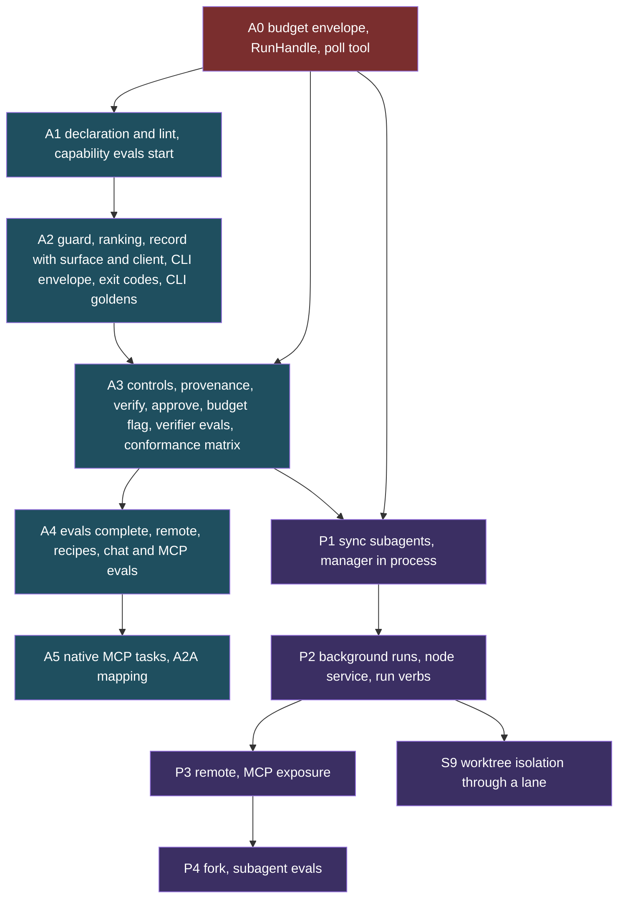

# PRD: Agent-backed capabilities and subagents

**Product / Feature:** Capabilities that may be backed by an agent, a recorded decision about when an agent runs, and subagents in `axi chat`.

**Owner:** Ben Booth (B-Tree Labs)   •   **Status:** Draft   •   **Last updated:** 2026-11-06

**Routing context:** dispatch is a routing decision under [ADR-201](../adrs/adr-201-routing-is-a-verdict-then-seats-guard-removes-options-graduated-seats-rank-the-rest.md) decisions 18 to 20; track C of `docs/working/router-pipeline-build-plan-2026-10-22.md` lists the routing dependencies.

**Decisions:** [ADR-232](../adrs/adr-232-capabilities-may-be-agent-backed-and-dispatch-is-a-recorded-verdict.md) (capabilities, dispatch verdict, controls), [ADR-233](../adrs/adr-233-chat-spawns-subagents-through-one-manager-and-one-run-handle.md) (subagents in chat), [ADR-237](../adrs/adr-237-every-agent-runs-on-one-harness-an-agent-is-a-contract.md) (one harness for every agent), ADR-236 (one permission model, draft #1614)

**Related (not changed by this PRD):** [prd-agents](prd-agents.md), [prd-chat-harness](prd-chat-harness.md) (session commands, `/fork`), [prd-capability-budgets](prd-capability-budgets.md) (spawn budget slices), [prd-work-verification](prd-work-verification.md) (proof of done), [prd-axiom-mcp-gateway](prd-axiom-mcp-gateway.md), [prd-evals](prd-evals.md), [prd-axiom-agent-plane](prd-axiom-agent-plane.md), [prd-agent-state-management](prd-agent-state-management.md)

**Why a new PRD and not an amendment:** the existing agent and chat PRDs describe the roster and the session commands. This feature crosses the capability registry, the dispatch guard, the MCP surface and chat, and has its own metrics. Extending `prd-agents` (a needs assessment) or `prd-chat-harness` (a trust and commands PRD) would bury it. Both are linked above so the relationship is explicit.

---

## 1) Elevator Pitch

A capability says how it may execute (a function, an agent, or a mix), the platform picks the cheapest rung that works and records why, and `axi chat` can hand bounded jobs to subagents that keep the parent's context small. Callers see one typed capability either way.

### Program goal (added 2026-11-06)

All Axiom agent work follows one sheet of music. An agent is a goal, a persona, contracts and capabilities, and every agent runs on one shared harness ([ADR-237](../adrs/adr-237-every-agent-runs-on-one-harness-an-agent-is-a-contract.md)). The program cleans up first, then demonstrates that it worked: each stage in the phased delivery table ends in a gate a job can check, and the program scorecard in section 7 measures the result. RIVET's incidents are the worked example because they are the best documented, and they stand for what any set of agents meets. Three pairings run through this document: **RIVET with KEEL** (a push under disk pressure, a CI failure the host caused), **PLINTH with KEEL** (a long job under pressure diagnoses and resumes) and **KEEL with KEEP and CLERK** (a credential on a command line; a leaking test becomes an owed fix).

## 2) Problem / Opportunity

- Today a model-backed capability such as `agents.ask` (`src/axiom/extensions/builtins/agents/skills/ask.py`) looks identical in the registry to a pure function. Nothing records that a model ran, what it could touch, or what it cost.
- Whoever writes the prompt chooses between a function and an agent. Nothing removes the agent when the caller may not spend, or the data may not leave; nothing escalates when the function says "unmet".
- Agents report success without evidence. The platform already has a rule that claims come from observed effects (`prd-work-verification`), but a capability has no place to declare its own check.
- `axi chat` has a synchronous delegate (`src/axiom/agents/delegation.py`) and a session `/fork`, but no way to run a child in the background, stop it, message it, or bound its spend as a slice of the parent's.
- Opportunity: the platform already has one dispatch chokepoint, a decision-record stream, a plan-hash approval path, immutable provenance and a budget specification. Wiring agents into those makes agent use auditable and cheaper than the usual version.

### What the code shows (2026-11-06)

At `origin/main` `40b86c581`; machine facts read once on one developer machine (macOS, Axiom 0.70.23 from a wheel).

1. **No release holds KEEL.** v0.70.23 was cut on 2026-10-31 before #1561 merged, and main is still at 0.70.23. The developer machine's wheel has no `node`, no `watch_integrity.py` and no `main_watch.py`. Its RIVET heartbeat runs code from before #1605, #1606 and #1610. Only the forge job runs current code.
2. **Installing KEEL would not be enough.** The manifest declares a heartbeat, but `startup = "lazy"` fails `is_always_on`, so the background service would never dispatch it.
3. **KEEL is blind on macOS and says it is fine.** `df -P -B1` is rejected by BSD `df`, and memory reads `/proc`. Run from main's source on this machine, `node vitals` returned `verdict: even keel`, `disks: []`, `memory: {}` at load 20, and published that verdict. Under ADR-231 that means room.
4. **Admission fails open.** `resource_level` returns "no pressure" for a missing or stale file.
5. **Main's own workflow cancels main.** `.github/workflows/ci.yml` sets `cancel-in-progress` true for `refs/heads/main`. No agent caused the cancelled run; a burst of merges and one line did. With it false, GitHub finishes the running job and keeps only the newest pending one, which is the "keep one verdict" rule at no agent cost.
6. **The merge-queue ruleset is not applied.** The rulesets API lists none. `CI_RUNNER` is `gcp`.
7. **`release.land` declares `risk = "read"` and merges under `--act`.** The baton counts that as a read.
8. **A0 landed on 2026-10-31 and was never wired.** `RunManager` and `register_poll_tools` have no production caller, the store is in memory, and #1568 is open. The "memory first" order on the epic came after it.
9. **`GraduationSource` is still live on main.** ADR-236 wanted it gone. Its writer landed unwired, so the table stays empty and nothing is wrong yet. Wiring the writer before PR 4 would create silent permits.
10. **Volumes leak from one flag.** Tested on this machine: `docker run --rm` with an anonymous volume, then `docker rm -f`, leaves the volume; `docker stop` does not. `timescale_container.stop()` uses `rm -f`, and `kit/medallion.py` starts with no `--rm` and removes with `rm -f`. The Postgres and TimescaleDB images both declare `VOLUME /var/lib/postgresql/data`. Separately, 16 `tsdb-*` and `sw-*` containers were still running 16 to 18 hours after their runs. Nothing in this tree uses the prefix `sw`, so that source is unknown.

## 3) Goals and Non-Goals

**Goals**

1. A capability can declare `deterministic`, `agentic` or `hybrid`, with a contract (persona, allow-list, model class, budget, output schema, verify step) for agent modes.
2. Dispatch picks the lowest rung that satisfies the request, escalates on evidence, and every verdict is a record usable for audit and evaluation.
3. Agent runs act as the caller with the intersection of permissions, deny writes by default, and treat tool results as data.
4. An agent-backed result carries provenance and is stored as an immutable fragment; success is backed by a declared deterministic check.
5. `axi chat` supports subagents with fresh context, a manager, send/stop/list, system-event notification, limits, and a path to remote and isolated runs.

**Non-goals**

- A new agent framework or a second registry. This extends `SkillRegistry` and the existing chokepoint.
- Autonomous self-escalation beyond declared limits.
- A recipe runner. ADR-185 keeps recipes runner-free; agent steps in a recipe are invoked by the following agent through the chokepoint.
- Choosing a model provider. That stays with routing (ADR-201).
- Pricing accuracy. Dollar figures are labeled estimates (`prd-capability-budgets` R3).
- Federation of subagents before the single-node path is proven (P3).

## 4) Personas

- **Extension author:** declares a capability and, if it needs an agent, its contract and verify step. Wants a lint that says what is missing.
- **Operator or person in chat:** wants answers fast and cheap, wants to see which rung ran and whether the result was verified, wants to stop a runaway.
- **Calling harness (over MCP):** wants one typed tool, cost visible in its description, and bounded latency.
- **Reviewer or auditor:** wants to ask why an agent ran, what it touched, what it spent, and whether anyone checked it.
- **Platform owner:** wants policy to remove options (data residency, budget, tier) without editing prompts.

## 5) User Stories

1. As an extension author, I declare `execution: hybrid` with a deterministic first step and an agent contract, and `axi ext lint` tells me if I forgot the budget or the verify step.
2. As a person in chat, I ask for a goal ("find out why this failed to start") and the platform tries the deterministic diagnosis first, then a bounded agent, and shows me the rung.
3. As an operator, I pin a capability `forbid_agent` for a site that must not send its data to a model, and the dispatcher never offers the agent rung there.
4. As a person in chat, I ask the assistant to "research X while I keep working"; it spawns a background subagent and I see a marked completion event, not a message that looks like mine.
5. As a harness author, I call the same capability over MCP and get a typed result, a provenance block and, for long jobs, a task handle I can poll.
6. As an auditor, I open a decision record and see which rungs were considered, which the guard removed and why, what was spent, and the verify outcome.
7. As an approver, a subagent's destructive step reaches me as a plan with the child's identity on it, and the child waits.
8. As a script author, I call an agentic capability from a terminal with `--json`, get a versioned envelope and a distinct exit code for verified, unverified, needs-approval, budget-exhausted and refused, and I am never prompted.
9. As an operator, I start a long job with `--detach`, close the terminal, and later run `axi agents status <run>` from another terminal.
10. As a maintainer, I see verified-success and cost per outcome sliced by surface and by calling harness, so a regression on one surface is visible.

## 6) Requirements

Each requirement is tagged with its phase. P1 to P4 apply to subagents (ADR-233). Capability phases are in the second table.

### Capabilities and dispatch (ADR-232)

| ID | Requirement | Phase |
|---|---|---|
| B1 | Budget envelope on `CapabilityToken` with `turns`, `tokens`, `dollars`, `wall_clock_seconds`; agent-backed runs refuse to start without one | A0 |
| B2 | Draw and decrement at step boundaries; remaining amounts readable; unused amounts refunded at completion | A0 |
| B3 | Inheritance on delegation and spawn is the intersection of the parent's remaining amounts and the requested slice | A0 |
| B4 | Exhaustion returns `unmet: budget_exhausted` naming the limit; recorded in the dispatch record and provenance `budget_drawn` | A0 |
| H1 | Internal `TaskHandle` / `RunHandle`: submit, state, progress events, result, cancel | A0 |
| H2 | Poll tool `<capability>.status` (and `.cancel`) as the guaranteed MCP fallback for long and remote calls | A0 |
| H3 | Native MCP progress and task support, enabled per client only after a per-client conformance test | A5 |
| H4 | A2A task lifecycle mapping for the handle, verified by a round-trip test before any remote agent-backed capability is enabled | A5 |
| C1 | `SkillSpec` accepts `execution`, `latency_class`, `data_residency`, `binding`, `dispatch`, `agent` as optional fields; undeclared stays deterministic and unchanged | A1 |
| C2 | `AgentContract` requires persona, allow-list, model class, all four budget limits, output schema; `verify` required when `risk` is not `read` | A1 |
| C3 | Projection to CLI, MCP, agent-tool and SKILL.md is unchanged in shape; MCP description states that a model may run | A1 |
| C4 | Guard removes rungs for permissions, residency, budget, approval and tier; recorded with reasons | A2 |
| C5 | Ranking picks the lowest satisfying rung; escalates only one rung at a time on stated evidence; precedence policy, declaration, hint, router | A2 |
| C6 | One `dispatch` decision record per call (content-free), feeding audit and regret evaluation | A2 |
| C7 | Failures return `chain` (`unmet`, `next`, `produced`), never raise across the surface | A2 |
| C8 | Effective permissions are the intersection of caller and persona; writes denied by default; destructive uses plan hash | A3 |
| C9 | Tool results handled as data; allow-list and guard enforced on every call regardless of model output | A3 |
| C10 | Result provenance block; immutable fragment via `CompositionService`; trace id links to the decision record | A3 |
| C11 | Verify step runs by the dispatcher, not the agent; result is `passed`, `failed` or `not_declared`; only `passed` (or a no-effect read) shows as success | A3 |
| C12 | Golden-trace eval and cost-regression test per agent-backed capability; shadow rollout before enable | A4 |
| C13 | Remote binding over MCP-HTTP or A2A with trust-graph check, label-join check and local verification of returned artifacts | A4 |
| C14 | Recipes may contain agent-backed steps, vetted with the step's golden trace; no runner | A4 |

### Subagents in chat (ADR-233)

| ID | Requirement | Phase |
|---|---|---|
| S1 | (needs A0) `spawn_agent` as a registered capability; fresh context, persona type, narrowing allow-list, budget slice, depth cap shared with delegation, synchronous | P1 |
| S2 | `SubagentManager` with run records (id, parent, state, budget, transcript ref, depth) | P1 |
| S3 | (needs H1) Background runs; completion and progress as marked system events never rendered as user input; `send`, `stop`, `list`; runs view in the TUI; default 3 concurrent children, configurable, queueing beyond | P2 |
| S4 | Approvals from children bubble to the human with the child named; background child without a human stays paused | P2 |
| S5 | Child transcripts stored as linked fragments parent to child | P2 |
| S6 | `RunHandle` interface shared by local and remote runs; remote binding with federation trust | P3 |
| S7 | MCP exposure of spawn, send, stop, list under the identity gate; double-nesting guard; progress via the H2 poll tool | P3 |
| S8 | Optional fork of the parent context (label-join permitting) | P4 |
| S9 | Optional git-worktree isolation for code-editing agents, through a lane with an owner and an expiry; manager never merges | S9 |
| S10 | Eval harness for subagent traces | P4 |

### CLI surface, node service and evaluation (ADR-232 parts 8 and 9, ADR-233 parts 10 and 11)

| ID | Requirement | Phase |
|---|---|---|
| K1 | CLI verbs of agent-backed capabilities go through the same dispatcher, loop and dispatch record; flags `--wait` (default), `--detach`, `--json`, `--approve`, `--no-input`, `--budget`, `--prefer` added by the projector | A2 |
| K2 | `--json` result envelope `axi.capability-result/1`: dispatch verdict, verified state, cost, trace id, unmet list; versioned, additive within a major | A2 |
| K3 | Exit-code table (0 verified or read-only, 3 unverified, 4 verify or schema failed, 5 unmet, 6 budget, 7 guard refused, 8 run not finished, 9 stopped; 1, 2, 130 as today) | A2 |
| K4 | No prompting on non-interactive CLI; `approval_required` carries the plan hash; `--approve <hash>` binds capability, params and scope; a mismatched hash is rejected; TTY prompt only with a TTY and no `--no-input`; an agent never approves itself | A3 |
| K5 | `--budget` may only lower; a value above the envelope is a usage error | A3 |
| N1 | `SubagentManager` hosted as a single-flight node service with durable run records; start-on-demand or `run_service_unavailable`; embedded mode for `--wait`; owner-aware recovery (dead owner becomes `failed`, cause `node_restart`) | P2 |
| K6 | Run verbs from any terminal: `axi agents list runs`, `status <run>`, `stop <run>`, `send <run> <msg>`, `wait <run>`; `/agents runs` stays the TUI view | P2 |
| K7 | Run verbs honor `--json` and the exit table; the same verbs are projected to MCP | P2 (CLI), P3 (MCP) |
| E1 | Layer 1 capability evals through the dispatcher: rung, escalations, schema, verify, cost, latency, tool trace; recorded-model replay in CI | A1 start, A4 complete |
| E2 | Live scheduled eval runs with pinned model versions, replicates, confidence intervals, paired comparison | A4 |
| E3 | Layer 4 verifier evals: an injected false success must be caught | with the first agentic capability (A3) |
| E4 | Layer 2 surface conformance matrix (chat, MCP, CLI): same verdict and envelope | A3 and S1 |
| E5 | Layer 3 CLI goldens: stdout and stderr, exit codes, `--json` schema, detach and wait semantics | A2 |
| E6 | Layer 3 chat evals: right capability and rung from natural requests; child events as system events, never user input | A4 (P2 for child events) |
| E7 | Layer 3 MCP evals: tool-selection accuracy per client harness; server-side gates | A4 |
| E8 | Dispatch record carries `surface` and `client`; metrics sliced by both | A2 |

Capability phases: **A0 prerequisites (budget envelope, internal task handle, poll tool)**; A1 declaration and lint; A2 guard, ranking, record; A3 controls, provenance, verify; A4 evals, remote, recipes; A5 native MCP progress and tasks, A2A task mapping. Where the new pieces land: the dispatch record with `surface` and `client` (E8), the envelope, the exit table and CLI goldens (K1 to K3, E5) land with A2, because A2 is where the record exists; capability evals start at A1 (the declaration gives them a target) and are complete at A4; `--approve`, `--budget` and the verifier evals land with A3, together with the first agentic capability; the surface conformance matrix lands at A3 and S1, when a second surface can call a real agentic capability; the node service (N1) and the run verbs (K6) land with background runs in P2, while the manager class itself exists from S2 in P1 and runs in process. A0 comes before A3 and before S1: neither the budget envelope nor any task or progress plumbing exists in the tree (verified 2026-10-31 under `src/axiom/governance/`, `src/axiom/extensions/builtins/mcp/` and `src/axiom/vega/federation/`). P1 can ship with A0, A1 and the start of A3, since synchronous local subagents need the budget, the contract and the controls but not the full ranking.



### Model selection: registry and evaluation (ADR-234)

The model-axis requirements. Phases are in the table above and are not repeated here.

| ID | Requirement | Phase |
|---|---|---|
| MD1 | A model registry whose entry is the capability card of one model: declared fields (price, context, tool use, structured output, vision, cache-read price), attested fields (regimes, retention, training use, region, onward processors; first-party only), measured fields (quality per capability class with n and eval set id, latency, tool-call reliability, cache hit rate) | M0 |
| MD2 | A declaration names a model class, never a model id; resolution is through the registry under the guard | M0 |
| MD3 | Guard removal with a reason code for: regime, residency, deployment tier, retention, hosted router, capability need, budget, parent set, health, quarantine | M0 |
| MD4 | Dispatch receipt records models considered, removed (with reason), chosen (with score table) and each escalation hop, with tokens and cost | M1 |
| MD5 | Fallback or failover that changes the processor goes back through the guard; a transport is never configured with a fallback list that crosses a label boundary | M1 |
| MD6 | External routers are providers behind a seat, advisory until graduated by paired evidence on site data; the adapter drops any answer outside the survivors | M2 |
| MD7 | Model cascade shares the capability's verify gate, budget and escalation record; subagent model sets are the intersection with the parent's survivors | M3 (subagents with P1) |
| MD8 | Per-model, per-capability-class quality tables; paired comparison; pinned versions; reported-model drift event; canary regression gate with quarantine | M4 |

Evaluation of the model axis uses the layers already planned (E1 to E3): replay mode in CI checks that removals, rankings and hops match the recorded receipt; live scheduled runs (E2) fill the measured fields and run the canary; the verifier evals (E3) double as the cascade's scorer tests. A model change that lowers measured quality in any capability class beyond its stated interval blocks enabling that model for the class.

### Agent harness, KEEL and RIVET (ADR-237)

The requirements for these items are the subsections below. Their phases are in the phased delivery table.

#### What "operational" means, and where each agent stands

| Test | Passes when | Source |
|---|---|---|
| Deployed | An installed release holds its code; roster and persona agree | Roster, wheel contents |
| Dispatched | Its heartbeat or trigger fired in the last two intervals, or it declares `on_demand` with a reason | `ticks.jsonl`, receipts |
| Hands off | Each hand-off in its manifest has executed at least once, with a receipt | Receipts; `next_steps` alone does not count |
| Evaluated | Its golden replays and a verifier eval pass at this commit | `tests/evals/agents/<agent>/` |
| Exercised | It resolved a real or injected case in the last 30 days | Receipts, drills |
| Remembers | Its last run recalled before acting and recorded after verify, through Memory | Memory receipts; a private pattern file does not count |

`axi agents readiness [--json]` prints one row per agent and exits non-zero on a regression. It reads receipts, so it needs no agent to report on itself.

**Baseline.** From `axi agents status` and the code on 2026-11-06, one developer machine. Evals: no per-agent eval file exists for any agent. Playbooks: only RIVET has one. "Exercised" is left unknown unless shown.

| Agent | Extension | Deployed | Dispatched here | Real hand-offs | Evals | Exercised | Plan |
|---|---|---|---|---|---|---|---|
| RIVET | release | Old wheel | Every 5 min | None found by `invoke_capability`; events to bus | No | Yes, reports and landings | Reference |
| KEEL | node | **No** | Not installed; `lazy` | HERALD, `whoami.report` | No | Unknown | Reference |
| TIDY | hygiene | Yes | Every 5 min | Not found | No | Yes, by reports | Fold into KEEL |
| TRIAGE | diagnostics | Yes | Stopped 09-21 | Not found | No | Unknown | Fold into KEEL |
| KEEP | vault | Yes | Stopped 09-21 | Not checked | No | Unknown | Consent, then App identity |
| CLERK | program | Yes | Never run | Not checked | No | CLI and MCP used | Consent; receives follow-ups |
| PRESS | publishing | Yes | Stopped 09-07 | Not checked | No | Unknown | Consent; digest |
| SCAN | signals | Yes | No run recorded; no heartbeat command, so status "enabled" misleads | Not checked | No | Unknown | Correlation capability |
| HERALD | notifications | Yes | On demand | Target of others | No | Yes, called | Evals |
| GUARD | authz | Yes | On demand | Target of others | No | Yes, by chokepoint | ADR-236 |
| PLINTH | data_platform | Yes | On demand | Not found in skills | No | Yes | Second reference |
| PULSE | schedule | Yes | On demand | Not checked | No | Unknown | Retry service |
| CURIO | research | Yes | On demand | Not checked | No | Unknown | Eval capability |
| WARDEN | federation | Yes | On demand | Not checked | No | Unknown | No work; declare on demand |
| CHALKE | classroom | Yes | On demand | Not checked | No | Unknown | No work; declare on demand |
| Axi | chat | Yes | On demand | `agents.ask` | No | Yes | Evals; prime agent, #473 |

Also dispatched by the service, with no agent on the roster: `directory`, stopped 09-07. Every "stopped" row traces to one consent decision at 0.47.0: core agents absent from it were not dispatched. Status reports it plainly, and nothing alerted.

**Owner of record.** ADR-230 says KEEL owns the machine. The tree still has three personas. Until KL3 lands the roster stays as listed, new capabilities go only to `node`, and any question for TIDY or TRIAGE is KEEL's by intent. Delegation below uses KEEL.

#### Delegation: who really has the skill

| Hand-off | To | Has it? | Gap |
|---|---|---|---|
| Disk, load, vitals | KEEL | `node.vitals`, `node.inventory`, `node.clean` (plans) | macOS; `apply`; RT1 |
| Host diagnosis | KEEL | `node.doctor`; incident code still in `diagnostics` | KL2 |
| CI diagnosis | RIVET itself | `failure_patterns`, `failure_narrative`, `plan_repair` | Contract, verify |
| Data diagnosis | PLINTH | `data.diagnose`, `data.troubleshoot` | Real hand-offs from KEEL |
| Notify | HERALD | `notifications.alert`, `notifications.send` | None; add dedupe key per incident |
| Gate | GUARD | `decide()` | `pr.*` not live; ADR-236 |
| Forge credential | KEEP | `vault.*`, `vault.git_credential` | **No GitHub App minting.** No App exists; workflows use `github.token` |
| Follow-ups | CLERK | `program.followup_add` | Not yet called by any agent; call it |
| Schedules | PULSE | `register`, `fire_now`, `pause`; `one_shot` | **Backoff unread;** `_allowed` bug (ADR-236 finding 6) |
| Correlation | SCAN | **No.** `correlator.py` is people and initiatives | `signals.correlate` |
| Evals | CURIO | **No eval capability.** `confidence_gate`, `quality_gate` only; evals are a library | `research.eval_run` |
| Digest | PRESS | `press.draft`; RIVET holds `release.ci_digest` | Render through PRESS; light |

#### KEEL: the environment owner

**Deployed to developer machines (KL0).** KL0 replaces Linux-only collectors with a platform seam, and a collector that cannot read a resource reports it unknown. Tick is the existing heartbeat at 900 seconds, made dispatchable. Tighten to 300 on a machine where a push or test is active.

**Waste inventory: `node.waste`.**

| Resource | Inventory from | Attribution | Ageing rule | Gate answer |
|---|---|---|---|---|
| Worktree, clean, merged, inactive, branch kept | `git worktree list`, `worktrees.py` signals S1 to S4 | Lane owner; branch; last commit author | Past expiry, or 14 days after merge | `notify`; undo is `git worktree add` from the kept branch |
| Worktree, dirty or unmerged | Same | Same | Reported at 30 days | `ask`; **never automatic** |
| Local branch, merged | `branch_prune.py` | Lane; PR | After merge | `notify`; archive ref exists today |
| Anonymous volume, labelled, run ended | Labels | Run label | 24 hours | See D3 |
| Anonymous volume, unlabelled, unattached | `docker volume ls -f dangling=true` | Unknown; created time, nearby runs | 7 days | `ask`, one plan per batch |
| Named volume | Labels, compose project | Project | Reported only | `ask` |
| Container, exited | `docker ps -a` | Name prefix, labels | 7 days if labelled | `notify` if labelled; else `ask` |
| Container, running, its run gone | Label plus run record | Run label | At once | `notify` if labelled; else `ask` |
| Image, unused | `docker system df` | Reported, pullable | 30 days | `notify` |
| Caches: pip, `uv`, pytest, ruff, build cache | Declared paths | Tool | Size cap | `allow`; regenerable by definition |
| Temp | Agent scratch, `/tmp` by owner | Session directory | 7 days | `notify` |
| Venv | Declared; `editable_bindings` floor | Lane | With its lane | `ask` |
| Orphan process | Process registry, `AXIOM_PROC_MARK` | Mark | Past `max_runtime_s` | `process.sweep` with `verify_ours` |
| Stacked sweeps (load 28) | Process registry | Agent, chain | Immediate | Admission: one per purpose per machine |

**Floors never crossed.** Dirty work, an editable install bound into a tree (`F2`), a process with its working directory inside, a held lane, a locked worktree, anything unattributed. A branch is never deleted by a worktree reclaim. KEEL does not remove what it cannot attribute without a person's `ask`: this keeps the standing rule that an agent never removes a resource it did not create, and extends it to resources whose creator cannot be shown.

**Attribution.** Each creation carries an owner: `AXIOM_PROC_MARK` for processes (built), container and volume labels `axiom.run`, `axiom.session`, `axiom.agent` (new), lane owner for worktrees (built). The session id comes from the harness where it exposes one, per the same verified matrix as MR3; otherwise from the lane. The report groups by session, agent and test module: "this module left 74 volumes this week."

**Growth, not only a floor.** Vitals keep a short history and compute GB per hour and hours to floor per mount, and counts per resource type. An alert fires at under 24 hours to floor, or at a count growth far above that machine's median, as `pressure` before any floor is near. Thresholds per site.

**Feeding back.** Each source becomes a fix: `node.waste` groups by source, and one finding above threshold calls `program.followup_add` naming the test or tool. First fix, KL7: `timescale_container.stop()` and `kit/medallion.py` use `rm -f -v`, test databases mount tmpfs at `/var/lib/postgresql/data`, a session fixture removes containers by run label, and `tests/` gains a guard that fails on a `docker rm -f` without `-v`. CI gets a post-suite check that zero labelled resources survive.

**Creation discipline: KL6.** `lane.claim` gains `worktree = true`, `expires`, `purpose`, and a default expiry. It creates the worktree, so the lane records owner, branch, expiry and the tree. `spawn_agent`'s isolation uses it. Harness built-ins and plain `git worktree add` bypass it, so a `post-checkout` hook adopts them unowned, and `node.waste` reports them under "not governed". A per-owner cap makes the cost visible: past it, `lane.claim` asks. Renewal is one command. AGENTS.md states the path.

**Contract: KEEL gives RIVET admission control.**

1. KEEL publishes `node/vitals.json`: `verdict` (`even keel`, `pressure`, `critical`, `blind`), `at`, per-mount free and floor, `hours_to_floor`, load, and which resource is short.
2. Before a push, `release.push_gate` reads the verdict, from the pre-push hook and from agent chains alike.
3. `pressure` or `critical`: the push **holds**. It is deferred, not failed. RIVET calls `node.reclaim` on a `high` child chain with the amount needed.
4. KEEL reclaims what its rules allow and returns what it freed, and what needs a person.
5. RIVET rechecks on the retry service. Enough room: the push resumes. Budget spent: HERALD alerts once, naming the mount and the reclaim outcome.
6. `blind`: the push proceeds, marked, and KEEL's blindness alerts.
7. A failure with host evidence (`No space left`, runner disk, OOM) is class `host_resource`, reported as "disk floor on this host", and never counted as a test failure or a flake.

The same contract serves PLINTH: `data.adopt_tick` reads the verdict, holds, asks for room, resumes.

#### First agentic capability: `release.ci_diagnose`

Hybrid: R1 the pattern database, R3 the narrative already in `failure_narrative.py`, R4 an agent loop. It only reads, so it can run in shadow early, and its verify is real. `agents.ask` remains A3's declaration migration, as #1571 says, with `verify: not_declared`; it proves no verifier, so it should not be the proof.

```toml
[[extension.provides]]
kind = "skill"
name = "release.ci_diagnose"
execution = "hybrid"
risk = "read"
latency_class = "bounded"
data_residency = "site"
binding = "local"
verify = "release.verify_diagnosis"
budget = { turns = 6, tokens = 40000, dollars = 0.50, wall_clock_s = 120 }

[extension.provides.agent]
persona = "agents/rivet/persona.md"
model_class = "standard"
allowed_tools = [
  "release.ci_health",
  "release.ci_job_log",       # new, bounded read of one job's log
  "release.list",
  "node.vitals",
  "agents.chains",
  "memory.recall",
]
stop_conditions = [
  "verify passed",
  "failure_class is host_resource: hand to node.doctor",
  "same signature seen twice on this head",
  "budget edge",
]

[extension.provides.agent.output_schema]
type = "object"
required = ["failure_class", "signature", "subject", "evidence", "retryable", "next"]
[extension.provides.agent.output_schema.properties]
failure_class = { enum = ["real_test", "main_red", "stale_branch", "flake", "lost_runner", "transient", "host_resource", "workflow_config"] }
signature = { type = "string" }
subject = { type = "object", description = "repo, head sha, workflow, job" }
evidence = { type = "array", description = "log lines with run and job ids; quoted exactly" }
culprit = { type = "string", description = "first red commit when known" }
retryable = { type = "boolean" }
next = { enum = ["retry", "update_branch", "hand_to_keel", "open_fix_worker", "tell_a_person"] }
```

The field names follow `AgentContract` and `Budget` on the #1583 branch. Budget numbers are starting estimates to replace with the first replay costs.

**Verify, `release.verify_diagnosis`, deterministic:** each evidence line occurs in that job's log at that sha; `failure_class` agrees with a rule table where one applies (a test id for `real_test`, a runner-lost marker for `lost_runner`); `signature` re-matches the log; a `flake` claim needs a passing rerun on the same head. A verifier eval injects a fabricated line and a wrong class, and both must fail.

**Rollout:** shadow, then the verified result replaces the R1 report when it matches, then `next: retry` drives RV2. Recorded signatures go through a CURIO gate into the pattern database, so R4 covers less each month.

#### Failure retries

Defaults for RIVET as the first declaring agent, replaceable per deployment. Delay is `uniform(0, min(cap, base * 2 ** attempt))`.

| Class | Retry? | Attempts | Base | Cap | Budget |
|---|---|---|---|---|---|
| Lost runner | Yes | 3 | 60 s | 15 min | 3 per commit |
| Flake | Yes, and record | 2 | 120 s | 10 min | 2 per commit |
| Transient network or API | Yes | 4 | 30 s | 10 min | Respects `Retry-After` |
| Rate limited | Wait | Limiter decides | | | Shared limiter |
| Stale branch | Update, not retry | 1 | | | One at a time |
| Host resource | After reclaim | 2 | KEEL decides | 30 min | Per head |
| Main already red | No | | | | Waits for main |
| Real test failure, workflow | No | | | | Diagnose once |

Storm or `critical`: all retries pause; their clock does not run. A repeat of one signature, or a spent budget, escalates once. Other agents declare their own classes: PLINTH's `transient_store` and `connector_timeout` use the same service.

#### Proof

**Replay evals.** Each is a fixture in `tests/evals/incidents/`, run by the #1583 replay harness. Fixtures from real runs where ids are known; "capture" means the raw log still has to be collected.

| Incident | Agents | Fixture | Passes when |
|---|---|---|---|
| Hung push, 11-05, about 5 hours | RIVET, KEEL, HERALD | Fake hook that never returns | Stopped within the bound; alert names the push; class not test failure |
| Poisoned venv cache across runner types | RIVET | Capture; fix was `37b3b9985` | Class `workflow_config`; `ci lint` finds the old shape |
| Lost runner | RIVET, PULSE | Capture; run id unknown | Retried with jitter, within budget; then one escalation |
| Flaky timing test | RIVET, CLERK | #1612: p95 2.292 s against 2.0 s on a loaded runner | Pass on re-run still records the flake; follow-up opened |
| Host disk floor | KEEL, RIVET, HERALD | Fake `df`, real verdict flow | Push holds; reclaim; resumes; failure reported as host |
| Waste, 11-06 | KEEL, CLERK | Labelled and unlabelled volumes | Only labelled reclaimed; report names the source; follow-up opened |
| Blind sensor | KEEL | `df` failing | `blind`, never `even keel`; admission marks it |
| Merged regression | RIVET | #1596 runs `42134326857`, `42145314359`, `42148438808` | Culprit named; draft revert only where policy allows |
| Repeated cancelled main | RIVET | 11 cancelled runs, 11-06 | Reported blind; verdict kept; lint finds the setting |

**Pairings, no runtime change.**

| Pairing | Case | Diff allowed |
|---|---|---|
| KEEL alone with SCAN (#540) | A workload exhausts a memory limit; bounded reversible bump; verify recovery | Persona, contract, capabilities |
| PLINTH with KEEL | Long adoption hits pressure: admission defers, KEEL reclaims, `data.adopt_tick` resumes, `data.diagnose` explains; verify is `data.pipeline_proof` | Persona, contract, capabilities |
| KEEL with KEEP | `node.inventory` sees a credential on a command line and hands to `vault.exposed` for real | Manifest hand-off only |

**Drills.** A sandbox repo with deliberately failing workflows, on a PULSE schedule, one class a week: hang, lost runner, flake, full disk on a disposable runner, red main, storm, cancelled main, leak. Each drill records detection time and whether a person acted. The sandbox holds no real credentials and its App identity reaches nothing else.

**Scorecard.** One artifact: the program scorecard, agent readiness, drill results, cost per verified outcome. Fed by jobs only. A figure that has no source shows `not measured`, never zero.

#### Skill chaining: proof of use and value

[ADR-185](../adrs/adr-185-tools-declare-what-they-need-and-make-and-vetted-chains-are-published-as-recipes.md) and [ADR-186](../adrs/adr-186-chain-readiness-is-a-level-an-extension-claims-and-lint-verifies.md) built the declarations, the chain response, the ledger, recipes and the lint. Tests show the machinery works. They do not show that agents use it or that it helps, and until both are shown it counts as unproven.

**Baseline, measured 2026-11-06 on one developer machine.** Deployed nodes have not been measured.

| Measure | Value | Source |
|---|---|---|
| Audited skill calls carrying a chain id | 0 of 44,674, since 2026-09-03 | `audit/actions.jsonl` |
| Recent agent sessions that passed `_chain` | 0 of 30 | Session transcripts |
| Capability calls arriving through MCP | 90 of 20,534, since 2026-09-21 | `telemetry/capabilities.jsonl` |
| Skills owing declarations | 173 of 392; 107 of them in six extensions the core agents depend on | `docs/working/skill-chaining-debt.md` |
| Recipes | 6, of which 5 are ready; none covers CI, landing, releases, data kits or node cleanup | `recipe.list` |

`_chain` is optional and nothing happens to a caller who omits it, so chain use cannot be measured while it depends on callers. The dispatcher assigns the id instead (CH1). Usage counts come from the audit record, because the baton ledger prunes finished chains.

**The proof has four parts.** Each can fail, and a failure is reported as one.

1. **Use on real work.** Over 30 days on deployed nodes, from receipts: at least 50% of offered next steps are followed in the same chain, at least 70% of refused calls succeed after the stated fix, and at least 80% of started recipes finish. Runs from tests are excluded.
2. **Controlled comparison.** At least 20 held-out tasks, three runs each, in at least two tier-1 harnesses, with chaining on and with the hints stripped. Grading is blind to the condition. Chaining passes if task success rises by at least 15 points, or is equal with at least 30% fewer tool calls, and unsafe actions are no higher in either case. The tasks and these thresholds are committed before the first graded run and do not change after it.
3. **Negative controls.** Removing a declaration fails the lint. A broken `requires` is refused with its fix. The comparison is rerun with a next-step hint deliberately wrong, and results must get worse; if they do not, the comparison cannot see what it claims to measure.
4. **One real incident.** A real RIVET and KEEL incident runs through a published recipe under one chain id, and the audit record alone replays what happened and who acted.

The comparison lives in `tests/emergence/` so that someone who did not build chaining can rerun it. If part 2 fails, the owner decides between fixing the hints and cutting the machinery back to what the evidence supports. More of the same declarations is not the response.

#### A local install stays responsive, and KEEL keeps it that way

A developer running Axiom in dev mode, and every product built on it, must be able to work on an ordinary machine without agents consuming it. The install gets a budget and stays within it. KEEL enforces the budget without asking the person.

Measured on one developer machine, 2026-11-09: one full test sweep took free disk from 51 GB to 16 GB, two sweeps at once took load to 125, 579 leaked container volumes held about 170 GB, and more than 150 worktrees had accumulated, 70 of them on merged branches.

Why worktrees still piled up, although the detection exists:

1. The stale-worktree detector can surface a finding, but `--prune` is a manual verb under `axi hygiene`. Nothing schedules it.
2. The worktree rules are TIDY's persona and skill; KEEL's `node.clean` plans models, images and tiers and never looks at worktrees. The merge of TIDY into KEEL moved the name, not this duty.
3. The persona says a merged PR triggers the prune, but `rivet.pr_merged` exists only in prose. No code emits it or listens for it.
4. KEEL's heartbeat never ran (`startup = "lazy"`), and a machine on a release older than KEEL has no `axi node` at all.
5. The dirty floor counts generated `runtime/` and `.axi/` state as if it were work, so a finished worktree can never be proven safe.

**Requirements.**

| Layer | Requirement |
|---|---|
| See | KEEL reads disk, memory, load, the container runtime's real size, worktrees, volumes and test databases on every supported host. A failed reading is `blind`, never healthy. |
| Size to the machine | Setup derives limits from the hardware: test workers, concurrent agents, worktrees, container storage, retention. Lowering is always allowed. Exceeding the safe ceiling needs an explicit override that is logged. |
| Admit | Test sweeps, container starts, subagents, new worktrees and bulk ingest ask KEEL first. Under pressure the work shrinks, then queues, then is refused with the reason and what would free room. Interactive use keeps reserved headroom. |
| Own and expire | Everything Axiom creates carries owner, session, purpose and expiry. KEEL removes expired labelled items with no prompt, on a schedule and on merge. Unlabelled items are reported and never deleted. |
| Keep work safe | A worktree is removed only when its commits are on the default branch or a merged PR, and it has no uncommitted work. Generated state is archived first. Branches are kept. |
| Compress | Old logs, telemetry, test output and local time-series data are compressed on a schedule that tightens with pressure. How much loss measured data may take is set per stream by its lossiness policy (#1695); with no policy, keep everything. |

**Proof.** A heavy simulated agent day on a small machine profile (16 GB memory, nearly full disk). The status command stays responsive throughout, free disk never crosses the floor, and every refusal names the next step. Negative controls: a planted unlabelled container and a user's own database both survive, a finished worktree is removed without a prompt, a worktree with uncommitted work is not, and a removed sensor reads `blind`.

#### Every agent uses Memory

Memory is the one memory of every agent. RIVET is the first case, not the rule's scope. Today RIVET does not use the Memory extension: it keeps learned patterns in `AgentKnowledgeStore` (`src/axiom/agents/learning.py`), a local file that `src/axiom/agents/sharing.py` also federates between nodes. A file on one machine cannot follow an agent to a hosted runner, and it is a second memory system.

| ID | Requirement | Stage item |
|---|---|---|
| AM1 | The shared run loop recalls before an agent acts, through the MR3 read path, scoped to that agent and task. A persona or contract does not opt in; it declares only what to recall | AMEM |
| AM2 | The loop records after verify: the signature, what was tried, and whether `verify` held. A failed or unverified fix is recorded as such and is never recalled as a fix | AMEM |
| AM3 | Recalled memory informs a decision and never authorises one. `decide()` still answers every action, and recall output is data, not instructions | AMEM |
| AM4 | Memory stays within its existing boundaries: per organization and per account, secrets to the vault, the serving gate on every read. No org's incidents, logs or signatures reach another's agent | AMEM |
| AM5 | An agent on a hosted runner reaches Memory with a run-scoped credential from KEEP, or records through a durable forge-side store that Memory absorbs. If Memory cannot be reached, the agent acts without recall and says so; it never blocks on memory | AMEM |
| AM6 | `AgentKnowledgeStore` retires: existing patterns are imported through the Memory import primitive, `agents/cli.py` and `agents/sharing.py` move to Memory, and federation of patterns follows Memory's federation rules. No second store remains | AMEM2 |
| AM7 | Every agent's waste, drift, flake and incident findings use the same path, including KEEL's `node.waste` | AMEM, KL5 |
| AM8 | Proof: a replay of a repeated incident shows the second occurrence resolved faster with recall than without, and the readiness "Remembers" test passes for every agent on the roster | Gate 4 |

Identity and rollout stay portable. Nothing about a particular repository lives in agent code: policy is repository configuration, and state is per installation. Each organization gets its own App from a shared manifest, with its own keys, runners, state and Memory, because a private App installs only on the account that owns it. A new organization starts watch-only and gains acting through the gate, per repository.

### Phased delivery (the single source of truth for phases)

Other documents reference this table and do not copy it. Since 2026-11-06 it holds the whole program in order: six stages, 0 to 5, each ending in a gate row, with the existing A, P and M phases, the memory read-path phases MR1 to MR4, and new items placed in sequence. `KL` is KEEL, `RT` runtime, `RV` RIVET, and `236/n` is pull request n of the ADR-236 migration plan. **Now** in Status means it can start today. The router build plan's track C lists only the routing releases each phase depends on. Owners are not assigned. Versions are assigned at cut (`axi release cut`), one release per phase, each shipping shadow first and behind a setting.

External prerequisites, all verified in the tree on 2026-10-31: ADR-152 is **Proposed**, not Accepted, and ADR-201 depends on it reaching Accepted; ADR-201 is Proposed and supplies the model-class names (`simple` to `smartest`, decision 9); the decision record, observe-only stage points and sink gate are the router plan's R2, R4 and R3, none of which this PRD builds.

| Stage | Phase | Contents | Depends on | Owner | Status | Exit criteria | Ships |
|---|---|---|---|---|---|---|---|
| 0 Stabilise | CI | `cancel-in-progress` false for main; merge-queue ruleset (#1518); bounded unattended push; `ci lint` rule for the setting | none | RIVET | **Now;** ruleset D2 | No started main run cancelled | repo settings |
| 0 | LAND | Land #1612, #1583, #1617; rebase or close #1542 chain, #1472, #1473, #1475; check #1516 for retired terms; close #1596 | CI | RIVET with authors | **In flight** | Green main; all open pull requests owned | internal |
| 0 | REL | Cut and install a release holding all the above; restart stale MCP servers | LAND | RIVET, KEEL by hand | D1 | Installed version matches on each developer machine | release |
| 0 | AUTHZ | Answer: does a real `Verdict` deny at every production caller? Covers `_allowed` (ADR-236 finding 6), the fail-open authority hook, `GraduationSource` while its writer is unwired | none | GUARD | **Now** | Written answer with a test | internal |
| 0 | **Gate 0** | A green main, an installed release, no open safety question | above | owner |  | **Exit Stage 0.** The last 20 main runs include 0 started runs cancelled and end green. A pending run replaced by a newer one shows as cancelled, never started and cost nothing, so it does not count. Every open pull request has an owner. `axi --version` on each developer machine matches the release. The authz check has a written answer with a test. The forge watch and the local heartbeat agree. |  |
| 1 One of everything | KL1 | Move `hygiene` capabilities to `node`: `worktrees.py`, `branch_prune.py`, `disk_ladder.py`, `lane_reclaim.py`, `heartbeat_liveness.py`, `retention.py`, `doc_hygiene`. No new capability in `hygiene`. Move, do not rewrite | Gate 0 | KEEL | Starts after Gate 0 | Tests move with skills | internal |
| 1 | KL2 | Move `diagnostics` and `install_health`: checks to `node.doctor`; incident chat, comms and interview with them | KL1 | KEEL |  | Tests move with skills | internal |
| 1 | KL3 | Delete the three extensions and the TIDY and TRIAGE personas; fix 21 importers; shrink the naming guard list | KL2 | KEEL |  | Roster, handshake and write-back agree on 14 agents | internal |
| 1 | KL4 | ADR-046's subscription moves to KEEL: `rivet.pr_merged` drives reclaim; close the `ci_watcher.py` overlap with RIVET | KL3 | KEEL, RIVET |  | A merge event triggers a reclaim plan | internal |
| 1 | PERM | ADR-236 in order: 236/1, 2, 3 (#1503 landed; file sink remains), 4 (#1504's writer landed; remove `GraduationSource`), 5, 6, 7, 11; accept the ADR; 236/12 registers `pr.*`, `node.reclaim.*`, `lane.*`; 236/13 enforces | Gate 0 | GUARD | Draft #1614 | 236/12 shadow shows no loosening | internal |
| 1 | LADDER | Delete the old ladders: 236/18 to 22 | PERM | GUARD |  | Deletions per ADR-236 section 7 | internal |
| 1 | ONE | One repo list: `watched-repos.toml`, read by the lander. Split `release.land` into a read and an acting capability | 236/6 for the split | RIVET | **Now** for the list | One list; merges count as writes | internal |
| 1 | CH1 | The dispatcher gives every skill call a chain id with no caller action: one chain per session, a one-step chain for a lone CLI call. `_chain` stays for a caller linking a specific run | none | Harness | **Now** | A call with no `_chain` reaches the audit record with a chain id | internal |
| 1 | LE1 | KEEL reads the host on every supported platform, its heartbeat dispatches, and one test sweep runs at a time on a machine | none | KEEL, RIVET |  | The heartbeat fires on a developer machine; two concurrent pushes take turns |
| 1 | CH2 | KL1 and KL2 carry `risk` and `requires` with each move, because `node` claims Level B and `hygiene` brings 12 skills that owe them | KL1 | KEEL |  | `node` still claims Level B after the move | internal |
| 1 | **Gate 1** | Fewer concepts; net code goes down | above | owner |  | **Exit Stage 1.** `extensions/builtins/` has no `hygiene`, `diagnostics` or `install_health`. `agents.roster` lists 14. `check_raci`, the trust matrix and `raci_review` are gone. One repo list. `decide()` is the only decider of a RIVET action. Net line count for the stage is negative, from `git diff --shortstat`. Every dispatched skill call carries a chain id without the caller passing one. |  |
| 2 Honest baseline | KL0 | KEEL on developer machines: macOS collectors, `startup = "daemon"`, core consent reconciled, `blind` verdict, vitals history | KL3, REL | KEEL |  | Real disks on macOS, or `blind` | `axi node` everywhere |
| 2 | RT1 | Named verdicts, `host` and `forge`; `blind` never reads as room (ADR-237 decision 3) | KL0 | Harness |  | Replay: blind sensor | internal |
| 2 | RT7 | `axi agents readiness` and the daily scorecard | KL3 | Harness |  | Five tests per agent, from receipts | `axi agents readiness` |
| 2 | CH3 | Clear the declarations for `agents`, then `release` | none | Harness, RIVET |  | Both claim Level B | internal |
| 2 | CH4 | Chain use from receipts in `axi agents readiness` and the scorecard: next steps followed, refusals recovered, recipes finished | CH1, RT7 | Harness |  | Each figure sourced or `not measured` | internal |
| 2 | LE2 | Ownership labels on everything Axiom creates; KEEL takes over worktree duty and removes expired labelled items on schedule and on merge | LE1 | KEEL |  | A finished worktree and an expired test container go with no prompt; unlabelled items survive |
| 2 | LE3 | Setup derives budgets from the hardware; overrides past the ceiling are logged | LE1 | KEEL |  | Two machine profiles get different limits from the same install |
| 2 | LE4 | Admission enforced on sweeps, then agents and worktrees; a stale or missing reading fails blind | LE1, LE3 | KEEL, RIVET |  | Under pressure work shrinks, queues or is refused with a next step |
| 2 | RT4 | Every heartbeat opens a chain; `next_steps` that must happen become real hand-offs; #721 as a `node.doctor` check | RT1 | Harness |  | Hand-offs show receipts | internal |
| 2 | RT8 | #605: declared prompt contributions consumed, inline copy removed, so a persona is data | none | Harness | **Now** | One prompt path | internal |
| 2 | MD1 | #1591: recall results a harness can act on | none | Memory | **Now** | Golden set passes | internal |
| 2 | MD2 | #1592: memory tools publish a real contract | none | Memory | **Now** | Per #1592 | internal |
| 2 | MD3 | #1593: one read path for every harness | MR1, MR2 | Memory |  | Per #1593 | internal |
| 2 | MD4 | #1594: proof per harness; capture alerts through HERALD; checks land in `node.doctor` | MR3, KL2 | Memory |  | Per #1594 | internal |
| 2 | A0 | B1 to B4 budget envelope on `CapabilityToken`; H1 internal `RunHandle`; H2 `.status` and `.cancel` poll tools | none inside this program | TBD | Code landed (`fd29460ca`), unwired; #1568 open. **Now:** register poll tools | ADR-232 part 5 acceptance tests 1 to 6 pass; an agent-backed run refuses to start without an envelope; poll tool works from an MCP client | budget envelope and handle, no user-visible agent feature |
| 2 | A1 | C1 to C3 declaration, `AgentContract`, lint; E1 capability evals begin (dispatcher called directly, replay mode); add `retry` to the declaration (ADR-237 decision 5) | A0 not required; ADR-201 decision 9 names | TBD | **In flight:** #1583, Unit Tests (3.13) red | lint rejects an agent-backed capability with no budget or verify; undeclared capabilities unchanged; first replay eval runs in CI | declaration fields and lint |
| 2 | **Gate 2** | Know what is true; hand-offs are real | above | owner |  | **Exit Stage 2.** The scorecard runs daily and is published. Vitals on macOS report real disks, or `blind`. RIVET and KEEL each appear in `agents.chains` on a tick. Every tier-1 harness passes the MR1 golden set and the MR4 round trip. Poll tools answer from an MCP client. A1's lint is on. The scorecard reports chain use from receipts. |  |
| 3 Shared runtime | RT2 | Step watchdog through `run_registered`; PULSE ticks the chain and process sweeps | RT4 | Harness |  | Replay: hung push | internal |
| 3 | RT3 | Retry service: full jitter, per-class budgets, child chain per attempt; `engine.py` honours it | RT2, A1 | Harness, PULSE |  | Replay: lost runner | internal |
| 3 | RT5 | `delegate()` carries the baton and envelope | RT4 | Harness |  | `agents.ask` shows in `agents.chains` | internal |
| 3 | RT6 | Shared forge limiter across processes; the breaker (236/17) reads it | RT3 | Harness |  | Two agents share one budget | internal |
| 3 | RT9 | Event triggers: `rivet.*`, `node.*`, `data.*` subjects reach capabilities through manifest hooks | RT4 | Harness |  | No agent-side polling for a covered event | internal |
| 3 | A2 | C4 to C7 guard, ranking, record (`surface`, `client`, E8); K1 to K3 flags, envelope, exit table; E5 CLI goldens | A1; router R2 (decision record), R0 (site default label); full label join needs R10, until then guard uses stored labels and the site default | TBD | Not started; D6 | one dispatch receipt per call; public-parity suite shows no new model call, wait or refusal; CLI goldens pass; envelope schema published | dispatch verdict in shadow, CLI contract |
| 3 | A3 | C8 to C11 controls, provenance, verify; K4 `--approve`, K5 `--budget`; E3 verifier evals; E4 conformance matrix (chat, MCP, CLI); `agents.ask` declaration migration; proof capability `release.ci_diagnose`, in shadow | A0, A2; router R4 (`pre_generate` wired, observe-only) and R3 (sink gate on GUARD) | TBD | Not started | injected false success is caught (exit 4); matrix shows zero disagreement; no unrecorded agent run | first agentic capability, shadow then enabled by evidence |
| 3 | P1 | S1, S2 synchronous subagents; manager class in process | A0, A3 | TBD | Not started | spawn is a dispatch with a receipt; budget slice, depth and allow-list enforced | `chat.spawn_agent`, synchronous |
| 3 | P2 | S3 to S5, N1 node service, K6 run verbs, K7 CLI; E6 child-event evals | P1; schedule substrate fit (open question 5) | TBD | Not started | run survives the command; restart marks orphans `failed` (`node_restart`) with zero unmarked; `axi agents list runs` works from a second terminal | background runs and run verbs |
| 3 | S9 | Worktree isolation through a lane, off the default branch; manager never merges | P2, KL6 | Harness, KEEL | Moved ahead of P3 | A child cannot enter a tree it did not create | worktree isolation |
| 3 | IDENT | Per-run forge identity from a GitHub App, issued by KEEP | D7 | KEEP |  | A commit carries the App identity | internal |
| 3 | AMEM | AM1 to AM5, AM7 in the shared run loop: scoped recall at start, verified outcome recorded at the end, for every agent | MR3, P1 | Memory |  | A repeat failure recalls its fix; "Remembers" reports | internal |
| 3 | AMEM2 | AM6: `AgentKnowledgeStore` imported into Memory and retired, with `agents/cli.py` and `agents/sharing.py` moved | AMEM | Memory |  | No second store remains | internal |
| 3 | GAPS | `signals.correlate` for SCAN; `research.eval_run` for CURIO | A1 | SCAN, CURIO |  | Each is a registered capability | internal |
| 3 | CH5 | Recipes for landing a pull request, diagnosing CI, reclaiming node waste, and trying a data kit | CH3 | RIVET, KEEL, PLINTH |  | Each passes `recipe.check` and an end-to-end test | internal |
| 3 to 4 | M0 | Model registry (declared, attested, measured groups) loaded into `ProviderSpec`; guard filters added to the existing `ModelStrategy` resolver (retention, hosted-router, capability need, parent set, regression quarantine); `hosted_router` kind removable by setting | ADR-201 decision 9 names; existing `ModelStrategy` (verified in tree); A0 not required | TBD | #1578 open | every removal carries a reason code; a site with one local model resolves with no extra call or wait (public-parity suite); a hosted router is removed by a deployment setting with no other change; registry loads from one config path | registry and guard filters, shadow |
| 3 to 4 | M1 | Model-axis fields in the dispatch receipt (considered, removed with reasons, chosen, score table, hops); per-call token and cost accounting drawn from the envelope; per-provider circuit breaker feeding the health check; cache-read tokens recorded | M0; A0 (envelope); A2 (dispatch record) | TBD | #1579 open | one receipt per call shows both axes; an unpriced model draws as unpriced; a breaker opens on injected failures and the guard removes the entry; no prompt text in receipts | receipts and budget accounting |
| 3 to 4 | M2 | Seat provider adapter for an external router (RouteLLM first; OpenRouter Auto where the guard keeps a hosted router) running in shadow behind `model-fit`; threshold calibrated on site queries; answer outside the survivor set is dropped and recorded | M1; ADR-201 R5 (seats and conformance suite); Python 3.14 and dependency check passed | TBD | #1580 open | adapter never returns a model outside survivors (property test); shadow report compares router pick with default on the paired eval set, cost and quality both; no regulated-label content reaches a hosted router | seat provider in shadow |
| 3 to 4 | M3 | Cascade on failed verify along the model axis, sharing the verify gate, the budget and the escalation record; maximum hops in the contract; shadow sample first | M1; A3 (verify gate, controls) | TBD | #1581 open | an injected weak-model failure escalates to the next surviving class and is recorded; escalation never reaches a removed model, including after a mid-run label change; total spend never exceeds the envelope | model cascade, shadow then enabled by evidence |
| 3 | **Gate 3** | The eight steps exist and any agent can use them | above | owner |  | **Exit Stage 3.** The watchdog stops an injected stuck step. An injected lost runner retries with jittered delay and stops at budget. A `hybrid` capability's dispatch record shows rung and reason. A worker's commit carries the App identity in a labelled lane. A guard test finds no agent name in the harness steps. Recipes cover landing, CI diagnosis, node reclaim and data kits. |  |
| 4 Reference agents | KL4a | `node.reclaim` for worktrees and volumes through `decide()` | KL1, 236/13, D3 | KEEL |  | Replay: waste | internal |
| 4 | KL5 | `node.waste`: inventory, attribution, growth alerts | KL0, KL4a | KEEL |  | Reports by session, agent and test module | `axi node waste` |
| 4 | KL6 | Governed worktrees through `lane.claim`: owner, expiry, adoption hook | KL1 | KEEL |  | No unowned worktree past a week | internal |
| 4 | KL7 | Fix leaks at source: `rm -f -v`, tmpfs test databases, run labels, session-end reaper, guard test | none for the flag | KEEL, test owners | **Now** for the flag | Zero labelled resources survive a suite | internal |
| 4 | RV1 | Classify failures into the eight classes, with a signature | RT3 | RIVET |  | Replays classify correctly | internal |
| 4 | RV2 | Smart retries declared on RT3 | RV1 | RIVET |  | Never loops; flake recorded | internal |
| 4 | RV3 | Stale branches updated in small batches after green, under the `forge` verdict | RT1, RT6 | RIVET |  | No storm caused | internal |
| 4 | RV4 | Stalled pushes and sweeps surface through RT2 with what is stuck | RT2 | RIVET |  | Replay: hung push | internal |
| 4 | RV6 | Cross-repo storm detection publishes the `forge` verdict; never touches main, tag or release runs | RT1, RT6 | RIVET |  | Replay: merge burst | internal |
| 4 | RV7 | `ci lint`: cache key across runner types, copied workflow blocks | none | RIVET | **Now** | Replay: poisoned cache | internal |
| 4 | RV8 | `release.push_gate`, the KEEL contract | KL0, RT1 | RIVET, KEEL |  | Replay: host disk floor | internal |
| 4 | RV9 | Worker that writes a fix, ADR-064's narrow classes first | S9, IDENT, A3 | RIVET |  | Verify green after the fix | internal |
| 4 | A4 | C12 to C14 evals complete, remote binding, recipes; E2 live scheduled runs; E6 and E7 chat and MCP evals | A3; router R3 (peer gate), R5 (seats and conformance suite) | TBD | Not started | cost-regression test gates enable; live drift report runs on schedule; remote result passes local verify | evals gate, remote and recipe steps |
| 4 | M4 | Per-model, per-capability-class eval tables; version pinning and reported-model drift event; canary regression gate with quarantine; router graduation on the tables | M0, M2, M3; A4 (E2 live scheduled evals) | TBD | #1582 open | a silent alias change in a test provider is detected and the entry quarantined; a router graduates only on paired evidence on site data; the quarantine clears on a passing re-run or a person's action | evals gate for models |
| 4 | PAIR | PLINTH with KEEL, persona, contracts and capabilities only | RT1 to RT6 | PLINTH, KEEL |  | Diff check passes | internal |
| 4 | CH6 | Clear the declarations for `notifications`, `schedule`, `program` and `data_platform` | CH3 | HERALD, PULSE, CLERK, PLINTH |  | All four claim Level B | internal |
| 4 | ORGS | One App per organization from a shared manifest; each starts watch-only, then acts per repository through the gate | Gate 4 drills, IDENT | RIVET, KEEP |  | A second organization runs with config only | internal |
| 4 | **Gate 4** | RIVET with KEEL does the work; an unrelated pairing needs no runtime change | above | owner |  | **Exit Stage 4.** A push under pressure holds, reclaims and resumes with no person. Volumes per day meet the target. RIVET's items add no runtime code. The unrelated pairing passes with a diff limited to persona, manifest, contract and capability files; a script fails on any change under `src/axiom/agents/`, `infra/chain_ledger.py`, `infra/skill_dispatch.py` or the schedule engine. The core agents' extensions claim Level B. |  |
| 5 Proof | REPLAY | Replay evals for every incident | A1 harness | CURIO |  | All pass in CI at no model cost | internal |
| 5 | DRILL | Scheduled failure injection in a sandbox repo, one class a week | D8 | RIVET, KEEL, PULSE |  | Four consecutive passes | internal |
| 5 | SCORE | Live scorecard artifact; weekly digest; a regression opens a follow-up | RT7 | PRESS, CLERK, HERALD |  | Every figure sourced or `not measured` | scorecard |
| 5 | CH7 | Controlled comparison and negative controls, in `tests/emergence/` | CH4, CH5 | CURIO |  | Parts 2 and 3 of the chaining proof pass, rerun by someone who did not build it | internal |
| 5 | CH8 | Chain use on real work and one real incident replayed from the audit record | CH4, CH5, CH6 | RIVET, KEEL, CURIO |  | Parts 1 and 4 of the chaining proof pass | internal |
| 5 | LE5 | Compression tiers that tighten with pressure, and the local-environment proof | LE2, LE3, LE4 | KEEL |  | The proof above passes with its negative controls |
| 5 | P3 | S6, S7 remote binding, MCP exposure | P2, A4 | TBD | Not started | double-nesting refused on every surface; conformance matrix covers run verbs | MCP run tools |
| 5 | P4 | S8, S10 fork, subagent evals (S9 moved ahead) | P3 | TBD | Not started | label-join check on fork; manager never merges; subagent trace evals run | fork and isolation |
| 5 | A5 | H3 native MCP progress and tasks per client; H4 A2A task mapping | A4 | TBD | Not started; off the critical path | per-client conformance test passes before enabling that client; A2A round-trip against `agent_card.py` passes | per-client native tasks |
| 5 | LEARN | #475: a verified narrative becomes a pattern through CURIO; #473: the prime agent uses the same harness, with an origin reference on `RunHandle` | A4, P2 | Harness |  | Per each epic | internal |
| 5 | **Gate 5** | Show it works, repeatedly | above | owner |  | **Exit Stage 5.** All replays pass, and a verifier eval catches an injected false success for each agentic capability. Four consecutive drills pass. Scorecard targets hold for 30 days. A new agent can be added by following one page. All four parts of the chaining proof pass. |  |

Dependency summary: M0 can start now (no dependency inside this program) and M1 follows A0 and A2; M2 waits on router R5; M3 waits on A3; M4 waits on A4. The model-axis phases are specified in [ADR-234](../adrs/adr-234-model-selection-is-the-second-axis-of-dispatch-guard-removes-models-seats-rank-them-external-routers-are-providers-behind-a-seat.md). A0 gates A3 and S1; ADR-152 Accepted gates ADR-201 and so the router-side prerequisites; router R2 gates A2; R4 and R3 gate A3; R5 gates A4. A1, and A0 on its own, can start now.

**Drop, merge or renumber.**

| Item | Action | Why |
|---|---|---|
| #1568 | Close after poll tools are wired; durable store moves to P2 | Code landed 10-31 |
| #721 | Merge into Stage 2 | `heartbeat_liveness.py` already exists |
| #540 | Rewrite as KEEL with SCAN | ADR-230 folds both ends into KEEL |
| S9 | Move ahead of P3 | A worker that writes needs it before remote exposure |
| H4 (A2A mapping) | Drop from the critical path, tied to first remote binding | No remote agent is planned before Stage 5 |
| "Memory before A0 and A1" | Replace | A0 landed first and A1 is nearly done. Keep the real dependency: MR3 before P1 |
| Local item "storm calming with cancels" | Drop the cancel half | One workflow line was the cause |
| RIVET's item "merge queue" | Move to Stage 0 | It is a repo setting with a decision, not agent work |
| Requirement ids MR1 to MR8 (model registry) | Renamed MD1 to MD8 | MR1 to MR4 are the memory read-path phases on #1591 to #1594 |

## 7) Success Metrics

| Metric | Definition | Target (to be baselined in A2) |
|---|---|---|
| Context saved per call | parent-window tokens a delegated call would have consumed inline, minus tokens in the returned summary | measured; reported per capability |
| Cost per outcome | estimated dollars and tokens per call that ends `verified: passed` | no rise beyond the cost-regression threshold release over release |
| Escalation rate | share of calls that moved above the starting rung, by reason | tracked; a rising rate on a hybrid capability signals the deterministic rung is under-built |
| Verified-success rate | calls ending `verified: passed` over agent-backed calls that declare verify | rising; `not_declared` share shown separately and driven down |
| Unrecorded agent runs | agent runs with no dispatch record | zero |
| p95 latency | per rung and per capability, against its declared `latency_class` | within class |
| Guard removals honored | calls where a removed rung ran anyway | zero |
| Surface parity | conformance-matrix cases where chat, MCP and CLI disagree on verdict or envelope | zero |
| Slice coverage | share of dispatch records carrying `surface` and `client` | all |
| Verifier catch rate | injected false successes caught by `verify` | all |
| Exit-code contract | CLI goldens passing for the exit table and `--json` schema | all |
| Orphaned runs | runs found `running` with a dead owner after a restart and not marked `failed` | zero |

Verified-success rate, escalation rate, cost per outcome and p95 latency are reported sliced by `surface` and `client`.

No numeric targets are asserted here beyond zero-tolerance items; the baselines do not yet exist (open question 2).

### Program scorecard (added 2026-11-06)

| Measure | Baseline | Basis | Target | How it is measured automatically |
|---|---|---|---|---|
| Time to notice a red main | 5 days | Session report; estimate of duration | 30 minutes, the forge watch interval | `release.ci_main_watch`: incident opened minus first red run |
| Time to notice stalled work | 5 hours, one hung push | Session report | 15 minutes to detect, 60 to stop | Process registry `max_runtime_s` breaches; hook timeout events |
| CI minutes on failed or cancelled runs | 41% | Session report; **window not recorded, treat as estimate** | Under 15% | `release.ci_health` over 30 days; check that `failed_minutes` counts cancelled runs, add it if not |
| Consecutive cancelled runs on main | 11 (17:11Z to 17:58Z, 2026-11-06) | **Measured** with `gh run list`; earlier notes said 7 | 0 runs of main cancelled | `release.ci_main_watch` |
| Failure classes resolved with no person | 0 of 8 | **Estimate**; class list below | 5 of 8 | Receipts: class, outcome, whether a person acted |
| Disk floor hits | 3 | Session report; **estimate, no vitals history exists** | 0 in 30 days on any machine with KEEL | `node.vitals` history |
| Open pull requests | About 60 earlier in the session; **15 measured** at this writing | `gh pr list` | None idle past 14 days without a named owner | `release.land` report |
| Agent extensions not running on the developer machine | 7: diagnostics, directory, vault, publishing, program, signals, node | **Measured** with `axi agents status` | 0 unexplained; each is running or declares why not | Readiness scorecard |
| Agents operational by the five tests | 0 of 16 | **Estimate** until the check exists | 8 by Stage 5; the rest declared on demand | Readiness scorecard |
| Orphaned volumes created per day | 119 in one day; 604 removed today, 113 GiB returned | Session report | Under 5 per day | `node.waste` |
| Worktrees | 156 at session start; 158 `axiom-wt-*` directories and 163 `git worktree` entries now | **Measured** | Each has an owner and an expiry; none past expiry for 7 days | `node.waste`, lane registry |
| Audited skill calls carrying a chain id | 0 of 44,674 | **Measured** on one developer machine | 100% after CH1 | Audit record |
| Next steps followed | Not measured | No source yet | At least 50% over 30 days | Receipts, CH4 |
| Refused calls that succeed after the stated fix | Not measured | No source yet | At least 70% over 30 days | Receipts, CH4 |
| Started recipes that finish | Not measured | No source yet | At least 80% over 30 days | Receipts, CH4 |
| Skills owing chaining declarations | 173 of 392 | **Measured** | 0 in the core agents' extensions by Gate 4 | `scripts/skill_chaining_debt.py` |

The eight failure classes: real test failure, main already red, stale branch, flake, lost runner, transient network or API error, host resource, workflow or cache configuration. The five that should resolve with no person are stale branch, flake, lost runner, transient, and host resource. A real failure, main already red and a workflow fault reach a person with a diagnosis, except where a verified worker can fix them.

## 8) Non-Functional and Constraints

- **Public path unchanged:** when all labels are public and the rung is deterministic, no added model call, wait or refusal reason (ADR-201 decision 13).
- **Security:** no input text in decision records; tool results are data; an agent never self-approves; depth and concurrency capped; worktree isolation never reaches outside the worktree it created.
- **Domain neutrality:** nothing here names a consumer domain. Capability examples in docs use generic names.
- **Compatibility:** existing capabilities, CLI verbs and MCP tools behave as before; `/agents` keeps its meaning.

## 9) Risks

| Risk | Mitigation |
|---|---|
| Cost runaway from nested or parallel agents | budget slices from the parent, concurrency 3, shared depth cap, exhaustion stops new draws |
| Prompt injection through tool results or retrieved text | data channel, allow-list and guard on every call, no instruction authority for results |
| Agent reports success that is false | dispatcher-run verify; `not_declared` shown as unverified |
| Declaration drift (author says deterministic, body calls a model) | lint plus the gateway recording any model call made under a capability not declared agentic |
| Dispatch becomes opaque | every verdict is a record; surfaces state rung and verify state (ADR-168) |
| Budget envelope is specified but absent from `CapabilityToken` (confirmed) | milestone A0 gates A3 and S1; acceptance criteria in ADR-232 part 5 |
| No task or progress plumbing exists, and client support for MCP tasks varies | internal handle first, `.status` poll tool as the guaranteed path, native MCP and A2A only after per-client tests |
| Remote agents leak data or return unverifiable work | label-join check before send; local verifier on returned artifacts |
| Double nesting across MCP | MCP spawns count as depth 1; spawns from Axiom-spawned runs over MCP refused |

## 10) Open Questions

1. Is the `dispatch` record a new kind in the existing routing-events table or a sibling table on the same chain? (ADR-232 OQ1)
2. What are the baselines for the metrics, and where do cost-regression thresholds live? The evals surface (`prd-evals`) is the likely home; not verified.
3. Who may register `agentic` capabilities: any author, or only signed manifests that request it?
4. Child-transcript retention and readers. (ADR-233 OQ2)
5. Does the schedule substrate support ad hoc one-off background jobs with a per-job lease? Partly answered: a `one_shot` cadence and owner-aware recovery exist; a per-run lease was not verified. (ADR-233 OQ1)
6. Where do run records live: schedule store, `axi tasks` store, or a new table? (ADR-233 OQ6)
7. Can a human's own `--approve <hash>` in a non-TTY shell count as approval? (ADR-232 OQ6)
8. Source of `client` on MCP and the string the CLI sends. (ADR-232 OQ5)
9. Replay and interval estimates for evals: build in `src/axiom/evals` or adopt a library; is a bench extension a better home than `src/axiom/evals`? (ADR-232 OQ10, OQ11)
10. Are `run_` ids collision-free against agent names, so `axi agents status` and `stop` can take either? (ADR-233 OQ4)

**Decisions recorded (owner, 2026-10-31)**

- Naming: "model class", not "tier" (ADR-201 reserves "tier" for prompt tiers).
- The subagent runs view is `/agents runs`; `/agents` is unchanged.
- The budget envelope on `CapabilityToken` is confirmed absent and is built as prerequisite A0.
- Task and progress plumbing is confirmed absent: internal handle, then the `.status` poll tool, then native MCP and A2A as later test-verified work (A5).
- CLI: a CLI call is the same dispatch as chat and MCP; the CLI never prompts; approval is a returned plan hash re-run with `--approve`; `--wait` default, `--detach`, versioned `--json`; the manager is a node service and run verbs work from any terminal.
- Evaluation: the eval target is the capability and its dispatch record; four layers; metrics sliced by `surface` and `client`.

**Decisions for the owner (2026-11-06).** Each has a default to proceed on.

- **D1: Cut a release now.** It is a floor action, and no local improvement counts until it happens. Default: cut once main is green and #1583 lands.
- **D2: Apply the merge-queue ruleset.** Default: yes, right after `cancel-in-progress` changes, using `.github/rulesets/main-merge-queue.json`.
- **D3: A disposable resource has no undo.** ADR-236 sends deletion to `ask` and `notify` needs an undo. Labelled, expired, regenerable resources would then need a person for each batch, which is today's failure. Default: amend ADR-236 so a regeneration recipe counts as the undo handle for resources created by the platform's own run with a disposable label. Unlabelled stays `ask`.
- **D4: ADR-061.** Default: accept as narrowed in ADR-237.
- **D5: Consent on developer machines.** Default: core-tier agents dispatch; `directory` and `publishing` stay off until each has a reason to run.
- **D6: A2 and the router.** A2 depends on R2 and R0, which have no issues. Default: A2 writes dispatch records into the existing receipt stream with `kind: dispatch`, and moves to `routing_events` when R2 lands.
- **D7: GitHub App identity.** An org-level act. Default: one App per acting agent, starting with RIVET, keys held by KEEP.
- **D8: Sandbox repo for drills.** Default: create one private repo in the same org.

**Not verified (2026-11-06).**

- The baselines marked estimate or session report; the 41% window; the 5-day figure's start.
- KEEL on any node; only the developer machine was read. Whether `lazy` was deliberate is unknown.
- That KL1's move is mechanical: the 21 importers were counted, not read.
- Whether `sw-*` containers come from a sibling branch or another repo.
- Whether `docker rm -f` on a `--rm` container always leaves the volume or can race; one trial each way.
- Most of `prd-agents.md`, `spec-agent-architecture.md` and `prd-axiom-agent-plane.md`: read by heading only.
- ADR-234 and ADR-185 beyond their decisions; ADR-064's detail past its context.
- Vendor support for harness worktree hooks.
- Whether #1605, #1606 and #1610 change anything RV5 relies on, beyond their summaries.
- The "production authz check" was read as the three points in AUTHZ.
- Which hand-offs agents other than KEEL perform at run time: a grep of skills found no `invoke_capability` in `release`, `hygiene`, `diagnostics` or `data_platform` skills, which does not rule out other routes.

## 11) Acceptance and Rollout

- **Sign-off:** platform owner for ADR-232 and ADR-233; extension-author representative for the declaration fields; whoever owns approvals for the bubble-up rule.
- **Rollout:** each agent-backed capability starts in shadow (deterministic serves, agent samples), enabled by evidence. Subagent phases ship in order P1 to P4, each behind a setting.
- **Rollback:** a setting disables `spawn_agent` and forces `forbid_agent` fleet-wide; the deterministic rung always remains.

**Keeping CI flowing meanwhile, with today's tools.** Nothing below waits for a later phase.

- `rivet-lander.yml` keeps landing and the forge watch keeps watching; both run main's code.
- `release.ci_sweep` keeps cancelling superseded pull-request runs. It never cancels main, tags or releases.
- `plan_update_branch` keeps updating one branch at a time.
- `axi process sweep` and `axi lane doctor` run by hand when load is high.
- Disk reclaim stays manual for now, by the one session that owns the machine, and that is recorded as the failure this plan removes.
- At most three open pull requests per author, batched.

## 12) Links

- Decisions: ADR-232, ADR-233, ADR-237 (above); ADR-236 draft on `docs/unified-approvals`.
- Issue amendments: [agent-runtime-issue-amendments-2026-11-06](../working/agent-runtime-issue-amendments-2026-11-06.md).
- Code anchors verified while writing: `src/axiom/infra/skills.py` (`SkillSpec`), `src/axiom/infra/skill_dispatch.py` (`invoke_capability`), `src/axiom/agents/delegation.py`, `src/axiom/extensions/builtins/chat/headless.py`, `src/axiom/extensions/builtins/chat/plan_apply.py`, `src/axiom/extensions/builtins/schedule/lease.py`, `src/axiom/memory/composition.py`.
