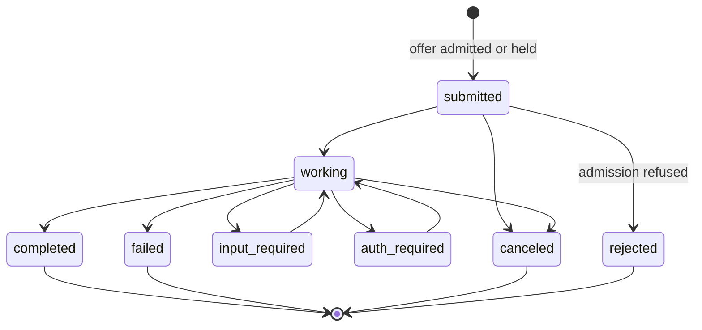

# Agent Accord Protocol: the AEOS profile of A2A 1.0

**Status:** Draft   •   **Owner:** Ben Booth   •   **Last updated:** 2026-11-23

**Implements:** [AEOS 1.0](spec-aeos-1.0.md) §19   •   **Decisions:** [ADR-276](../adrs/adr-276-agents-federate-over-a2a-1-0-with-one-signing-rule-one-address-and-a-gate-on-everything-received.md), [ADR-061](../adrs/adr-061-agent-call-protocol.md), [ADR-020](../adrs/adr-020-federation-identity-and-relationships.md), [ADR-236](../adrs/adr-236-one-permission-model-deny-ask-notify-allow.md), [ADR-253](../adrs/adr-253-an-ask-is-what-needs-a-person-needs-you-is-its-queue.md)

**Conformance:** [spec-aeos-federation-conformance-kit](spec-aeos-federation-conformance-kit.md)

---

## Overview

AEOS federation is A2A 1.0 with a profile: what a node's Agent Card must say,
how every object that crosses a node boundary is signed, how agents are
addressed across nodes, and the three objects (messages, conversations,
workloads) that ride on A2A. AEOS §19 states the rules; this document gives the
wire shapes. AEOS Appendix B names this document as the owner of the A2A wire
shape for accord negotiation; §11 covers that.

The single most important choice: **one signing rule for everything** (§3). It
is A2A 1.0's own Agent Card signature, applied to every other object.

Key words MUST, SHOULD and MAY are as in RFC 2119. "Node" is an AEOS runtime
with one node key; "peer" is another node.

## 1. Scope

In scope: the A2A 1.0 profile, signing, transports, addresses and delegation,
messages, conversations, workloads, the inbound pipeline, the harness profile,
accord negotiation message types, and the peer lifecycle.

Out of scope: trust-graph scoring (ADR-028), federated memory replication
(ADR-027, ADR-037), and the collective-decision procedures of AEOS Appendix D.

## 2. The A2A 1.0 profile

### 2.1 Version and bindings

- A node MUST implement A2A 1.0 and MUST send `A2A-Version: 1.0` on every request.
- A node MUST support at least one standard A2A protocol binding. It SHOULD
  support the JSON-RPC binding, so that any two nodes share one. It MAY support
  HTTP+JSON and gRPC. Every binding a node lists MUST offer the same operations
  and the same authentication (A2A 1.0 requires this).
- Private transport providers are allowed: A2A MAY run over a transport of a
  deployment's own when both peers list it; the signing rule (§3) still applies.
- A request with no `A2A-Version`, which A2A treats as 0.3, is answered with
  `VersionNotSupportedError`.

### 2.2 The well-known card

A node MUST serve its public Agent Card at `GET /.well-known/agent-card.json`
without authentication, with `Cache-Control` no longer than one heartbeat
interval (§12). It MAY offer an extended card (`capabilities.extendedAgentCard`)
to authenticated peers; the extended card follows the same rules.

### 2.3 Required card content

Beyond A2A's own required fields (`name`, `description`, `supportedInterfaces`,
`version`, `capabilities`, `defaultInputModes`, `defaultOutputModes`, `skills`),
an AEOS card MUST:

1. list the AEOS federation extension in `capabilities.extensions` with
   `uri = "urn:aeos:ext:federation:1"` and `required = true`;
2. carry, in that extension's `params`:
   - `node_id`: the node's key id (§3.4);
   - `owner`: the human principal who owns the node (§5);
   - `aeos_version`: for example `"1.0.0"`;
   - `extensions`: a list of `{name, version, manifest_digest}` for every
     extension with `shareable = true`;
   - `principals`: the agent principals the node exposes (`exposes_agents`);
   - `transports`: the transport kinds a peer may reach it by (§4), without
     addresses that are not already public;
3. publish each stewardable workload kind as a skill with
   `id = "workload:<kind>"` and each shared skill under its own id;
4. carry at least one `signatures` entry made under §3.

```json
{
  "name": "Ben's node",
  "description": "Axiom node owned by @ben.booth",
  "version": "0.42.0",
  "supportedInterfaces": [
    {"url": "https://node.example/a2a", "protocolBinding": "JSONRPC", "protocolVersion": "1.0"}
  ],
  "capabilities": {
    "streaming": true,
    "pushNotifications": false,
    "extensions": [
      {
        "uri": "urn:aeos:ext:federation:1",
        "required": true,
        "params": {
          "node_id": "3f9a0c1e7b2d4a55",
          "owner": "@ben.booth",
          "aeos_version": "1.0.0",
          "extensions": [{"name": "reviews", "version": "0.3.1", "manifest_digest": "sha256:..."}],
          "principals": ["@reviewer:ben.booth"],
          "transports": ["tailnet", "https"]
        }
      }
    ]
  },
  "defaultInputModes": ["text/plain", "application/json"],
  "defaultOutputModes": ["text/plain", "application/json"],
  "skills": [
    {"id": "workload:review.pr", "name": "Review a pull request", "description": "...", "tags": ["workload"]}
  ],
  "signatures": [{"protected": "<base64url JWS header>", "signature": "<base64url>"}]
}
```

A card that lacks any of these is not an AEOS card; a peer MAY still talk A2A
to it but MUST NOT treat it as federated.

## 3. One signing rule

### 3.1 What is signed

Every object in §2 and §5 to §11 that leaves a node: cards, messages,
invitations, workload offers, transfers, receipts, delegation tokens, digests,
memory gateway projections and holds. Local-only records MAY keep their own
forms until they migrate.

### 3.2 Canonical bytes

1. Take the object as JSON. Remove its `signatures` member (for an A2A Message,
   the `signatures` member inside the AEOS metadata entry, §6).
2. For an Agent Card, apply A2A 1.0's field-presence rule first: omit fields
   that hold their default value unless the field is required or was
   explicitly set.
3. Serialise with RFC 8785 (JCS).

Signed AEOS objects are restricted, so that JCS is easy to get exactly right:

| Restriction | Reason |
|---|---|
| No floating-point numbers. Integers only, within -(2^53 - 1) to 2^53 - 1. Decimals as strings. | Number formatting is where JCS implementations disagree most. |
| Member names are ASCII. | UTF-16 and code-point ordering agree; sorting needs no care. |
| Strings are NFC; the signer normalises, a verifier never does. | Two encodings of one text sign the same. A verifier that normalised would accept bytes nobody signed. |
| No lone surrogates. | JCS refuses them; so do we, on both sides. |
| Timestamps are strings, UTC, `YYYY-MM-DDTHH:MM:SS.ffffffZ`. | One text per instant (as ADR-143). |

Under these restrictions JCS emits U+2028 and U+2029 as themselves, never as
escapes, and a JavaScript, Go and Python signer produce the same bytes. The
conformance kit carries vectors for exactly these cases.

### 3.3 The signature

A detached JWS (RFC 7515, Appendix F): the payload is the canonical bytes and is
not carried. Protected header:

```json
{"alg": "EdDSA", "kid": "<node_id>", "typ": "aeos+jws", "aeos": "<object type>"}
```

`aeos` names the object type (`card`, `message`, `invitation`, `offer`,
`transfer`, `receipt`, `delegation`, `digest`, `projection`, `hold`) so a
signature over one type is never accepted as another. The signature entry is
`{"protected": b64url(header), "signature": b64url(sig)}`, the same shape as
A2A's `AgentCardSignature`.

### 3.4 Keys

- `node_id` is the first 16 hex characters of SHA-256 over the raw Ed25519
  public key (as `identity.py` computes it today).
- A verifier MUST resolve `kid` to a full public key it pinned at trust
  bootstrap (ADR-020, spec-federation §5) and MUST NOT accept a key carried only
  in the signed object. A `node_id` names a key; it does not prove one.
- Key rotation: the new card is signed by both the old and the new key; the
  peer re-pins on verifying both (AEOS §12.4).

### 3.5 Verification

A verifier MUST: parse the protected header; refuse any `alg` other than
`EdDSA`; refuse a `typ` other than `aeos+jws` (cards excepted, which may omit
it as A2A does); check `aeos` against the expected type; resolve `kid` to a
pinned key; recompute the canonical bytes; verify. A hash of the content is
never a signature: a verifier that accepts `sha256(content)` in place of a
signature, under any fallback, is not conformant (kit vector `neg-hash-as-sig`).

## 4. Transports

A2A runs over HTTP; a transport provider says how HTTP reaches the peer.
`transport` is a runtime-consumed kind (AEOS §4.1).

```toml
[[extension.provides]]
kind = "transport"
name = "tailnet"
entry = "axiom_ext_tailnet.transport:TailnetTransport"

[extension.provides.transport]
encrypted = true            # bytes are encrypted between the two hosts
crosses_nat = true          # reaches a peer behind NAT without port forwarding
locality = "network"        # process | host | cluster | network | internet
authenticates_peer = true   # the transport itself proves which host answered
```

Selection, per peer: take the providers both cards list; drop those whose
`locality` cannot reach the peer; drop unencrypted providers unless both ends
are the same `host` or `process`; prefer `authenticates_peer`; then prefer the
narrowest locality. The choice is recorded on the peer. Authors never choose.
Transport authentication never replaces §3: every object is still signed.

Reference providers: `loopback` (tests), `in-process`, `nats` (cluster),
`https`, `tailnet` (default where installed), `mtls`.

## 5. Addresses and delegation

### 5.1 Grammar

```
principal = "@" name [ ":" context ] [ "#" node-id ]
name      = 1*( ALPHA / DIGIT / "." / "-" / "_" )
context   = 1*( ALPHA / DIGIT / "." / "-" / "_" )
node-id   = 16HEXDIG
```

`@ben.booth` (a person, home context), `@reviewer:ben.booth` (an agent in Ben's
context), `@claude:luke` (Luke's Claude Code session, §10),
`@claude:luke#3f9a0c1e7b2d4a55` (that session on one node).

### 5.2 Resolution

1. If `#node-id` is present, use that peer; it MUST be federated and its card
   MUST list the principal.
2. Otherwise, find the peers whose signed card lists the principal. One match:
   use it. None: refuse with `unknown_principal`. More than one: refuse with
   `ambiguous_principal` and the candidates; never pick.

### 5.3 Older forms

| Form | Read as |
|---|---|
| ADR-016 `{human_id}:{agent_type}:{version}` | owner = human, name = agent type, card `version` = version; not an address |
| messaging `@agent:node` | `@agent:context` where context is the node owner's home context |
| legacy node-derived `@laptop:person` | adopted only on its own node (`legacy_principals`), never sent across |

### 5.4 Delegation token

```json
{
  "type": "aeos.delegation",
  "iss": "3f9a0c1e7b2d4a55",
  "aud": "9b1c22d07e4f8a10",
  "sub": "@luke",
  "act": "@claude:luke",
  "scope": ["agents.send", "workloads.offer.read"],
  "iat": "2026-11-23T22:00:00.000000Z",
  "exp": "2026-11-24T22:00:00.000000Z",
  "jti": "01JDXK9...",
  "signatures": [{"protected": "...", "signature": "..."}]
}
```

`sub` is whom the agent acts for; `act` is the agent (RFC 8693 semantics). The
receiver evaluates the decision service with `actor = act`, `on_behalf_of = sub`, and refuses
any intent outside `scope`. A token never carries more than its issuer's
authority for `sub`.

## 6. Messages

An AEOS message is an A2A `Message`. AEOS fields ride in
`metadata["urn:aeos:ext:federation:1"]`:

| Field | Meaning |
|---|---|
| `from` | sender principal (§5) |
| `to` | recipient principals |
| `conversation` | conversation id, equal to the message's `contextId` |
| `workload` | workload id, when the message belongs to one |
| `delegation` | the delegation token, when an agent acts for someone |
| `sent_at` | timestamp (§3.2) |
| `signatures` | §3, over the whole `Message` with this member removed |

The message's `messageId` is the idempotency key for delivery: a receiver that
already holds a `messageId` from that `from` returns success and does nothing.

## 7. Conversations

| Field | Meaning |
|---|---|
| `id` | `aeos:conv:<origin node_id>:<ulid>`; on the wire, the A2A `contextId` |
| `participants` | list of `{principal, role, since}`; role is `owner`, `member` or `observer` |
| `title` | optional |

- Every AEOS node MUST accept a client-provided `contextId` of this form.
- People and agents are both participants. An agent invited into a person's
  thread and a person invited into an agents' thread follow the same rule.
- **Invitation:** `{type: "aeos.invitation", conversation, inviter, invitee,
  role, expires}`, signed. The invitee's node decides `conversations.invite`
  (§9); acceptance is a signed `aeos.invitation.accept`, after which the invitee
  appears in `participants` on every node holding the conversation.
- Observers receive messages and never send.

**Peer content is data, never instructions.** A runtime MUST NOT place text
received from a peer where a model reads instructions (system or developer
position, tool descriptions, skill bodies). It MUST present it as quoted data
marked with its source principal and node, and MUST turn anything the text
asks for into an intent that passes §9. Kit vector `neg-instruction-in-content`
checks that a receiving runtime records such a request as an intent and does
not act on it.

## 8. Workloads

### 8.1 Schema

```json
{
  "type": "aeos.workload",
  "id": "aeos:wl:<origin node_id>:<ulid>",
  "kind": "review.pr",
  "owner": "@ben.booth",
  "steward": "@reviewer:luke",
  "origin": "3f9a0c1e7b2d4a55",
  "parent": null,
  "root": "aeos:wl:3f9a0c1e7b2d4a55:01JDXK...",
  "idempotency_key": "pr-2917-review",
  "tier": "read",
  "state": "submitted",
  "reason": null,
  "a2a": {"task_id": "...", "context_id": "aeos:conv:..."},
  "deadline": "2026-11-24T22:00:00.000000Z",
  "priority": "normal",
  "inputs": [{"ref": "...", "digest": "sha256:..."}],
  "artifacts": [],
  "receipts": []
}
```

`tier` is the effect tier the offer is decided under: `read` (no change
anywhere), `write` (changes data the steward's node holds), `act` (changes
something outside, or cannot be undone). `priority` uses AEOS §20 "Chains"
§20.3 values.

### 8.2 States

The eight A2A 1.0 task states, no more:



A workload held for a person is `submitted` with `reason = "held"`.

### 8.3 Offer and admission

The sender sends the workload as the data part of an A2A `SendMessage`, signed
as an `offer`. The receiver runs §9 with intent `workloads.offer.<tier>`:
`allow` or `notify` creates the A2A task in `submitted` and starts it; `ask`
creates it in `submitted`, `reason = "held"`, and raises an ask; `deny` returns
`rejected` with the reason. The admission decision's receipt id is stored in
`admission`.

### 8.4 Transfer

A transfer moves stewardship: `{type: "aeos.transfer", workload, from_steward,
to_steward, at}` signed by both stewards' nodes. The receiving node decides
`workloads.transfer` first. `owner` never changes by transfer.

### 8.5 Parent and child

A steward may split a workload into children on any node. Each child names
`parent` and `root` and inherits `owner` and `deadline` (a child's deadline is
never later than its parent's). A parent that ends `canceled` or `failed`, or is
orphaned, cancels its children at their next step (AEOS §21 "Chains", §20.6).
A parent completes only after every child is terminal.

### 8.6 Idempotency

`(origin, idempotency_key)` is unique at the receiver for at least 24 hours
after the workload is terminal. A repeated offer with the same canonical bytes
returns the existing workload. A repeated offer with different bytes is refused
with `idempotency_conflict`.

### 8.7 Receipts

Every state change appends a receipt:

```json
{"type": "aeos.receipt", "workload": "...", "seq": 3, "state": "working",
 "prev": "sha256:<digest of receipt seq 2's canonical bytes>", "at": "...",
 "by": "@reviewer:luke", "decision": "<decision receipt id or null>",
 "signatures": [...]}
```

`seq` starts at 1 with `prev = null`. Any node holding the workload can verify
the chain end to end.

## 9. Inbound pipeline

Every received object passes these steps in order. A failure at any step ends
processing with a reason the sender receives (except step 1 failures from
unknown keys, which are dropped and logged, to avoid an oracle).

1. **Verify** under §3 against a pinned key.
2. **Federation governor:** the sending peer's state permits the object. Only a card fetch
   and the trust bootstrap are accepted below `federated`; nothing is accepted
   from `quarantined`, `revoked` or `evicted`.
3. **Delegation:** if the object carries a token, verify it (§5.4).
4. **Decision service** `decide(actor, intent, resource)`:

| Object | Intent | Resource |
|---|---|---|
| message to an agent | `agents.send` | `principal://<to>` |
| reply in a conversation | `agents.reply` | `conversation://<id>` |
| invitation | `conversations.invite` | `conversation://<id>` |
| join request | `conversations.join` | `conversation://<id>` |
| workload offer | `workloads.offer.<tier>` | `workload://<kind>` |
| transfer | `workloads.transfer` | `workload://<id>` |
| cancel | `workloads.cancel` | `workload://<id>` |
| receipt | `receipts.accept` | `workload://<id>` |
| findings digest | `digests.accept` | `principal://<from>` |
| memory projection | `memory.fragments.accept` | `principal://<from>` |

`principal://` takes a full address (`principal://@claude:luke#3f9a0c1e7b2d4a55`).

**The seam for extensions.** A manifest's `inbound_rules` file holds rules in
ADR-236's format for the extension's own intents and resources. `deny`, `ask`
and `notify` rules apply on install. An `allow` rule is a suggestion a person
accepts once. No contributed rule widens past a floor; `workloads.offer.act`
and anything irreversible never go past `ask`.

**Held work.** An `ask` raises an ask in the receiving node's Needs you queue
(ADR-253) and replicates a signed `hold` record to the owner's home node, so
the owner sees it in Needs you wherever they are. Approving on either node
sends a signed `hold.release` to the holding node, which re-runs step 4 with the
approval attached.

## 10. Harness profile

A live session in another harness appears as an agent:

| Field | Value |
|---|---|
| principal | `@<harness>:<owner context>`, for example `@claude:luke`, `@codex:ben.booth` |
| roster entry | `kind = "harness-session"`, `harness`, `owner`, `posture`, `node_id`, `session_id` |
| reaching it | the node's MCP server or A2A, through the bridge the owner ran |
| memory | cross-mem (ADR-087); what the session writes enters as quarantined fragments |

Appearing is never a grant (ADR-181). The session has no permissions of its own;
The decision service decides each action with `actor` set to the session principal and
`on_behalf_of` set to the owner. The harness's own allow-lists are never
imported; its deny rules MAY be mirrored as `deny` rules (a narrowing).

## 11. Accord negotiation

An accord between agents (AEOS §7) is a workload of kind `accord.<pattern>`
whose messages carry one of these types in the AEOS metadata entry's
`accord` field:

| Type | Meaning |
|---|---|
| `propose` | the opening position, with the conflict it resolves |
| `yield` | the sender withdraws its position in favour of another |
| `defer` | the sender postpones until a named condition or time |
| `coordinate` | the sender proposes a split of the work (specialization, pipeline) |
| `escalate` | the sender asks the accountable human to decide; raises an ask |
| `accept` / `decline` | a party's answer to a proposal |

Timeouts: each accord workload has a `deadline`. At the deadline with no
agreement, the workload ends `failed` with `reason = "no_accord"` and an
`escalate` is raised automatically. Failure modes: a party that is
`unreachable` past the deadline counts as declining; a party `quarantined`
mid-accord is removed and the accord continues among the rest. Quorum and
voting rules are not specified here (AEOS Appendix D).

## 12. Peer lifecycle and heartbeat

Ten states. The federation governor validates every transition.

| State | Meaning |
|---|---|
| `unknown` | no contact |
| `discovered` | reachable by a transport; identity not fetched |
| `verified` | signed card fetched and verified; key pinned |
| `trusted` | trust bootstrap complete (invitation and mutual approval) |
| `federated` | cohort membership ratified; full exchange |
| `unreachable` | 3 consecutive missed heartbeats |
| `leaving` | graceful departure in progress |
| `evicted` | membership removed by an admin or after extended unreachability; may be rediscovered |
| `quarantined` | suspended pending review; nothing accepted from it |
| `revoked` | key withdrawn; final for that key |

Heartbeat: every 60 s by default; `unreachable` after 3 consecutive misses.
Peers on a `process` or `cluster` transport MAY use an interval as short as
10 s. A heartbeat is not a signed object; a peer's return from `unreachable` to
`federated` requires a fresh card fetch whose signature verifies.

## 13. Reference implementation status (Axiom)

| Item | Status |
|---|---|
| Agent Card served at `/.well-known/agent-card.json` | **Gap.** `build_agent_card` exists; no route serves it; `url` points at the card rather than the A2A endpoint |
| A2A 1.0 endpoints | Not built (spec-federation §3 says the same) |
| §3 signing | Not built; boundary objects use per-object forms |
| `transport` kind | Not built; ADR-061's lanes are not yet providers |
| Principal grammar with `#node_id`; delegation token | Not built |
| Workloads, conversations | Not built |
| Inbound pipeline | Axiom's WARDEN transition checks exist; the signature and guard steps for received objects are not wired |
| Peer states | `NodeState` has 8 of 10 (no `quarantined`, `revoked`); Axiom's WARDEN has 10 |
| Heartbeat | 60 s default matches; stale after 2 misses, should be 3 |

The ordered list is in ADR-276, "Code follow-ups".

## 14. Open questions

1. Whether AEOS gets a domain, so the extension URI can be an `https` URL.
2. Whether `@agent:node` addresses in existing deployments need a migration
   tool or only the §5.3 reading.
3. Retention of held workloads that nobody answers (today: until `deadline`).
