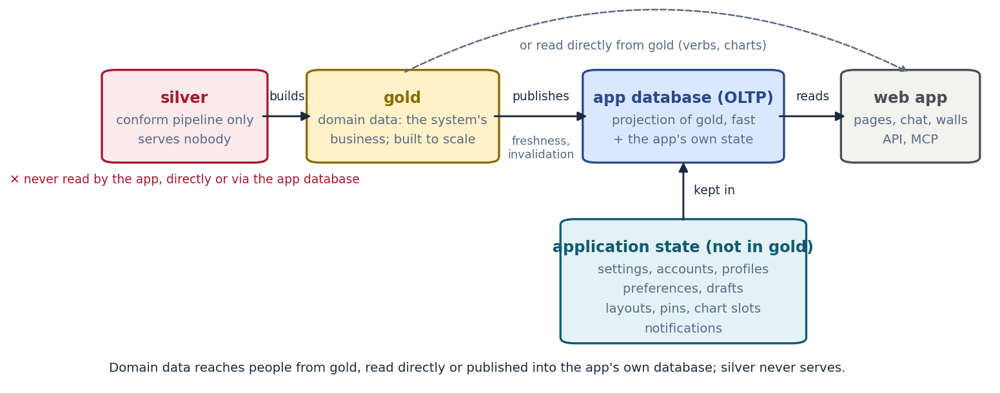

# Site View — Technical Specification

**Status:** Draft (for review)   •   **Owner:** Axiom platform   •   **Last updated:** 2026-10-30

**Implements:** [`prd-site-view.md`](../prds/prd-site-view.md)   •   **Design:** the Site section of the master design, https://claude.ai/artifact/4Wtqj1voZMCdw56C24HHLv (private; the owner shares it; a convenience view that may lag, not the source), and appkit's design entry, [`docs/design/site-view/`](https://github.com/b-tree-labs/axiom-appkit/tree/main/docs/design/site-view)   •   **Decisions:** ADR-209 (every installation is a site, proposed), ADR-050 (tenant/site vocabulary), ADR-211 (Control), ADR-137 (runs), ADR-213 D12 (library contributions)

> **Decisions since this draft (2026-11-10).** Where this document disagrees with
> these, these win: the rail is Chat · Site · [Model] · [Chart] · Log · Library · Team,
> with History at the bottom; Model and Chart are shown by user type; Team is universal,
> on every rail by default, and a person or site may switch it off; a product inserts its
> items after Site; a hidden item stays reachable through Search and ⌘K and through a
> More item at the bottom of the rail (shown only while something is hidden, each item
> with Pin to rail), and Settings is where the rail is changed; Search is a full-width row under the
> wordmark plus ⌘K, not a rail item (master design D1, D11; ADR-223 as amended);
> Control is off the rail: it is Site › Automate, keeping its route `#/control` and its
> ⌘K name, and Site's modes are Operate, System and Automate (D27); "Steer" stays
> retired; the accent is the one interactive colour and a brand's identity colour is
> never interactive or a status, and controls are rounded from appkit's tokens (ADR-226
> as amended); people see "log", code keeps `logbook`, and `log` is the command noun
> (ADR-243); a person's Book follows domain and roles and only grows (ADR-239); a record
> lives with its writer, and a page reads its own tables and reads gold only read-only
> with an "as of" (ADR-241). Earlier rounds below are kept as the record.

---

## Overview

How the Site view is built. **What it is and why** (personas, the system and
loop catalogs, the three worked examples, version 1 and the
phases) is in the PRD, [`prd-site-view.md`](../prds/prd-site-view.md), and is not
repeated here.

The central design choice: a site is the set of **systems** and **loops** that
extensions contribute through two small, read-only contracts (§3), arranged on
an STPA control structure (§4). One evaluator runs every contribution's health
where the data lives and writes one snapshot (§5); every surface, the CLI, MCP
and Control read that snapshot, so no two views can disagree. Products
specialize the Site through declared extension points, never by forking (§3.2).

## 1. Scope & Goals

- **In scope:** the system and loop contracts; the product extension points;
  relations and the health roll-up; the snapshot and its readers; scope
  plumbing; the lineage record; pipeline kinds and their health signals; the
  operating-configuration and improvement-loop records; physical
  representations; the API.
- **Out of scope:** requirements, personas and phasing (the PRD); write paths
  to a site's configuration (ADR-209 D5, D8).
- **Non-goals:** commanding equipment; computing uncertainty (it is relayed
  from `axiom.uncertainty`); inventing health (unknown stays unknown).

## 2. Architecture Summary

Each extension that knows about a part of a site contributes a **site system**.
A scheduled **site health evaluator** runs every contributed system's health
function where the data lives (the serving node), resolves relations, computes
the roll-up and root causes, and writes one **site health snapshot**. Every
surface reads that snapshot: the rail home, the system drill-ins, the footer
chip and drawer, the `axi site health` CLI, MCP, and Control (which receives a
run in the `needs` band whenever a member turns `broken`). An app bound to a
remote site forwards to the site's node rather than evaluating locally.

| Layer | What it is | Where it lives |
|---|---|---|
| Contribution | `[[site_systems]]` in `axiom-extension.toml`, or entry-point group `axiom.site_systems` | each extension or pack |
| Registry | discovers, validates (conformance), orders systems | `axiom.site.systems` (new) |
| Evaluator | runs `health()` / `inventory()` / `relations()` per system per site; builds the snapshot | serving node, on the schedule substrate |
| Snapshot | one immutable, timestamped record per evaluation | extension schema via `axiom.infra.db.session_for("site_view")` |
| API | `/api/v1/sites/{site}/systems…`, `/health`, `/lineage` | webapp catalog router |
| Surfaces | rail home, drill-ins, lineage, chip + drawer, CLI, MCP, Control | appkit + webapp |

Display levels follow the ISA-101 high-performance HMI hierarchy, which this
view borrows directly (PRD §10, prior art): the rail home is the **level 1 overview**, a
system drill-in is **level 2**, a member detail is **level 3**, and lineage is
the **level 4 diagnostic**.

## 3. The Base Interface

Every site system implements this contract. It is deliberately small: six
things, all read-only.

```python
# axiom/site/systems/contract.py  (new; mirrors library/preview/contract.py)

HealthState = Literal["ok", "degraded", "broken", "unknown"]

@dataclass(frozen=True)
class SystemManifest:
    id: str                 # "<pack>.system.<name>", e.g. "data_platform.system.pipelines"
    name: str               # "Data pipelines"
    summary: str            # one line, shown under the card title
    icon: str               # appkit icon key
    order: int = 100        # card order on the rail home (lower first)
    evaluates_health: bool = True   # False = inventory-only; excluded from roll-up
    scope: str = "site"     # "site" today; "program" reserved for cross-site systems
    contributed_by: str = ""

@dataclass(frozen=True)
class MemberRef:
    system: str             # SystemManifest.id
    member: str             # stable id within that system
    # Rendered "system/member"; the unit relations and reasons point at.

@dataclass(frozen=True)
class Member:
    ref: MemberRef
    kind: str               # system-defined: "pipeline", "hop", "instrument", "model", "shift"…
    name: str
    status: Literal["active", "planned", "retired"] = "active"   # planned/retired are never evaluated
    part_of: MemberRef | None = None   # containment, for hierarchies (ISA-95 style)
    attrs: dict[str, Any] = field(default_factory=dict)          # small, display-safe
    href: str | None = None            # deep link to the member detail (level 3)

@dataclass(frozen=True)
class Reason:
    code: str               # stable, machine-readable: "hop.late", "feed.silent"…
    member: MemberRef | None
    state: HealthState      # what this reason alone would make the member
    text: str               # one plain sentence a person can act on
    fix: str | None = None  # the next step, when one is known
    since: str | None = None        # ISO 8601: when the condition started
    evidence: dict[str, Any] = field(default_factory=dict)       # numbers behind the claim

@dataclass(frozen=True)
class Health:
    state: HealthState
    reasons: tuple[Reason, ...]     # empty only when state == "ok"
    basis: str                      # what was checked: "freshness vs declared cadence"
    evaluated_at: str
    limit: str | None = None        # what this evaluation cannot establish (ADR-137 run.limit)

@dataclass(frozen=True)
class Relation:
    source: MemberRef
    verb: str               # from the controlled vocabulary in §5.1
    target: MemberRef

@dataclass(frozen=True)
class Card:
    headline: str           # "2 pipelines · 1 late"
    stats: tuple[Stat, ...] # at most three
    state: HealthState

@dataclass(frozen=True)
class ViewSpec:
    component: str          # appkit component key for the drill-in, e.g. "site.pipelines"
    data: str               # API path the component reads

class SiteSystem(Protocol):
    manifest: SystemManifest
    def inventory(self, ctx: SiteContext) -> tuple[Member, ...]: ...
    def health(self, ctx: SiteContext) -> Health: ...
    def relations(self, ctx: SiteContext) -> tuple[Relation, ...]: ...
    def card(self, ctx: SiteContext, health: Health) -> Card: ...
    def view(self, ctx: SiteContext) -> ViewSpec: ...
```

`SiteContext` carries the resolved site (`axiom.site` record from ADR-209), the
caller's principal, the evaluation clock, and the site's `[ext.<pack>]` config
(`site.ext("<pack>")`). A system never reads another system's store; it reaches
across only through relations, which the evaluator resolves.

**Health rules every system follows:**

1. `unknown` is a real answer, not a gap. It always carries a reason ("no
   heartbeat source is configured", "the evaluation timed out"). It is never
   rendered green.
2. `planned` and `retired` members are inventory, not health. They are drawn
   dashed and never counted (this is how declared-but-unbuilt topology hops
   already render).
3. `broken` means a person needs to act. `degraded` means it works and is
   worse than declared. The bar for each is the system's own declared budget
   (for a pipeline, its cadence), never a global constant.
4. Absent stays absent: a missing measurement is not zero, a missing
   uncertainty is `claimable: false`.

**Contribution** follows the Library pattern exactly (`library/contrib.py`
`KINDS`): either a `[[site_systems]]` table in an extension's
`axiom-extension.toml` (`id`, `name`, `entry = "module:attr"`, `order`), or a
callable in the entry-point group `axiom.site_systems` returning a list of
`SiteSystem`. A conformance helper (`axiom.site.systems.conformance.assert_conformant`)
checks id shape (`^[a-z0-9_]+\.system\.[a-z0-9_]+$`), that `health()` returns
reasons for every non-ok state, that `inventory()` refs are unique, and that
every relation endpoint resolves or is reported as dangling.

### 3.1 The loop contract

Systems say *what a site is made of*. **Loops** say *how it keeps itself
working*: anything that runs in cycles of trigger, act, observe and evaluate.
A loop is a first-class, cross-cutting concept beside systems. It runs
**through** systems, it is contributed the same way, and its health feeds the
same roll-up.

```python
# axiom/site/loops/contract.py  (new; sits beside systems/contract.py)

LoopKind = Literal["control", "improvement", "maintenance", "calibration", "scheduled",
                   "operating_cycle", "compliance", "data_quality", "corrective_action",
                   "replenishment", "release"]

@dataclass(frozen=True)
class Trigger:
    kind: Literal["time", "event", "threshold"]
    spec: str               # cron or interval for time; event name; "<quantity> <op> <value>"
    expected_period_s: int | None = None   # for time triggers, and declared for others

@dataclass(frozen=True)
class LoopManifest:
    id: str                 # "<pack>.loop.<name>", e.g. "data_platform.loop.freshness_report"
    name: str
    kind: LoopKind
    owner: str              # a person, role or agent: "@name:context"
    trigger: Trigger
    through: tuple[MemberRef, ...]   # the systems and members it runs through
    measure: str | None = None       # the quantity the loop is meant to move, if any
    grace_s: int = 0                 # how late a cycle may start before it is overdue
    contributed_by: str = ""

@dataclass(frozen=True)
class Cycle:
    id: str
    triggered_at: str
    started_at: str | None
    ended_at: str | None
    outcome: Literal["success", "partial", "failed", "skipped", "refused", "pending"]
    measure_value: float | None = None   # the loop's measure at evaluation
    evidence: tuple[str, ...] = ()       # receipts, run records, attest entries

@dataclass(frozen=True)
class LoopState:
    timeliness: Literal["on_time", "due", "overdue", "missed", "unknown"]
    last_outcome: str | None
    trend: Literal["converging", "steady", "drifting", "unknown"]   # of the measure
    next_due: str | None

class SiteLoop(Protocol):
    manifest: LoopManifest
    def cycles(self, ctx: SiteContext, since: str) -> tuple[Cycle, ...]: ...
    def state(self, ctx: SiteContext) -> LoopState: ...
    def health(self, ctx: SiteContext, state: LoopState) -> Health: ...   # same Health as systems
    def couplings(self, ctx: SiteContext) -> tuple[Relation, ...]: ...   # §5.4
```

Default mapping from loop state to health, which a loop may tighten but not
loosen: `missed`, or the last two cycles `failed`, is `broken`; `overdue` or a
`drifting` measure is `degraded`; `unknown` timeliness is `unknown`.

Contribution mirrors systems: `[[site_loops]]` in `axiom-extension.toml`, or the
entry-point group `axiom.site_loops`. **Scheduled loops need no contribution at
all.** The schedule extension contributes one adapter that presents every PULSE
`schedule_definition` as a `scheduled` loop: trigger from `cadence_kind` and
`cadence_payload`, owner from the owning extension and `raci_default`, cycles
from `schedule_fire_log` (`intended_fire_at`, `started_at`, `finished_at`,
`outcome` of success, failed or dead letter), and `through` from the
extension's declared systems. A schedule whose `next_fire_at` has passed by
more than its grace is `overdue`; a dead-lettered fire is `missed`.

> **Naming note.** "Tile" already means a discovery prompt in
> `spec-extension-ui-protocol.md`. The per-system summary on the rail home is a
> **card**, to keep the two apart.

### 3.2 Product extension points: specializing the Site without forking

A product (a domain consumer built on Axiom) changes *its* Site entirely through
contributions. They resolve in three layers, with the more specific layer
winning: **platform** (Axiom's generic systems, loops and labels), then
**product** (the domain consumer's package), then **site** (a site
repository's `[ext.<pack>]` configuration under ADR-209 D4, and its
representations). The product layer is an ADR-209 `SiteExtension` (entry-point
group `axiom.site_extensions`, D6) that also declares the kinds below in its
`axiom-extension.toml`.

| Extension point | Declared as | What it may do | What it may not do |
|---|---|---|---|
| **Add a system type** | `[[site_systems]]` | contribute a new `SystemManifest` with its own member kinds, health, card and view | reuse another system's id |
| **Extend a system** | `[[site_system_extensions]]` with `extends = "<system id>"` | add member kinds, pipeline kinds or hops (a `stream` kind into a model), drill-in panels, and relations to its own systems | remove members or reasons the base system reports |
| **Add a loop or a loop kind** | `[[site_loops]]`; `[[site_loop_kinds]]` | contribute loops; add a `LoopKind` with its trigger shape | change the default loop-health mapping except to tighten it |
| **Health rules** | `[[site_health_rules]]`: `applies_to` (system and member kind), `entry` | add reasons evaluated after the base system's own. A rule may **only raise** a member's state (ok to degraded to broken), never lower it, and never turn `unknown` into `ok` | silence a base reason |
| **Labels and vocabulary** | `[site_labels]`: `system.<id>.name`, `loop_kind.<kind>`, `member_kind.<kind>`, per locale | rename what the person sees, as the Library's book schemes rename the Data Book (`BookScheme.display_name`) inside the Library | change ids, which stay stable across products; relabel the Library rail item |
| **Relations** | `[[site_relation_verbs]]` | add **contextual** verbs | add causal verbs, which the roll-up must understand; those change only in Axiom |
| **Physical representations** | renderers in Axiom; content in the product (templates) or the site (drawings, geometry, anchors) | declare `geometry3d`, `schematic2d` or `map` content and instrument `anchor`s (§8.2) | ship a renderer that bypasses the colour and motion rules |
| **Layout** | `[site_layout]`: card order; the control-structure position of each system | place product systems in the skeleton of §4.1 | hide a broken system |

Conformance (`axiom.site.conformance.assert_product`) checks that a product's
contributions resolve, that its health rules only raise, that its labels cover
every locale it declares, and that it names no system id it does not own.
A product that needs something none of these points allows asks for a new
extension point in Axiom; it does not fork the view.

## 4. The Skeleton and the System Catalog

### 4.1 The skeleton: a control structure

STPA models any operation as a hierarchy of controllers, each holding a model
of what it controls, issuing control actions downward and receiving feedback
upward. The Site view adopts that structure as the arrangement of its systems.
Each position is generic; the systems in §4.2 fill them.

| Position in the control structure | Direction | Site systems that fill it |
|---|---|---|
| **Constraints from above** (governing bodies, owners) | control | licenses, permits & obligations; access & security |
| **Human controller**: procedures, model of the process, model of the automation, model of context | both | people & shifts; documents & records (procedures); operations (schedule, campaigns, mode) as the model of context |
| **Controls and actuators** | control | control & actuation, **observed only**: the platform provides no controls and issues no commands. This is a stated boundary |
| **Automated controller** with its own process model | control | control & actuation (the control system, observed); models & twins where a model is promoted into the control path by a recorded decision |
| **Controlled process** | (the plant) | assets & machines |
| **Sensors** | feedback | instruments & sensors |
| **Real-time feedback channel** (sensor, acquisition, straight to a consumer's input; seconds) | feedback | data pipelines of kind `stream`; this is the path into the estimators and models |
| **Batch feedback channel** (sensor, acquisition, transport, ingest, bronze, silver, gold; minutes to hours) | feedback | data pipelines of kind `batch`; this is the path to displays, history, training, validation and replay. Compute & infrastructure sit underneath both |
| **Estimators in the feedback path**: configuration estimate, model selection, predictions beside measurements | feedback | models & twins, with the operating configuration (§7.2); fed by the real-time channel |
| **The improvement loop**: a controller *of the models*, which measures their error and changes them | both | model improvement (§7.4): residuals in, hypotheses and training runs, a candidate revision out, promoted by a person |
| **Displays** | feedback | the app itself: charts, chat answers, this view; agents & AI that advise; fed by the batch channel and by the predicted pipeline |
| **Disturbances** | into the process | environment |
| **Supporting** (keeps the loop able to run) | n/a | maintenance; supply & inventory; compute & infrastructure |

Two consequences shape the rest of this spec:

- **Most of what the platform can evaluate lies on the feedback path.** Version
  1 lives there entirely: it asks whether the measured feedback and the
  model's predicted feedback reaching the displays are sound.
- **A display that shows a prediction must say which model, for which
  configuration, under which decision, and how fresh** (STPA's "mode
  confusion" hazard: a person believing the automation is doing one thing
  while it does another). Lineage (§7) is how the Site view meets that.

### 4.2 The catalog

The initial catalog of sixteen system types, with examples, is in the PRD
(§5.1). Each entry is a `SystemManifest` contributed by the extension that owns
the knowledge: the data platform contributes data pipelines and compute, the
schedule extension contributes the scheduled-loop adapter, attest contributes
licenses and obligations, the directory contributes people, and so on. Two
structural notes for implementers:

- **Compute and infrastructure** is split from data pipelines. The existing
  topology API mixes the two (a hop is both a node and a stage). Here a node is
  an infrastructure member and a pipeline hop `runs_on` it.
- **Data pipelines** and **models** are distinct systems joined by relations: a
  model `consumes` a pipeline and `produces` another.

## 5. Coordination

### 5.1 Relations

Relations are typed edges between members of different (or the same) systems.
The verb vocabulary is controlled so that the roll-up can reason about it. A
verb is either **causal** (failure flows along it) or **contextual** (shown,
not propagated), and every relation also carries the **path** it lies on in the
control structure: `feedback`, `control` or `context`. The path is what lets
the roll-up say *"the people in charge cannot currently see the process"*
(a feedback-path failure) as distinct from *"something that acts on the process
is unavailable"* (a control-path fact the platform only reports).

| Verb | Causal? | Default path | Example |
|---|---|---|---|
| `feeds` | yes, source to target | feedback | an instrument feeds a pipeline; a pipeline hop feeds the next hop |
| `consumes` | yes, target to source | feedback | a model consumes a pipeline |
| `produces` | yes, source to target | feedback | a model produces a pipeline |
| `runs_on` | yes, target to source | feedback | a pipeline hop runs on a node |
| `part_of` | yes, child to parent (degrades, never breaks, the parent) | context | a sensor is part of a machine |
| `requires` | yes, target to source | control | an operation mode requires a license and a qualified shift |
| `estimates` | yes, source to target | feedback | a configuration estimator estimates the operating configuration from observations |
| `selects` | yes, source to target | feedback | a model selector selects a model revision for a configuration |
| `observes` | yes, source to target | feedback | an instrument observes a configuration variable |
| `trains` | yes, source to target | context | a training set trains a model revision |
| `tests` | contextual | context | a hypothesis tests a claim against a targeted loss |
| `derives_from` | yes, source to target | context | a residual dataset derives from measured and predicted runs; a modified deck derives from a hypothesis |
| `twins` | contextual | feedback | a stream channel and a batch channel carry the same readings (reconciled, §7.3) |
| `holds` | contextual | context | a person on shift holds a qualification |
| `authorizes` | contextual | control | a license authorizes an operation |
| `governs` | contextual | control | a procedure governs an operation |
| `records` | contextual | context | a logbook records a run |
| `monitors` | contextual | feedback | an agent monitors a pipeline |
| `maintains` | contextual | context | a work order maintains an instrument |

### 5.2 Roll-up: "why is the site degraded?"

The evaluator builds a graph from every system's members and causal relations,
then:

1. **Member state** is the worst of its own reasons.
2. **System state** is the worst member state among evaluated, active members.
   The roll-up also reports, separately, the worst state on the **feedback
   path** ("can the controllers see the process?"), since that is the
   question most site health questions reduce to.
3. **Site state** is: `broken` if any evaluated system is broken; else
   `degraded` if any is degraded; else `unknown` if any evaluated system is
   unknown; else `ok`. A site is never `ok` while something it evaluates is
   unknown. Inventory-only systems (`evaluates_health = false`) are excluded
   and shown as "not evaluated".
4. **Root causes.** A non-ok member is a *root cause* if no causal upstream
   member is also non-ok. Every other non-ok member is a *consequence*, linked
   to its root(s). The "why degraded" list shows root causes first, each with
   its consequence count ("instrument feed silent since 14:02, 3 downstream
   effects"), so one failure reads as one item and not five.
   An `unknown` upstream member shared by two or more non-ok members is
   reported as the **probable** root cause, labelled as probable, since its
   state could not be established.
5. **Cycles** (a model that consumes its own output) are cut at the edge the
   evaluator reaches last, and the cut is recorded in the snapshot.

### 5.3 One evaluation, many readers

The snapshot is the only source of health. It carries `snapshot_id` and
`evaluated_at`, and every surface shows the time it was evaluated. When a member
first enters `broken`, the evaluator raises a Control run:

| Run field | Value |
|---|---|
| `agent` | the site's watch principal, `@site-watch:<site>` |
| `capability` | `site.health` |
| `band` | `needs` |
| `consequence` | from the reason (`loss` by default for data; a system may declare `harm`) |
| `summary` | the root cause's `text` |
| `limit` | the health `limit` |
| dedupe key | `site/system/member/code`; one open run per key |

The run moves to `done` when a later snapshot finds the member healthy, with the
recovery time in its log. A consequence never raises its own run; it is listed
inside the root cause's run. This is what keeps the chip, the drawer, the rail
home and Control in agreement: none of them evaluates anything.

### 5.4 Loops: how they couple

The loop kinds and their examples are in the PRD (§5.2). Each kind is a
`LoopKind`; an extension may contribute a loop of any kind, and a product may
add a kind (§3.2).

**Loops run through systems,** and a system's drill-in lists the loops that run
through it, with their state. **Loops couple,** and a coupling is a relation
(§5.1) with one of these verbs, all causal:

| Coupling verb | Example |
|---|---|
| `takes_offline` | maintenance takes an instrument offline for a window |
| `marks` | that window marks the instrument's readings (quality flag) |
| `excludes` | the improvement loop excludes marked readings from residual datasets |
| `invalidates` | a calibration change invalidates residual slices computed before it |
| `triggers` | a data-quality failure triggers a rebuild; a residual threshold triggers a hypothesis |
| `blocks` | an expired authorization blocks an operating cycle from starting |

Couplings carry failure into the roll-up. An overdue calibration whose
instrument's residuals are drifting appears as **one** root cause (the overdue
calibration) with the drift folded under it as a consequence, not as two
unrelated problems. Calibration drift and model error look alike in residuals;
the coupling is what tells them apart.

## 6. Scope

### 6.1 Model

A person may see one site or many. Visibility is ADR-209's FGA model: a site is
in a person's scope when they hold `viewer` (or `reader`, `program_reader`) on
it, through ownership, org membership, program membership or sharing. The
server resolves the set; the client never decides it.

```python
@dataclass(frozen=True)
class SiteScope:
    mode: Literal["one", "all"]
    site: str | None          # the slug, when mode == "one"
    sites: tuple[str, ...]    # the authorized set, server-resolved
```

"All sites" is a separate mode, never a fake id. It is a **browse** scope: it
is valid on the rail home (a portfolio of site cards) and on cross-site lists.
Lineage, drill-ins and anything that acts are always single-site.

### 6.2 The pattern this ports

This is the advisor scope pattern already proven in a sibling product, where an
advisor who works with several client operations picks one, or "all" for browse pages:

| Piece | Ported shape |
|---|---|
| State owner | `SiteScopeProvider` context, hook `useSiteScope()` exposing `scope`, `sites`, `selectSite(slug, {persist})`, `browseAll()` |
| Request carriage | site is a **path segment** (`/api/v1/sites/{site}/…`) for single-site calls; an interceptor adds `?site=` only to the few unscoped list endpoints, with an exempt-path list (auth, health, the sites list itself) |
| Server enforcement | one resolver, `authorized_sites(principal)`, used by every route. An id outside the set returns **404, not 403**, so site ids cannot be probed. `all` mode requires the set to have two or more members and is browse-only |
| Initial selection | URL, then the last selection in local storage, then the profile's `last_viewed_site`, then the only site if there is exactly one, then the served site (`axiom.site.served()`), else none. **Never the first site in the list.** A stored id is used only if it is still authorized |
| Switching | clears member-level selection (the open drill-in, the open lineage); deep links from search or Control switch scope first, then open |
| Placement | the top of the Site rail, under the brand. A person with one site sees a static chip, not a dropdown |
| Picker | listbox with search (name, slug, org, program), grouped by org then program, own sites pinned first, keyboard up/down/enter/escape. **Added:** each option carries its site's health dot from the latest snapshot, and the "All sites" row shows counts by state |

The CLI already has the same resolution chain (`axiom.site.active()`:
`--site`, `AXIOM_SITE`, `site.toml`, binding, default). The web selector is its
equivalent and writes nothing to the CLI's state.

### 6.3 Every page and API respects scope

- Every `/api/v1/sites/{site}/…` route calls `authorized_sites` before anything
  else. Forwarded calls (a bound app) carry the caller's identity to the site's
  node, which enforces again.
- Snapshot reads are filtered by scope; the "All sites" home reads only the
  site-level summary of each snapshot, never member detail.
- Control runs raised by the evaluator inherit the site, so Control's own
  filters show only runs for sites in scope.

## 7. Lineage

### 7.1 The path of a value

For any served value, measured or predicted, lineage is the path back from the
number on the screen to where it came from, with what is known about its
quality at each step.

```text
GET /api/v1/sites/{site}/lineage?feed=<handle>&channel=<name>&at=<iso8601>
```

```python
@dataclass(frozen=True)
class LineageStep:
    kind: Literal["served", "tier", "relay", "collector", "instrument", "model_run",
                  "selection", "configuration", "observation", "declared_record", "source",
                  # backward past the model revision, phase 4 (§7.4):
                  "training_set", "physics_run", "input_deck", "hypothesis", "residual_dataset"]
    ref: MemberRef | None     # the member in its system, when there is one
    name: str
    at: str | None            # when this step handled this value (or its batch)
    state: HealthState        # the member's state in the snapshot that served it
    tier: str | None = None   # bronze | silver | gold, for kind == "tier"
    transform: str | None = None      # what this step did ("unit conversion", "1 s resample")
    quality: tuple[str, ...] = ()     # flags carried or raised here
    uncertainty: dict | None = None   # as reported; {"claimable": False} when none was
    inputs: tuple["LineagePath", ...] = ()   # for a model run: the lineage of what it consumed

@dataclass(frozen=True)
class LineagePath:
    value: Any
    unit: str | None
    at: str
    source_class: Literal["measured", "predicted", "estimated", "simulated"]
    model_ref: str | None     # the producer, when there is one (provenance.model_ref)
    fixture: bool             # declared scaffolding (provenance.is_fixture)
    steps: tuple[LineageStep, ...]   # ordered from the served value back to the origin
```

- A **measured** value names its **channel** first. A batch value walks back:
  served, gold, silver, bronze, transport (relays), collector, acquisition,
  instrument (with its class, placement and channel map entry). A stream value
  walks back: consumer input, stream, acquisition, instrument. Either one links
  to its **twin** on the other channel when reconciliation found it.
- A **predicted** value walks back through the model-selection chain of §7.2:
  served, then the **model revision** that produced it with the
  **configuration key** and the **membership probability** `p` it was selected
  under, then the **operating configuration** snapshot (its variables, each with
  value, uncertainty, source class and freshness), then the **observations**
  behind each variable, then the **instruments** (or declared records) that made
  them. Each observation from an instrument names the channel that fed the
  model (normally the stream) and links to the **batch twin** of that input, so
  a person can audit the prediction's input against gold.
  This recursion is what lets a person see that a prediction is suspect because
  an input went quiet or held.
- Every step reuses the data platform's provenance envelope
  (`{"tier", "source", "method", "rows"}`) and the `source_class` and
  `model_ref` already on records. Lineage adds no new provenance capture in
  version 1; where a step cannot be established it is shown as a dashed
  "not recorded" step, never omitted.
- Uncertainty is relayed exactly as the producer reported it. Lineage never
  combines uncertainties across steps.

### 7.2 Model selection by estimated configuration

A predictive model is valid only for the configuration of the process it was
built for. A site that serves predictions therefore needs a typed answer to
"what configuration is the process in, how sure are we, and which model is
valid for it?". The generic shape, which the predicted pipeline's health and a
prediction's lineage both read:

| Concept | What it is |
|---|---|
| **Configuration schema** | declared per kind of asset: the variables that define its configuration, each with role, unit, class (`static`, `slow`, `operational`), domain, `max_age`, whether it is in the key, and whether corroboration is required |
| **Observation** | evidence for a variable: a measured channel (by instrument role) or a declared record (a procedure, a plan, an attested log entry, a declared description of the asset), each with its own stated uncertainty |
| **Configuration estimator** | fuses observations into a posterior, per variable, with calibrated uncertainty; detects change; passive, never commands |
| **Operating configuration** | the published snapshot as of `t`: a vector of variables (value, uncertainty, source class, `observed_at`, `max_age`, evidence refs) and a state, `steady`, `changing` or `unknown` |
| **Configuration key** | the discrete subset projected from it (exact match), canonical and hashed, with a site-given label |
| **Validity envelope** | on each model revision, derived from its lineage (training and validation), never hand-typed: key, operating ranges, modes, quantities, uncertainty, and what it is not qualified for |
| **Selection decision** | `select` (serve revision `r` with probability `p_r` of being inside its envelope at or above a threshold), `transition` (publish nothing while the configuration changes), or `refuse` (publish nothing, with the reason: stale configuration, no qualified revision, or not confident) |

Every published prediction row carries the configuration key, the model
reference and `p_r`. Held values are never published: a model with no fresh,
qualified configuration says so rather than repeating its last answer.

**Predicted-pipeline health** is therefore a chain, not a feed:

| Hop | Healthy when | Reasons it raises |
|---|---|---|
| observations | every key variable has an observation within `max_age` | `observation.stale`, `observation.held`, `observation.missing` |
| configuration estimate | a snapshot within its cadence; state `steady` | `configuration.stale`, `configuration.changing`, `configuration.unknown` |
| selection | latest decision is `select` | `selection.transition` (degraded), `selection.refuse` (broken, with the refusal reason), `selection.unrecorded` (unknown) |
| model revision | the selected revision's envelope covers the configuration with `p_r` at or above threshold | `revision.low_confidence`, `revision.unqualified` |
| delivery: bronze, silver, gold | rows arriving at the declared cadence, values not held | `feed.late`, `feed.silent`, `value.held` |
| served | the display can show revision, key, decision and freshness beside the value | `display.unattributed` when a served row lacks them |

**Measured-pipeline health** covers both measured channels of §7.3, shown
separately, since one can be healthy while the other is not.

### 7.3 Two measured channels, and reconciliation between them

An instrumented value usually travels **two channels**:

| Kind | Path | Serves | Time scale | Health signals |
|---|---|---|---|---|
| **stream** (real-time) | sensor, acquisition, straight into a consumer's input (an estimator, a model, a controller); it does **not** pass through the medallion | the estimators and models in the feedback path | seconds | end-to-end latency (source timestamp to consumed-at), gaps and drops, staleness at the consumer's input, consumer liveness, held value |
| **batch** (medallion) | sensor, acquisition, transport, ingest, bronze, silver, gold, served | displays, history, training, validation, replay | minutes to hours | hop freshness against cadence, row arrival, tier audit, held value |
| **predicted** | a model's output, then the tiers (§7.2) | displays, and the record of what was predicted | per model | the §7.2 chain |

**Reconciliation is a health signal of its own.** The same reading, identified
by `(site, feed, channel, source timestamp)`, should arrive on both measured
channels and agree within the channel's declared tolerance. A reading present
on one channel and missing on the other means a channel is dropping; two that
disagree mean a channel is altering. The evaluator samples reading identities
from the stream consumer's input record and looks for their twins in bronze,
raising `reconcile.missing_twin` or `reconcile.disagree`. The same join is how a
prediction made from real-time inputs is audited later against gold.

Reconciliation needs the stream consumer to record what it consumed. The
minimum a consumer publishes (a small `stream-health` beat, every few seconds)
is: the reading identity of its last consumed input per channel, `consumed_at`,
the source timestamp, the observed latency, and counts of gaps and drops since
the last beat. Without it, every stream hop is `unknown` with
`stream.unobserved`, and reconciliation is `unknown` with
`reconcile.unavailable`. Neither is ever shown as ok.

### 7.4 The improvement loop

A prediction exists to be compared with what happened, and the comparison exists
to make the next prediction better. The Site view places that loop in the
picture now and builds it later (phase 4); version 1 only keeps the identifiers
it will need (PRD §7: reading identity, configuration key and model revision are stored from version 1).

The loop, in the order work happens:

1. **Residuals.** Measured and predicted values are matched by reading identity
   `(site, feed, channel, source time)` and by operating configuration key (§7.2)
   into **residual datasets**, sliced by configuration and time window. The
   calibration literature calls the systematic part *model discrepancy*.
2. **Targeted loss.** Someone names the loss they want to reduce: a metric over a
   residual slice (for example bias or RMS of one quantity in one regime), with a
   threshold fixed before any run.
3. **Hypothesis.** A typed, attributable record that claims a change will reduce
   that loss, cites the residual evidence, and states the change.
4. **Training.** The hypothesis and residuals yield a modified simulation input
   deck; simulation runs produce a new training set; training (any method: a
   reduced-order model, dynamic mode decomposition, a learned surrogate) produces
   a **candidate revision**.
5. **Validation and promotion.** The candidate is validated against the targeted
   loss on held-out windows, and checked for regressions elsewhere. A person
   promotes it up the readiness ladder, which updates its validity envelope.
   New predictions produce new residuals, and the loop turns again.

**Reuse, not invention.** These steps are the run, verdict and slots of the
ModSim engine (`axiom.modsim.run/1`, `axiom.modsim.verdict/1`; slots `create`,
`sim`, `run`, `train`, `predict`, `measure`, `validate`; draft PR #1430,
ADR-204). Model revisions and their states (candidate, verified, validated,
staged) and their lineage come from the model registry. The first consumer's
loop spec defines the same steps and the hypothesis record; this spec adopts its
fields and adds the targeted loss.

**The hypothesis record** is a signed, append-only entry (an attest logbook
`entry_type = "hypothesis"`, with state changes as later entries that reference
it), so who claimed what, and what came of it, cannot be edited after the fact:

| Field | Holds |
|---|---|
| target loss | the metric, the residual slice it is computed over, its current value, and the threshold that counts as success, fixed before any run |
| claim | the change and its expected effect on the target loss, in numbers |
| change | the knobs, as a diff to a registered model or deck revision |
| regime | where the claim applies (configuration key, operating range, steady or transient) |
| evidence | the residual datasets it cites |
| test | held-out windows, metric and threshold, fixed before the run; never used for tuning |
| parent | the verdict that suggested it |
| origin and budget | a person, a residual analysis or an agent; the compute a person allowed |
| runs | the ModSim run records it started |
| status and outcome | proposed, running, confirmed, refuted or inconclusive, with the measured change in the target loss; a refuted hypothesis is kept |

**Pipelines the loop adds** (kinds alongside §7.3):

| Pipeline | Path | Health |
|---|---|---|
| **residuals** | measured and predicted, joined by reading identity and configuration key, into residual datasets by slice | join coverage (share of predictions with a measured twin), slice freshness, unmatched rows |
| **training** | hypothesis and residuals, modified deck, simulation runs, training set, candidate revision | runs in flight, faulted or refused runs, time from hypothesis to candidate, budget spent |
| **validation and promotion** | candidate, verdict against the targeted loss, regression checks, a person's promotion, envelope update | candidates awaiting validation or promotion, regressions found, promotions reverted |

**Model improvement system health:** each targeted loss and its trend across
revisions (is the error going down?), open hypotheses and their state, training
runs in flight, candidates waiting, and regressions. A loss that rose after a
promotion is `broken`; a hypothesis past its budget, or a candidate waiting
longer than declared, is `degraded`.

**Lineage both ways.** Backward from any prediction, past the model revision of
§7.1: training set, simulation runs, input deck, hypothesis, residual dataset,
and the measured and predicted runs it was built from. Forward from a
hypothesis: the deck changes it implied, the runs, the candidate, the verdict,
the promotion, and the target loss before and after.

## 8. Layout

The Site view is its **own nav rail home**, not a page inside another one.

| Region | Content |
|---|---|
| Rail head | brand, then the **site scope selector** |
| Rail body | Overview, then one item per contributed system in card order, each with a small state dot; then **Loops**; then Lineage |
| Rail foot | account, the connected-mode chip, and the **site status chip** |
| Center: Overview | site header (name, state, evaluated-at), the "why degraded" roll-up, then the systems in one of two arrangements (below) |
| Center: system | the system's drill-in component (`ViewSpec.component`) |
| Drawer | member detail (level 3) and lineage (level 4) open in the appkit `DetailDrawer` without leaving the page |

Two arrangements of the Overview are offered for the owner's choice; both read
the same snapshot:

- **Card grid.** One card per system, ordered by `order`. Compact and familiar;
  the relations are implicit.
- **Control structure.** The systems placed in the STPA skeleton of §4.1:
  constraints and the human controller across the top, the control path down
  the left (controls, automated controller, actuators: observed only, drawn
  dashed where the platform provides nothing), the feedback path up the right
  (instruments, pipelines, estimators and models, displays), the controlled
  process across the bottom, disturbances beneath it. Health colours the boxes
  and the feedback arrows, so a broken pipeline reads as a cut in the feedback
  path. This arrangement makes "why degraded" spatial.

The **Loops** view answers *what is overdue, across everything?* One table of
every loop at the site, overdue and missed first, then due soon: loop, kind,
owner, the systems it runs through, trigger, last cycle and outcome, next due,
trend of its measure, and state. Couplings show as links between rows. Each
system drill-in shows the same rows filtered to the loops that run through it.

The **site status chip** is the ambient entry from every other page of the
app: one line ("site ok", "1 degraded", "1 broken") in the rail foot. It opens
the drawer with the roll-up and the worst system expanded, the way the earlier
data-flow drawer option did, now covering all systems. Clicking through lands on
the Site rail home.

### 8.1 View modes

The Site view has three **view modes**, switched by a toggle in the page header.
The **selection is preserved across modes**: a member, a channel or a value
selected in one mode is selected in the others (it lives in the URL, as
`?sel=<system>/<member>[/<channel>]`).

| Mode | What it shows | Built from |
|---|---|---|
| **Physical** | a mimic of the site: its geometry or schematic, instruments pinned where they are, and pipelines drawn as flows between them, including where the unseen things (data, water, power) come from and go | the representations of §8.2 |
| **Systems** | the systems and loops: the card grid or the control structure, health, the roll-up, the Loops view | §4, §5, §8 |
| **Data** | the raw values: the platform data table with filters, compare, export and copy-as-code, scoped to the selection | the data table (`spec-data-table.md`) over gold |

A site with no representations has no Physical mode; the toggle shows two
modes, not a broken third.

### 8.2 Physical representations

A representation is an **optional declaration** on an asset or system member.
Axiom defines the contract and the renderers; the geometry and schematics
themselves are the consumer's or the site's.

| Kind | Content | Renderer | Example |
|---|---|---|---|
| `geometry3d` | a ChartSpec 2.0 `mesh3d` scene (`data.scene`: a `mesh` of points and polygons, or a `ref` past the inline bound; `elements`, one id per cell, which is what a pick reports; `length_unit`), per ADR-214 D10 | the chart renderer's WebGL path, static image on the server | a process vessel, a machine, a building |
| `schematic2d` | an SVG with **named anchors** (`data-anchor="<id>"` on elements): loop diagrams, P&IDs, electrical one-lines | an SVG overlay renderer | a test loop, a production line |
| `map` | GeoJSON features with ids as anchors | a map renderer | fields and pivots, a campus |

**Anchors join the physical to everything else.**

- An instrument member carries an optional `anchor` (a representation id plus
  an anchor or element id, or a position in the representation's units), so it
  is pinned to where it is. A consumer's instrument declarations gain this
  field where they lack it.
- A pipeline hop carries an optional `path`: an ordered list of anchors. The
  pipeline then renders as a flow between them.
- Flows that are not data, such as cooling water, process water or electrical
  power, are declared the same way, as members of an assets or utilities
  system with a `path`. That way the view can show where the unseen things come
  from and where they are consumed.

**Rendering rules,** after the mimic-diagram practice of SCADA and HMI design
and ISA-101's high-performance guidance:

- The base is muted grey. Colour is reserved for abnormal state, so animation
  does not become noise.
- A flow animates with **speed and density following its rate** (rows per
  second for data). It is coloured only when it is not ok. A broken hop is drawn
  as a **break** in the path. A flow whose state is `unknown` is drawn dashed,
  with no motion and a question mark, never as flowing.
- `prefers-reduced-motion` stops all motion and shows direction with static
  arrowheads.
- **Clicking** an instrument, a hop or a geometry element opens the drawer: the
  live value, a sparkline, health with reasons, and the lineage (§7) of the
  value.

### 8.3 Configuration: the landing page and the rail

Both are settings, resolved per caller in the same layers as feature flags
(ADR-210): platform default, then product, then site, then person, later
layers winning. Each value records which layer it came from, so "why do I land
here" has an answer.

```toml
# product layer (the product's axiom-extension.toml), site layer ([ext.site_view] in site.toml)
[ui]
landing = "chat"            # chat | site | <rail item id>; platform default "chat"

[[ui.rail]]                 # the standard order; a product relabels and inserts, never reorders the standard items
id = "search"
[[ui.rail]]
id = "chat"
[[ui.rail]]
id = "site"
label = "Site"              # relabellable: a product sets its gravity noun ("Fields")
[[ui.rail]]
id = "control"
label = "Control"           # relabellable ("Operate"); only site, control and model may be relabelled
[[ui.rail]]
id = "model"                # the builder's item (PRD §13); a product may relabel: "Twin"
flag = "modsim"             # availability: ADR-210 flag key
[[ui.rail]]
id = "chart"                # charts, tables, queries
[[ui.rail]]                 # product-inserted items sit after chart and before log
id = "log"
[[ui.rail]]
id = "library"              # always labelled "Library"; not relabellable. The product's book name
                            # (book scheme display_name) appears inside the Library's sidebar
[ui.rail_foot]
history = true              # chat history at the foot
account_menu = ["access", "settings", "admin"]
```

Rail presets come from role packs. Each role declares the items it shows:

```toml
[[rail_presets]]
role = "site-admin"
show = ["search", "chat", "site", "control", "chart", "log", "library"]
```

**Visibility of a rail item for a caller:**

- **available** = the item's flag resolves `on` or `soon` (ADR-210), and FGA
  permits it;
- **shown** = available, and (the person's override if set, otherwise the
  union of the presets for the caller's roles on this site).

`chat` and `site` are always shown when available. A person's overrides are
stored per site under the person's settings, as `ui.rail.<id> = "show" | "hide"`.

### 8.4 Notebook cards

A notebook is a registered, versioned artifact: an ordered list of cards.

```python
@dataclass(frozen=True)
class AgentCard:
    prompt: str                 # what the person wrote
    resolved: ToolCall | None   # skill name + arguments, shown before running; None = did not resolve (shown, never improvised)
    result_ref: str | None      # receipt / run record / dataset id written by the call
    status: Literal["draft", "resolved", "ran", "failed", "unresolved"]

@dataclass(frozen=True)
class PythonCard:
    source: str
    outputs: tuple[OutputRef, ...]   # stored outputs; a figure is a ChartSpec 2.0 document when possible

@dataclass(frozen=True)
class Notebook:
    id: str                      # registry id; revisions are content-hashed
    cards: tuple[AgentCard | PythonCard, ...]
    inputs: tuple[str, ...]      # dataset and deck revisions it read, pinned
```

Agent cards resolve only to registered skills (ADR-056: one skill on every
surface), so a card runs exactly what the CLI and MCP would. **Replay** re-runs
the cards in order against the pinned inputs. A replay that would read a newer
input says so, and asks before it re-pins.

## 9. Data Model & Schema

Persisted through `axiom.infra.db.session_for("site_view")` (schema per
extension, ADR-052). Postgres at runtime.

| Table | Key | Content |
|---|---|---|
| `snapshot` | `snapshot_id` | `site`, `evaluated_at`, `state`, `duration_ms`, `systems` (jsonb: card + health per system), `roots` (jsonb), `cuts` (jsonb) |
| `member_state` | `(snapshot_id, system, member)` | `state`, `reasons` (jsonb), `root_of` (array of member refs) |
| `transition` | `(site, system, member, code, since)` | first-seen, last-seen, recovered-at, `control_run_id` |

Snapshots are retained for 30 days at full detail and as site-level state
only after that, which gives "how long has this been degraded" and uptime-style
history without a second store.

Site configuration (read through `site.ext("site_view")`):

```toml
[ext.site_view]
evaluate_every_s = 60

[ext.data_platform.pipelines.measured_stream]
class = "measured"
kind = "stream"               # sensor -> acquisition -> consumer input; no medallion
consumer = "<model id>"
health_feed = "<stream-health beat>"   # what the consumer publishes (§7.3)
max_latency_s = 2
max_hold_s = 600
twin = "measured_batch"       # reconcile against this pipeline
tolerance = { abs = 0.0 }     # per-channel overrides allowed

[ext.data_platform.pipelines.measured_batch]
class = "measured"
kind = "batch"                # through the medallion
feeds = ["<measured feed handle>"]
cadence_s = 1                 # the declared budget; late at 3x, broken at 900 s
max_hold_s = 600              # a value unchanged longer than this is flagged `value.held`

[ext.data_platform.pipelines.predicted]
class = "predicted"
kind = "batch"
feeds = ["<model output feed handle>"]
produced_by = "<model id>"
cadence_s = 1
```

## 10. API Surface

All under `/api/v1`, all scope-checked (§6.3), all read-only.

| Route | Returns | Version |
|---|---|---|
| `GET /sites` | authorized sites, each with `state` and `evaluated_at` from its latest snapshot | exists; adds state in v1 |
| `GET /sites/{site}/health` | the latest snapshot: site state, roots, per-system card + health | exists; reshaped in v1 |
| `GET /sites/{site}/systems` | system manifests in card order | v1 |
| `GET /sites/{site}/systems/{system}` | inventory, health, relations for one system | v1 |
| `GET /sites/{site}/systems/{system}/members/{member}` | one member, its reasons, its relations both ways | v1 |
| `GET /sites/{site}/lineage` | a `LineagePath` (§7) | v1 |
| `GET /sites/{site}/health/history?since=` | state transitions | v2 |

MCP mirrors the same reads (`axiom_site__health`, `axiom_site__lineage`), and
the CLI gets `axi site health [--site]` and `axi site lineage <feed> <channel>`.

## 11. Failure Modes

| Failure | Behavior |
|---|---|
| A system's `health()` raises or times out | that system is `unknown` with reason `system.evaluation_failed`; the others evaluate normally |
| The evaluator itself stops | every surface shows the snapshot's age; past 3x `evaluate_every_s` the chip reads "site status stale" in the stale style, never the last green |
| A bound app cannot reach the site's node | the view shows the unreachable banner and greys the last snapshot (the appkit node-unreachable pattern) |
| A relation endpoint does not resolve | recorded as a dangling relation on the snapshot; it does not affect state |
| A site has no contributed systems | the home says so and lists which extensions would contribute them |

## 12. Rollout & Migration

What version 1 builds, and the phases after it, are in the PRD (§7). This
section holds the technical prerequisite and the order.

### 12.1 Prerequisite: bound-app forwarding

On a bound app, `/sites/{site}/channels` and `/series` forward to the site's
node, but `/topology`, `/health`, `/nodes`, `/uptime` and `/checklist` read the
local heartbeat store. A bound app therefore reports **its own** topology (an
almost empty, mostly `planned` chain) instead of the remote site's. Version 1
forwards every `/sites/{site}/…` route under a binding, and the evaluator runs
on the node that holds the data. A regression test asserts that a bound app's
`/health` for a remote site equals the node's own answer.

### 12.2 Phases

The phase plan is in the PRD (§7). The technical order within it: the
contracts, registry and conformance first; then the evaluator and snapshot; then
the data pipelines system and the PULSE loop adapter; then the surfaces. Phase
work adds contributions, not changes to the contracts.

**Build-out (2026-10-30).** The web app build-out that carries this design to a
deployed node, phase by phase (P0 foundation through P7 assurance), is in
[spec-webapp-buildout-roadmap.md](spec-webapp-buildout-roadmap.md). The Site view
itself is its P4.

## 13. Invariants & Determinism

- One snapshot per evaluation; surfaces never compute health.
- A broken member raises exactly one open Control run per dedupe key.
- `ok` is reported only when every evaluated system is ok.
- Scope is resolved on the server; a site outside scope is indistinguishable
  from one that does not exist.
- Lineage steps are ordered served-first; a step that cannot be established is
  present and marked, never dropped.
- Reading identity, configuration key and model revision are stored wherever a
  producer supplies them, so later phases join rather than rebuild.


## 14. Open Questions

1. Should `degraded` propagate along `part_of` to the parent always, or only
   when a declared fraction of children are degraded?
2. Is the watch principal `@site-watch:<site>` a new agent on the roster, or
   should the existing data-watch agent own Control runs for site health?
3. "All sites" home: is a site card enough in version 1, or does the owner want
   the cross-site "why degraded" list from the start?
4. Retention: is 30 days of full snapshots the right default for small
   personal sites?
5. Promotion up the readiness ladder is a gated, reversible, evidence-carrying
   standing change. Should it share one mechanism with other graduation
   decisions on the platform (lane graduation in the governed-interaction
   design), or stay with the model registry?
6. Should the hypothesis record be an attest entry type (signed, append-only, as
   proposed in §7.4) or a ModSim-owned record that attest countersigns?

## Appendix A. Worked specializations

The PRD (§5.9) compares three kinds of site side by side. The
first consumer's specialization (the systems it adds and renames, its loops,
health rules, representations and labels) is written in that consumer's own
repository, against the extension points of §3.2.

## References

- First consumer's loop and ladder (its repository): ADR-036 model, shadow and twin (in review), the twin improvement loop spec, ADR-039 the operating configuration selects a model (in review), ADR-024 model references resolve to the registry
- `spec-modsim-engine.md` and ADR-204 (draft PR #1430): slots, run record, verdict
- `spec-attestation.md`: signed append-only logbooks and entry types
- `spec-axiom-schedule.md` (PULSE): `schedule_definition`, `schedule_fire_log`, lease; `data_platform/services/orchestrator.py`, the production host that projects cadences

- ADR-209 every installation is a site (proposed); `docs/working/site-primitive-inventory-2026-10-28.md`
- ADR-050 facility is a domain term; platform uses tenant/site
- ADR-211 Control (provisional) and ADR-137 runs; appkit `control/types.ts` `Run`
- ADR-213 D12 library contributions; `library/contrib.py`, `library/preview/contract.py`
- `webapp/api/catalog.py` (`/sites/{site}/topology`, `/health`, `/channels`), `axiom/infra/topology.py`, `data_platform/ingest_sink/heartbeat.py`
- `data_platform/medallion.py` (`envelope`), `data_platform/provenance` (`source_class`, `model_ref`, fixtures), `data_platform/tiers.py`
- `spec-extension-ui-protocol.md` (tiles, which is why the summary is a card)
- `spec-data-table.md` (Data mode); ADR-214 D10 (the `mesh3d` scene contract for `geometry3d`)
- ANSI/ISA-95 (IEC 62264) equipment hierarchy; ANSI/ISA-101.01 HMI; Plattform Industrie 4.0, Asset Administration Shell specification

## Addendum (v5, 2026-10-30): one gravity item with modes; typed logs; audit mode

PRD §14 decides structure against behaviour.

**The rail.** The `control` item leaves the standard rail and becomes a mode of `site`:

```toml
[[ui.rail]]
id = "site"
modes = ["operate", "system", "automate"]   # each strictly one thing; automate carries ADR-211's model of loops, agents, knobs and dials
label = "Site"                              # a farm product: "Field"
[ui.rail.system]
views = ["physical", "diagram", "data"]     # the §8.1 view modes, renamed (PRD §14.11)
```

**Mode defaults.** A rail preset may set `mode`, for example:

```toml
[[rail_presets]]
role = "auditor"
show = ["search", "chat", "site", "log", "library"]
mode = "system"
landing = "log:audit"
```

**A mode's content.** A mode paints only its own content on the shared canvas:
- `system` reads only declarations and configuration versions, and never health;
- `operate` reads state, attention and the plan.

**State is a URL.** Every state is `p, mode, tab, sel, filters, window`. The trail is the last four
states, per tab and per session.

**Typed logs** are projections of existing sources, with no new store:

| Log | Source |
|---|---|
| operations, workflow, inspections | attest logbooks |
| change | `axi audit` actions, GUARD verdicts and ADR-197 change records |
| system | signals and health |
| data quality | ADR-132 quality marks |
| maintenance | a maintenance logbook, *new* |

**Audit mode** is a read model over the same sources. It adds:
- per-source chain status;
- evidence-package export (spec-attestation's design);
- findings and sampling, *new* (PRD §14.11, open questions 3 and 4).

**Landing, per preset (PRD §14.11).** Axiom's default `ui.landing` is `"chat"`. A rail preset
may set `landing`. Resolution runs platform, then product, then site, then preset, then person,
and the later layer wins:

```toml
[[rail_presets]]
role = "site-admin"
landing = "site:operate"
[[rail_presets]]
role = "researcher"
landing = "chat"                   # a product may set "irradiate:mine"
[[rail_presets]]
role = "maintenance"
landing = "site:operate?filter=work_orders"
[[rail_presets]]
role = "auditor"
landing = "log:audit"
```

A landing value is `<item>[:<mode or tab>][?<filter>]`. A person's override is stored as
`ui.landing` under their settings. With two roles, the primary lens's preset wins (PRD §11.1).

**The attention bar (PRD §14.12, decision 6).** It is shell chrome on every screen. It shows one line
and is absent when it has nothing to show. It resolves in the same layers as `ui.landing`, so a
persona preset sets the default and the person's setting wins:

```toml
[ui.attention_bar]
enabled = true
kinds = ["obligation_due", "obligation_overdue", "draft", "approval_pending"]   # the person's own items only
due_soon = "15m"                    # the "due soon" window
```

**Retention classes (PRD §14.12, decision 3).** Each logbook and log type declares
`retention_class`:

| Class | Floor |
|---|---|
| `system` | 365 d |
| `operational` | 5 y |
| `qualification` | current cycle + 1 |
| `lifetime` | the life of the site or licence |
| `legal_hold` | until released |

The rules:
- A site's `retention` may lengthen a floor and never shorten it; the loader refuses a shorter value.
- Deletion at expiry is an attested act, and its record is kept at the `lifetime` class.

**Waivers, findings and sampling (decisions 1 and 2)** are attest record kinds:
- `waiver` has signer, authority, reason, scope, `expires_at` and `revoked_by`. It suppresses the
  obligation's alarm, and the obligation shows it.
- `not_applicable` is a system fact citing the interval or mode, and is unsigned.
- `finding` and `corrective_action` live in the reviews logbook.
- A sample draw records its population query and its seed.

## Addendum (v6, 2026-10-30): ConCert contracts

```python
@dataclass(frozen=True)
class Control:
    id: str
    claim: str
    cadence: str                       # "monthly" | "P1M"
    evidence_recipe: tuple[str, ...]   # sources: logbook ranges, chain, sample(n, seed policy), lineage, waivers, captures
    control_class: Literal["data_derived", "visual", "physical"]
    countersign_required: bool         # the site's setting per class; default true unless data_derived
    owner_role: str

@dataclass(frozen=True)
class Certification:                   # an attest record in the reviews logbook, meaning "verified"
    control_id: str
    period: tuple[str, str]
    through: str
    certifier: str                     # a person, or an agent @name:context
    certifier_model: str | None        # e.g. "vendor/model@3.2" for an agent
    policy_id: str
    basis: dict                        # structured; free text is marked untrusted
    evidence_manifest: str             # sha256 of the package
    countersigned_by: str | None
```

**Rules.**
- A `CaptureTask` produces a signed media record: time, the site anchor, the enrolled device id,
  sha256 and the signer.
- A live walkthrough stores signed segments and `item → [timestamps]`.
- An evidence package is versioned (`axiom.concert.evidence/1`). It carries the records, digests,
  anchors, the verifier, and an `untrusted` marker on every free-text field.
- The MCP tools in PRD §15.6 are thin wrappers over `concert.*` skills (ADR-056).
- Grants are KEEP capability tokens carrying `accountable_human_id`, scope, budget (ADR-157) and
  expiry.

## Addendum (v7, 2026-10-30): chart slots and wall displays

```python
@dataclass(frozen=True)
class ChartSlot:
    id: str
    chart_ref: str                    # catalog item id@revision, or @latest; a ChartSpec 2.0 document, referenced, not copied
    placement: str                    # "site:operate/panel/2", "site:operate/today/header", "model:improve", "log:ops/header", "wall:<id>/r1c2"
    overrides: dict                   # window, size, title; never the query
    visible_to: dict[str, Literal["shown", "off"]]   # per persona; "off" renders nothing
    added_by: str

@dataclass(frozen=True)
class WallDisplay:
    id: str                           # shareable by URL
    grid: tuple[int, int]
    slots: tuple[ChartSlot | StatusSlot | ScheduleSlot | MimicSlot | RunSlot | AttentionSlot | CameraSlot, ...]
    refresh_s: int = 15
    session: Literal["kiosk"] = "kiosk"          # read-only; a device principal (open question)
    pii: bool = False
    quiet_hours: tuple[str, str] | None = None
    stale_after_s: int = 60           # past this, a slot shows "showing <time> · retrying"
```

**Rules.**
- The catalog lists suggested charts (from the selection's context), site defaults (site config)
  and saved charts.
- Pin to… creates a `ChartSlot`. It is refused for a product's frozen surfaces.
- A slot whose chart reads a twin output renders the series dashed and labelled "simulated", with
  the model revision, rung and freshness.
- **Feel settings** (resolved like `ui.landing`):

  ```toml
  [ui.feel]
  hover_detail = true
  motion = "subtle"                 # subtle | off; prefers-reduced-motion forces off
  sounds = false                    # sign, certify, save, alert
  ```

## Addendum (2026-10-30): public site and intake contracts

```python
@dataclass(frozen=True)
class Publication:                    # an attest record in the "publications" logbook
    id: str                           # "PUB-0032"
    items: tuple[str, ...]            # catalog chart ids@revision, or dataset snapshot ids
    snapshot_sha256: str              # data is inlined; never fetched at view time
    as_of: str
    checks: dict                      # sensitivity, export_control, content_gate (PRESS), data_quality, each with a result
    approved_by: str                  # a signed act by an authorized role
    retire_at: str | None

@dataclass(frozen=True)
class IntakeItem:                     # written by the public intake endpoint, read only inside the node
    id: str
    kind: Literal["contact", "partnership", "access_request", "service_request"]
    fields: dict                      # minimal; declared per form
    consent: str
    received_at: str
    retention_class: str = "operational"
    spam_state: Literal["clear", "held"] = "clear"
```

**Rules.**
- The public site is a build artifact: HTML, CSS, a small surface-interactivity script and inlined
  data. It has no API base URL, so a build that references one fails.
- The intake endpoint has one verb, `POST /intake/<form>`. It responds `202` with no body content
  beyond a receipt id, and it has no read routes. The node drains the queue outbound.
- An `access_request` converts through the gate's invite flow.
- **`data_quality` check.** It fails if any point in the snapshot has quality other than `good`, or
  carries a hold or staleness reason (`value.held`, `stale_source`, sentinel, consistent), or if the
  window overlaps an incident window. The result lists each mark with its count. Approval is
  refused while it fails. The curator's picker ranks windows by the fraction of points with quality
  `good`, and offers the nearest clean window.

## Addendum (v9, 2026-10-30): the delayed live view, the replay and the credit

```python
@dataclass(frozen=True)
class StandingApproval:               # a signed act; one per site per scope; PRD §17.7
    id: str                           # "PUB-STANDING-01"
    series: tuple[str, ...]           # catalog series ids@revision; nothing else may publish under it
    views: tuple[str, ...]            # "replay", chart ids, "key_numbers"
    min_delay: timedelta              # >= the site's policy delay (default 24 h)
    aggregation: str                  # "mean_1m" and the like; raw resolution needs its own approval
    approved_by: str
    retire_at: str | None

@dataclass(frozen=True)
class NightlyPublication:             # an attest record citing the standing approval
    standing_id: str
    window: tuple[str, str]           # every point's time <= build_time - min_delay
    published: tuple[str, ...]        # series that passed every check
    refused: dict[str, list[str]]     # series id -> reasons (value.held, stale_source, incident:<id>)
    snapshot_sha256: str

@dataclass(frozen=True)
class PublicSiteConfig:
    sections: tuple[Literal["replay", "funding", "recruiting", "services", "research", "team", "about"], ...]
    powered_by: PoweredBy | None = None   # off by default for a generic site
    questions: Literal["off", "faq", "constrained_model"] = "off"

@dataclass(frozen=True)
class PoweredBy:
    label: str                        # "Powered by <product>"
    href: str                         # the site's own "how this site is built" page
    placements: tuple[Literal["footer", "lineage"], ...] = ("footer",)
```

**Rules.**
- The nightly build refuses any point newer than `build_time - min_delay`, and any series, view or
  aggregation the standing approval does not name; a new kind of content needs a per-item approval
  (§17.2).
- The data-quality check (above) runs per series; a refused series is listed in `refused` and the
  page renders its reason in words; the rest of the day publishes.
- The replay's data is inlined at the approved aggregation (a day of 11 series at 1-minute means is
  about 100 KB); the page makes no network calls.
- `powered_by` renders as muted footnote-size text; it never appears in the header or the hero.
- `questions = "faq"` serves only answers published through the publishing loop. `"constrained_model"`
  runs apart from the node, over the published corpus only, with no tools, a bot challenge, per-IP
  and global rate limits, a daily budget that switches it off when spent, answer caching and a
  kill-switch.

**v10 additions (PRD §17.14, §17.15).**

```python
@dataclass(frozen=True)
class PublicCanvas:                   # loaded from the site repo, e.g. public/canvas.toml; config only
    site: str
    brand: dict[str, str]             # token overrides (accent and the like)
    sections: tuple[CanvasSection, ...]
    publish: tuple[str, ...]          # catalog series and chart ids, each also named by a StandingApproval
    app_base_url: str | None = None   # where "Sign in" and "Open in the app" point

@dataclass(frozen=True)
class CanvasSection:
    kind: Literal["hero", "key_numbers", "replay", "research", "team", "study_here", "partner", "intake", "publications", "custom"]
    order: int
    content: dict                     # copy and image paths in the site repo
    requires: tuple[str, ...] = ()    # catalog ids it needs; missing or refused -> the section is omitted
```

**Rules.** The build omits a section whose `requires` are not all published; it never renders a
placeholder. The relation `site:<id>#communications_editor` grants edit and submit on that site's
canvas only. The sign-in probe (`GET <app>/auth/probe`) returns 204 or 401 with no body and no CORS
grant beyond the public origin; the static site reads no other app route.

## Addendum (v11, 2026-10-30): device classes and responsive breakpoints

```python
class DeviceClass(str, Enum):
    CONSOLE = "console"        # fixed station enrolled to a room
    TABLET = "tablet"          # personal or kiosk mode (mode shown on every screen)
    PHONE = "phone"            # never satisfies presence

@dataclass(frozen=True)
class DevicePolicy:
    device_class: DeviceClass
    kiosk: bool = False
    may_sign: frozenset[str] = frozenset()      # act kinds this class may sign (the product declares)
    acknowledge_only: frozenset[str] = frozenset()
    presence: Literal["enrolment", "room_code", "none"] = "none"
    theme_default: Literal["light", "console"] = "light"

BREAKPOINTS = {"phone": 900, "tablet": 1180}   # px; <= phone: tab bar, bottom sheet, top badge, card lists
```

**Rules.** The device class is declared at enrolment and recorded in every signature.
A signature on a class not in `may_sign` for that act is refused; an act in
`acknowledge_only` records an acknowledgement, never a signature. A room-code proof is
valid for 60 s and is bound to the room's location. Drafts on any device carry
`state = "pending"` until the node returns a signature; the UI never renders a pending
draft as signed. The bottom tab bar takes the role's first four rail items plus More,
and a product may pin its workflow item into the four for the roles that use it.

## Addendum (v12, 2026-10-30): semantic colour tokens

Every theme maps onto these tokens. A product supplies its palette; a site's brand may
set only the `accent*` tokens.

| Group | Tokens | Meaning | Who may set |
|---|---|---|---|
| surface | `ground`, `panel`, `panel-2`, `well`, `rule`, `rule-strong` | page, panels, raised and recessed areas, lines | theme |
| text | `ink`, `ink-2`, `ink-3` | primary, secondary, labels only | theme |
| accent | `accent`, `accent-soft`, `accent-ink` | structure, actions, selection; never a status | theme; a brand override |
| status | `ok`, `warn`, `bad`, `none`, `info` (+ `-tint` each) | ✓ · ? and ⏳ · ✕ · — · information and corrections | product palette only |
| alarm | `alarm-surface` (derived from `bad`), `alarm-ink` | a full-screen required-obligation alarm | derived |
| series | `series-1` … `series-n` | data channels; a channel's simulated counterpart uses the same token with `stroke-dasharray` and a "simulated" label | product palette |
| held | `held` (= `ink-3` at 15–20 %, hatched) | data held or stale in a span | derived |

```python
@dataclass(frozen=True)
class ThemeChoice:
    surface: Literal["app", "console", "public", "print", "wall", "alarm"]
    default: Literal["light", "dark", "console"]
    per: Literal["person", "device", "site"]      # console and wall: device; app: person; public: site

def validate_brand(accent: str, palette: dict[str, str]) -> None:
    """Refuse a brand accent within ΔE 20 (CIELAB) of any status colour, normally and
    under simulated deuteranopia and protanopia."""
```

**Checks in CI (design tokens):** each status colour on its panel ≥ 4.5:1 (WCAG); the
worst ΔE among `ok`, `warn`, `bad` under normal vision, deuteranopia and protanopia
≥ 15; a brand accent passes `validate_brand`.

## Addendum (v15, 2026-10-30): the platform icon standard

One icon library serves every Axiom product surface; appkit ships it beside the tokens.
The SVGs live in appkit at [`docs/design/site-view/icons/`](https://github.com/b-tree-labs/axiom-appkit/tree/main/docs/design/site-view/icons) (generated; one
file per icon), and appkit's `scripts/gen_icons.py` builds its icon library from them;
product-specific icons (in the reference product: Irradiate, its states, the control rod, the sample) live
in the product's repository.

| Rule | Standard |
|---|---|
| Grid | 24 px, 2 px padding; round and triangular shapes reach the padding edge, squares sit 0.5 px inside |
| Stroke | 1.7, round caps and joins, corner radius 2; no fills except small solid dots; dashed only for a two-way (twin) path or a waiting node |
| Sizes | 16 inline and dense tables, 20 buttons and tabs, 24 rail and headers, 32 empty states; scale the whole icon, never the stroke |
| Colour | `currentColor`; status hues only from the status tokens (`ok`, `warn`, `bad`, `none`, `info`); never colour alone |
| Names | semantic (a noun or a state), never a shape: `deck`, `vv`, `registry`, `warn` |
| Families | rail, loop stages, the ladder (model, shadow, twin), nouns, Log types, Library kinds, Calendar sources, public site, states (✓ ? ✕ — i ⏳), actions (✦ discuss, ⛶ expand, + new, search …) |
| Pairing | rail items, + New and empty states pair icon and word; icon-only only for ✦ ⛶, close, more and search, with a tooltip and an accessible name |
| Accessibility | decorative (beside its word): `aria-hidden`; meaningful alone: `role="img"` + `aria-label`; state icons always have a text alternative |

The loop node token (a phase-coloured ring, the stage icon, a numbered badge and a state
badge) is a canonical component; its state badges are the library's state icons.

## Addendum (2026-10-30): the app database and gold

Corrects the earlier wording "every screen reads gold" (PRD §19.7). **Domain data
reaches people from gold, read directly or published into the app's own database;
silver never serves. The app database also keeps the application's own state.**
A record lives with its writer and reaches gold one way; a page reads its own tables
and reads gold only read-only through the gold door, with an "as of" (ADR-241).



Generated by `scripts/diagrams/webapp_app_database.py` (run from the repo root).

| Store | Holds | Written by | Read by |
|---|---|---|---|
| silver | conformed rows (internal to the conform pipeline) | conformance | building gold; otherwise only silver's metadata (ADR-128 E5); never the app |
| gold | domain data: the business functioning of the system; built to scale | gold views and functions | gold verbs, charts, chat; the publish step |
| app database (OLTP, one per variant, schema per extension, ADR-052) | (1) **published from gold:** what pages need fast, as a projection; (2) **application state:** accounts and profiles, settings, preferences, drafts, layouts, pins and chart slots, notifications | (1) the publish step only; (2) the app | pages, API, MCP |

```python
@dataclass(frozen=True)
class Publication:
    """One gold object published into the app database."""
    gold_object: str                 # e.g. "gold.<view>"; never a silver relation
    app_table: str                   # in the extension's own schema
    gold_version: str                # the gold version (or watermark) the rows came from
    freshness: timedelta             # declared; beyond it the page shows "as of" and the lag
    invalidate_on: Literal["gold_change", "schedule", "both"]
```

**Rules.** A publication names exactly one gold source and its version; a page reading
a published table shows "as of" when the lag exceeds the declared freshness; dropping
and rebuilding every publication from gold yields the same rows and leaves application
state untouched; nothing in the app database is copied from silver (a test scans the
publication registry). Acceptance: MVP-11-A4 to A6.

## Addendum (v13, 2026-10-30): actors (people, agents, nodes)

PRD §20. The directory of actors is **a read across existing stores**; it adds no
table of its own.

| Fact | Source today (main) | Gap to build |
|---|---|---|
| handle, kind, public key | `axiom.vega.identity.Principal` (`@name:context`), `infra.principal.PrincipalContext` (acting posture) | — |
| person account, roles, keys, invitations | webgate accounts, `role_bundles` (role → scopes), `gate.invite / role / rescope / revoke / list`, `POST /gate/keys` (self-minted) | an `offboard` orchestration verb over existing ones |
| groups and attributes | `directory` (ADR-103): providers, `GroupRoleMap`, reconcile, revoked fast path | wire `resolve_actor` so attributes reach the decision function |
| authorization | `authz` (relationship graph, OpenFGA adapter), one decision function | relation `agent:<h>#accountable@user:<p>` |
| signing roles, devices, presence, grants | `attest`: `roles.toml`, `devices`, `presence` (room code), `grants`, `intervals`, logbooks | converge `roles.toml` into authz relations (ADR-146 note) |
| qualifications | — (none on main) | an attribute with `valid_until` and evidence (a signed record), expiry registered with the expiry steward; checked and snapshotted at signing |
| duty | `attest` intervals (shift, watch), presence | derive `duty(actor, at)`; no stored "on duty" flag |
| agents | `agents.roster` (role, domain, namespaces, asks), `liveness` (last report), consent, delegation (namespace filter, depth ≤ 2, requester) | an accountable person per agent at the site; pause as an audited verb |
| reachability | `principal` profile (verified endpoints) | — |
| trail | audit chain, attest records | filtered views per actor |

```python
@dataclass(frozen=True)
class Actor:
    handle: str                                   # @name:context (ADR-020)
    kind: Literal["person", "agent", "node"]
    display_name: str
    roles: frozenset[str]
    accountable: str | None                      # required for kind == "agent"
    sources: tuple[str, ...]                     # which stores contributed (for explain)

@dataclass(frozen=True)
class Qualification:
    holder: str                                   # handle
    kind: str                                     # product vocabulary
    valid_until: date | None
    evidence_ref: str | None                      # a signed record
    currency_rule: str | None                     # product rule, e.g. recent activity from intervals

@dataclass(frozen=True)
class Duty:
    actor: str
    state: Literal["at_station", "on_duty", "on_call", "off", "running", "paused", "stopped"]
    station: str | None
    since: datetime
    source: str                                   # the interval, presence or roster entry

def check_relief(incoming: str, station: str, at: datetime) -> list[Check]:
    """Before the signing card: qualifications held and current, presence, fresh sign-in.
    Any failing check blocks Sign and names the way out; the current holder stays."""
```

**Skills (one skill, every surface):** `actors.list`, `actors.show`, `actors.duty`
*(P4)*, `actors.qualifications` *(P4)*, `roster.check` *(P4)*, `agents.pause` and
`agents.resume` *(with the agent spine)*, `gate.offboard` *(new)*. All reads respect the
viewer table in PRD §20.3; every write is audited.

**Invariants.** Duty is derived, never typed in. A qualification checked at signing is
snapshotted into the signed record. An agent never signs a record and always has an
accountable person. Offboarding never deletes a signed record. A role or scope change
takes effect on the next request without a new sign-in.

**Build from the as-built appkit components (do not redesign).**

| Surface | As built (appkit main) | v13 adds |
|---|---|---|
| Account | `Settings` with `layout="tabs"` (the reference app's Profile page), `Profile` (view and edit in place, fields as data, `editable` defaults false), `AccountMenu` (avatar chip; items as data; subtitle = the principal), `Avatar`, `NodeSettings` (Archive, System) | tabs: Keys, Devices and voice, My agents, Qualifications; an "expires soon" line; the public-listing field; the menu item "Account" |
| Settings (site) | `Settings` (sidebar layout, filter), `settingsNav` (groups gated by the caller), `NodeSettings` | nothing new; people administration moves to Team |
| Agent | `control/AgentDrawer` on `DetailDrawer` (Profile · Activity · Tune), `control/AgentProfile` (skills by provenance, coverage, ceiling), `AgentMark` | in the Profile tab: accountable person, Pause, "may not" with ConCert status |
| Directory, person profile, roster, duty tile | none | new, on `DataTable`, `DetailDrawer`, `Avatar` and the signing card |

## Addendum (v14, 2026-10-30): calendar and schedules

PRD §22. The calendar is a **read across sources that already exist**; it adds no
event table. Everything below is a read seam plus one appkit component.

| Fact | Source today (main) | Gap to build |
|---|---|---|
| job cadence, next fire, outcome | `schedule`: `ScheduleDefinition` (`cadence_kind`, `next_fire_at`, `state`), `ScheduleFireLog` (`intended_fire_at`, `started_at`, `finished_at`, `outcome`) | a bounded fire-log query (none exists; only the table); expand cron/RRULE in a window (`formats.py` parses them) |
| booked resource time | `schedule` time slots (`planned_start/end`, `actual_start/end`, `resource_key`, `state` reserved/active/done/cancelled), blackouts, `conflicts.py` | adapter to `ScheduledItem` |
| event carriers, recurrence, zone | `schedule/calendar/protocol.py` `EventSpec` (`summary`, `start`, `end`, `rrule`, `timezone`, `status_line`, `links`, `metadata`) | reuse the field names; no ICS writer exists yet (`icalendar` used only for parsing) |
| due dates | `attest.obligations` (`due_at`, `warn_at`, `state` ok/warn/missed, `interval`) | include only obligations with an interval of a day or more |
| credential and grant expiry | `vault` metadata (`expires_at`, `review_by`), `rotation_due_at()`, `vault.audit` findings | adapter |
| follow-ups (program) | `program` `Followup.due_at` | **not wired**: the program tracker is not designed into the app |
| site zone | none: zones are per schedule (`tz`, default UTC); attest notes "UTC midnight until per-site time zones are declared" | a `site.timezone` (IANA) in site configuration, read by the calendar, attest and the scheduler |
| RBAC/ABAC | the one decision function (MVP-07) | evaluate per item; `detail` = full / limited / busy |

**Read seam.** `schedule.items.list(window, scope, viewer, sources?, resources?)` and
`schedule.items.show(id)`; a source registers a provider in its manifest
(`[[extension.schedule_source]]`, beside the existing `[[extension.schedule]]`).
Providers return `ScheduledItem` (PRD §22.3). The service merges, applies visibility,
expands recurrence inside the window (cap 500 occurrences per source per window, then
a collapsed line), computes conflicts per `resource.key`, and caches for 60 s. It never
writes to a source.

**Parity.** Page: `/calendar` and schedule slots. CLI: `axi schedule agenda [--from
--to --source --resource --mine --format table|json|ics]`, `axi schedule item show
<id>`, `axi schedule export --ics` *(new; `axi schedule list` keeps listing
definitions)*. Chat: "what's on this week", "when is X due", "what's booked on
<resource> Tuesday" answer from the same read and link to the page. MCP:
`schedule.items_list`, `schedule.items_show` *(new)*.

**appkit.** `Calendar` (modes `day | week | month | agenda | timeline`; props: items,
window, view, resources, zone label, `onNudge`, `onOpen`, `onMove` only when an item
declares `move`) and `ScheduleSlot` (a placed reference with a source filter, a view,
a window rule such as "next 4 hours" or "this week", per-persona visibility; off takes
no space). The week grid's overlap layout is lifted from the product prototype's
`layoutTimedEvents` so that the product tab renders through it.

**Acceptance.**

| ID | Acceptance |
|---|---|
| CAL-A1 | No calendar code path writes to a source; a drag calls the source's declared verb or is not offered |
| CAL-A2 | Every view states its zone; a site-local date does not move when the viewer's zone changes |
| CAL-A3 | The daylight-saving day renders 23 or 25 hours with the repeated hour labelled |
| CAL-A4 | A `limited` item shows only its named fields, on the page, in chat, in MCP and in ICS alike |
| CAL-A5 | A minute-scale obligation never appears as a calendar item |
| CAL-A6 | A product's calendar tab rendered through `Calendar` matches its frozen prototype in a screenshot review |
| CAL-A7 | `t d w m a l j k n p g /` behave as in PRD §22.2 |
