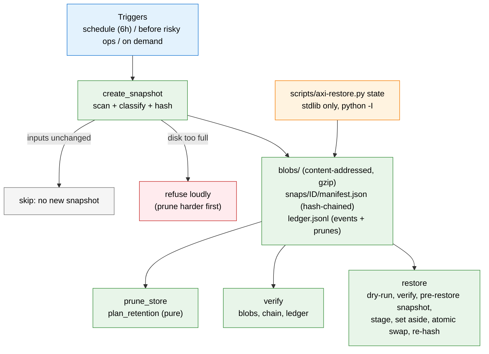

# Spec: State Snapshots

**Owner:** platform • **Status:** Active • **Last updated:** 2026-10-08
**PRD:** none (operator-safety capability; amends no PRD) • **Key ADRs:** ADR-056 (CLI verbs are thin wrappers over skills), ADR-052 (databases are out of scope here)

## Overview

The harness keeps a lot of state in files under the user state dir: identity,
settings, consents, the approval queue, sessions, user commands, memory-ledger
sidecars, audit chains, schedule state. Losing or corrupting it by a bad
upgrade, a bad rotation, a torn write or a disk failure should be a ten-minute
recovery, not a rebuild. State snapshots are the mechanism: periodic and
pre-risk captures of that state into a content-addressed, tamper-evident store,
a safe restore, and a retention policy that ages old snapshots out
responsibly.



Code: `src/axiom/infra/state_snapshots.py` (engine),
`src/axiom/extensions/builtins/state/` (the `state` noun, skills, schedule),
`src/axiom/infra/backup_core.py` (the lifecycle every backup kind shares: atomic writes, hash-chained
ledger and its external head, lock, disk checks, retention, `latest` selection, fault injection),
`scripts/axi-restore.py` (emergency path; `state` and `vault` subcommands in one stdlib-only script;
`axi-state-restore.py` and `axi-vault-restore.py` are one-release shims).

## What is and is not covered

| Covered | Not covered (said in every report) |
|---|---|
| File-based harness state under the state dir, tagged `critical` / `useful` | **Databases.** Postgres-backed stores are never dumped implicitly. The manifest carries a pointer; `--with-db` runs the supported dump path (`axiom.infra.backup.create_backup`, the same code `data backup` uses) |
| Consistent copies of live SQLite files (SQLite backup API, not a torn byte copy) | **Secret values.** Credential value stores, keychain and vault values are never copied; only names are recorded (`secret_metadata`). A restore brings back every record that *refers* to a credential; the credential is re-entered or re-issued, **or restored from an encrypted vault backup** (`spec-vault-backup.md`, `axi vault backup`) |
| The credential *metadata* index (names, expiry) | Caches and large regenerable data: venvs, model weights, packs, logs, traces, scheduler tick logs, the derived recall projection. Each exclusion is in the manifest with pattern, tier, reason and example paths |

Node identity keypairs under `identity/` and `memory/` are included: they are
unrecoverable and a node without them is a different node. This is why the
snapshot directory is owner-only (0700 dirs, 0600 files). To keep any path out,
add a glob to `state.snapshots.exclude`.

The rule list is `DEFAULT_RULES` (first match wins). New state is protected by
default: anything not matched by an exclude is a `useful` include, so adding a
new state file does not require touching the list. A file larger than
`state.snapshots.max_file_bytes` (64 MiB) is excluded *unless it is critical*
(ceiling 1 GiB), because silently dropping the memory ledger db for being large
is the worst possible default.

## Contracts

### CLI (`axi state ...`, names via the brand helper)

| Verb | Behaviour |
|---|---|
| `snapshot [--to DIR] [--reason R] [--force] [--no-prune] [--with-db --db-url URL [--yes-this-database]]` | Take a snapshot. Skips when inputs are unchanged. Refuses loudly when the disk is too full. |
| `ls [--to DIR]` | List snapshots, the interval, and what is / is not covered. |
| `show [ID]` | Contents by tier, exclusions with reasons, credentials left out (names), database coverage, chain and ledger hashes. |
| `diff [ID] [--only GLOB]` | What a restore would change right now. |
| `verify [ID] [--quick]` | Re-hash every blob, recompute the chain, cross-check the ledger. Prints `ledger_head`. |
| `restore [ID] [--only GLOB] [--apply] [--force] [--emergency]` | **Dry run unless `--apply`.** `ID` is an id, a unique prefix, `latest`, or `latest-verified`. |
| `prune [--apply] [--harder]` | **Dry run unless `--apply`.** Lists what goes and why. |
| `pin ID` / `unpin ID` | Exempt a snapshot from pruning. |

Every verb is a skill function `state.<verb>` (`(params, ctx) -> SkillResult`)
registered through `SkillRegistry`; the CLI is a dispatcher over them and every
output ends with real next-step commands. Read verbs project to MCP; `snapshot`,
`restore` and `prune` are CLI-only. Only `restore` is journaled to the action
audit: journaling a snapshot would change the state the next snapshot compares.

### Python seams

```python
from axiom.infra.state_snapshots import (
    snapshot_before, take_snapshot_before,   # guard a risky operation
    latest_snapshot_for, restore_file,       # per-file fallback for corrupt state
    plan_retention, RetentionPolicy,         # pure retention planner
)
latest_snapshot_for(path) -> SnapshotRef | None   # newest intact copy of ONE file
restore_file(path) -> SnapshotRef                 # puts it back; corrupt copy kept as <name>.pre-restore-<ts>
```

`latest_snapshot_for` verifies only the file asked about (manifest hash and the
blob's content hash), so a component that has just found its own file corrupt
does not pay to verify 150 MB it does not want. `restore_file` does not refuse
for running services (it is called *from* them) and replaces exactly one file.

### Settings keys (`state.snapshots.*`, global scope in `settings.toml`)

| Key | Default | Meaning |
|---|---|---|
| `enabled` | true | Master switch for scheduled and pre-risk snapshots. |
| `interval_hours` | 6 | Scheduled cadence while the harness is active. |
| `auto_prune` | true | Run retention after each snapshot. |
| `keep_last` | 24 | Newest N snapshots regardless of age. |
| `keep_recent_hours` | 24 | Keep *everything* from this window. |
| `keep_daily` / `keep_weekly` / `keep_monthly` | 14 / 8 / 6 | Newest snapshot of each of the N most recent days / ISO weeks / months that have one. |
| `protect_newest` | 3 | Never pruned (floor of 1). |
| `max_count` / `max_bytes` | 100 / 2 GiB | Hard caps (0 = unlimited). |
| `min_free_bytes` / `min_free_fraction` | 1 GiB / 5% | Free-space floor on the snapshot disk. |
| `max_file_bytes` | 64 MiB | Per-file ceiling for non-critical files. |
| `exclude` | `[]` | Extra exclude globs; they win over every built-in rule. |

`AXIOM_SNAPSHOT_BEFORE=0` disables the pre-risk snapshots (the test session sets
it so no suite writes into a developer's real state dir).

## Design

### Storage and integrity

```
<root>/blobs/<aa>/<sha256>          content-addressed, gzip-stored, deduplicated across snapshots
<root>/snaps/<id>/manifest.json     a snapshot exists iff this directory exists
<root>/snaps/<id>/PINNED            pin marker (outside the hash chain on purpose)
<root>/ledger.jsonl                 hash-chained append-only event log: snapshot / prune / restore / pin
<root>/axi-restore.py               copy of the emergency script (state + vault), travels with the snapshots
<state>/secrets/snapshot-head.json  newest ledger (seq, head) per store, kept OUTSIDE the store (rollback evidence)
```

Default root is `<state>/snapshots/` (a snapshot never contains snapshots);
`--to DIR` puts it elsewhere. When the snapshot dir is on the same device as the
state, every report warns that a disk loss takes both.

A manifest records version, created_at, host, axiom version, reason, trigger,
per-file path / sha256 / size / mode / tier, what was excluded and why, the
credentials left out (names), the database pointer, and `inputs_hash`. It
carries `prev` (the previous snapshot's `chain_hash`) and
`chain_hash = sha256(prev + "\n" + sha256(canonical(body)))`.

`verify` detects: a blob that is missing or no longer hashes (bit-rot, tamper),
a manifest edited after the fact, a broken chain, a manifest *replaced* by a
self-consistent forgery (the ledger recorded the original `chain_hash`), a
ledger edited or truncated, and a snapshot deleted outside the tool (recorded as
taken, absent, never pruned). A hash chain is used rather than the attest
machinery because the emergency script must verify with the standard library
alone. A chain does not stop someone who rewrites the entire store; record the
`ledger_head` that `verify` prints somewhere else if that matters to you.

**Atomic creation.** Blobs are written to `tmp/`, fsynced and renamed (a blob is
a pure function of its hash, so a stray one is harmless and garbage-collected).
The manifest is built in `tmp/<id>.partial-*/`, fsynced, and the directory is
renamed into `snaps/` as the commit point; a crash leaves no visible snapshot.
A directory lock serializes snapshot, prune and restore.

**Skip if unchanged.** `inputs_hash` covers path, content and mode of every
included file except *churn* files (`CHURN_GLOBS`: audit logs, heartbeat logs).
Those are captured, but growth confined to them does not justify a snapshot;
otherwise a live harness (and the scheduled snapshot's own bookkeeping) would
make every tick a change.

### When snapshots are taken

* **Scheduled:** `state.snapshot_tick` is declared as a PULSE interval cadence
  in the extension manifest (`[[extension.schedule]]`, every 30 minutes). The
  skill itself applies `interval_hours` (default 6) and the unchanged-skip, so
  changing the interval is a settings edit, not a re-registration, and an idle
  harness produces no snapshots. No new daemon. A failed scheduled snapshot
  logs `SCHEDULED STATE SNAPSHOT FAILED` at ERROR and returns a failed result.
* **Before risky operations:** `snapshot_before(reason)` / `take_snapshot_before`
  is called by `ext install` (after the signature check, before anything is
  replaced), `update` (the full update path, not its dry run), and foreign
  credential rotation (metadata only; values are not snapshotted).
  Restore takes its own pre-restore snapshot. A failure to snapshot is logged
  loudly and the operation proceeds (the operator asked for the upgrade, not a
  snapshot) unless `strict=True`.
* **On demand:** `axi state snapshot`.

### Restore

1. Resolve the id; build the diff (read-only). Dry run stops here.
2. Refuse if the snapshot fails a deep `verify` (unless `--force`, which still
   refuses any single blob that fails its hash).
3. Refuse while services appear to be running (live `*.pid` files; exclusively
   held `*.lock` files) unless `--force`. There is no central service registry;
   what holds neither a pid file nor a lock is not seen, and the report says so.
4. Take a pre-restore snapshot; refuse if it cannot be taken (unless `--force`).
5. Per file: stage in the target's directory, fsync, set the current file aside
   as `<name>.pre-restore-<ts>` (hardlink, so the name is never absent), swap
   with an atomic rename, re-hash. A failed re-hash puts the original back.
   Nothing is ever deleted; files the snapshot lacks are left alone.
6. Manifest paths are confined to the state dir (no `..`, no absolute paths, no
   symlinked directory redirecting a write outside).
7. Print follow-ups: what to restart, how to undo (restore the pre-restore
   snapshot), how to remove the leftovers, and that databases are separate.

### Retention

`plan_retention(snapshots, policy, now) -> RetentionPlan` is a pure function
(no clock, no disk). Each decision carries its reasons; every applied prune is
appended to the ledger with those reasons.

The defaults are GFS-style because recovery needs differ by age: the emergency
you are most likely to have is *"undo what I just did"*, so **everything from the
last 24 hours is kept**; *"it broke last week and I only noticed now"* is
covered by **one per day for 14 days**; slow drift and quarterly config changes
by **one per week for 8 weeks** and **one per month for 6 months**. `keep_last`
(24) means a burst of activity followed by a quiet month does not age the whole
history out. Hard caps of **100 snapshots / 2 GiB** bound the worst case; because
blobs are deduplicated and gzip-stored, 2 GiB is on the order of months of
history for a typical state dir.

Invariants, each with a test that fails if broken:

1. The newest `protect_newest` (3) snapshots are never pruned.
2. A pinned snapshot is never pruned.
3. The newest snapshot that passes `verify` is never pruned.
4. If no snapshot verifies, **nothing** is pruned (the plan says why).
5. Corrupt snapshots occupy no tier slot and go first, only when an intact one is protected.
6. Over the caps, the coarsest and oldest history is evicted first (monthly, weekly, daily, recent); byte accounting is the *union* of kept blobs, so deduplication is not double-counted. If only protected snapshots remain and the caps still cannot be met, the plan reports `over_budget` rather than breaking an invariant.
7. A snapshot dated in the future is clamped to `now` for ordering; equal timestamps break ties by id, deterministically.

**Disk pressure.** Before writing, the space the new blobs need is estimated. If
free space after that would drop below `min_free_bytes` or `min_free_fraction`
of the disk, retention is applied with the *harder* policy (a quarter of the
dense tiers, half of the rest). If there is still not enough, the snapshot is
**refused loudly** (`DiskPressureError`, non-zero exit, next-steps naming
`prune` and `--to`) rather than filling the disk.

## One backup core, three kinds

State snapshots, vault backups (`spec-vault-backup.md`) and Postgres dumps (`axiom.infra.backup`,
`axi data backup`) differ in what they copy, not in how a backup is made trustworthy. That part is
`src/axiom/infra/backup_core.py`, once:

| Concern | Shared implementation | Per kind |
|---|---|---|
| Atomic write | `stage_file` / `commit_staged` / `atomic_publish` (temp file, fsync, chmod, rename, directory fsync) | what is written |
| Ledger | `HashChainLedger` (identical on-disk line format for snapshots and vault) | the events |
| Rollback evidence | `ExternalHead` (newest `(seq, head)` kept outside the store, only ever extended) | where the record lives |
| Chained manifest | `build_manifest` / `check_manifest` (snapshots) | vault archives carry an AEAD-authenticated header instead |
| Lock, disk space, same-device warning | `backup_lock`, `has_room`, `same_device_warning` | thresholds, wording |
| Retention | `plan_retention` (pure; never leaves zero verified) | which backups are verified, pin/taint storage |
| `latest` | `select_newest_intact(BackupKind)`: newest that verifies, every skip named | what "verifies" means |
| Fault injection | `FAULTS` (no-op unless a drill installs a plan) | n/a |

The Postgres path gained the thin parts of the lifecycle without a rewrite of `pg_dump`: a directory
lock, a free-space check, a recorded size and sha256 (`.<dump>.manifest.json`), a structural check
(`verify_backup`), a dump that fails or is truncated leaves no file behind, `restore_latest` (newest dump
that verifies, otherwise refuses naming each reason), `prune_backups` (shared retention), and
`.dump` files restore with `pg_restore` rather than `psql`. Deferred, deliberately: a hash-chained ledger
and external head for dumps, a second copy, and real-database drills (they need `pg_dump`/`psql`; the
stubbed lifecycle drills run everywhere and the round trip skips with a reason where they are absent).

## Failure handling contract

What a restore does when something is wrong, and what the operator does. Every row is a drill in
`tests/infra/backup_drills/` (state snapshots x scenario), asserted against the target's real content
before and after, and each lands in exactly one outcome class: **restored**, **restored-from-fallback**
(an older good snapshot, with the skipped newer ones named and why), **partial-restore-reported** (what
was restored vs not, by path) or **refused-safely** (nothing changed, a named reason, a next command).
A crash, a hang, a torn file, silently wrong data or a secret in the output fails the drill.

| Situation | Result | Operator |
|---|---|---|
| Newest snapshot damaged (bit flip, truncated, zero-length or missing blob, manifest edited or emptied, chain link broken, schema newer than this tool) | `restore latest` uses the newest snapshot that verifies, prints `FELL BACK: skipped snapshot <id>: <reason>`; never uses a bad one | Nothing; `state verify` shows the damage; take a fresh snapshot |
| Every snapshot bad | Refused. One line per snapshot with its reason, then: another location or second copy (`--from DIR`), the emergency script, or `--force` to restore what is intact | Try the second copy; `python3 -I axi-restore.py state verify latest --snapshots DIR` |
| Snapshot dir missing, renamed, replaced by a file, unreadable, on an unmounted disk | Refused, naming which of those it is | Mount or rename it back, or `--from <second copy>` |
| Ledger deleted, or an older copy of the store restored over it | Detected by the head recorded outside the store (`LEDGER MISSING` / `ROLLBACK SUSPECTED` / `TAMPER SUSPECTED`); `restore latest` is refused, an explicitly named snapshot restores with a WARNING | Name the snapshot (`state ls`), or `--force` if you know the store is right. The evidence is never overwritten: a ledger shorter than recorded does not move the record back |
| Ledger chain broken part-way | Snapshots recorded before the break are still trusted; those at or after it are passed over | As above |
| Restore killed part-way (power cut, `kill -9`) | Every file is its old or its new content, never a mixture; stray `.restore-*` temp files are ignored; nothing is recorded as restored | Re-run the same command: it only touches what still differs. `state restore <pre-restore id>` undoes |
| Target worse than the snapshot: newer or hand-edited files | Replaced, the original kept as `<name>.pre-restore-<ts>` and listed | Delete the leftovers once satisfied |
| A symlink or directory where a file belongs | Conflict: that path is left alone and listed under **PARTIAL RESTORE**; `--force` replaces a symlink as a link (kept aside), never the file it points at | Resolve the path, re-run |
| Read-only directory, wrong permissions | That file is listed as not restored with the OS reason; the rest are restored | Fix permissions, re-run |
| Disk full while restoring | Files already restored stay restored, the rest are listed (**PARTIAL RESTORE**, `No space left`); no file is left torn | Free space, re-run |
| Disk full while taking a snapshot | `DiskPressureError`: nothing published, existing snapshots byte-identical | Free space or `--to` another disk |
| The pre-restore safety snapshot cannot be made | Restore refuses; nothing changed | Fix the cause, or `--force` to proceed with no undo (said in the output) |
| A write that did not land | Caught by the post-write re-hash; the original is kept; reported as not restored | Re-run; investigate the disk |
| Lock held (a snapshot or prune running) / a second restore at once | Refused, naming the lock; nothing changed | Retry shortly |
| Clock wrong (a future-dated or equal-timestamp snapshot) | `latest` is the most recently *taken* (ledger order), not the highest timestamp; a future-dated newest snapshot does not suppress the next scheduled one | Fix the clock |
| Fresh machine (empty state dir, other HOME or hostname) | Works from the snapshot directory alone | `axi-restore.py state restore latest --state NEW --snapshots DIR --apply` |
| Retention configured to keep nothing | `protect_newest` floors at 1; the newest *deeply verified* snapshot is never pruned (pruning re-verifies before deleting; a quick check cannot see bit rot) | Fix the settings |

`latest` never means a snapshot taken by a restore (trigger `restore`): those hold the state the
restore found, which is the thing being repaired. Restore one by naming it to undo.

The same contract holds for the emergency script (`python3 -I axi-restore.py state ...`) with the
main CLI unusable; its drills run under `python -I` with a shadow `axiom` package that raises on
import, with the power cut, dropped write and disk-full injected around it.

### Restore drills (run them before you need them)

```
pytest tests/infra/backup_drills -q          # the matrix; prints outcome classes by backup kind
pytest tests/infra/backup_core -q            # shared core + compatibility with pre-refactor backups
```

The drills use a temp state dir, HOME, file secrets backend and jsonl action ledger; the guard that
keeps them off a real `~/.axi`, keychain or database runs first and is itself tested. Faults are
injected at named steps (`axiom.infra.backup_core.FAULTS`: `stage.write`, `stage.fsync`,
`commit.replace`, `restore.file`, `backup.publish`, `ledger.append`, `lock.acquire`), never by timing;
production never installs a plan, so the seam costs one attribute test. Mutation checks
(`test_d_mutation_checks.py`) remove each safety property in turn and prove a drill fails.

## Runbook: recovering the harness

Pick the first row that matches.

| Situation | Do this |
|---|---|
| Something I just changed is wrong | `axi state diff latest` then `axi state restore latest --only 'settings.toml'` then add `--apply` |
| One state file is corrupt | `axi state restore latest --only 'path/to/file' --apply` (or the component calls `restore_file`) |
| The `axi` CLI will not start | `python3 -I <snapshot-dir>/axi-restore.py state verify latest` then `... state restore latest` then add `--apply`. The script is standard-library only and lives next to the snapshots (also at `scripts/axi-restore.py` in the source tree). |
| The latest snapshot is damaged | Nothing to do: `restore latest` already means "the newest snapshot that verifies" and prints which newer ones it skipped and why (CLI and script alike) |
| The state dir is gone, snapshots are on another disk | `python3 -I /mnt/other/snapshots/axi-restore.py state restore latest --state ~/.axi --snapshots /mnt/other/snapshots --apply` |
| I restored and it was the wrong call | The output named a pre-restore snapshot: `axi state restore <that id> --apply`. Individual files are also kept as `<name>.pre-restore-<ts>`. |
| The database is lost | Snapshots do not hold it. Restore from the dump taken with `axi state snapshot --with-db --db-url URL` or `axi data backup` using `pg_restore` / `psql` (see `axiom.infra.backup`). |

`axi state restore --emergency` runs the same stdlib script under `python -I`
from the CLI when the in-process code is suspect but the CLI still starts.
Stop Axiom services before an `--apply`; the restore refuses otherwise.
After the restore: restart services, run `axi state diff <id>` (it should show
no changes), then remove the `*.pre-restore-<ts>` leftovers once satisfied.
Credentials are not in snapshots: re-enter or re-issue those named under
`secret_metadata` (`axi state show` lists them).

## Decisions

* ADR-056: every verb is a skill function; the CLI only dispatches. The noun is purpose-named (`state`), not agent-named.
* ADR-052: Postgres-backed stores are backed up through the database path, not copied as files.

## Open questions

* Remote targets (object storage, another host) for `--to`: only a mounted directory today. Owner: platform.
* A signed ledger head (so a full-store rewrite is detectable without an out-of-band record). Owner: platform, with the attest work.
* Service detection beyond pid files and locks (OS service managers). Owner: platform.
* Wiring `restore_file` into the state readers that quarantine corrupt files today (`LockedJsonFile`); owned by the chaos-hardening work, which consumes the seam above.
* The `/undo --force` and settings-bulk-change call sites named in the original brief do not exist in this tree; `snapshot_before` is ready for them.

_Copyright (c) 2026 The University of Texas at Austin and B-Tree Labs. Apache-2.0 licensed._
