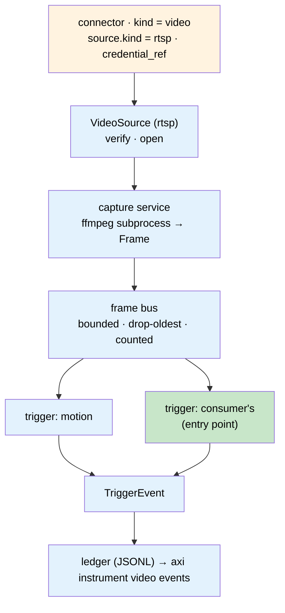

# Spec: Live Video

**Owner:** B-Tree Labs • **Status:** Draft • **Last updated:** 2026-11-11
**PRD:** [prd-video.md](../prds/prd-video.md) • **Key ADRs:** [ADR-240](../adrs/adr-240-a-video-source-is-a-connector-with-a-kind-and-a-trigger-is-a-registered-contract.md), [ADR-256](../adrs/adr-256-an-instrument-quantifies-what-a-sensor-gives-and-kinds-register-under-one-noun.md) (video is instrument kind `video`), ADR-220, ADR-182

## Overview

The `video` extension (`src/axiom/extensions/builtins/video/`) holds video sources
and runs triggers on them. A source is a connector of kind `video`; its
`source.kind` selects a `VideoSource` implementation from the extension's
source-kind registry (first kind: `rtsp`, the live stream of an IP camera). A capture
service opens each source once through an `ffmpeg` subprocess and fans frames out on
an in-process bus; triggers subscribe to the bus and emit events. Nothing here plays,
records or stores video.



## Contracts

### Connector kind `video`

Stored where, and in the envelope that, the connector registry's loader reads
(ADR-220 §2), one file per source, so a connector name is unique across every kind.
The data platform's ingest listing builds configs with a bronze root and skips a
`video` file (a camera is not a bronze source), and a test keeps it that way. The
`video` factory reads `params.source.kind` and
builds the `VideoSource` from the source-kind registry; everything outside
`[connector.params.source]` is common to every kind. `[[connector.params.triggers]]`
tables attach triggers to the source (§`StreamTrigger`, attaching).

```toml
# <state>/plinth/connectors/cam-1.toml
[connector]
name = "cam-1"
kind = "video"
credential_ref = "foreign://video-cam-1"      # stored with `axi vault set video-cam-1`; never in this file

[connector.params]
fps_cap = 10                                  # decoded frames per second offered to the bus (1..60)

[connector.params.source]
kind = "rtsp"
url = "rtsp://cam.example.org:554/stream1"    # no userinfo; refused if present
transport = "tcp"                             # tcp | udp; default tcp
```

The credential's value is `username:password`, or a JSON object with `username` and
`password`. A source name is lowercase letters, digits, `-` and `_` (it names files).

`connector status` lists every video source with every other connector: the
connector extension asks each family's status provider (a builtin's
`connector_status.rows(state_dir)` by convention, or an `axiom.connector_status`
entry point from a portfolio distribution) and names no kind; video's rows carry the
source's health and a one-line detail. `connector reload [<name>]` asks every family
the same way: a family's `connector_status.reload(state_dir, name)` (or an
`axiom.connector_reload` entry point, same gate) answers for the connectors it has,
so a name no family has is an error and any other is reloaded by its own family;
video's applies trigger attachments (§Design, Reload). `doctor` and `node doctor` check that a node
with a declared video source has ffmpeg and numpy, naming the install line; with no
source the check is skipped.

Lifecycle (ADR-238 D5), common to every kind: `connect` — write the file (an
existing name is refused, never replaced); `verify` — ask the source for one frame
and record `codec`, `width`, `height`, `fps`, `latency_ms`, or the classified error
and its fix, in `<state>/video/verify/<name>.json` (the connector status store is
in-process and holds delivery outcomes, so it cannot carry this across processes);
`status` — last verify + live session counters; `revoke` — stop capture, release
the claim, remove the file and its records. `detect` is delegated to the kind. The
connector is `ready | degraded | failed | unmounted` as in ADR-220 §3: `unmounted`
until a verify has run, `failed` while the last verify failed, `degraded` while a
started source is reconnecting, waiting, or started with nothing capturing it.

### `VideoSource` and the source-kind registry

```python
class VideoSource(Protocol):
    kind: str                       # "rtsp"
    replayable: bool                # False: live, lost frames are gone (SIG-B3)
    def detect(self) -> DetectResult: ...          # ADR-068 shape
    def verify(self) -> VerifyReport: ...          # codec, width, height, fps, latency_ms
    def ffmpeg_input_args(self) -> list[str]: ...  # what goes before `-i <input>` and the input itself
    def redacted(self) -> dict: ...                # what `status` may print
```

The registry is `KindRegistry`-shaped (ADR-110 §1): `register(kind, factory)`,
duplicate registration raises, process-local default. A kind's factory takes
`(source_params: dict, credential: Secret | None)`. Built-ins register at the
extension's import; `axi instrument video list --kinds` shows what is registered with
`replayable`.

**Kind `rtsp`** (ephemeral). Params: `url` (required, `rtsp://` or `rtsps://`;
refused if it carries userinfo), `transport` (`tcp` default). `detect` — RTSP
`DESCRIBE` with the resolved credential (Basic, or Digest per RFC 2617), reported as
the rungs `url-resolves`, `describe-answers`, `auth-accepted`, `codec-decodable`.
`verify` — `ffprobe` for the stream, then one frame through the capture pipe. Input
args without a login: `-rtsp_transport <t> -i rtsp://<host>/<path>`. With one:
`-f concat -safe 0 -protocol_whitelist pipe,rtsp,rtsps,tcp,udp,rtp,tls,crypto -i
pipe:N`, where `pipe:N` is a pipe the child inherits carrying an ffconcat script
(`file 'rtsp://<user>:<pass>@<host>/<path>'`, login percent-encoded, and `option
rtsp_transport <t>`). ffmpeg takes a login only in the URL, and a command line is
readable by every user of the machine, so the login is never on one: not ffmpeg's,
not ffprobe's, not in the process registry (whose record names the input as
`rtsp://***@<host>/<path> (on pipe:N)`). A kind marks such an input with
`ffmpeg.SECRET_INPUT` in `ffmpeg_input_args()` and returns the secret part from the
optional `ffmpeg_secret_input()`.

### `Frame`

```python
@dataclass(frozen=True)
class Frame:
    stream: str          # connector name
    ts: str              # ISO-8601 UTC wall clock at decode
    pts: float           # presentation time from the stream, seconds
    seq: int             # gapless per session; restarts on reconnect (session_id changes)
    session_id: str
    array: numpy.ndarray # H×W×3, uint8, RGB
```

`(stream, session_id, seq)` identifies a frame across an overlap switch; a
subscriber drops repeats. A `Frame` carries no source kind: a trigger cannot tell a
camera from anything else. `pts` is on the fps-capped output timeline
(`seq / fps_cap`): raw video on a pipe carries no timestamps of its own.

### Frame bus

Per-source, in-process. `subscribe(name, maxsize=…) -> Subscription`; a full
subscription drops its oldest frame and increments `dropped`. One slow subscriber
never delays another or the decoder. Counters per subscription: `delivered`,
`dropped`, `last_frame_age_s`.

### `StreamTrigger` and `TriggerEvent`

```python
class StreamTrigger(Protocol):
    name: str                       # e.g. "motion"
    version: str
    def start(self) -> None: ...
    def observe(self, frame: Frame) -> Iterable[TriggerEvent]: ...
    def health(self) -> dict: ...   # counters; merged into `status`
    def stop(self) -> None: ...

@dataclass(frozen=True)
class TriggerEvent:
    stream: str
    trigger: str                    # "motion@0.1.0"
    ts: str
    kind: Literal["started", "ended", "occurred"]
    incident_key: str               # stable for one episode: f"{stream}:{trigger}:{episode_id}"
    severity: str                   # from the trigger's config; default "info"
    score: float | None = None
    detail: Mapping[str, Any] = field(default_factory=dict)
```

An event is refused at construction outside the contract: `kind` is `started`,
`ended` or `occurred`; `severity` is `info`, `warning` or `critical` (the one
ADR-238 D3 gives a floor); the key starts `<stream>:<trigger>:` and names an
episode. An event has no field that names a recipient. `BaseTrigger` (exported
with the contract) holds a trigger's config and builds events from a frame
(`self.event(frame, kind, episode_id, score=, detail=)`), filling in the stream,
the time, `name@version`, the configured severity and the key.

Discovery: entry-point group `axiom.video_triggers` (`name = "pkg.module:build"`,
`build(config: dict) -> StreamTrigger`, or the trigger class itself) and the manifest block

```toml
[[video_triggers]]
name = "my-trigger"
factory = "consumer_pkg.video:build"
```

Both pass the portfolio gate (ADR-023-A1 A1.3) before anything is imported,
because importing is already execution. An entry point passes when its
distribution declares `axiom.portfolio_member`. A manifest block passes when the
manifest is the platform's own (in this package's `extensions/builtins/`) or sits
at `<pkg>/extensions/builtins/<ext>/` of an installed portfolio distribution. Where
a manifest lives decides it, never what it says: any manifest can write `builtin =
true`, and a project or user extension directory is refused. The AEOS manifest
schema declares the block. Built-ins (`motion`) register the same way. A name
declared twice fails loudly: neither copy is used, and both origins are named.
`list --triggers` shows each trigger as `registered`, `refused` (with why) or
`conflict`, with its version and origin.

Attaching to a source is configuration in the connector file, applied by
`axi connector reload <name>`. One table per trigger per source: `name` selects
the trigger and everything else is its factory's config, with `severity`
defaulted to `info`. A factory is given that table and nothing about the source.
A table with a key that would name a recipient (`notify`, `recipient`, `to`,
`route`, …) is refused (ADR-238 D2: routing decides).

```toml
[[connector.params.triggers]]
name = "motion"
severity = "info"
roi = "960,540,640,360"      # x,y,w,h; default "full"
min_area = 0.02              # fraction of ROI pixels changed
min_frames = 3               # consecutive frames above min_area to open an episode
cooldown_s = 5               # seconds below min_area to close it
```

### Events

Every `TriggerEvent` is appended with `axiom.infra.state.locked_append_jsonl` to
`<state>/video/events.jsonl`, one row per event with exactly the event's fields,
and `axi instrument video events` reads it (a line cut short by a power loss is skipped). It
keeps a source's history after `revoke`. The text listing is time (local), kind,
severity and incident key; `--json` carries every field. That ledger is the
record and the end of the pipeline in this spec; nothing is routed, published or
stored anywhere else. Moving the record to a more durable store (the extension's
schema via `session_for`, or a DAQ feed) is a change to this section when it is
needed, not to the trigger contract.

### CLI `axi instrument video` — each verb is skill `video.<verb>` (ADR-056)

Video is instrument kind `video` (ADR-256, [spec-instrument](spec-instrument.md)): its
verbs are `<cli> instrument video <verb>`, and video claims no noun of its own. The
`instrument` noun hands `commands/cli.py` the rest of the command line and the command
the person typed as `prog`, and returns its exit code. The skills keep their names
(`video.add`), so the MCP tools do not change (ADR-256 D5). Every fix and usage line
gets the command from `naming.command()` (`<cli> instrument video`); a precondition
template writes `{cli} instrument video <verb>`, and the platform fills `{cli}`.

Every verb takes `--json`. Phase 1 ships `add`, `verify`, `list [--kinds]`,
`status`, `start`, `stop`, `diagnose`, `install`, `uninstall` and `revoke`; phase 2
adds `events` and `list --triggers`. There is no verb to attach a trigger
(VID-015). The reads (`list`, `status`, `diagnose`, `events`) are also MCP tools;
the verbs that change a node's capture stay on its own command line.
Every fix a verb gives names the active distribution's CLI (a precondition writes
`{cli}`, which the platform fills from the branding), never a literal `axi`. The
capture process runs under the platform's default branding, so whoever starts it
(`start`, the boot unit) passes the name in `AXIOM_VIDEO_CLI`, and the fixes it
writes name the command a person types too.

| Verb | Params | Output |
|---|---|---|
| `add <name> --kind rtsp --url <rtsp://…> --credential-ref <ref> [--transport] [--fps-cap]` | writes the connector, runs `verify`; kind-specific flags come from the kind's registration | the verify report |
| `verify <name>` | — | codec, width, height, fps, latency_ms |
| `list [--kinds \| --triggers]` | — | declared sources with kind and state; or registered source kinds with `replayable`; or triggers with version, origin, what each does, and any refused or declared twice with the reason |
| `status [<name>] [--json]` | — | per source: kind, state, session_id, fps, frames, drops, reconnects, last_frame_age_s, the triggers attached in its file, and each running trigger's health (frames, events, errors, dropped, open episodes, its own counters); credentials redacted |
| `start <name>` / `stop <name>` | — | takes/releases the source's claim; starts/stops the subprocess |
| `events [<name>] [--since <iso>] [--json]` | — | ledger rows, oldest first; a name nothing declares is its history, not an error; `--since` without an offset is local time |
| `install` | — | registers `capture --all` with the machine's service manager (systemd user unit, launchd, Task Scheduler) so started sources are captured again after a reboot, and starts it; refused where only a bare subprocess is available; says whether a systemd unit outlives the login (linger) and the command if not |
| `revoke <name>` | — | the last lifecycle step (ADR-238 D5): stops capture, releases the claim, deletes the declaration, its verify record and session, closes any episode left open; keeps its events in the ledger; leaves the login in the vault and says how to remove it (`vault rm`); undo is `add` |
| `uninstall` | — | stops and removes that unit; started marks stay, and the result names the sources nothing will capture after a reboot |
| `diagnose <name>` | — | ladder: `ffmpeg` on PATH → `numpy` installed → source declared → kind registered → credential resolves → the kind's `detect` → `verify`; for `rtsp`: URL resolves → DESCRIBE answers → auth accepted → codec decodable; the first failure names its fix and later rungs are skipped; writes nothing |

**The instrument kind.** `video/instrument.py` defines `KIND`, which the `instrument`
noun loads after the portfolio gate:

| Member | Value |
|---|---|
| `name`, `yields` | `video`, `frames` |
| `skill_for_verb` | every verb above, to `video.<verb>`; `instrument` exports it in `SKILL_FOR_VERB`, so help, Tab and the `next:` lines know each verb's skill and risk |
| `build_parser(prog)`, `main(argv, prog)` | `commands/cli.py`'s `get_parser` and `main`, with `prog` the full command |
| `list()` | one row per declared source: kind `video`, the source's name, its health, its capture state, and its source kind (and `started`) as detail |
| `status()` | the sources counted by health in one line (`2 sources, 1 running, 1 ready, 1 unmounted`), with the `status` and `diagnose` fix when one is not ready |

Both summaries read the status view `video.list` and `video.status` read. Importing
the kind imports no video library.

Manifest: no `cmd` provider; `[[instrument_kinds]] name = "video"`, entry
`axiom.extensions.builtins.video.instrument:KIND` (the `instrument` noun carries
`functions = ["acquire"]`, ADR-164); `kind = "service"`, `name = "capture"`; skills
per verb;

```toml
[extension.availability]
switch = "overlap"
readiness = "process"
drain_s = 10
migrations = "none"
single_flight = true          # per source, by claim
verified_by = "pending"
```

## Design

**Started.** A source is captured while it is *started*: `start` sets
`<state>/video/started/<name>` and `stop` clears it. The mark is what a copy brought
up during a switch takes over, and what a waiting copy gives up on. `start` spawns
a detached capture process for the source (`python -m
axiom.extensions.builtins.video.services.capture --source <name>`, registered in the
process registry, logging scrubbed output to `<state>/video/logs/<name>.log`) unless
a live copy already holds it, and returns once that process holds the claim. A
deploy runs `--all`, which follows the marks as they change. A running `--all`
service advertises itself in `<state>/video/services/<pid>.json` (with its process
start time), and `start` then hands it the source instead of spawning (`via` is
`service`, `spawned` or `already-held`).

**Boot.** `install` registers `python -m axiom.extensions.builtins.video.services.capture
--all` as a long-running unit (restart on failure) through `axiom.infra.services`,
pinned with `AXI_STATE_DIR` to the installing state directory and carrying only
named variables (`AXIOM_VIDEO_FFMPEG`, `AXIOM_VIDEO_FFPROBE`,
`AXIOM_FOREIGN_SECRETS_BACKEND`, `AXIOM_MODE`, and `AXIOM_VIDEO_CLI`, the installing
CLI's name), never the shell's environment.
`status` reports whether it is installed and running, and says so when capture
would not come back after a reboot. `stop` clears the mark;
the holder notices within a second and releases. Only a holder that has not let go
within `drain_s`, and that `start` spawned for this source alone, is sent `SIGTERM`.

**Capture service.** One supervisor thread per started source. It takes the source's
claim (`axiom.infra.pending_claim`, item = `<state>/video/claims/<name>`), builds
the `VideoSource` from the registry, and spawns `ffmpeg -nostdin -loglevel error
<source.ffmpeg_input_args()> -vf fps=<fps_cap> -f rawvideo -pix_fmt rgb24 pipe:1`,
reads `width*height*3` bytes per frame from stdout, builds a `Frame` and offers it to
the bus. Everything after the input args is the same for every kind. A credential
reaches the subprocess only; the command line is never logged, and `status` prints
`source.redacted()`. Width and height come from the `verify`
report, re-probed on each (re)connect. Stdout EOF or a stall longer than
`3 / fps_cap` seconds (minimum 5 s) ends the session; a session's first frame is
allowed 10 s more, for the handshake, probing and the first keyframe. The process is
killed, a new `session_id` is minted, and the supervisor reconnects with exponential
backoff (1 s to 60 s) plus up to 25 % jitter, counting `reconnects`; a session that
delivered frames resets the backoff. For a `replayable` kind, EOF is the end of the
source, not a loss: the session ends and `status` says `finished`. A trailing half
frame is counted in `drops`, as are frames a full subscription dropped. While it
reconnects, `status` says why the last session ended (EOF after how many frames,
with what the decoder said; or the stall), not only that it is reconnecting.

The holder writes its session and counters to `<state>/video/live/<name>.json`
about once a second; `status` believes it only while its writer holds the claim, so
a snapshot left by an exited process reads as `stopped`. A waiting copy writes
`<state>/video/standby/<name>.<copy>.json` instead and never overwrites the holder's.
`AXIOM_VIDEO_FFMPEG` and `AXIOM_VIDEO_FFPROBE` name the binaries when they are not
on `PATH`; pointed at nothing, they mean "not installed", never a fallback.

**Overlap.** A second copy finds the claim held by a live owner and does not start
that source; it reports `waiting` for it. A claim whose owner is dead, or that has
not been touched for 30 s, is taken over. A holder touches its claim every second
and stops capturing the moment it finds it no longer holds it. The old copy on
`stop` or SIGTERM kills its subprocess and releases.

**Trigger runner.** The copy holding a source runs its attachments
(`runner.TriggerSet`) from the moment it takes the claim; a waiting copy runs none.
One thread per attached trigger with its own subscription (`trigger:<name>`, so a
slow trigger drops its own oldest frames and nobody waits); a trigger exception is
counted in its health and does not stop capture or another trigger. A
`TriggerConfigError` from `observe` (a region outside the frame) makes it `failed`,
with its fix, and it is no longer fed; the source is then `degraded` and `status`
says which trigger and why. `health()` is merged into `status`.

Every event is checked before it is written: it names this stream and this
trigger, a `started` opens a key that is not open, an `ended` closes one that is;
anything else is dropped and counted. An episode is one incident and is never left
open. Its `started` row is kept in `<state>/video/episodes/<name>.json` while it is
open, and capture writes its `ended` (`detail.reason`, `closed_by = "capture"`)
when the trigger cannot: when capture stops (before the claim is released), when
reload replaces or detaches the trigger, when the next holder finds what a crashed
one left open, and when the source is revoked. A copy that loses its claim writes
nothing more; the copy that took the source closes it.

**Reload.** `connector reload [<name>]` checks each source's attachments (every
trigger known, every config builds, one per trigger), writes a request to
`<state>/video/reload/<name>`, and waits up to 3 s for the holder's answer in its
live snapshot. The holder reads the request about once a second from a thread of
its own, whatever capture is waiting on (a probe, a back-off, a camera's first
frame), and that thread never touches the claim, so a wedged holder still goes
stale. It applies the file's attachments: an unchanged one keeps running (its
episode is not split), a changed one is replaced, a removed one is detached. A
reload is all or nothing: if any attachment does not build (a typo that renames
`motion` to `motoin` included), nothing changes, what ran keeps running, and the
row says so and names it. When capture starts there is nothing previous to keep,
so what builds runs and the rest is `failed`. The row is `applied` `running`,
`pending` or `not-running` (they apply when capture starts); an attachment that
cannot be applied is `failed` when nothing runs and `degraded` while the previous
triggers still do (ADR-220 §3). Reloading a name another family has does not ask
storage about it, and shows no storage roles. Only triggers are applied: a
changed URL, transport, login or fps cap applies at the next start, and the row
says so. `status` says when the file's attachments differ from the running ones.

**`motion`.** Each frame: crop to ROI, grayscale (BT.601 luma), downscale so the
longer side is ≤ 320 px (a block mean, summed in two integer steps: about 12 ms for
a 4K frame), absolute difference against a running-average background (α = 0.05),
threshold at 25/255, `score = changed_pixels / total`. `score ≥ min_area` for
`min_frames` consecutive frames opens an episode (`started`, a new 8-hex
`episode_id`); `score < min_area` for `cooldown_s` (by the frames' time) closes it
(`ended`). `detail` carries `method = "frame_diff"`, `heuristic = true`, `roi`,
`min_area`, and on `ended` `score_peak`, `started` and `duration_s`. The background
resets on a new session, and a session's first `1/α` = 20 frames learn it as a
plain mean and are not scored: a background that starts as one noisy frame carries
that noise into every difference, and sensor noise of σ = 12 per channel opened an
episode at the start of every session. An episode open across a reconnect stays
open and closes after `cooldown_s` of quiet on the new session. A setting it does
not have is refused, so a typo is not silently ignored. It is a heuristic and says
so: a change of light counts as much as something moving.

**Failure modes.** `ffmpeg` missing → `diagnose` and `start` fail with the install
hint; wrong credential → `verify` fails with the vault instruction; an ephemeral source offline →
`degraded`, reconnecting, `last_frame_age_s` growing; bus consumer stalled → its
`dropped` grows, nothing else changes; a trigger that raises → its `errors` grow,
nothing else changes; a trigger whose config cannot work → `failed` with its fix,
the source `degraded`; an unknown or broken attachment → `connector reload` fails
with the trigger names it knows; a disk too full for the ledger → the event is
counted as an error and capture goes on.

## Tests

Unit (no binaries): `FakeFrameSource` yields numpy frames; bus drop-oldest and
counters; the registry rejects a duplicate kind and an unknown `source.kind` fails
loudly; `rtsp` refuses userinfo; `status --json` contains no credential; claim
refuses a live second holder and recovers a dead one; `motion` opens and closes one
episode on a synthetic moving square and stays silent on static noise; discovery
honours the gate and rejects a duplicate name; ledger write is the locked append;
each CLI verb has a subprocess test, run as `python -m axiom instrument video` so it
passes the top-level dispatcher and the kind registry as a person's command does; video
is a registered instrument kind and `axi video` is not a noun; no shipped text names a
video verb without `instrument`.

The unit tests need no binaries: `ffmpeg` and `ffprobe` are a stand-in script that
echoes the login in its errors the way `ffmpeg` does, and the camera is a fake RTSP
server answering `DESCRIBE` with Basic and Digest auth.

Integration (`-m integration`): `ffmpeg -re -f lavfi -i testsrc=size=640x360:rate=10
-c:v libx264 -tune zerolatency -g 10 -f rtsp rtsp://<user>:<pass>@127.0.0.1:<port>/t`
publishing to `mediamtx` (with a login) as the camera, since `-rtsp_flags listen` is
an input flag and `ffmpeg` cannot serve RTSP itself; `add`, `verify`, `diagnose`,
`start`, counters advancing, `stop`, through the CLI. Then the ways a camera
misbehaves: it loses power and comes back (reconnect on a new session, same
process); a wrong login, path and port each fail at their own `diagnose` rung; the
capture is SIGKILLed (the real decoder does not outlive it; `start` takes the dead
claim); UDP transport; and a soak (`AXIOM_VIDEO_SOAK_S`, 60 s default, `slow`) with
steady frames, no reconnects or drops, one decoder and flat memory. Skipped,
naming the missing binary, where `ffmpeg` or `mediamtx` is not installed.

Phase 2, unit: the event contract refuses an unknown kind, severity or a key for
another stream or trigger, and has no field naming a recipient; an attachment that
names one is refused; a factory sees only its table. Discovery: an entry point or a
manifest block outside the portfolio is refused and never imported, whatever the
manifest says about itself; a duplicate is a conflict and neither is used.
`motion` on synthetic scenes (a square crossing a gray room with sensor noise): one
episode, one key; silent on static noise up to σ = 15; region, `min_frames`,
`cooldown_s`, a pause shorter than the cooldown, two crossings, a 4K frame, the
background reset per session, a light change firing. The runner: one subscription
per trigger, the locked append, an episode closed on stop, reload, takeover after a
crash and revoke; a raising, slow, out-of-order or misaddressed trigger isolated.
Reload, at the supervisor: applies, keeps an unchanged attachment, keeps the
previous one on a broken change, detaches a removed one.

Phase 2, process-level (stand-in `ffmpeg` playing `FAKE_VIDEO_SCENE=crossing`):
`add`, attach `motion` in the file, `start`; `events` lists one episode under one
key; `connector reload` changes the attachment while capture runs; `stop` leaves no
episode open. Integration: `SimulatedCamera(scene="crossing")` (a square crossing a
noisy gray room for 3 s of every 15 s) gives one episode per crossing, and
`scene="still-noise"` stays silent while `motion` sees every frame.

Process-level (stand-in `ffmpeg`, always run): SIGKILL takeover; a second `--all`
copy waits and takes over on SIGTERM; no decoder after `stop`; `vault set` +
`foreign://` against a Digest camera with the login on disk only in the vault's
store; the reads are MCP tools that answer.

## Decisions

- ADR-240: a source is a connector of kind `video` with a source kind (`rtsp` first);
  one acquisition decoded out of process; triggers are a registered contract emitting
  events with incident keys.
- ADR-220: configuration, factory, reload, health states.
- ADR-238 D5: the connector lifecycle verbs.
- ADR-182: overlap switch with a durable claim.

## Open questions

None open. Settled 2026-11-09: severity is per-trigger configuration; capture is
always on once started.
