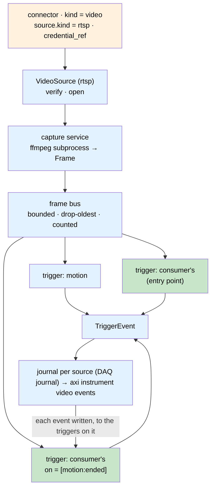

# Spec: Live Video

**Owner:** B-Tree Labs • **Status:** Draft • **Last updated:** 2026-11-22
**PRD:** [prd-video.md](../prds/prd-video.md) • **Key ADRs:** [ADR-240](../adrs/adr-240-a-video-source-is-a-connector-with-a-kind-and-a-trigger-is-a-registered-contract.md), [ADR-264](../adrs/adr-264-a-video-trigger-can-take-the-events-of-the-triggers-before-it-on-its-source.md) (a trigger takes another's events), [ADR-256](../adrs/adr-256-an-instrument-quantifies-what-a-sensor-gives-and-kinds-register-under-one-noun.md) (video is instrument kind `video`), ADR-220, ADR-182

## Overview

The `video` extension (`src/axiom/extensions/builtins/video/`) holds video sources
and runs triggers on them. A source is a connector of kind `video`; its
`source.kind` selects a `VideoSource` implementation from the extension's
source-kind registry (first kind: `rtsp`, the live stream of an IP camera). A capture
service opens each source once through an `ffmpeg` subprocess and fans frames out on
an in-process bus; triggers subscribe to the bus and emit events, and a trigger can
also take the events of other triggers on its source (`on`), so small triggers build
on each other. Two triggers are built in: `motion` (did something move) and
`reference-match` (which named reference picture does a region of the view match, or
none). Nothing here plays, records or stores video.

The event shape, trigger attachment and discovery, the event journal, the state files,
starting and stopping the capture process, the boot unit, the diagnose ladder and the
back-off are `instrument/shared/`'s ([spec-instrument](spec-instrument.md) §What the
kinds share, ADR-275 D8), bound to `video`. Video's modules export the same names, and
what it writes is unchanged.



## Contracts

### Connector kind `video`

Stored where, and in the envelope that, the connector registry's loader reads
(ADR-220 §2), one file per source, so a connector name is unique across every kind.
The data platform's ingest listing builds configs with a bronze root and skips a
`video` file (a camera is not a bronze source), and a test keeps it that way. The
`video` factory reads `params.source.kind` and
builds the `VideoSource` from the source-kind registry; everything outside
`[connector.params.source]` is common to every kind. `[[connector.params.triggers]]`
tables attach triggers to the source (§`StreamTrigger`, attaching).

```toml
# <state>/plinth/connectors/cam-1.toml
[connector]
name = "cam-1"
kind = "video"
credential_ref = "foreign://video-cam-1"      # stored with `axi vault set video-cam-1`; never in this file

[connector.params]
fps_cap = 10                                  # decoded frames per second offered to the bus (1..60)

[connector.params.source]
kind = "rtsp"
url = "rtsp://cam.example.org:554/stream1"    # no userinfo; refused if present
transport = "tcp"                             # tcp | udp; default tcp
```

The credential's value is `username:password`, or a JSON object with `username` and
`password`. A source name is lowercase letters, digits, `-` and `_` (it names files).

`connector status` lists every video source with every other connector: the
connector extension asks each family's status provider (a builtin's
`connector_status.rows(state_dir)` by convention, or an `axiom.connector_status`
entry point from a portfolio distribution) and names no kind; video's rows carry the
source's health and a one-line detail. `connector reload [<name>]` asks every family
the same way: a family's `connector_status.reload(state_dir, name)` (or an
`axiom.connector_reload` entry point, same gate) answers for the connectors it has,
so a name no family has is an error and any other is reloaded by its own family;
video's applies trigger attachments (§Design, Reload). `doctor` and `node doctor` check that a node
with a declared video source has ffmpeg and numpy, naming the install line; with no
source the check is skipped.

Lifecycle (ADR-238 D5), common to every kind: `connect` — write the file (an
existing name is refused, never replaced); `verify` — ask the source for one frame
and record `codec`, `width`, `height`, `fps`, `latency_ms`, or the classified error
and its fix, in `<state>/video/verify/<name>.json` (the connector status store is
in-process and holds delivery outcomes, so it cannot carry this across processes);
`status` — last verify + live session counters; `revoke` — stop capture, release
the claim, remove the file and its records. `detect` is delegated to the kind. The
connector is `ready | degraded | failed | unmounted` as in ADR-220 §3: `unmounted`
until a verify has run, `failed` while the last verify failed, `degraded` while a
started source is reconnecting, waiting, or started with nothing capturing it.

### `VideoSource` and the source-kind registry

```python
class VideoSource(Protocol):
    kind: str                       # "rtsp"
    replayable: bool                # False: live, lost frames are gone (SIG-B3)
    def detect(self) -> DetectResult: ...          # ADR-068 shape
    def verify(self) -> VerifyReport: ...          # codec, width, height, fps, latency_ms
    def ffmpeg_input_args(self) -> list[str]: ...  # what goes before `-i <input>` and the input itself
    def redacted(self) -> dict: ...                # what `status` may print
```

The registry is `KindRegistry`-shaped (ADR-110 §1): `register(kind, factory)`,
duplicate registration raises, process-local default. A kind's factory takes
`(source_params: dict, credential: Secret | None)`. Built-ins register at the
extension's import; `axi instrument video list --kinds` shows what is registered with
`replayable`.

**Kind `rtsp`** (ephemeral). Params: `url` (required, `rtsp://` or `rtsps://`;
refused if it carries userinfo), `transport` (`tcp` default). `detect` — RTSP
`DESCRIBE` with the resolved credential (Basic, or Digest per RFC 2617), reported as
the rungs `url-resolves`, `describe-answers`, `auth-accepted`, `codec-decodable`.
`verify` — `ffprobe` for the stream, then one frame through the capture pipe. Input
args without a login: `-rtsp_transport <t> -i rtsp://<host>/<path>`. With one:
`-f concat -safe 0 -protocol_whitelist pipe,rtsp,rtsps,tcp,udp,rtp,tls,crypto -i
pipe:N`, where `pipe:N` is a pipe the child inherits carrying an ffconcat script
(`file 'rtsp://<user>:<pass>@<host>/<path>'`, login percent-encoded, and `option
rtsp_transport <t>`). ffmpeg takes a login only in the URL, and a command line is
readable by every user of the machine, so the login is never on one: not ffmpeg's,
not ffprobe's, not in the process registry (whose record names the input as
`rtsp://***@<host>/<path> (on pipe:N)`). A kind marks such an input with
`ffmpeg.SECRET_INPUT` in `ffmpeg_input_args()` and returns the secret part from the
optional `ffmpeg_secret_input()`.

### `Frame`

```python
@dataclass(frozen=True)
class Frame:
    stream: str          # connector name
    ts: str              # ISO-8601 UTC wall clock at decode
    pts: float           # presentation time from the stream, seconds
    seq: int             # gapless per session; restarts on reconnect (session_id changes)
    session_id: str
    array: numpy.ndarray # H×W×3, uint8, RGB
```

`(stream, session_id, seq)` identifies a frame across an overlap switch; a
subscriber drops repeats. A `Frame` carries no source kind: a trigger cannot tell a
camera from anything else. `pts` is on the fps-capped output timeline
(`seq / fps_cap`): raw video on a pipe carries no timestamps of its own.

### Frame bus

Per-source, in-process. `subscribe(name, maxsize=…) -> Subscription`; a full
subscription drops its oldest frame and increments `dropped`. One slow subscriber
never delays another or the decoder. Counters per subscription: `delivered`,
`dropped`, `last_frame_age_s`.

### `StreamTrigger` and `TriggerEvent`

```python
class StreamTrigger(Protocol):
    name: str                       # e.g. "motion"
    version: str
    sensitivity: str                # optional: the class of what it writes; "internal" if absent
    def start(self) -> None: ...
    def observe(self, frame: Frame) -> Iterable[TriggerEvent]: ...
    def health(self) -> dict: ...   # counters; merged into `status`
    def stop(self) -> None: ...

@dataclass(frozen=True)
class TriggerEvent:
    stream: str
    trigger: str                    # "motion@0.1.0"
    ts: str
    kind: Literal["started", "ended", "occurred"]
    incident_key: str               # stable for one episode: f"{stream}:{trigger}:{episode_id}"
    severity: str                   # from the trigger's config; default "info"
    score: float | None = None
    detail: Mapping[str, Any] = field(default_factory=dict)
    sensitivity: str = "internal"   # the trigger's declared class (ADR-267)
```

An event is refused at construction outside the contract: `kind` is `started`,
`ended` or `occurred`; `severity` is `info`, `warning` or `critical` (the one
ADR-238 D3 gives a floor); `sensitivity` is one of the journal's classes (`open`,
`internal`, `ec-controlled`, `itar`, `restricted`); the key starts
`<stream>:<trigger>:` and names an episode. An event has no field that names a recipient. `BaseTrigger` (exported
with the contract) holds a trigger's config and builds events from a frame
(`self.event(frame, kind, episode_id, score=, detail=)`), filling in the stream,
the time, `name@version`, the configured severity, the key and the trigger's
sensitivity.

**A trigger states the sensitivity of what it writes** (VID-031, ADR-267): the class
attribute `sensitivity`, `internal` when absent. It is code, not configuration, so a
missing line in a file cannot make controlled data look ordinary. `restricted` is
the class for data a site controls by its own rules rather than an export
regulation; like `ec-controlled` and `itar` it is controlled, and a journal never
drops it on overflow (VID-032). The runner writes each event with its trigger's
class, whatever the event says. A trigger whose class is not one is refused at
attach with its fix.

Discovery: entry-point group `axiom.video_triggers` (`name = "pkg.module:build"`,
`build(config: dict) -> StreamTrigger`, or the trigger class itself) and the manifest block

```toml
[[video_triggers]]
name = "my-trigger"
factory = "consumer_pkg.video:build"
```

Both pass the portfolio gate (ADR-023-A1 A1.3) before anything is imported,
because importing is already execution. An entry point passes when its
distribution declares `axiom.portfolio_member`. A manifest block passes when the
manifest is the platform's own (in this package's `extensions/builtins/`) or sits
at `<pkg>/extensions/builtins/<ext>/` of an installed portfolio distribution. Where
a manifest lives decides it, never what it says: any manifest can write `builtin =
true`, and a project or user extension directory is refused. The AEOS manifest
schema declares the block. Built-ins (`motion`) register the same way. A name
declared twice fails loudly: neither copy is used, and both origins are named.
`list --triggers` shows each trigger as `registered`, `refused` (with why) or
`conflict`, with its version and origin.

Attaching to a source is configuration in the connector file, applied by
`axi connector reload <name>`. One table per trigger per source: `name` selects
the trigger and everything else is its factory's config, with `severity`
defaulted to `info`. A factory is given that table and nothing about the source.
A table with a key that would name a recipient (`notify`, `recipient`, `to`,
`route`, …) is refused (ADR-238 D2: routing decides).

```toml
[[connector.params.triggers]]
name = "motion"
severity = "info"
roi = "960,540,640,360"      # x,y,w,h; default "full"
min_area = 0.02              # fraction of ROI pixels changed
min_frames = 3               # consecutive frames above min_area to open an episode
cooldown_s = 5               # seconds below min_area to close it
```

```toml
[[connector.params.triggers]]
name = "reference-match"
reference_set = "/srv/example/front-door-refs"   # absolute; the directory below
sample_s = 1.0               # match about one frame per this many seconds of frame time
dwell_s = 15.0               # a label is reported once read this long without a break
leave_s = 3.0                # a reported label is left after this long without agreement
heartbeat_s = 300.0          # an `occurred` per region at least this often, in every state
severity = "info"
```

`reference_set` is required and the others take the defaults shown. `sample_s`,
`dwell_s` and `leave_s` are seconds, 0 or more; `heartbeat_s` is above 0. Any other
key is refused, so a typo is not silently ignored. The path must be absolute,
because the capture process's working directory is not the one a person wrote the
file in; a relative path is refused with that fix.

### Reference set (`reference-match`)

A reference set is a directory the consumer builds: `reference-set.json` and the
reference pictures it names, side by side. The platform reads it and never writes
it; `reference_set.write_reference_set(directory, manifest, images)` is offered to
a consumer's builder, and fills in each picture's hash. The trigger knows nothing
about what a picture shows: every label, region and threshold is the set's.

```json
{
  "format": "reference-set/1",
  "name": "front-door",
  "version": "2026-11-12.1",
  "working_size": [960, 540],
  "masks": [[0.0, 0.03, 0.19, 0.10]],
  "landmarks": {
    "bounds": [0.0, 0.0, 1.0, 1.0],
    "exclude": [[0.40, 0.20, 0.70, 0.90]],
    "image": "landmarks.npy", "sha256": "<hex>"
  },
  "regions": [
    {
      "name": "door",
      "bounds": [0.45, 0.25, 0.65, 0.85],
      "exclude": [],
      "margin": 0.2,
      "references": [
        {"label": "closed", "image": "door-closed.npy", "sha256": "<hex>", "min_match": 0.6},
        {"label": "open", "image": "door-open.npy", "sha256": "<hex>", "min_match": 0.6}
      ]
    }
  ],
  "guards": {"view": 0.85, "exposure": [40.0, 220.0], "clipped": 0.05},
  "provenance": {}
}
```

| Field | Meaning |
|---|---|
| `format` | `reference-set/1`. A set in a format this version does not read is refused, naming the ones it does. A change to this table is a new format string, not an edit |
| `name`, `version` | Any non-empty strings. Every event and `status` name them |
| `working_size` | `[width, height]` in pixels. A frame is reduced to it by a whole factor `k` (a frame is `k·width × k·height`), so it is also the size the pictures were taken at |
| box | `[x0, y0, x1, y1]`, fractions of the frame, `0 ≤ x0 < x1 ≤ 1` and the same for `y`. At the working size its rows are `round(y0·height)` to `round(y1·height)` and its columns the same for `x` (Python's `round`). The landmarks' and a region's box is their `bounds`; `masks` and `exclude` are lists of boxes. The key is not `box` because, in this platform, that word names a storage vendor (`tests/test_no_storage_vendor_in_core.py`) |
| `masks` | Boxes left out of every comparison: text burned into the picture, such as a clock or a caption. Default none |
| `landmarks` | The parts of the view that do not change (`bounds` minus `exclude` minus the masks) and their picture. The view guard compares them |
| `regions` | One or more, each with a `name` (lowercase letters, digits, `-`, `_`; unique), its `bounds`, optional `exclude` boxes, a `margin` (0 to 2) and two or more `references` |
| reference | A `label` (the same pattern, unique in its region, never `changing` or `unknown`), its picture, and a `min_match` (-1 to 1) |
| `guards` | `view`: the least landmark match (-1 to 1); `exposure`: `[low, high]` mean luma, `0 ≤ low < high ≤ 255`; `clipped`: the largest fraction (0 to 1) of pixels at 2 or below or 253 or above |
| `provenance` | Optional, any JSON object. Carried, never read |
| picture | `image` is a file name in the directory (no path) and `sha256` the hex SHA-256 of its bytes. It is a 2-D `.npy` array of BT.601 luma (0 to 255, any real dtype) of its box at the working size, loaded with `allow_pickle=False`. Its shape must be its box's, every value finite, and its visible pixels not flat |

Any other key, at any level, is refused. `reference_set.load_reference_set(path) ->
ReferenceSet` reads and checks a set; every refusal is a `ReferenceSetError` (a
`TriggerConfigError`) that names the field or the file and its fix. The trigger
loads the set when its attachment is built, so `connector reload` refuses a set
that cannot work before anything changes. A set is read once; a set changed on
disk applies at the next reload that changes the attachment, or the next start.

**A trigger on another's events** (ADR-264, VID-027..030). An attachment can name,
with `on`, the attachments on the same source whose events it takes: an attachment's
name for every event it writes, or `<name>:<kind>` for one kind. A single string is
one entry. Like `name`, `on` is the runner's: it is in the attachment's config (so a
change to it is a change to the attachment) and never given to the factory.

```toml
[[connector.params.triggers]]
name = "my-stage"
on = ["motion:ended"]        # or ["motion"] for started, ended and occurred
```

```python
@runtime_checkable
class TakesEvents(Protocol):
    def on_event(self, event: TriggerEvent) -> Iterable[TriggerEvent]: ...
```

A trigger takes events by implementing `on_event` as well as `StreamTrigger`. It is
called on the trigger's own thread, never at the same time as `observe`, with a copy
of the event the upstream wrote, so a trigger needs no lock and cannot change what
another is given. What it returns is checked and journaled exactly as what `observe`
returns is, and can be taken by a trigger further on. An event carries no frame
(ADR-256 D7); a trigger that needs pixels reads its own next frame.

### Events

Every `TriggerEvent` is appended to its source's own journal,
`<state>/video/journal/<source>/`: the data platform's DAQ journal (`DAQJournal`,
[spec-signal-ingest-and-producer](spec-signal-ingest-and-producer.md)), written
through a `DAQConsolidator`, so an event is stored exactly as a DAQ reading is
(`segments/seg-<offset>.jsonl`, one envelope and record per line; `cursors/`). That
journal is the ledger: the record and the end of the pipeline in this spec. Nothing
is routed, published or sent; sending is a `DAQTransmitter` cursor on the same
journal, a later change to this section and not to the trigger contract. Nothing
writes `<state>/video/events.jsonl` any more (VID-022).

One event is one journaled record (VID-023). Each trigger is a feed of its own, so
each has its own gapless `seq` and hash chain (`prev_hash` → `content_hash`, what
`verify_chain` checks), and a new holder of the source continues them from the
journal's tail.

| Field | Value |
|---|---|
| envelope `producer_id` | `video-<source>` |
| envelope `feed` | `video.<trigger name>`, for example `video.motion` |
| envelope `source_class`, `model_ref` | `estimated`, and the trigger's `name@version`: an event is a versioned algorithm's reading of frames, not a sensor's, and a consumer must be able to tell `motion@0.1.0` from its successor |
| envelope `delivery_class`, `payload_kind` | `standard`, `records` |
| record `schema_id` | `video/trigger-event-v1` |
| record `ts` | the event's `ts` |
| record `values` | `kind`, `score`, `detail` |
| record `tags` | `stream`, `trigger`, `incident_key`, `severity` |
| record `quality`, `sensitivity` | `good`, and the event's sensitivity: its trigger's declared class, `internal` by default |

**One writer at a time per source** (VID-024). The holder's trigger threads, the
capture service closing an episode, a successor during an overlap switch and
`revoke` can all write one source's events. Every append holds an in-process lock
and an exclusive file lock, `<journal>/writer.lock`, so no two writers interleave.
A writer that finds the journal changed since its own last append re-reads it
first, so `seq` and the chain continue from what is on disk and no `seq` is written
twice. A last line without its newline, a write cut off by a power loss, is
truncated under the lock before the next append; a reader skips any line that does
not parse.

**Reading** (VID-025). `axi instrument video events` reads every source's journal,
or one, oldest first: by time across sources, in the order written within one. Each
row is exactly the event's fields (`stream`, `trigger`, `ts`, `kind`,
`incident_key`, `severity`, `score`, `detail`, `sensitivity`; a row an earlier
release wrote has `internal`). The text listing is time (local),
kind, severity and incident key; `--json` carries every field. `revoke` keeps the
journal, so a source's history outlives its declaration. Events an earlier release
wrote to `<state>/video/events.jsonl` are read from it, read-only, and listed with
the rest; reading that file is dropped in a later release, marked `# contract:`.

**Retention: none yet** (VID-026). Nothing consumes the journal, so it has no
cursor, `compact` releases nothing and there is no `max_bytes`: it keeps every
event. An event is a few hundred bytes. A transmitter's cursor is what would let
delivered segments go.

### CLI `axi instrument video` — each verb is skill `video.<verb>` (ADR-056)

Video is instrument kind `video` (ADR-256, [spec-instrument](spec-instrument.md)): its
verbs are `<cli> instrument video <verb>`, and video claims no noun of its own. The
`instrument` noun hands `commands/cli.py` the rest of the command line and the command
the person typed as `prog`, and returns its exit code. The skills keep their names
(`video.add`), so the MCP tools do not change (ADR-256 D5). Every fix and usage line
gets the command from `naming.command()` (`<cli> instrument video`); a precondition
template writes `{cli} instrument video <verb>`, and the platform fills `{cli}`.

Every verb takes `--json`. Phase 1 ships `add`, `verify`, `list [--kinds]`,
`status`, `start`, `stop`, `diagnose`, `install`, `uninstall` and `revoke`; phase 2
adds `events` and `list --triggers`. There is no verb to attach a trigger
(VID-015). The reads (`list`, `status`, `diagnose`, `events`) are also MCP tools;
the verbs that change a node's capture stay on its own command line.
Every fix a verb gives names the active distribution's CLI (a precondition writes
`{cli}`, which the platform fills from the branding), never a literal `axi`. The
capture process runs under the platform's default branding, so whoever starts it
(`start`, the boot unit) passes the name in `AXIOM_VIDEO_CLI`, and the fixes it
writes name the command a person types too.

| Verb | Params | Output |
|---|---|---|
| `add <name> --kind rtsp --url <rtsp://…> --credential-ref <ref> [--transport] [--fps-cap]` | writes the connector, runs `verify`; kind-specific flags come from the kind's registration | the verify report |
| `verify <name>` | — | codec, width, height, fps, latency_ms |
| `list [--kinds \| --triggers]` | — | declared sources with kind and state; or registered source kinds with `replayable`; or triggers with version, origin, what each does, and any refused or declared twice with the reason |
| `status [<name>] [--json]` | — | per source: kind, state, session_id, fps, frames, drops, reconnects, last_frame_age_s, the triggers attached in its file, and each running trigger's health (frames, events, errors, dropped, open episodes, its own counters; a trigger whose health has `regions` gets one text line per region with its state, since when and its reasons); credentials redacted |
| `start <name>` / `stop <name>` | — | takes/releases the source's claim; starts/stops the subprocess |
| `events [<name>] [--since <iso>] [--json]` | — | journal rows (§Events), oldest first; a name nothing declares is its history, not an error; `--since` without an offset is local time |
| `install` | — | registers `capture --all` with the machine's service manager (systemd user unit, launchd, Task Scheduler) so started sources are captured again after a reboot, and starts it; refused where only a bare subprocess is available; says whether a systemd unit outlives the login (linger) and the command if not |
| `revoke <name>` | — | the last lifecycle step (ADR-238 D5): stops capture, releases the claim, deletes the declaration, its verify record and session, closes any episode left open; keeps its events in its journal; leaves the login in the vault and says how to remove it (`vault rm`); undo is `add` |
| `uninstall` | — | stops and removes that unit; started marks stay, and the result names the sources nothing will capture after a reboot |
| `diagnose <name>` | — | ladder: `ffmpeg` on PATH → `numpy` installed → source declared → kind registered → credential resolves → the kind's `detect` → `verify`; for `rtsp`: URL resolves → DESCRIBE answers → auth accepted → codec decodable; the first failure names its fix and later rungs are skipped; writes nothing |

**The instrument kind.** `video/instrument.py` defines `KIND`, which the `instrument`
noun loads after the portfolio gate:

| Member | Value |
|---|---|
| `name`, `yields` | `video`, `frames` |
| `skill_for_verb` | every verb above, to `video.<verb>`; `instrument` exports it in `SKILL_FOR_VERB`, so help, Tab and the `next:` lines know each verb's skill and risk |
| `build_parser(prog)`, `main(argv, prog)` | `commands/cli.py`'s `get_parser` and `main`, with `prog` the full command |
| `list()` | one row per declared source: kind `video`, the source's name, its health, its capture state, and its source kind (and `started`) as detail |
| `status()` | the sources counted by health in one line (`2 sources, 1 running, 1 ready, 1 unmounted`), with the `status` and `diagnose` fix when one is not ready |

Both summaries read the status view `video.list` and `video.status` read. Importing
the kind imports no video library.

Manifest: no `cmd` provider; `[[instrument_kinds]] name = "video"`, entry
`axiom.extensions.builtins.video.instrument:KIND` (the `instrument` noun carries
`functions = ["acquire"]`, ADR-164); `kind = "service"`, `name = "capture"`; skills
per verb;

```toml
[extension.availability]
switch = "overlap"
readiness = "process"
drain_s = 10
migrations = "none"
single_flight = true          # per source, by claim
verified_by = "pending"
```

## Design

**Started.** A source is captured while it is *started*: `start` sets
`<state>/video/started/<name>` and `stop` clears it. The mark is what a copy brought
up during a switch takes over, and what a waiting copy gives up on. `start` spawns
a detached capture process for the source (`python -m
axiom.extensions.builtins.video.services.capture --source <name>`, registered in the
process registry, logging scrubbed output to `<state>/video/logs/<name>.log`) unless
a live copy already holds it, and returns once that process holds the claim. A
deploy runs `--all`, which follows the marks as they change. A running `--all`
service advertises itself in `<state>/video/services/<pid>.json` (with its process
start time), and `start` then hands it the source instead of spawning (`via` is
`service`, `spawned` or `already-held`).

**Boot.** `install` registers `python -m axiom.extensions.builtins.video.services.capture
--all` as a long-running unit (restart on failure) through `axiom.infra.services`,
pinned with `AXI_STATE_DIR` to the installing state directory and carrying only
named variables (`AXIOM_VIDEO_FFMPEG`, `AXIOM_VIDEO_FFPROBE`,
`AXIOM_FOREIGN_SECRETS_BACKEND`, `AXIOM_MODE`, and `AXIOM_VIDEO_CLI`, the installing
CLI's name), never the shell's environment.
`status` reports whether it is installed and running, and says so when capture
would not come back after a reboot. `stop` clears the mark;
the holder notices within a second and releases. Only a holder that has not let go
within `drain_s`, and that `start` spawned for this source alone, is sent `SIGTERM`.

**Capture service.** One supervisor thread per started source. It takes the source's
claim (`axiom.infra.pending_claim`, item = `<state>/video/claims/<name>`), builds
the `VideoSource` from the registry, and spawns `ffmpeg -nostdin -loglevel error
<source.ffmpeg_input_args()> -vf fps=<fps_cap> -f rawvideo -pix_fmt rgb24 pipe:1`,
reads `width*height*3` bytes per frame from stdout, builds a `Frame` and offers it to
the bus. Everything after the input args is the same for every kind. A credential
reaches the subprocess only; the command line is never logged, and `status` prints
`source.redacted()`. Width and height come from the `verify`
report, re-probed on each (re)connect. Stdout EOF or a stall longer than
`3 / fps_cap` seconds (minimum 5 s) ends the session; a session's first frame is
allowed 10 s more, for the handshake, probing and the first keyframe. The process is
killed, a new `session_id` is minted, and the supervisor reconnects with exponential
backoff (1 s to 60 s) plus up to 25 % jitter, counting `reconnects`; a session that
delivered frames resets the backoff. For a `replayable` kind, EOF is the end of the
source, not a loss: the session ends and `status` says `finished`. A trailing half
frame is counted in `drops`, as are frames a full subscription dropped. While it
reconnects, `status` says why the last session ended (EOF after how many frames,
with what the decoder said; or the stall), not only that it is reconnecting.

The holder writes its session and counters to `<state>/video/live/<name>.json`
about once a second; `status` believes it only while its writer holds the claim, so
a snapshot left by an exited process reads as `stopped`. A waiting copy writes
`<state>/video/standby/<name>.<copy>.json` instead and never overwrites the holder's.
`AXIOM_VIDEO_FFMPEG` and `AXIOM_VIDEO_FFPROBE` name the binaries when they are not
on `PATH`; pointed at nothing, they mean "not installed", never a fallback.

**Overlap.** A second copy finds the claim held by a live owner and does not start
that source; it reports `waiting` for it. A claim whose owner is dead, or that has
not been touched for 30 s, is taken over. A holder touches its claim every second
and stops capturing the moment it finds it no longer holds it. The old copy on
`stop` or SIGTERM kills its subprocess and releases.

**Trigger runner.** The copy holding a source runs its attachments
(`runner.TriggerSet`) from the moment it takes the claim; a waiting copy runs none.
One thread per attached trigger with its own subscription (`trigger:<name>`, so a
slow trigger drops its own oldest frames and nobody waits); a trigger exception is
counted in its health and does not stop capture or another trigger. A
`TriggerConfigError` from `observe` (a region outside the frame) makes it `failed`,
with its fix, and it is no longer fed; the source is then `degraded` and `status`
says which trigger and why. `health()` is merged into `status`.

**Events between triggers** (ADR-264). After the runner writes an event to the
journal, it gives a copy to every running trigger whose `on` matches the attachment
that wrote it, in the order written (VID-027). That includes the `ended` the runner
writes when it closes an upstream's episode on a reload, and excludes nothing it
wrote; an event that could not be written is given to nobody. A trigger is given
what is written while it runs: nothing is replayed to a trigger that starts later,
and stopping capture gives the triggers being stopped nothing more. A trigger whose
upstream is detached, failed or being replaced keeps running and is given events
again when the upstream runs.

Each trigger keeps its pending events in its own queue, and its thread takes them
with its frames in frame time (VID-028): before observing a frame, it gives the
trigger its pending events in the order written for as long as the next one's `ts`
is at or before the frame's `ts`. An event waits for such a frame at most `EVENT_WAIT_S` = 1 s of wall time, and
while no frame arrives it is given within the poll interval (0.2 s), so a stalled
camera or a clock ahead of the frames never holds an event. A frame the trigger had
not yet taken can be older than an event it was just given; frame time says which
came first. The queue holds 256 events; a trigger that falls behind drops its
oldest and counts them in `events_dropped`, and nothing upstream waits (VID-030).
`on_event` that raises is counted like `observe` that raises, and
`TriggerConfigError` from it makes the trigger `failed`.

An `on` is checked with the attachments, at a reload and when capture starts, and
refused with its fix (VID-029): an entry that is not `<name>` or `<name>:<kind>`, a
kind other than `started`, `ended` or `occurred`, an attachment that is not on this
source, the attachment itself, a cycle (named in order), or a trigger that does not
take events (it has no `on_event`). A reload with any of these changes nothing.
When capture starts, the attachment is `failed` with its fix and the others run.
`health` carries `on`, `events_in` (given) and `events_dropped`, and the text
`status` shows them on the trigger's line.

Every event is checked before it is written: it names this stream and this
trigger, a `started` opens a key that is not open, an `ended` closes one that is;
anything else is dropped and counted. An episode is one incident and is never left
open. Its `started` row is kept in `<state>/video/episodes/<name>.json` while it is
open, and capture writes its `ended` (`detail.reason`, `closed_by = "capture"`)
when the trigger cannot: when capture stops (before the claim is released), when
reload replaces or detaches the trigger, when the next holder finds what a crashed
one left open, and when the source is revoked. A copy that loses its claim writes
nothing more; the copy that took the source closes it.

**Reload.** `connector reload [<name>]` checks each source's attachments (every
trigger known, every config builds, one per trigger), writes a request to
`<state>/video/reload/<name>`, and waits up to 3 s for the holder's answer in its
live snapshot. The holder reads the request about once a second from a thread of
its own, whatever capture is waiting on (a probe, a back-off, a camera's first
frame), and that thread never touches the claim, so a wedged holder still goes
stale. It applies the file's attachments: an unchanged one keeps running (its
episode is not split), a changed one is replaced, a removed one is detached. A
reload is all or nothing: if any attachment does not build (a typo that renames
`motion` to `motoin` included), nothing changes, what ran keeps running, and the
row says so and names it. When capture starts there is nothing previous to keep,
so what builds runs and the rest is `failed`. The row is `applied` `running`,
`pending` or `not-running` (they apply when capture starts); an attachment that
cannot be applied is `failed` when nothing runs and `degraded` while the previous
triggers still do (ADR-220 §3). Reloading a name another family has does not ask
storage about it, and shows no storage roles. Only triggers are applied: a
changed URL, transport, login or fps cap applies at the next start, and the row
says so. `status` says when the file's attachments differ from the running ones.

**`motion`.** Each frame: crop to ROI, grayscale (BT.601 luma), downscale so the
longer side is ≤ 320 px (a block mean summed in integers, `luma.block_luma`, shared
with `reference-match`: about 5 ms for a 4K frame), absolute difference against a running-average background (α = 0.05),
threshold at 25/255, `score = changed_pixels / total`. `score ≥ min_area` for
`min_frames` consecutive frames opens an episode (`started`, a new 8-hex
`episode_id`); `score < min_area` for `cooldown_s` (by the frames' time) closes it
(`ended`). `detail` carries `method = "frame_diff"`, `heuristic = true`, `roi`,
`min_area`, and on `ended` `score_peak`, `started` and `duration_s`. The background
resets on a new session, and a session's first `1/α` = 20 frames learn it as a
plain mean and are not scored: a background that starts as one noisy frame carries
that noise into every difference, and sensor noise of σ = 12 per channel opened an
episode at the start of every session. An episode open across a reconnect stays
open and closes after `cooldown_s` of quiet on the new session. A setting it does
not have is refused, so a typo is not silently ignored. It is a heuristic and says
so: a change of light counts as much as something moving.

**`reference-match`.** It answers one question per region: which of the set's
reference pictures does this part of the view match, or none. It knows nothing
about what is in view. It is a heuristic and says so, and none of its numbers is a
confidence.

*Sampling.* A frame is matched when its time (`frame.ts`) is at least `sample_s`
after the last matched frame, when it is the first frame of a session, or when its
time is earlier than the last matched one. Every other frame is skipped, at a cost
of microseconds.

*One matched frame.* In order:

1. **Size.** The frame must be `k` times the working size for one whole `k ≥ 1`. A
   frame the set does not fit raises `TriggerConfigError`: the trigger is `failed`
   with a fix that names both sizes, and the source is `degraded`. It is a
   configuration fault, not `unknown`.
2. **Reduce.** A `k × k` block mean per channel, summed in integers (the reduction
   `motion` uses, `luma.block_luma`), then BT.601 luma, `float32`.
3. **Compare.** Every comparison is the zero-mean normalised correlation of two sets
   of pixels, in `float64`, between -1 and 1. It is undefined (`null` in events) when
   either side's standard deviation is below 0.5 luma levels. Masked and excluded
   pixels are left out. It ignores a change of gain and offset, so a uniform change
   of light leaves it unchanged.
4. **Guards,** for the frame. `view`: the landmarks against their picture, failing
   below `guards.view` or when undefined. `exposure`: the mean luma of every unmasked
   pixel outside `guards.exposure`, or more than `guards.clipped` of them clipped.
5. **Each region.** Its correlation with each of its references. `flat`: the region
   itself has no contrast.
6. **Result.** With any of `view`, `exposure` or `flat`, the region reads `unknown`
   with those reasons, in that order. Otherwise the best reference wins if it is at
   least its `min_match` and beats the runner-up by at least the region's `margin`
   (on a tie, the first listed is best). If not, the region reads `unknown`, reason
   `neither`: it matches no reference well enough.

*Over time, per region,* on matched frames and their own times:

- A **run** is consecutive matched frames reading the same result. A new session
  starts a new run.
- A label is **reported** once its run has lasted `dwell_s`. The first label
  reported since the trigger started is the **first**. Reporting a label after the
  reported one was left, or a different label, is a **transition**.
- A reported label is **left** once no matched frame has agreed with it for
  `leave_s`. A shorter disagreement is not a change.
- The **state** is `unknown` before the first label (reason `settling` while a label
  is still dwelling); the label while it is reported and not left; and once it is
  left, `unknown` while a guard fails and `changing` otherwise, until a transition.

*Events, per region,* timed by `frame.ts`:

| Event | When | Incident key | `detail` |
|---|---|---|---|
| `occurred`, `first: true` | The first label since start is reported | The region's status key | `since`: when the label was first seen |
| `started` | A reported label is left | A new change key | `from`, `last_seen`: the last frame that agreed |
| `ended` | The next label is reported | The change's key | `from`, `to`, `since`, `started`, `returned` |
| `occurred`, `heartbeat: true` | `heartbeat_s` since the region's last event (or since its first matched frame), in **every** state | The region's status key | `since`: when the current state began |
| `ended`, `closed_by: capture` | Capture stops, reload replaces or detaches the trigger, a crash, a revoke (spec §Trigger runner) | The change's key | `reason`, `started`; no `to`: the change was interrupted, not concluded |

- When `dwell_s` is shorter than `leave_s`, a new label can be reported before the
  old one is left; the `started` and its `ended` are then written together.
- `returned: true` means the region left its label and came back to the same one:
  a person, a shadow or a guard, not a change. Only an `ended` with `from ≠ to` is a
  change of label.
- Keys are `<stream>:reference-match@<version>:<episode>`. A change's episode is
  `<region>-<8 hex>`. A region's status key, `<region>-status-<8 hex>`, is minted
  when the trigger starts and shared by its `occurred` events, so routing collapses
  them into one incident per region (ADR-238 D4) and each change is its own.
- Every event's `detail` carries `region`, `method = "reference_correlation"`,
  `heuristic = true`, `reference_set` and `reference_version`, the region's `state`
  and `reasons`, its `scores` (`{label: correlation}`) and the frame's `view`. The
  event's `score` is the correlation of the label it names, and nothing when its
  state is `changing` or `unknown`.
- While frames arrive, a region is never silent for longer than `heartbeat_s` (to
  within one `sample_s`), whatever its state. Heartbeats while `unknown` carry their
  reasons, so a reader can tell a region that cannot be read from one that is not
  being watched.

*Several regions* ride one attachment, because a source takes one attachment per
trigger name. Each region has its own runs, state, keys and heartbeat, and is
unaffected by the others; the guards are the frame's, so a failed guard makes every
region `unknown`.

*A reconnect* (a new `session_id`) starts a new run and matches the next frame, and
leaves the rest as it was: the reported label, an open change and the heartbeat
clock. The time without frames counts as time without agreement, so after an outage
longer than `leave_s` the first matched frame that disagrees leaves the label at
once (`started`), and one that agrees keeps it with nothing written. A label seen
before an outage never completes its dwell with frames from after it. A frame earlier
than the last matched one (a clock stepped back) starts a new run too, and the
region's clocks are brought back to it, so the heartbeat and `leave_s` count from
there.

*`health()`*: `reference_set` (`name`, `version`, `path`), `heuristic`, `frames`,
`matched`, `analysis` (`working_size` and `factor`, the `k`; nothing before the first
matched frame), and per region in `regions`: the
`state`, `since`, the reported `label`, the `reasons`, the last `scores` and `view`,
`counts` (matched frames by what each read, `unknown` included), `changes`,
`returned` and the `open` change's incident key.

*Cost:* one matched 3840×2160 frame against a 960×540 set with one region is about
18 ms on a 6-core desktop CPU (Ryzen 5 5600X), 13 ms of it the reduction (`k = 4`) and
the rest luma and the comparisons; a 320×180 frame is under 1 ms, and a frame that
is not matched costs about 2 µs. At the default `sample_s = 1` that is under 2 % of
one core for a 4K camera.

*Known limit, not fixed here.* A change of light that is not uniform (a lamp on one
side, the sun through a window) changes the landmarks too, so it can fail the view
guard, and every region then reads `unknown` until the light returns. That is the
honest answer, and it is written down rather than tuned away: it is the set's
references and guard that decide, and a set that must read under several lights
needs a later format.

**Failure modes.** `ffmpeg` missing → `diagnose` and `start` fail with the install
hint; wrong credential → `verify` fails with the vault instruction; an ephemeral source offline →
`degraded`, reconnecting, `last_frame_age_s` growing; bus consumer stalled → its
`dropped` grows, nothing else changes; a trigger that raises → its `errors` grow,
nothing else changes; a trigger whose config cannot work → `failed` with its fix,
the source `degraded`; an unknown or broken attachment → `connector reload` fails
with the trigger names it knows; a disk too full for the journal → the event is
counted as an error, given to no trigger, and capture goes on; an `on` that cannot
work → refused with its fix, a reload changes nothing; a trigger behind on its
events → its `events_dropped` grows, nothing upstream waits. For `reference-match`: a relative or
missing `reference_set`, a manifest that does not read, a format it does not read,
a picture whose hash, shape or values do not fit, a reserved or repeated label, or
a setting it does not have → the attachment does not build and `connector reload`
says which and how to fix it; a frame size the set does not fit → `failed` with
the sizes, the source `degraded`; a shifted view, bad exposure or a flat region →
`unknown` with the reason, heartbeats go on.

## Tests

Unit (no binaries): `FakeFrameSource` yields numpy frames; bus drop-oldest and
counters; the registry rejects a duplicate kind and an unknown `source.kind` fails
loudly; `rtsp` refuses userinfo; `status --json` contains no credential; claim
refuses a live second holder and recovers a dead one; `motion` opens and closes one
episode on a synthetic moving square and stays silent on static noise; discovery
honours the gate and rejects a duplicate name; an event is a journaled record in
its source's journal, one feed per trigger, its chain intact across a restart and a
change of holder, one writer at a time across threads and processes, a torn last
line skipped and repaired, `events.jsonl` read and never written, nothing
compacted;
each CLI verb has a subprocess test, run as `python -m axiom instrument video` so it
passes the top-level dispatcher and the kind registry as a person's command does; video
is a registered instrument kind and `axi video` is not a noun; no shipped text names a
video verb without `instrument`.

The unit tests need no binaries: `ffmpeg` and `ffprobe` are a stand-in script that
echoes the login in its errors the way `ffmpeg` does, and the camera is a fake RTSP
server answering `DESCRIBE` with Basic and Digest auth.

Integration (`-m integration`): `ffmpeg -re -f lavfi -i testsrc=size=640x360:rate=10
-c:v libx264 -tune zerolatency -g 10 -f rtsp rtsp://<user>:<pass>@127.0.0.1:<port>/t`
publishing to `mediamtx` (with a login) as the camera, since `-rtsp_flags listen` is
an input flag and `ffmpeg` cannot serve RTSP itself; `add`, `verify`, `diagnose`,
`start`, counters advancing, `stop`, through the CLI. Then the ways a camera
misbehaves: it loses power and comes back (reconnect on a new session, same
process); a wrong login, path and port each fail at their own `diagnose` rung; the
capture is SIGKILLed (the real decoder does not outlive it; `start` takes the dead
claim); UDP transport; and a soak (`AXIOM_VIDEO_SOAK_S`, 60 s default, `slow`) with
steady frames, no reconnects or drops, one decoder and flat memory. Skipped,
naming the missing binary, where `ffmpeg` or `mediamtx` is not installed.

Phase 2, unit: the event contract refuses an unknown kind, severity or a key for
another stream or trigger, and has no field naming a recipient; an attachment that
names one is refused; a factory sees only its table. Discovery: an entry point or a
manifest block outside the portfolio is refused and never imported, whatever the
manifest says about itself; a duplicate is a conflict and neither is used.
`motion` on synthetic scenes (a square crossing a gray room with sensor noise): one
episode, one key; silent on static noise up to σ = 15; region, `min_frames`,
`cooldown_s`, a pause shorter than the cooldown, two crossings, a 4K frame, the
background reset per session, a light change firing. The runner: one subscription
per trigger, the journal append, an episode closed on stop, reload, takeover after a
crash and revoke; a raising, slow, out-of-order or misaddressed trigger isolated.
Reload, at the supervisor: applies, keeps an unchanged attachment, keeps the
previous one on a broken change, detaches a removed one.

Phase 3, unit (`test_reference_match_*.py`, synthetic scenes in `scenes.py`: a
noisy room with static landmarks and a door whose picture follows a schedule):
a region reads the label of the reference it matches, labels taken from the set
(one test uses `alpha` and `beta`); a region that matches no reference reads
`unknown`, never a label; the dwell, one change as one `started`/`ended` pair, a
return flagged and not a change; a shifted view, bad exposure and a flat region,
each `unknown` with its reason; a change of light alone never gives another label;
a heartbeat in every state, `unknown` included; two regions reporting independently,
each event naming its region; every refusal with a fix (relative path, missing set,
bad hash, unknown setting, reserved label, a frame size the set does not fit);
the runner closing an open change on stop and replacing a changed attachment on
reload; a reconnect as §Design says; the manifest declaring the trigger, `list
--triggers` showing it, and the manifest's generated skill blocks in step with the
skills. Integration: `SimulatedCamera(scene="door")` (a door in a noisy room that
opens and closes every 10 s) with a set built from the scene's geometry gives one
change per opening and closing, heartbeats, and the events through the CLI; a set
at a working size the stream does not fit leaves the trigger `failed` with its fix.

Phase 5, unit (`test_a_trigger_can_take_the_events_of_the_triggers_before_it`): a
trigger on another is given each event it wrote, after the write and in order, and
a kind narrows that; what `on_event` returns is journaled and reaches the trigger
after it (a chain of three); the runner's `ended` for a replaced upstream is given;
each downstream gets its own copy; `on_event` runs on the trigger's thread and never
beside `observe`; one that raises is counted. Frame time: an event comes before the
first frame at or after it, a lagging trigger included; with no frames, or frames
behind the event, it is not held past `EVENT_WAIT_S`. Refusals: a malformed entry,
an unknown kind, an attachment not on the source, itself, a cycle and a trigger with
no `on_event`, each with its fix, at a check, at a reload (nothing changes) and at
capture start (that one `failed`); the factory never sees `on`. Bounded: a trigger
behind drops its oldest events and counts them; `status` shows `on` and the counts.

Phase 2, process-level (stand-in `ffmpeg` playing `FAKE_VIDEO_SCENE=crossing`):
`add`, attach `motion` in the file, `start`; `events` lists one episode under one
key; `connector reload` changes the attachment while capture runs; `stop` leaves no
episode open. Integration: `SimulatedCamera(scene="crossing")` (a square crossing a
noisy gray room for 3 s of every 15 s) gives one episode per crossing, and
`scene="still-noise"` stays silent while `motion` sees every frame.

Process-level (stand-in `ffmpeg`, always run): SIGKILL takeover; a second `--all`
copy waits and takes over on SIGTERM; no decoder after `stop`; `vault set` +
`foreign://` against a Digest camera with the login on disk only in the vault's
store; the reads are MCP tools that answer.

## Decisions

- ADR-240: a source is a connector of kind `video` with a source kind (`rtsp` first);
  one acquisition decoded out of process; triggers are a registered contract emitting
  events with incident keys.
- ADR-264: a trigger can take, with `on`, the events of the triggers before it on
  its source, in frame time with its frames.
- ADR-267: a trigger states the sensitivity of what it writes; `restricted` is the
  class a site controls by its own rules.
- ADR-220: configuration, factory, reload, health states.
- ADR-238 D5: the connector lifecycle verbs.
- ADR-182: overlap switch with a durable claim.
- No ADR for `reference-match`: it is a trigger under ADR-240's contract, and its
  one hard-to-change surface, the reference-set format, carries a version string
  (`reference-set/1`) so that a change is a new format, read beside the old.

## Open questions

None open. Settled 2026-11-09: severity is per-trigger configuration; capture is
always on once started.
