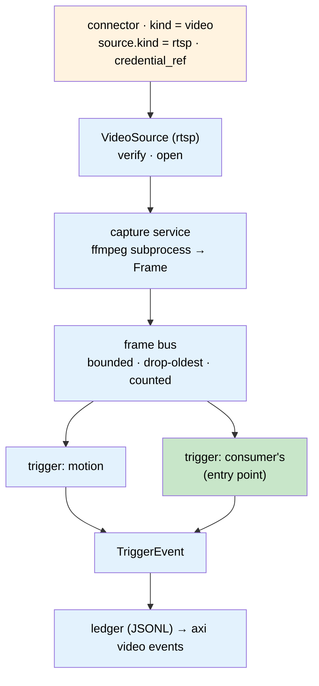

# Spec: Live Video

**Owner:** B-Tree Labs • **Status:** Draft • **Last updated:** 2026-11-09
**PRD:** [prd-video.md](../prds/prd-video.md) • **Key ADRs:** [ADR-240](../adrs/adr-240-a-video-source-is-a-connector-with-a-kind-and-a-trigger-is-a-registered-contract.md), ADR-220, ADR-182

## Overview

The `video` extension (`src/axiom/extensions/builtins/video/`) holds video sources
and runs triggers on them. A source is a connector of kind `video`; its
`source.kind` selects a `VideoSource` implementation from the extension's
source-kind registry (first kind: `rtsp`, the live stream of an IP camera). A capture
service opens each source once through an `ffmpeg` subprocess and fans frames out on
an in-process bus; triggers subscribe to the bus and emit events. Nothing here plays,
records or stores video.



## Contracts

### Connector kind `video`

Stored by the connector registry's loader (ADR-220 §2), one file per source. The
`video` factory reads `params.source.kind` and builds the `VideoSource` from the
source-kind registry; everything outside `[params.source]` is common to every kind.

```toml
# <state>/plinth/connectors/cam-1.toml
name = "cam-1"
kind = "video"
credential_ref = "vault://video/cam-1"        # username + password; never in this file
[params]
fps_cap = 10                                  # decoded frames per second offered to the bus
[params.source]
kind = "rtsp"
url = "rtsp://cam.example.org:554/stream1"    # no userinfo; refused if present
transport = "tcp"                             # tcp | udp; default tcp
```

Lifecycle (ADR-238 D5), common to every kind: `connect` — write the file; `verify`
— ask the source for one frame and record `codec`, `width`, `height`, `fps`,
`latency_ms` in the connector status store; `status` — last verify + live session
counters; `revoke` — remove the file and release the claim. `detect` is delegated to
the kind. The connector is `ready | degraded | failed | unmounted` as in ADR-220 §3.

### `VideoSource` and the source-kind registry

```python
class VideoSource(Protocol):
    kind: str                       # "rtsp"
    replayable: bool                # False: live, lost frames are gone (SIG-B3)
    def detect(self) -> DetectResult: ...          # ADR-068 shape
    def verify(self) -> VerifyReport: ...          # codec, width, height, fps, latency_ms
    def ffmpeg_input_args(self) -> list[str]: ...  # what goes before `-i <input>` and the input itself
    def redacted(self) -> dict: ...                # what `status` may print
```

The registry is `KindRegistry`-shaped (ADR-110 §1): `register(kind, factory)`,
duplicate registration raises, process-local default. A kind's factory takes
`(source_params: dict, credential: Secret | None)`. Built-ins register at the
extension's import; `axi video list --kinds` shows what is registered with
`replayable`.

**Kind `rtsp`** (ephemeral). Params: `url` (required; refused if it carries
userinfo), `transport` (`tcp` default). `detect` — RTSP `DESCRIBE` with the resolved
credential. `verify` — one keyframe. Input args: `-rtsp_transport <t> -i
rtsp://<user>:<pass>@<host>/<path>`, credential injected for the subprocess only.

### `Frame`

```python
@dataclass(frozen=True)
class Frame:
    stream: str          # connector name
    ts: str              # ISO-8601 UTC wall clock at decode
    pts: float           # presentation time from the stream, seconds
    seq: int             # gapless per session; restarts on reconnect (session_id changes)
    session_id: str
    array: numpy.ndarray # H×W×3, uint8, RGB
```

`(stream, session_id, seq)` identifies a frame across an overlap switch; a
subscriber drops repeats. A `Frame` carries no source kind: a trigger cannot tell a
camera from anything else.

### Frame bus

Per-source, in-process. `subscribe(name, maxsize=…) -> Subscription`; a full
subscription drops its oldest frame and increments `dropped`. One slow subscriber
never delays another or the decoder. Counters per subscription: `delivered`,
`dropped`, `last_frame_age_s`.

### `StreamTrigger` and `TriggerEvent`

```python
class StreamTrigger(Protocol):
    name: str                       # e.g. "motion"
    version: str
    def start(self) -> None: ...
    def observe(self, frame: Frame) -> Iterable[TriggerEvent]: ...
    def health(self) -> dict: ...   # counters; merged into `status`
    def stop(self) -> None: ...

@dataclass(frozen=True)
class TriggerEvent:
    stream: str
    trigger: str                    # "motion@0.1.0"
    ts: str
    kind: Literal["started", "ended", "occurred"]
    incident_key: str               # stable for one episode: f"{stream}:{trigger}:{episode_id}"
    severity: str                   # from the trigger's config; default "info"
    score: float | None = None
    detail: Mapping[str, Any] = field(default_factory=dict)
```

Discovery: entry-point group `axiom.video_triggers` (`name = "pkg.module:build"`,
`build(config: dict) -> StreamTrigger`) and the manifest block

```toml
[[video_triggers]]
name = "my-trigger"
factory = "consumer_pkg.video:build"
```

Both pass the portfolio gate (ADR-023-A1) before import. Built-ins (`motion`)
register the same way. Duplicate names fail loudly.

Attaching to a source is configuration in the connector file, applied by
`axi connector reload <name>`:

```toml
[[params.triggers]]
name = "motion"
severity = "info"
roi = "960,540,640,360"      # x,y,w,h; default "full"
min_area = 0.02              # fraction of ROI pixels changed
min_frames = 3               # consecutive frames above min_area to open an episode
cooldown_s = 5               # seconds below min_area to close it
```

### Events

Every `TriggerEvent` is appended with `axiom.infra.state.locked_append_jsonl` to
`<state>/video/events.jsonl`, and `axi video events` reads it. That ledger is the
record and the end of the pipeline in this spec; nothing is routed, published or
stored anywhere else. Moving the record to a more durable store (the extension's
schema via `session_for`, or a DAQ feed) is a change to this section when it is
needed, not to the trigger contract.

### CLI `axi video` — each verb is skill `video.<verb>` (ADR-056)

| Verb | Params | Output |
|---|---|---|
| `add <name> --kind rtsp --url <rtsp://…> --credential-ref <ref> [--transport] [--fps-cap]` | writes the connector, runs `verify`; kind-specific flags come from the kind's registration | the verify report |
| `verify <name>` | — | codec, width, height, fps, latency_ms |
| `list [--kinds \| --triggers]` | — | declared sources with kind and state; or registered source kinds with `replayable`; or registered triggers with version and origin |
| `status [<name>] [--json]` | — | per source: kind, state, session_id, fps, frames, drops, reconnects, last_frame_age_s, per-trigger health; credentials redacted |
| `start <name>` / `stop <name>` | — | takes/releases the source's claim; starts/stops the subprocess |
| `events [<name>] [--since <iso>] [--json]` | — | ledger rows |
| `diagnose <name>` | — | ladder: `ffmpeg` on PATH → kind registered → the kind's `detect` → `verify`; for `rtsp`: URL resolves → DESCRIBE answers → auth accepted → codec decodable; the first failure names its fix |

Manifest: `kind = "cmd"`, `noun = "video"`, `functions = ["acquire"]`;
`kind = "service"`, `name = "capture"`; skills per verb;

```toml
[extension.availability]
switch = "overlap"
readiness = "process"
drain_s = 10
migrations = "none"
single_flight = true          # per source, by claim
verified_by = "pending"
```

## Design

**Capture service.** One supervisor thread per started source. It takes the source's
claim (`axiom.infra.pending_claim`, item = `<state>/video/claims/<name>`), builds
the `VideoSource` from the registry, and spawns `ffmpeg -nostdin -loglevel error
<source.ffmpeg_input_args()> -vf fps=<fps_cap> -f rawvideo -pix_fmt rgb24 pipe:1`,
reads `width*height*3` bytes per frame from stdout, builds a `Frame` and offers it to
the bus. Everything after the input args is the same for every kind. A credential
reaches the subprocess only; the command line is never logged, and `status` prints
`source.redacted()`. Width and height come from the `verify`
report, re-probed on each (re)connect. Stdout EOF or a stall longer than
`3 / fps_cap` seconds (minimum 5 s) ends the session: the process is killed, a new
`session_id` is minted, and the supervisor reconnects with exponential backoff
(1 s to 60 s) plus jitter, counting `reconnects`. For a `replayable` kind, EOF is
the end of the source, not a loss: the session ends and `status` says `finished`.

**Overlap.** A second copy finds the claim held by a live owner and does not start
that source; it reports `waiting` for it. A claim whose owner is dead is taken over.
The old copy on `stop` or SIGTERM kills its subprocess and releases.

**Trigger runner.** One thread per attached trigger with its own subscription; a
trigger exception is counted in its health and does not stop capture or another
trigger. `health()` is merged into `status`.

**`motion`.** Each frame: crop to ROI, grayscale, downscale so the longer side is
≤ 320 px, absolute difference against a running-average background (α = 0.05),
threshold at 25/255, `score = changed_pixels / total`. `score ≥ min_area` for
`min_frames` consecutive frames opens an episode (`started`, new `episode_id`);
`score < min_area` for `cooldown_s` closes it (`ended`). `detail` carries
`method = "frame_diff"`, `roi`, `score_peak`. The background resets on reconnect.

**Failure modes.** `ffmpeg` missing → `diagnose` and `start` fail with the install
hint; wrong credential → `verify` fails with the vault instruction; an ephemeral source offline →
`degraded`, reconnecting, `last_frame_age_s` growing; bus consumer stalled → its
`dropped` grows, nothing else changes.

## Tests

Unit (no binaries): `FakeFrameSource` yields numpy frames; bus drop-oldest and
counters; the registry rejects a duplicate kind and an unknown `source.kind` fails
loudly; `rtsp` refuses userinfo; `status --json` contains no credential; claim
refuses a live second holder and recovers a dead one; `motion` opens and closes one
episode on a synthetic moving square and stays silent on static noise; discovery
honours the gate and rejects a duplicate name; ledger write is the locked append;
each CLI verb has a subprocess test.

Integration (`-m integration`): `ffmpeg -re -f lavfi -i testsrc=size=640x360:rate=10
-c:v libx264 -tune zerolatency -f rtsp -rtsp_flags listen rtsp://127.0.0.1:<port>/t`
as the camera; `verify`, `start`, counters advancing, `stop`.

## Decisions

- ADR-240: a source is a connector of kind `video` with a source kind (`rtsp` first);
  one acquisition decoded out of process; triggers are a registered contract emitting
  events with incident keys.
- ADR-220: configuration, factory, reload, health states.
- ADR-238 D5: the connector lifecycle verbs.
- ADR-182: overlap switch with a durable claim.

## Open questions

None open. Settled 2026-11-09: severity is per-trigger configuration; capture is
always on once started.
