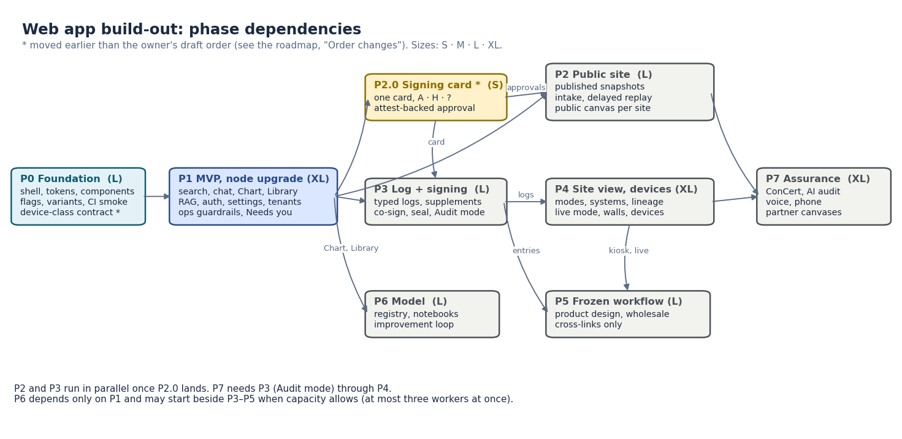

# Spec: web app build-out roadmap (phases, layers, variants)

**Owner:** platform (web) • **Status:** Draft, hand-off for implementation • **Last updated:** 2026-10-30
**PRD:** [prd-site-view.md](../prds/prd-site-view.md) • **Design spec:** [spec-site-view.md](spec-site-view.md)
**Phase specs:** [P0 + P1 MVP](spec-webapp-buildout-mvp.md) · [P2 public site](spec-webapp-buildout-p2-public-site.md) ·
[P3 Log and signing](spec-webapp-buildout-p3-log-and-signing.md) · [P4 Site view and devices](spec-webapp-buildout-p4-site-view-and-devices.md) ·
[P5 frozen workflow item](spec-webapp-buildout-p5-frozen-workflow-item.md) · [P6 Model](spec-webapp-buildout-p6-model.md) ·
[P7 assurance and reach](spec-webapp-buildout-p7-assurance-and-reach.md)

This spec turns the finished Site view design (PRD §1–§22, spec addenda v5–v14, gallery
sections v1–v13) into phases that a fresh session can each build in one pass. It is
generic. A product keeps its own specializations (its workflow item, its live-mode
details, its public-site sections) in its own repository, and a site keeps its
deployment specifics (its node, its brand, its tenants) in its site repository.

**Reuse, do not contradict.** The product's existing web app spec already fixes the
layering (Axiom backend + appkit base, the product as a minimal appkit configuration,
the site as configuration only), the feed contract, and the feature-flag contract
(`on | off | soon`; default → environment → node → account → user; audited; protected
environments). This roadmap builds on those contracts unchanged. Where a phase below
names flags, it uses that contract.

## 1. Phases

| Phase | What ships | Size | Entry | Spec |
|---|---|---|---|---|
| **P0** Foundation | the standard shell (search as a full-width row under the wordmark), semantic colour tokens, the canonical-component gallery and the one Expand behaviour (⛶ / Esc) in appkit, flags, the three-variant runner and per-variant CI smoke, the device-class contract (data only), the acceptance-ID harness | L | none | [MVP spec §P0](spec-webapp-buildout-mvp.md#p0-foundation) |
| **P1** MVP and the node upgrade | items 1–24 of the MVP (search, chat, Chart, Library, history, RAG, auth, Account and Settings and the change log, the Team directory, the app database fed from gold, branding, tenants, data platform and AI harness, audit trail, user lifecycle, scope selector, uploads → RAG, parity, quality marks, ops guardrails, notifications, labels, the schedule read: agenda by CLI, MCP and chat, no calendar component), deployed as three variants on the staging node | XL | P0 gate | [MVP spec §P1](spec-webapp-buildout-mvp.md#p1-the-mvp) |
| **P2.0** Signing card | one signing card with A · H · ? keys, backed by an attested approval record | S | P1 gate | [P2 spec §P2.0](spec-webapp-buildout-p2-public-site.md#p20-the-signing-card) |
| **P2** Public site | static public site on a public edge, charts from published snapshots, the governed publishing loop, the narrow intake door, the delayed live view and replay, a public canvas per site, insider sign-in | L | P2.0 merged; P1 Chart catalog, intake → invitations, quality marks | [P2 spec](spec-webapp-buildout-p2-public-site.md) |
| **P3** Log and signing | Log with typed logs, entries, supplements (corrections), co-sign, seal, read-back, the Audit mode, retention classes enforced | L | P2.0 merged | [P3 spec](spec-webapp-buildout-p3-log-and-signing.md) |
| **P4** Site view, live mode, devices, walls | Site's three modes (Operate · System · Automate), System's Physical · Diagram · Data views, the system catalog, lineage, loops, the scope model at full depth, chart slots, wall displays (kiosk display URLs, auto-cycle; the basic Expand and Esc are P0/P1), console / tablet / phone device classes, the `Calendar` component and schedule slots (Operate's next hours and today, Automate's executors, the walls' week ahead, the roster) | XL | P3 gate | [P4 spec](spec-webapp-buildout-p4-site-view-and-devices.md) |
| **P5** The product's frozen workflow item | a product's vetted workflow design placed wholesale in the shell; Axiom supplies only the slots, including `Calendar`'s week and by-resource timeline for the product's calendar tab | L | P3 and P4 gates | [P5 spec](spec-webapp-buildout-p5-frozen-workflow-item.md) |
| **P6** Model | the builder's item and the improvement loop ([PRD](../prds/prd-model-loop.md)), in three packages: **P6a** registries and runs (catalog views, codes and executors, scheduled runs, tagged outputs); **P6b** train, V&V and promote (training sets, model kinds, V&V records, promotion on the signing card, deployment); **P6c** monitor and improve (monitors on both measured channels, analyses and agent notebooks, findings, hypotheses, cycles and history) | XL (was L; split) | P1 gate; P6a also needs the ModSim engine skeleton merged; P6b needs P2.0 (signing card); P6c uses P3's Change log and P4's chart slots (links until they land) | [P6 spec](spec-webapp-buildout-p6-model.md) |
| **P7** Assurance and reach | ConCert with external audit AIs, the Audit workspace at full depth, voice, phone signatures where allowed, partner public canvases and the network page, the phone agenda, ICS subscribe by a vault-issued URL, public dates on the canvases | XL | P3, P4 gates; P2 for canvases | [P7 spec](spec-webapp-buildout-p7-assurance-and-reach.md) |

**Sizes.** S ≈ one worker, one day; M ≈ one worker, two to three days; L ≈ up to three
workers, about a week; XL ≈ up to three workers, more than a week, split into work
packages that each land on their own. Every phase is split into work packages small
enough for one worker to finish and land; "one shot" means the phase spec is complete
enough that nobody has to come back and ask.

### Notebooks and learning mode (where they ride)

Notebooks are designed in [prd-notebooks.md](../prds/prd-notebooks.md) and ride existing
phases rather than adding one. **The MVP does not get a notebook editor**: P1 carries N0
(read-only notebook rendering in the Library, Open in Jupyter, RAG ingest, labelled
samples, chat "show me how" cards), size S. The editor (N1, L) lands with P6a because it
needs the per-user container executor; N2 (agent mode, HPC, the official outcomes,
practice cycle reruns, L) with P6b–P6c; N3 (courses and grading, L) with P7 unless a
course term pulls it earlier. Learning mode: MVP samples and "show me how"; P4 training
replays; P5 practice requests; P6 cycle reruns.

## 2. Dependency graph

Generated by `scripts/diagrams/webapp_buildout_phases.py` (run from the repo root).

### Order changes from the draft order, and why

1. **The signing card moves to the start of P2 (P2.0), from P3.** The public site's
   publication approval and the standing approval behind the delayed live view are
   signatures on the same card (PRD §17.4, §17.7, §19.3; gallery v12 "Publication
   approval uses the card"). Building P2 first without it would mean a second card or a
   rewrite. P2.0 is small (S) and lands before P2 and P3 start, so P2 and P3 can still
   run in parallel without both editing the card.
2. **The device-class contract moves into P0 (data only).** Every signature records
   the device class it was made on (spec addendum v11), so the P2.0 card and P3's
   logs need the field from the first signature. Writing it later would mean
   re-stamping signatures, which the signed-record rules forbid. P0 adds only the
   `DeviceClass` / `DevicePolicy` types and the enrolment field (default: the browser
   class); the device UX stays in P4.
3. **P6 (Model) depends on P1, and its packages on P2.0 and the engine skeleton.** P6a may start beside P3–P5 when capacity allows
   (at most three workers at once). It stays sixth by priority, not by dependency.
4. **P5 needs both P3 and P4.** A product's workflow item writes signed entries into a
   typed log (P3) and opens on a kiosk device and in the live mode (P4). It cannot
   run beside P4.
5. **P7 needs P3's Audit mode and P4's devices;** its partner canvases need P2.

No other change: P1's Chart and catalog come before P2 as drafted, and P2 may run in
parallel with P3 as drafted.

## 3. Capability → layer

Layers: **Axiom backend** (`axiom-os`: extensions, skills, HTTP, MCP, CLI),
**appkit** (`axiom-appkit`: the shell, tokens, components), **product** (a product's
appkit configuration, verbs, role packs, vocabulary, specialized systems),
**site config** (a site repository: brand, tenants, flag overrides, connectors,
channel maps, content). The test for each row is the three questions in `AGENTS.md`
("Which Layer Does This Belong To?").

| # | Capability | Axiom backend | appkit | Product | Site config | Phase |
|---|---|---|---|---|---|---|
| 0 | Shell (rail, landing, trail, drawer, attention bar) | landing and rail config API | `NodeApp`, `NavRail`, `DetailDrawer`, `Breadcrumbs`, attention bar | renames, inserted items, persona presets | rail overrides, landing | P0 |
| 1 | Search | `search` skills, index | `NodeSearch`, `SearchPalette` | domain resolvers | — | P1 |
| 2 | Chat | `chat`, prompt pipeline, tools | `ChatDock`, chat home | domain tools, vocabulary | model choice | P1 |
| 3 | Chart | `charts`, `scidisplay`, catalog API, ChartSpec | charts, figure lane, chart slots (P4) | domain catalog resolver | channel maps, groups | P1 |
| 4 | Library | `library`, previews | `FileLibrary`, library views | the classification tree's name and content | content | P1 |
| 5 | Chat history | `chat` history store, retention | the History rail item | — | retention overrides | P1 |
| 6 | RAG | `rag` store, corpora, retrieval | citations | domain corpora | site corpora | P1 |
| 7 | Auth, RBAC, ABAC | `auth`, `authz` (relationship graph), `oauth`, keys | `useGateUser`, account menu | role packs, attributes | realm, grants | P1 |
| 8 | Account (personal) and Settings (site), change log | `settings`, change log, gate account flows, self-minted keys | Account page (avatar menu), `Settings`, `NodeSettings`, `Profile` | product sections | defaults | P1 |
| 9 | Branding | brand validation (`validate_brand`) | brand layer (accent tokens only) | product palette | logo, name, accent, credit | P1 |
| 10 | Site tenants | `sites`, tenancy (schema / row / role) | — | — | tenant list | P1 |
| 11 | Data platform, AI harness, the app database | `data_platform` (gold serving), the app database with publish-from-gold and its freshness, `llm_serving`, `mcp`, `lane` | "as of" marks | kits, normalizers | connectors | P1 |
| 12 | Feature flags | `flags` (feature flags and their stored overrides, over the one registry of ADR-254; `features` covers what a node runs) | `FlagProvider`, `FlagsAdmin` | registry defaults | overrides | P0 |
| 13 | Audit trail | audit chain, explain | change-log view | — | — | P1 |
| 14 | Invitations, keys, SSO, lifecycle | `auth`, gate invites, keys, `directory` | invitation and key pages | — | SSO realm | P1 |
| 15 | Site scope selector | scope model (spec §6) | scope selector | — | sites in scope | P1 |
| 16 | Uploads → Library → RAG | `library` upload, extract, `rag` ingest | upload tray | extractors | — | P1 |
| 17 | MCP and CLI parity | skills registry (one skill, every surface) | — | product verbs | — | P1 |
| 18 | Data-quality marks in Chart and Chat | expectations → marks on gold | marks legend, hover card | domain expectations | thresholds | P1 |
| 19 | Ops guardrails | health, backups, switch runner, disk alerts | health page | — | thresholds, schedules | P1 |
| 20 | Tokens, themes, responsive baseline | token checks in CI | `tokens.css`, `theme.ts`, breakpoints | product palette | brand accent | P0 |
| 21 | Notifications, "Needs you" | `notifications`, obligations | attention bar queue | product obligations | channels | P1 |
| 22 | Export-control and retention labels | classification boundary, retention classes | label chips | product classes | site policy (lengthen only) | P1 |
| 23 | Team: the basic directory of people and agents | `actors.list`, `actors.show` (a read over gate, directory, agent roster, node registry) | Team rail item, actor drawer | role packs | rail label | P1 |
| 24 | Calendar and schedules (PRD §22) | `schedule.items` read seam over scheduler, time slots, obligations, vault expiry, roster, product sources; ICS writer | `Calendar` (day, week, month, agenda, timeline), `ScheduleSlot` | its sources; a frozen calendar tab renders through `Calendar` | site time zone, week start, slot placement | P1 read only (MVP-24); P4 component; P5 product tab; P6 Model slot; P7 phone, ICS subscribe, public dates |
| 25 | Starting and creating: + New, EmptyState, first run, ✦ Discuss | `sites.checklist`, `next` cards, `gate invite`, `data` kit verbs, the gated context read for chat | page-header create action with ▾ and "Ask…", `EmptyState`, first-run checklist, ✦ ⛶ pair, chat slide-out with context chips | starters, templates, samples (labelled), product create flows (a frozen flow keeps its own label) | landing page, branding, checklist hidden | P0 components; P1 on every MVP page (MVP-25); later phases add their pages' create actions and empty states as acceptance rows |
| — | Signing card | attest (signed records) | the signing card | verbs, read-back text | — | P2.0 |
| — | Public site | publishing loop, snapshot publish, intake | public canvas sections | domain sections | canvas config | P2 |
| — | Typed logs, Audit mode | attest logbooks, audit | Log, Audit mode | entry types | retention | P3 |
| — | Site modes, systems, lineage, loops | site systems contract, roll-up | Site view, map component | specialized systems | system declarations | P4 |
| — | Duty status, qualifications with expiry, roster with qualification check, agent profiles | attest intervals and presence, qualification attributes (KEEP expiry), roster check, agent accountable binding | People and shifts system, roster, profiles | qualification types, station rules | rosters, quals | P4 |
| — | Devices, walls | device policy, enrolment | responsive shell, wall mode | persona × device matrix | enrolled devices | P4 |
| — | Frozen workflow item | — (slots only) | item slot, kiosk entry, cross-link chips | the whole design | — | P5 |
| — | Model | model registry, runs, notebooks | Model item | domain codes | — | P6 |
| — | ConCert, external audit AIs | controls, evidence assembly | ConCert queue | controls catalog | auditors | P7 |

## 4. The three-variant model

The owner tests three compositions side by side on the staging node while the MVP is
built: **bare Axiom**, **the bare product**, and **a site** (the product plus one
site's configuration).

| | Bare Axiom | Bare product | Site |
|---|---|---|---|
| Composition | appkit `DefaultApp` with Axiom defaults | the product's `App.tsx` (appkit `NodeApp` + product verbs, resolvers, role packs) | the bare product + the site repo's brand, tenants, flag overrides, connectors |
| Codebase | one: the released Axiom + appkit + product wheels; no fork per variant | | |
| Port and path (decided 2026-10-30) | `:8960`, `/` | `:8961`, `/` | `:8962`, `/` |
| Behind the front door | `/v/axiom/` | `/v/product/` | the site's public app host |
| Flag set | Axiom registry defaults for `staging` | + product registry defaults | + site overrides |
| Auth realm | its own realm and session cookie name (`axiom_s_axiom`) | its own (`axiom_s_product`) | the site's SSO realm (`axiom_s_site`) |
| App state (chat history, saved views, uploads, flag overrides) | its own tenant id | its own tenant id | the site's tenants |
| Data platform | **one shared** medallion and gold serving; each variant's app database receives what its pages need from gold; none reads or writes bronze or silver | | |

**Rules.**
- **One command.** `axi app run --variant axiom|product|site [--port N] [--realm R]`
  starts one variant; `axi app run --all` starts all three under the node's supervisor
  with blue/green slots (ADR-182). The same verb is a skill, so it is on CLI, chat and
  MCP (`app.run`, `app.variants`). New in P0.
- **Isolation is tested, not assumed.** A session minted in one realm is refused by the
  other two; a flag override in one variant does not change another's resolved map; a
  Library upload in one variant is not retrievable from another's RAG.
- **Variant is configuration.** A variant is a named composition record
  (`[variant.<name>]` in the node's configuration: app module, port, path, realm, flag
  layer, tenant ids). There is no `if variant ==` in code.
- **Per-variant CI smoke.** Each repo's CI builds the variant it owns and runs one smoke
  per variant: the shell renders the expected rail for the variant's default persona;
  `/api/v1/flags` returns the variant's set; search, chat (against a fixture model),
  Chart (a fixture gold series) and Library (a fixture file) answer; the realm
  isolation checks above pass. Axiom CI owns the bare-Axiom smoke, the product repo the
  bare-product smoke, the site repo the site smoke. Smoke runs on pull requests only for
  paths that touch the web app (cost rule: no smoke on docs-only changes).

## 5. Traceability

Every acceptance row has an ID, and every test that proves one carries the ID as a
marker, so a report can list which rows are proven.

| Prefix | Meaning | Defined in |
|---|---|---|
| `MVP-NN` | MVP item NN (0–23) | [MVP spec](spec-webapp-buildout-mvp.md) |
| `MVP-NN-An` | acceptance row n of item NN | MVP spec |
| `P2-An` … `P7-An` | acceptance rows of a later phase | the phase spec |
| `H1`–`H7` | design heuristics | PRD §14.7 |
| `R19.n` | cohesion rule n | PRD §19 |
| `VAR-An` | three-variant isolation rows | §4 above and the MVP spec |
| product prefixes | journey, parity and audit tables | the product's build-out index (product repo) |

**Marker.** Python: `@pytest.mark.acceptance("MVP-02-A1")`; TypeScript:
`it("MVP-02-A1 …")`. P0 adds `axi app acceptance --phase P1`, which lists each row,
its tests, and pass / fail / unproven. A phase gate is "every row proven".

## 6. Persisting the design

### 6.1 The gallery

The gallery (sections v1–v13, about 305 screenshots, 90 MB as it stands) is committed,
split by layer, under a size budget.

| Goes to | What | Budget |
|---|---|---|
| Axiom (this repo) | screens with no domain content: the shell, rail, landing, Search, Chat, Chart, Library, settings, the canonical components, the colour-token sheets, the generic farm and factory examples, the generic Site view diagrams | ≤ 12 MB |
| The product repo | screens showing the product's domain (its live mode, logs, workflow item, public-site sections), scrubbed of organization names | ≤ 15 MB |
| The site repo | screens showing the site's brand or name, and legacy-site comparison shots | ≤ 5 MB |
| Nowhere | vendored libraries (the plotting bundle, 4.3 MB), recording scripts, raw recordings | — |

**Format.** WebP at quality 80, at most 1600 px wide, at most 400 KB each; PNG only
for the token swatch sheets (exact colours). Light theme by default; dark only where
the screen is about the theme. Animations as WebM ≤ 2 MB, with a still WebP fallback;
no GIFs. No file over 2 MB; a CI check (`scripts/check_design_assets.py`, added with
the commit) enforces the per-file and per-folder budgets.

**Index.** One `README.md` per folder lists each section (v1–v13), its screens, and the
PRD and spec sections each one illustrates. The interactive gallery pages are not
committed; the screenshots and the index are the record.

**Location. Decided (owner, 2026-10-30), moved 2026-11-10:** the generic design copy
(README, index and icons) lives in appkit at `docs/design/site-view/` (appkit #124).
The Site section's screens are not committed to any repository; they are in the shared design's
Site section (https://claude.ai/artifact/4Wtqj1voZMCdw56C24HHLv), a convenience view that may lag. The two approved 2026-11-12 designs are
committed in appkit (see `docs/design/README.md`, "Where the design lives").

**How.** A worker on the P0 gate runs the split: classify every screen with the
Axiom domain scan and the product's organization scan over the screen's source HTML
and caption, convert, write the indexes, and open one docs PR per repo. A screen the
scans cannot classify goes to the product repo.

### 6.2 ADR stubs (Proposed)

Next free numbers checked against every ref and worktree on 2026-10-30 (Axiom main
ends at ADR-221; ADR-222 is claimed on a branch). Re-check with
`python scripts/lint_adr_numbers.py --next` before merge.

| ADR | Decision |
|---|---|
| [ADR-223](../adrs/adr-223-the-standard-rail.md) | the standard rail and the configurable landing |
| [ADR-224](../adrs/adr-224-site-is-one-item-with-three-modes.md) | Site is one item with Operate · System · Automate (amends ADR-211) |
| [ADR-225](../adrs/adr-225-device-classes.md) | console, tablet, phone device classes; class recorded in every signature |
| [ADR-226](../adrs/adr-226-semantic-colour-tokens.md) | semantic colour tokens; a brand sets the accent only |
| [ADR-227](../adrs/adr-227-one-signing-card.md) | one signing card, the verb names the act, A · H · ? |
| [ADR-228](../adrs/adr-228-the-public-site-is-static-and-separate.md) | the public site is static, separate, fed by published snapshots |
| [ADR-229](../adrs/adr-229-concert-continuous-certification.md) | ConCert: continuous certification, the inverted audit |

The product records its own: the frozen workflow item (product repo).

### 6.3 Tokens and canonical components become appkit code (P0)

1. **Tokens.** Extend appkit's single token source (`frontend/src/tokens.css`, the
   canon of ADR-123; the served copy is generated by `scripts/gen_served_tokens.py`
   and never hand-edited) with the semantic set of spec addendum v12: `ok`, `warn`,
   `bad`, `none`, `info` and their `-tint`s, `alarm-surface`, `alarm-ink`,
   `series-1…n`, `held`, `well`, `rule-strong`, `accent-ink`. Keep today's `--go` as
   a compatibility alias of `--ok` for one minor release.
2. **Themes.** `ThemeChoice` (surface × default × per) in `theme.ts`: app (person),
   console and wall (device), public (site), print, alarm.
3. **Checks in CI (appkit).** A token test computes, per theme: each status colour on
   its panel ≥ 4.5:1; worst pairwise ΔE (CIELAB) among `ok`, `warn`, `bad` ≥ 15 under
   normal vision, deuteranopia and protanopia; `validate_brand` refuses an accent
   within ΔE 20 of any status colour. The Python twin of `validate_brand` lives in
   Axiom (settings validation) so a brand is refused at configuration, not at render.
4. **Canonical components.** One per repeated job (PRD §19.5): attention-bar queue,
   case object (`CaseCard` + `AlarmBand`), signing card (P2.0), DataTable, map
   component (P4), hover card (value · unit · source · as-of · quality), status chip
   (glyph + word), drawer (`DetailDrawer`, sections fixed), trail (`Breadcrumbs`, "›").
   Each exists once in appkit and is exported; a lint refuses a second component with
   the same job name in a product.
5. **The component gallery.** appkit's `frontend/preview/gallery` becomes the living
   gallery: every canonical component in every theme and at the three breakpoints,
   with the token swatch sheet. Visual snapshots of the gallery run in appkit CI and
   are the reference for visual review.

## 7. Working rules (every phase)

- At most three workers at once; routine work (CI, merges, relays) on a smaller model.
- One worktree per work package off `origin/main`; never `git add -A`; never reset over
  uncommitted work.
- Four-surface parity (page, CLI, chat, MCP) in the same PR or the next, or a stated
  reason in the PR.
- Visual changes carry screenshots for review before merge.
- Tests never write to a developer's database; use throwaway containers.
- Axiom code and docs stay domain-neutral (guard: `tests/test_axiom_names_no_domain.py`).
- A frozen product design wins inside its area; a conflict with a shell rule is raised
  to the owner, never resolved silently (PRD §19).
- The staging node is owned by one session at a time; deploys go through it, by tag.

## 8. Open decisions

Owner decisions that affect the build. None is decided here.

| # | Decision | Source | Blocks |
|---|---|---|---|
| OD-1 | Fold the standing review into ConCert inside Log › Audit: one Audit workspace (being asked now) | product cohesion audit, top decision 1 (D1) | P3 Audit mode shape, P7 |
| OD-2 | One queue name: "Needs you" everywhere, including the product's frozen run panel | cohesion top decision 2 (K4, D2) | MVP-21 label, P4 |
| OD-3 | Phone signatures: acknowledge only for log acts; voice signing by phone only for room-free acts, off by default | cohesion top decision 3 | P4, P7 |
| OD-4 | Status palette (caution yellow, accent never a status, a channel and its twin share a hue); push the colour-blind-safe dark palette to appkit; green vs blue "ok" | cohesion top decision 4; PRD §19.6 Q1 | P0 token values (not the token names) |
| OD-5 | Publications live in Library as files in a folder in the as-built browser (no new screen); Site › System keeps only standing approvals | cohesion top decision 5 (D6) | P2 placement |
| OD-6 | Minimal "settings" for the MVP (proposal in the MVP spec, MVP-08) | this spec | MVP-08 |
| OD-7 | May a person override a station's console theme? | PRD §19.6 Q2 | P4 |
| OD-8 | Public-site freshness: hourly rolling publication under the standing approval vs nightly | product parity matrix, finding 1 | P2 |
| OD-9 | **Decided 2026-10-30, moved 2026-11-10:** the design copy is in appkit `docs/design/site-view/` (appkit #124); screens are linked from the shared design | §6.1 | — |
| OD-10 | **Decided 2026-10-30:** variant ports and paths as in §4 and the site's staging plan | §4 | — |
| OD-11 | The people-and-agents rail item: label (Team, People or Crew), its place (after Log), and whether every persona shows it by default | PRD §20.2 | MVP-23 |
| OD-12 | Is a full profile page open to every colleague, or only the drawer; and who sees qualifications | PRD §20.3 | MVP-23-A5, P4 |
| OD-13 | Does a lapsed qualification block a roster assignment outright, or warn until the relief check (which always blocks) | PRD §20.5 | P4 |
| OD-14 | Do nodes appear in Team, or only in Site › System | PRD §20.1 | MVP-23 |
| OD-15 | Calendar placement: no rail item (schedule slots plus a full page under More, recommended) vs a Calendar rail item vs both | PRD §22.5 | P4 |
| OD-16 | The calendar's CLI noun: `axi schedule agenda` / `item show` (beside the scheduler's existing `list`) or a new `axi calendar` | PRD §22.7 | MVP-24 |
| OD-17 | Fields a `limited` item shows to another group (a product decides; a default is proposed) | PRD §22.7 | P5 |
| OD-18 | A site time zone in site configuration, shared by the calendar, attest and the scheduler (none exists today) | spec addendum v14 | MVP-24 |
| OD-19 | A page shortcut for the create action (C, N, or only search "new") | spec MVP-25 | MVP-25 |
| OD-20 | Whether samples ship in the product or only in the demo variant | spec MVP-25 | MVP-25-A5 |
| OD-21 | Ghost-text questions: fixed per area (recommended for P1) or generated from context | spec MVP-25 | MVP-25-A7 |
| OD-22 | The Charts Discuss pill: replaced by the ✦ icon everywhere (recommended) or kept worded on Charts | spec MVP-25 | MVP-25-A7 |

## 9. Tickets and the design

The design is the product's interactive web app design page (sections `#shell`, `#site`,
`#chart`, `#model`, `#library`, `#roadmap`, and so on). Its roadmap section links each
phase to the program tracker, and the tracker links back.

**Convention.**
- Every ticket for this work carries a short **Design context** block: a link to the
  section that gives it context (for example `…/artifact/4Wtqj1voZMCdw56C24HHLv#model`)
  and the path of the PRD or spec section on its PR.
- Every such ticket carries one label `design:<section>`: `design:shell`, `design:chart`,
  `design:model`, … or `design:phase-p0` … `design:phase-p7` (with `phase-p2-0`, `phase-p6a`,
  `phase-p6b`, `phase-p6c`) when it covers a whole phase rather than one section.
- A design section lists its tickets through the **Tracker** link beside its status chip
  (the primary ticket; the label filter lists the rest). The `tracker` field in the design's
  `STATUS` block holds the ticket numbers; `tools/status_from_tracker.py` derives the
  Designed / Building / Live chips from ticket state (dry run by default).
- A ticket that adds a section or moves a phase updates the design's `STATUS` block in the
  same change, or says in the ticket why not.

**Phase to tracker** (project 15, `netl_triga_digital_twin`; checked 2026-10-30 against
the tracker page v166, not against live GitLab). *Gap* = no phase-specific ticket yet;
the product umbrella #531 is the only link.

| Phase | Tracker items | State |
|---|---|---|
| P0 Foundation | #531 | gap |
| P1 MVP and node upgrade | #482 (data platform to the HPC centre), #522 (data), #502 (analyst chat), #524 (AI chat), #531 | matched |
| P2.0 Signing card | #523 (signed journal and roles) | partial |
| P2 Public site | #531 (supersedes the DT website) | gap |
| P3 Log and signing | #523, #512 (Ops Log) | matched |
| P4 Site view, devices, walls | #525 (sites), #457 (DAS framework), #493, #517 (widget substrate) | matched |
| P5 Frozen workflow item | #455 (ExpMan epic), #513 | matched |
| P6a Registries and runs | #472 (registry 2.0), #510 (ModSim epic), #511 (Model page) | matched |
| P6b Train, V&V, promote | #460 (NuclearBench), #458 (real-time ROM), #520 (run metadata security), #516, #519, #521 | matched |
| P6c Monitor and improve | #459 (monitoring and notification framework) | partial |
| P7 Assurance and reach | #520 (inverted audit, partial) | gap |

Orphans (tracker items for this work with no phase): #526 (program root) and #530
(tracker and CLERK) are umbrellas; #443 (smoothing rod) and #514 (camera to power) belong
to other lanes. Proposed new tickets: P0 foundation; P2.0 signing card; P2 public site;
P7 ConCert and Audit workspace; P6c monitors and hypotheses; Calendar (MVP-24, P4).

## References

- PRD: [prd-site-view.md](../prds/prd-site-view.md) §11–§22. Spec: [spec-site-view.md](spec-site-view.md), addenda v5–v14.
- ADR-052 (extension schemas and tenancy), ADR-056 / ADR-072 (one skill, every surface),
  ADR-123 (token canon), ADR-164 (node functions), ADR-210 (feature flags), ADR-182 (never down), ADR-197 (switch
  runner), ADR-205 (a key belongs to a person), ADR-211 (Control), ADR-215 (deployment sizes).
- Diagram source: `scripts/diagrams/webapp_buildout_phases.py`.
