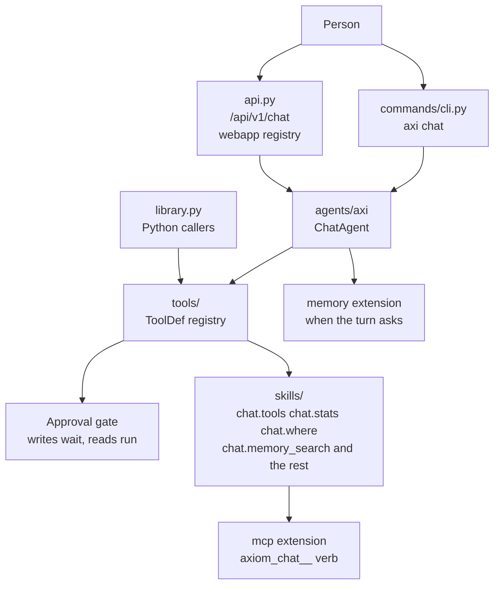
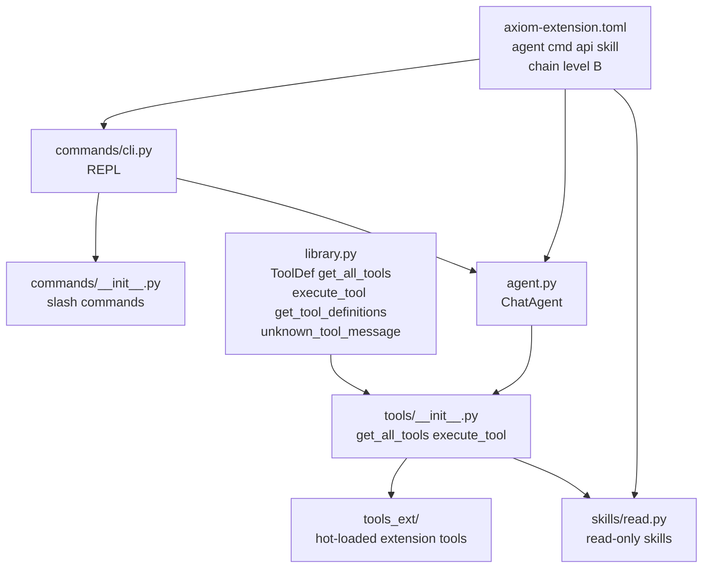
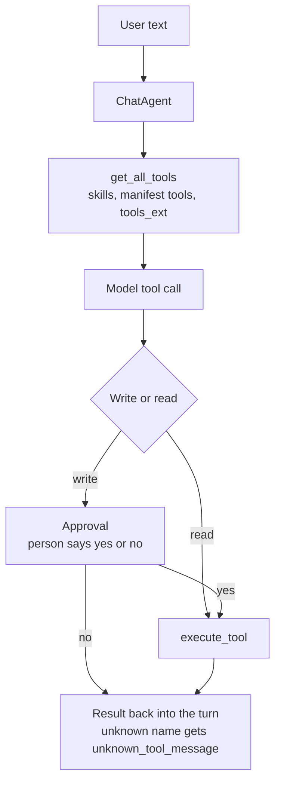

<!-- Copyright (c) 2026 The University of Texas at Austin -->
<!-- Copyright (c) 2026 B-Tree Labs -->
<!-- SPDX-License-Identifier: Apache-2.0 -->

# chat

**AXI, the loop agent, and the tool registry the loop calls.**

A person talks to AXI. AXI calls tools. A write waits for approval. A read runs. The same turn can resume, stream, and carry session memory. The CLI noun is `chat`. The agent name is `axi`. A consumer distribution may show another face. The agent identity stays AXI.

Conformance is [AEOS 0.1](../../../../../docs/specs/spec-aeos-0.1.md) with the 0.2 draft chain amendments. The manifest sets `aeos_version = "0.2.0"` and `chain_level = "B"`. Chat declares no `kind = "tool"`. It consumes tools. Its read-only command forms are skills, projected to MCP as `axiom_chat__<verb>`.

## Where it sits



`/api/v1/chat` is chat's slice of the composed API. The webapp registry mounts it. webapp does not import chat.

## Pieces



| Piece | What it is |
|---|---|
| `commands/cli.py` | `axi chat`. Starts, resumes, and runs the REPL. |
| `commands/__init__.py` | Slash commands the REPL dispatches. |
| `agent.py` | `ChatAgent`. The turn loop, tool calls, approval, streaming, session. |
| `tools/` | The toolkit. `ToolDef` records, `get_all_tools`, `execute_tool`. Extension tools load from `tools_ext/`. |
| `library.py` | The Python library for that registry. |
| `skills/read.py` | Read-only skills. Chain level B: each declares risk, and a refusal carries a fix. |
| `api.py` | Conversation routes under `/api/v1/chat`. |

`cli.py` at the extension root imports `commands/cli.py`.

## One turn



`chat.memory_search` and `chat.memory_recent` produce a `fragment_id`. The next call is `chat.memory_show` with that id. The chain declarations live on the skill blocks in the manifest.

## Toolkit and library

```python
from axiom.extensions.builtins.chat import execute_tool, get_all_tools
```

Those names resolve through `library.py` on first use. Importing the package does not build the registry. `get_tool_definitions` is the list the model sees. `unknown_tool_message` is the text returned for a name that was not offered.
