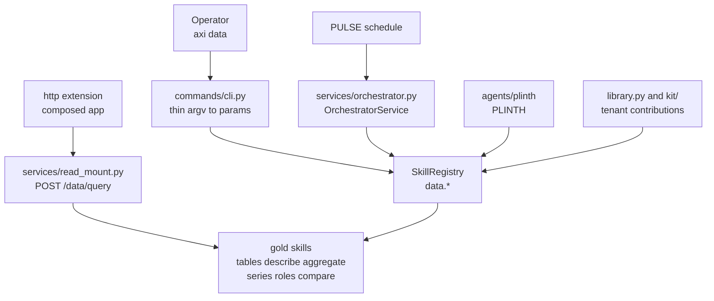
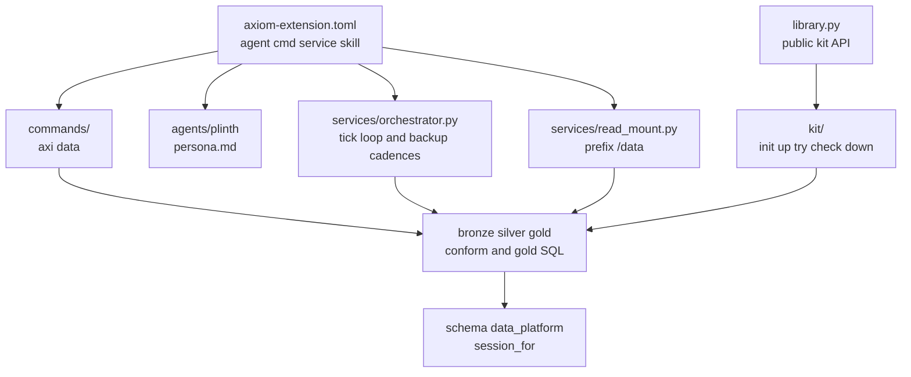
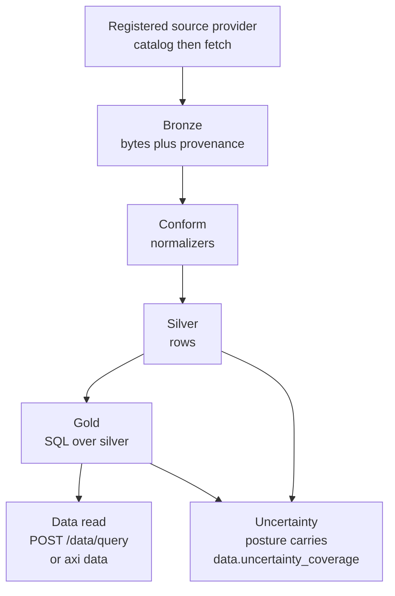

<!-- Copyright (c) 2026 The University of Texas at Austin -->
<!-- Copyright (c) 2026 B-Tree Labs -->
<!-- SPDX-License-Identifier: Apache-2.0 -->

# data_platform

**The medallion, the `axi data` verbs, and the tenant data kit.**

Connectors land bytes in bronze. Conform turns those bytes into silver rows. Gold is SQL over that silver. `axi data` is the CLI noun. PLINTH is the agent that reasons about an install when `data.diagnose` finds an anomaly. The deterministic verbs stay skills. The agent does not own the noun.

Conformance is [AEOS 0.1](../../../../../docs/specs/spec-aeos-0.1.md), version 0.1.0, `builtin = true`. The manifest does not publish an MCP tool surface. Pipelines run on PULSE schedules.

## Where it sits

`POST /data/query` runs only on the node that holds the medallion. Any other node answers 404. The body is a verb name and a params object. The route does not accept a database URL.

## Pieces

| Piece | What it is |
|---|---|
| `commands/cli.py` | `axi data`. Each verb builds a params dict and invokes a skill. |
| `skills/` | `data.*` on `SkillRegistry`. The CLI, the orchestrator, and PLINTH call these. |
| `services/orchestrator.py` | PULSE host. Tick loop, `BackupPolicy` cadence projection, dead-letter event `data.dispatch.dead_letter`. |
| `services/read_mount.py` | Mounts `POST /data/query` on the composed HTTP app. `requires_authz = true`. |
| `agents/plinth` | PLINTH. Install and diagnose reasoning. Not the CLI noun. |
| `kit/` | The toolkit. A tenant repository gets one working example of each contribution and a local medallion that enforces the same tenant boundary as the host. |
| `library.py` | The Python library for that toolkit. |

The historical modules `cli.py`, `read_mount.py`, and `orchestration/service.py` import the implementations above.

## The medallion

`[extension.uncertainty] posture = "carries"` describes the code. A row that declares no sources is reported that way. `data.uncertainty_coverage` is the verb that says how much of the served surface declares anything.

A time-series table is declared once. `data.ensure_schema` applies that contract. `data.adopt_timeseries` converts a populated plain table in place. `data.storage` reports bytes, ratio, and days of runway.

## Toolkit and library

The toolkit is `kit/`. `axi data kit-init` writes a `data/` folder with one example of each contribution. `kit-up` starts a local medallion. `kit-try` runs bronze through gold, verbs, and charts as the tenant role. `kit-check` is the gate before promotion. `kit-down` drops the sandbox.

The library is `axiom.extensions.builtins.data_platform.library`. It exports the same functions the verbs call:

`KitError`, `KitProject`, `init`, `up`, `down`, `try_kit`, `check_kit`, `load`, `inventory`, `sample`, `scaffold_contribution`, `load_snapshot`, `materialize`, `rows_to_load`, `take_snapshot`.

Importing `library` loads the kit. The package imports `library`, so importing the package loads the kit too.

The heavy lakehouse stack is the `data-platform` extra. The base install does not import it.
