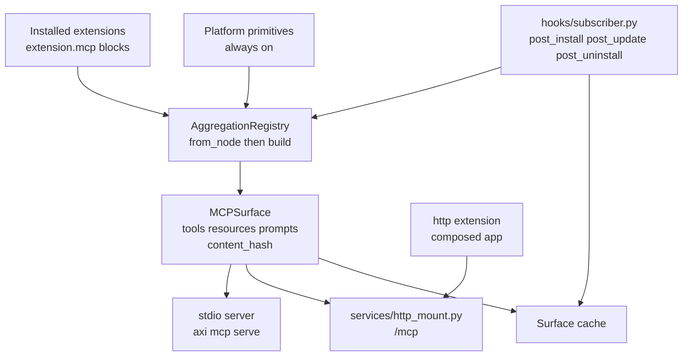
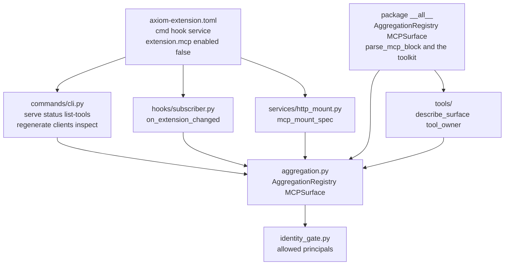
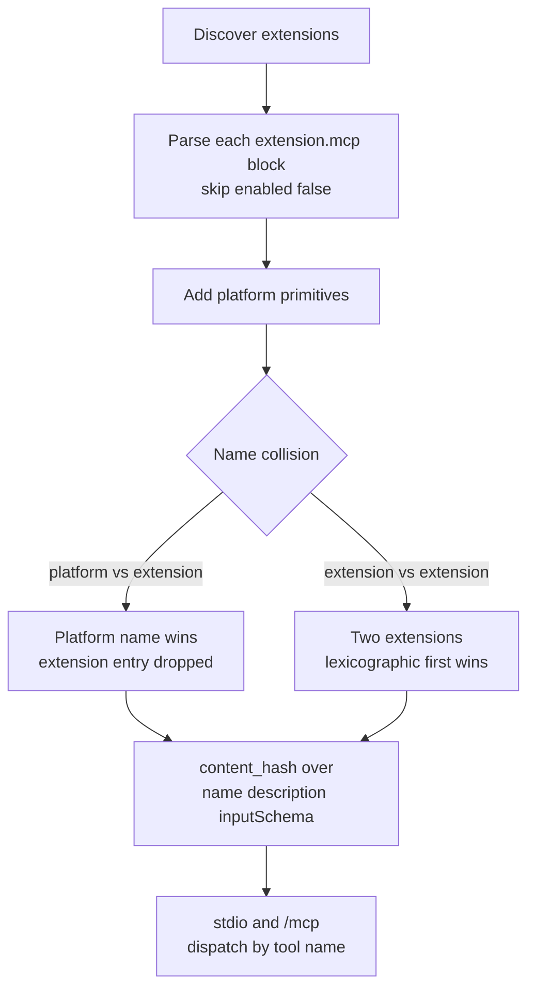

<!-- Copyright (c) 2026 The University of Texas at Austin -->
<!-- Copyright (c) 2026 B-Tree Labs -->
<!-- SPDX-License-Identifier: Apache-2.0 -->

# mcp

**One MCP server per node. Every extension's published tools, on one surface.**

The server reads each extension's `[extension.mcp]` block, merges those contributions with the platform primitives, and serves the result. Stdio is the default. `POST` traffic for MCP-over-HTTP is the `/mcp` mount on the composed app. This extension's own block is `enabled = false`. The root server does not contribute tools to itself.

Conformance is [AEOS 0.1](../../../../../docs/specs/spec-aeos-0.1.md), version 0.1.0, `builtin = true`. The spec is `docs/specs/spec-builtin-mcp-server.md`.

## Where it sits



The HTTP mount switches with the http app: `blue-green`, readiness `http:/healthz`. The hook `fail_mode` is `warn`. A failed refresh does not block install.

## Pieces



| Piece | What it is |
|---|---|
| `commands/cli.py` | `axi mcp`. Serve, status, list-tools, inspect, regenerate, clients. |
| `aggregation.py` | Builds `MCPSurface`. Same inputs, same `content_hash`. |
| `hooks/subscriber.py` | Regenerates the cache when the installed set changes. |
| `services/http_mount.py` | MCP-over-HTTP on the composed app. `requires_authz` defaults to true. |
| `identity_gate.py` | Tool name to principal patterns. An unmapped tool fails closed to owner-only. |
| `tools/` | The toolkit. `describe_surface` and `tool_owner` call `MCPSurface.to_dict` and `handler_source`. |
| `__init__.py` | The library. The registry types plus the toolkit names. |

`cli.py`, `subscriber.py`, and `http_mount.py` at the extension root import those implementations.

## How a surface is built



Manifest tools take `inputSchema` from `schema_inference`: an inline table, then `input_schema_module`, then the freeform blob. Registry tools take it from the shared projector. A schema change is a surface change, because the hash covers the schema.

## Toolkit and library

```python
from axiom.extensions.builtins.mcp import describe_surface, tool_owner
```

`describe_surface` returns `to_dict()` plus `tool_count`. `tool_owner` returns the contribution that owns a tool name, or `None`. `AggregationRegistry` and `MCPSurface` are the types those functions sit on.

Importing the package imports `AggregationRegistry`, which imports the `mcp` SDK. Importing `axiom.extensions.builtins.mcp.tools` does not. That module only calls `to_dict` and `handler_source`.
