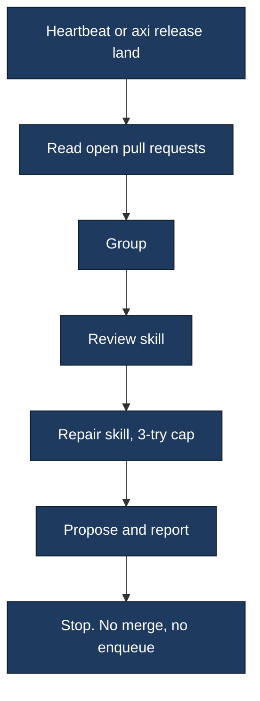

# Spec: pull request lander

Status: Draft. The config key `mode` is warn or propose. `land --act`
lands an eligible pull request.

## Loop

The heartbeat calls the lander. There is no new daemon. `axi release land`
runs the same report as a CLI step, a container step, or a scheduled job.
`--propose` records the proposal. The default command only prints it.



## Grouping

A pull request joins a group when it shares one of these, inside
`window_hours` (default 6):

1. `batch:<id>` label. This one ignores the window.
2. Agent session, from a `session:<id>` label or an `Agent-Session:` line.
3. Ticket id, through a `TicketIndex`. GitHub Issues and Linear ship first.
4. Branch prefix: the first path segment, or the token before the first hyphen.
5. An identical set of files.

`batch-exempt` opts out of signals 2–5. A `dependabot/` branch does
too: Dependabot has already grouped that update, and every such branch
shares the prefix `dependabot`, so automatic batching and file-overlap
would join unrelated groups. An explicit `batch:` label still joins
them. An older single-package branch
(`dependabot/<ecosystem>/<name>-<version>`) is still reported as
superseded by the newer one. Two grouped branches that touch the same
manifest are not a duplicate. A proper file subset is not a
group; it is a human decision. Partial overlap that is not a subset is
recorded only as a shared signal when the sets are equal. A Dependabot
pull request is left out of that overlap.

The report's `batches` respect the window. `families` use the same
signals with the window lifted, so an older backlog still shows which
pull requests belong together.

## Spend

`assess` multiplies in-progress runs and open pull requests by a learned
suite cost (`learn_suite_minutes`, the median of observed runs) when the
reading carries one. Otherwise it keeps the fixed fallback. `right_size`
takes the same learned cost on its context.

## Repair and review

`plan_repair(..., attempts=)` returns `try-cap` once a head has been
tried `REPAIR_TRY_CAP` (3) times. The lander calls `choose_reviewer`
when a roster and an author model are both present. Neither call pushes.

## Advisories

`advisory_status` is one neutral, non-blocking check context
(`rivet/batch`). Warn mode builds it and does not post it. GitHub's
`post_status` validates that shape and then refuses. GitLab's forge is
a stub: `list_open` raises `ForgeUnavailable` and names merge trains as
not wired.

## Lock, ledger, and the auto-closer

One pass holds `SingleFlight("release.lander:<repo>")` on the switchplan
file lease. A second pass is `busy` and writes nothing. A proposal is a
switchplan `FileLedger` record in phase `planned` plus one JSON line at
`<state>/agents/rivet/lander.jsonl`.

Pull requests the proposal would land or close are claimed as `lander`
in `<state>/agents/rivet/pr-actors.json`. The auto-closer skips those.
While the closer runs it claims `auto_closer`, and the lander leaves
those pull requests in `blocked_by_closer`. Claims expire (default one
hour) and the next pass replaces the lander's set.

## Approval and acting

The report still records a head SHA binding: `bound` matches, `reset`
means a new push. Execution is a different step. `run_actor` diagnoses
the blocker, asks a `FixProvider` for a diff, and submits that diff to
the existing `ApprovalGate` after `check_raci` and `RACILedger.propose`.
The Accountable person is `raci.approvers` in the config. `auto_allowed`
is empty unless the config names action types, and a human-routed path
is never in that set.

The gate's record stores the head SHA and the diff hash. A later push
makes that approval `invalidated` and nothing is applied. The store's
own TTL expires an unanswered proposal. A rejection stays a rejection.
Force-push is not a command the actor can build. After a matching
approval the actor applies the diff, re-runs CI, and lands only when
the result is green, up to `max_rounds`. The switchplan ledger records
each step. `AXIOM_LANDER_KILL=1` (or the configured name) stops the loop.

## Selectors and fix providers

`TestSelector.select(paths, base_sha, head_sha)` returns the tests to
run or the whole suite. `testmon` reads pytest-testmon's database and
does not delete it. `null` runs everything, which is the right default
for a repository that is not Python. `FixProvider` diagnoses and
drafts; `mechanical` calls `plan_repair`. Both are entry points:
`axiom.release.test_selector` and `axiom.release.fix_provider`.

Minutes saved use the selector's share of the suite. Affected-scope
grouping uses the selector's test ids. The other batching signals are
unchanged.

## Config

See the examples next to this spec. The schema is what `parse_config`
accepts. Defaults name no repository and no organisation. The watch
list is the CLI, then `watch.env` (default `AXIOM_LANDER_REPOS`), then
`repos` in the file, then the state-dir list. The token is the name of
an environment variable plus the scopes that variable must carry. A
pasted token value is rejected.

## Deploy anywhere

Three places run the same code:

- A local heartbeat, with repos named by the environment variable or
  the config file. It proposes. It executes only an approved proposal.
- A scheduled job in the consumer repository. Cache `.testmondata`
  the way this repository's unit-test job already does (the cache key
  is the base SHA; main, the merge queue, and nightly run the full
  suite and refresh the map). Do not invent a second selector.
- A container whose command is `axi release land --repo owner/name`.
  The token comes from the host secret store under `token.env`.

A failed read names the `gh` command and the forge's error. The token
value is left out. Warn mode still only reports: the error is why the
report stopped, and it is not a merge.

## Webhook handoff

`handoff` is a fix provider. It asks the mechanical provider first. When
that provider cannot draft a diff, it POSTs one JSON request to the
URL in `fix_provider.webhook.url_env` (`RELEASE_FIX_WEBHOOK_URL`). The
sender key is the value of `key_env` (`RELEASE_FIX_WEBHOOK_KEY`), sent
as the header named by `key_header` (`X-Fix-Key`). The key is not
written to the ledger or the log. One request is recorded per pull
request, head SHA, and blocker. A second pass with the same triple
does not send again.

A draft, a human review hold, or a protected path is reported as that
reason and is not POSTed. A draft is never handed to the fixer. The
body contains `repo`, `pr` (the pull request number), `head_sha`,
`branch` (`rivet-fix/<pr>-<shortsha>`, the first 7 hex characters of
the head), and `failing_checks` (each check's name, plus a log URL
when one is known).

The fix writer pushes a normal commit on `rivet-fix/<pr>-<shortsha>`,
where `shortsha` is the first 7 hex characters of the head. The branch
is cut from that head. The next pass reads the diff against the head
and files it through the same approval gate as a built-in fix: head
SHA, diff hash, and TTL. A side branch whose base is not the current
head is ignored, and a request for the new head is sent.

```json
{
  "repo": "owner/name",
  "pr": 4,
  "head_sha": "0123456789abcdef",
  "base": "main",
  "diagnosis": "failing_test",
  "blocker": "failing_test",
  "failing_checks": [{"name": "unit", "log_url": "https://ci.example/logs/1"}],
  "branch": "rivet-fix/4-0123456"
}
```

`diagnosis` and `blocker` are the same kind. `failing_checks` lists
check names and log-excerpt URLs. Enabling the provider replaces
`fix_provider = "mechanical"` with a table, because those two shapes
cannot share a key:

```toml
[fix_provider]
name = "handoff"

[fix_provider.webhook]
url_env = "RELEASE_FIX_WEBHOOK_URL"
key_env = "RELEASE_FIX_WEBHOOK_KEY"
key_header = "X-Fix-Key"
separate_reviewer = true
```

After approval the lander applies the branch with a fast-forward or a
merge commit, then a plain push. It reruns CI and lands only when that
run is green. The merge command pins `--match-head-commit` to the SHA
CI passed.

## Auto-approval

`raci.auto_approver` is off when empty. Set to a reviewer identity, it
may approve a fix that does not touch a protected path. The identity
must differ from the fix writer. The approval stores the head SHA, the
diff hash, and a deadline of `approval_ttl_hours`. Every automatic
approval is a ledger record with the reviewer identity and the
rationale. CI must be green before the lander merges, and the merge is
pinned to that SHA.

Protected paths still wait for a person in `raci.approvers`: behavior,
pricing, security, data, test setup, workflow and CI config, and
dependency changes. Dependency files match in any directory:
`pyproject.toml`, any `*requirements*.txt`, Python lockfiles,
`package.json`, `package-lock.json`, `npm-shrinkwrap.json`,
`yarn.lock`, `pnpm-lock.yaml`, `bun.lockb`, `Dockerfile*`,
`docker-compose*.yml` / `docker-compose*.yaml`, `compose*.yml` /
`compose*.yaml`, `go.mod`, `go.sum`, `Cargo.toml`, `Cargo.lock`,
`Gemfile`, and `Gemfile.lock`. A Dependabot pull request that only
touches those files is held. `docs/examples/auto-approve.toml` turns the
reviewer on. The other examples leave it commented.

`land --act` may land a green, unprotected, non-draft pull request
with no pending human review and no changes-requested review. A
protected path is held. The default command, without `--act`, still
only reports.

## Claim labels

Before it acts, the lander adds `claims.label` (default `rivet:claimed`).
It removes that label when the pass finishes with a result other than
waiting, and when the recorded claim is older than `claim_ttl_s`
(default 3600). `claim_ttl_s` is read from this table. A top-level
`claim_ttl_s` still applies when the table does not set one. A
pull request carrying any label in `claims.foreign_labels` is skipped.
The lander does not remove a foreign label.

```toml
[claims]
label = "rivet:claimed"
claim_ttl_s = 3600
foreign_labels = ["external:working"]
```

## Human review

Landing reads review requests and the latest review by each author.

A pending request to a human user blocks landing. The report says
`waiting on <login>`. A bot, an app account, or a team request does
not. This repository has no CODEOWNERS file, so a person is requested
by naming their user account. A team assignment is not that request.

A human review whose latest state is changes requested also blocks
landing, including when the request itself has been cleared. A later
approval from that person clears the block. When that person has
approved and no human review request is still pending, the ordinary
landing rules apply: checks passing, not a protected path, and the
merge pinned to that SHA.

The pull-request author's own approval counts toward landing only when
that login is in `self_landers`. Otherwise it never counts: it does not
clear a changes-requested review from that same person, and it does not
answer a review request for them. The default is an empty list. A repo
whose only human is its owner should list that owner there. A hold is
still a pending request to a human user.

## No fixer

When `fix_provider` is `handoff` and `url_env` or `key_env` is empty,
the report note is `no fixer configured`. A failing pull request that
is otherwise eligible for a fix is left for a person with that reason.
A draft, a human review hold, or a protected path is named instead,
and is not sent to the webhook. A green pull request is still eligible
to land. The missing webhook is not a failed run.

## One lander

A repo on this lander's watch list has one lander. Outside actors do
not merge, enqueue, or force-push. They deliver a fix only by pushing
`rivet-fix/<pr>-<shortsha>` from the pull-request head. The lander
picks that branch up on its next pass.

## Not in this release

Posting the advisory check, and a GitLab merge-train client. GitLab
reads are still the stub. Force-push is not implemented.
